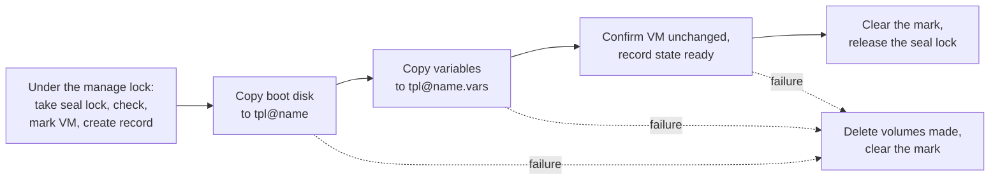

# Custom templates and images: design

Status: draft, awaiting approval. Its decisions came from an interview, and two of them are provisional until the
test-bed probes under Checks settle them. The text is revised for a plan-critic review, its scoped re-review, an
architecture review and the needs checks of the two projects that asked for it; none of them changed a decision. Once
built, the code wins and this design follows it.
Basis: roadmap outcome 5 in [`fork-roadmap.md`](fork-roadmap.md). It extends
[`disposable-vms-design.md`](disposable-vms-design.md), whose overlays, seeds, reset, expiry and invariants still hold
unless this design changes them. The terms image, volume and template are used as the
[README's Terms section](../../README.md#terms) defines them.

## Summary

Agents test images built anywhere and keep prepared VMs as templates. Behind a config switch, an agent seals a
shut-off VM the server created into a template, or imports a disk image file from a share directory as one, and deletes
templates agents made. A template is a disk together with the UEFI variables and the hardware it was built with, so a
fully updated Windows keeps its Secure Boot certificates in every VM made from it and after every reset. `create_vm`
boots a built image directly, takes more CD-ROMs, and offers Secure Boot setup mode and hibernation. Every UEFI VM the
server creates keeps its variables as a volume in the pool, which is what lets the server copy them for seals and
snapshots.

Two needs drive it. A dotfiles repository builds a Windows 11 VM with every update, WSL and SSH, keeps that state as a
template, and runs each test in a fresh VM from it. A Nix configuration repository boots each ISO and disk image it
builds, under BIOS, UEFI and UEFI with its own Secure Boot keys and a TPM, and tests hibernation.

## Decisions

Device passthrough was settled in the same interview but is its own roadmap item, follow-up 36, outside this design.

| Decision | Recommended | Chosen | Why | Status |
| -- | -- | -- | -- | -- |
| Where agent-made templates are recorded | A metadata volume `tpl@<name>.meta` in `disk_pool`, beside `tpl@<name>.qcow2` and `tpl@<name>.vars` (the `@` names follow review finding B2) | As recommended | Keeps every part of a template in one known location that every server using the pool sees, and that outlives any server's own state | resolved |
| Switch and caps for agent-made templates | `manage.agent_templates` (off by default, also needs `manage.create`), `max_templates = 4`, `max_template_gib = 100` counting allocated space of every agent-made template; checked before a seal or import, which is refused with the numbers | As recommended | Space is the real limit; a virtual-size cap would block a mostly empty 80 GiB Windows disk | resolved |
| Deleting templates | `template_delete` removes an agent-made template's disk, variables and record; needs `manage.delete`; refuses while any VM on the host backs onto it (count in the reply, names in the log); config templates are never deleted by a tool; any agent may delete any agent-made template | As recommended | Versioned templates pile up otherwise and the caps would block new seals; sharing matches how VMs work | resolved |
| Which VMs can be sealed | Only VMs the server created (owned), not `manage_vms` | As recommended | Sharing an operator VM's contents with every agent must be an explicit act: import its disk, or seal a copy a create tool made | resolved |
| What a seal copies | The boot disk as one standalone qcow2, chain merged and internal snapshots dropped; no seed disk, no CD-ROMs; a VM with a second writable disk is refused until it is detached; hardware the template cannot record, such as a host device added by hand, is left out and named in the reply | As recommended | The template must not depend on an older one, nothing the guest relies on is lost silently, and host devices belong to one host and moment | resolved |
| Seal in the call or in the background | Background: `template_create` returns a transfer ID, the agent waits with `wait_for` `transfer_done`; the template is listed only when complete; a failure deletes the partial volumes; starting the VM being sealed is refused | As recommended | A copy of 30 GB or more can outlast an MCP client's call timeout | resolved |
| Host device passthrough | Its own roadmap item, outside this design: operator-named devices in `[manage.devices.<name>]`, either `serial` (a host serial device such as a `/dev/serial/by-id/` path, shown to the guest as a serial port, attach while shut off) or `usb` (vendor, product, optional serial number resolved to the bus address at each attach, hot-pluggable); `list_devices`, `attach_device`, `detach_device` on owned VMs with `manage.reconfigure`; one VM per device across the host; templates never carry devices; tested with a USB-to-serial adapter and a spare USB device; PCI passthrough stays parked | As recommended | A guest driving physical hardware is a new trust boundary, so each device is named by the operator with no wildcards | resolved |
| Tying a template to its firmware build | Variables stored as `tpl@<name>.vars`; each VM names the sealed VM's firmware code file and starts from a copy through `<nvram template=…>`; the code file's path is pinned and its hash recorded; a changed hash warns in the reply and the VM still starts | As recommended | A routine `ovmf` upgrade must not break every template, and the variable store format is stable; the Secure Boot template test catches a breaking firmware change | resolved |
| Where VM variables live, and snapshots | Each UEFI VM the server creates keeps its variables as `<vm>.vars` in `disk_pool`, named in `<nvram>` and created by libvirt from the chosen firmware descriptor's variables at first start, or from the template's variables for a VM from a sealed template; seal copies it to `tpl@<name>.vars`; a snapshot of a shut-off UEFI VM copies it to `<vm>@<snapshot>.vars`, revert copies it back, snapshot and VM deletion delete the copies; UEFI VMs made earlier cannot be sealed and their snapshots stay without variables | As recommended | libvirt's own NVRAM path is root-owned and has no API to read or write it, so the server could neither seal nor snapshot variables there | provisional: the first probe under Checks must show that libvirt accepts a variables path in the pool and creates the file there, and that the per-VM AppArmor profile lets QEMU write it; a failure returns the design to the owner |
| Hardware a template records, and per-VM overrides | A template records OS, firmware, Secure Boot mode (off, Microsoft keys, setup), TPM, memory and vCPUs (disk size from the volume); seal takes them from the VM, import from the call, config templates may set them; a VM defaults to them and may override memory and vCPUs within limits, grow the disk, add or drop the TPM; firmware and Secure Boot are fixed for a sealed template and chosen per VM for an imported or config template; values above a limit are refused with the limit named | As recommended | The Windows template needs its build hardware back, one imported image must boot in every mode, and a sealed template's variables belong to one firmware | resolved |
| Cloud-init seed per template | `seed = "nocloud"` or `"none"`, default `nocloud` for Linux and `none` for Windows, set at seal, import or in the config; with `none` the VM keeps the template's hostname and identity and `user_data` is refused; `nocloud` on Windows is the cloudbase-init opt-in, which its first user verifies | As recommended | Windows shows the seed as a stray drive, and images without cloud-init gain nothing from it | resolved |
| Importing an image, and `disk_image` | Source inside `host_share_dirs`, resolved like `copy_to_vm` (a `/nix/store` result is copied in with `cp -L`); raw or qcow2 kept as-is, so a template may be raw; a qcow2 naming a backing file or an external data file is refused; virtual size within `max_disk_gib`, space counted toward the template cap; runs in the background with a transfer ID; `create_vm` `disk_image` makes the copy the VM's own disk, deleted with it, with `disk_bus` `virtio` (default), `sata` or `usb`; every upload is sparse: zero runs and holes go as holes through `virStreamSendHole` with `VIR_STORAGE_VOL_UPLOAD_SPARSE_STREAM`, and a seal's `qemu-img convert` copy already skips zeros; non-sparse sources are accepted | As recommended, with sparse uploads | One copy path serves both uses; a backing reference would let QEMU open host files; sparse uploads keep raw images small without asking agents to prepare them | resolved |
| Secure Boot setup mode, and TPM state on reset | `secure_boot` takes `"off"`, `"on"` (Microsoft keys) or `"setup"` (no keys enrolled), with `true` and `false` still read as on and off, in `create_vm`, templates and per-VM choices; setup mode combines with `tpm: true`, and keys the guest enrolls live in its variables, so a seal carries them; `reset_vm` gives an empty TPM by default and keeps it with `keep_tpm: true`; TPM state persists across reboots and shutdowns | As recommended | Lanzaboote and `sbctl` need firmware with no keys; a reset must return to the template, which never carries TPM state, while TPM-bound disks opt in to keep it | provisional: a test-bed check settles how a reset clears TPM state, since a reset keeps the UUID that libvirt files TPM state under |
| More CD-ROMs | `create_vm` `extra_isos`: up to 4 ISOs from `iso_dirs`, each a read-only SATA CD-ROM after the installer and driver drives, never booted from; `set_cdrom` on a shut-off VM adds a drive at a free named target | As recommended | An unattended Windows install needs the installer, virtio-win and an answer-file ISO; an existing VM can only gain a drive through `set_cdrom` | resolved |
| Hibernation per VM | `hibernate` on `create_vm` and templates, off by default, sets `<suspend-to-disk enabled='yes'/>` with suspend to memory still off; a hibernating guest shuts the VM off, `vm_events` records it, `start_vm` resumes it; a seal records it; `vm_events` shows what libvirt reports, since libvirt keeps no hibernated state for a shut-off VM | As recommended | nix-config's hibernate-and-resume path with LUKS swap needs a VM to cover it | resolved |
| Nested virtualization | No new setting: `host-passthrough` with the host's `kvm_intel nested=Y` already exposes it; a test-bed check shows `/dev/kvm` in a Linux template VM, and the dotfiles WSL 2 run covers Windows | As recommended | It already works but nothing proves it | resolved |

## Behaviour

### Names

Agent-made template volumes and variable copies use `@`, which no VM or snapshot name can contain, because
`check_name` allows only `A-Z`, `a-z`, `0-9`, `.`, `_` and `-`. A VM can therefore never be named so that its volumes
land on a template's:

| Volume | Holds |
| -- | -- |
| `tpl@<name>.qcow2` or `tpl@<name>.img` | An agent-made template's disk, qcow2 or raw. VMs back onto it and never write it. |
| `tpl@<name>.vars` | A UEFI template's firmware variables, which every VM made from it starts from. |
| `tpl@<name>.meta` | An agent-made template's record. |
| `<vm>.vars` | A UEFI VM's own firmware variables. |
| `<vm>@<snapshot>.vars` | The variables saved with a snapshot of a shut-off UEFI VM. |

Templates from the config keep the volume names the operator gave them. Template names follow the hostname rule, and
one name space covers config and agent-made templates.

### The record

The record is a JSON document padded to a fixed 64 KiB, with its SHA-256 inside, written in one upload and read back to
confirm it. A write that does not read back is retried twice; after that the seal fails, the template stays incomplete,
and `template_delete` removes it. It holds the template's origin (`sealed` or `imported`), its state (`building` or
`ready`), the seal's ID, the sealed VM's UUID, OS, machine type, disk bus, firmware, firmware code file path and
SHA-256, Secure Boot mode, TPM, memory, vCPUs, seed choice, hibernation setting and creation time. The checksum detects
a torn or damaged record; it does not authenticate one, and anyone who can write the pool can forge a record, as they
can forge any volume. The server therefore never trusts the record further than it must:

- volume names come from the template name, never from the record;
- a firmware code path is used only when one of the host's firmware descriptors in `/usr/share/qemu/firmware` names it;
- a record that does not parse, or whose checksum fails, makes the template unusable, and `template_delete` still
  removes the volumes its name derives.

A template from the config has no record and keeps working as today. It may now set the same hardware fields, `seed`,
`hibernate`, and a raw disk. A template is usable when its record says `ready`, or it comes from the config, and every
volume it needs exists. `list_templates` lists usable templates, with origin, seal ID, hardware, firmware, Secure Boot
mode, seed choice, space on disk and the number of owned VMs using each, and lists separately, as incomplete, the names
whose record says `building` or does not parse.

### Finding templates

One resolver answers every question about templates, from the config's entries and the pool's records together: the
tool gates (`create_vm_from_template`, `reset_vm`, `list_templates`, `template_create`, `template_delete`), the startup
log of template problems, the lookup at create and reset, and the expiry sweep's gate, which today refuses to run
without a config template. With `agent_templates` on and no template in the config, the template tools are advertised
and VMs with a lifetime still expire.

### Free space

Every check of free space uses what an unprivileged user can still write on the pool's filesystem, from `statvfs` on
the pool's directory. libvirt's own figure includes the filesystem's root reserve, because libvirt runs as root: on
this host it reports 145.8 GiB where an ordinary user sees 99 GiB, so a check against it would let a copy eat into the
reserve.

### Sealing a VM

`template_create` with `vm` and `name` seals a VM. It needs `manage.agent_templates` and `manage.create`.

1. Under the manage lock, the server takes an advisory lock on `~/.cache/virtmanager-mcp/seal-<name>.lock`, then
   checks, marks and claims in one step. The checks refuse:
   - a VM whose owner element the server did not write, read with `owner_of` and not `can_manage`, so a VM in
     `manage_vms` is refused;
   - a VM that is not shut off;
   - a UEFI VM without a `<vm>.vars` volume, which covers UEFI VMs made before this design such as `t-win11`, and a UEFI
     VM whose firmware code file changed since its first start. The server records, in the VM's owner element, the code
     file path and SHA-256 that libvirt resolved at the VM's first start, read from the live definition, and the seal
     takes the record's firmware from there, never from a fresh match against the descriptors. A VM whose first start
     the server did not make has no such entry and is refused;
   - a VM with a second writable disk;
   - a boot disk whose format in the VM's definition differs from the format libvirt reports for its volume, and a raw
     boot disk whose first 4 KiB, read through a download stream, begin with the qcow2 magic. A guest writes its own
     raw disk, and libvirt would probe such a disk as a qcow2 that names a backing file of the guest's choosing;
   - a name in use, and a seal that would pass `max_templates`, `max_template_gib` or the free space. The space
     estimate is the boot disk's allocated size, its chain included.
2. The mark is a `sealing` attribute on the VM's owner element, holding the template name, the seal's ID, its start
   time, and the uid and lock path of the process that holds it. A mark is live while that seal lock is held. A process
   with the same uid and lock path that finds the lock free treats the mark as stale, ignores it, and clears it; any
   other process treats the mark as live until it is 24 hours old, because it cannot see the lock. Every management call
   that changes a VM, `start_vm` and `stop_vm` included, checks the mark under the manage lock, through one helper, and
   refuses a live one, naming the template; so does the expiry sweep. `start_vm` holds the lock only for the check and
   libvirt's create call, not for the rest of its boot, and the snapshot tools hold it only for the steps that copy
   variables; step 5 covers the moments outside the lock. Only the server writes owner attributes, as for `generation`
   and `expires`. Other libvirt clients, such as `virsh` or virt-manager, ignore the mark; step 5 catches what they
   change.
3. The record is created with state `building` and the volume-existence check, which claims the name. A seal cut short
   by a crash leaves a `building` record and a free seal lock. `template_delete` of a `building` record refuses while
   the seal lock is held, so it never deletes under a running copy; once the lock is free, it deletes the volumes. The
   VM's mark is already stale at that point, whether or not anyone deletes the record.
4. The boot disk is copied with libvirt's volume copy into a standalone qcow2, which merges the overlay chain, drops
   internal snapshots and skips zero blocks. The seed disk and CD-ROMs are not copied. `<vm>.vars` is copied to
   `tpl@<name>.vars`, and the record takes the hardware, machine type and disk bus from the VM's definition. Hardware
   the record cannot hold, such as a host device added by hand, is left out and named in the result.
5. Before it writes `ready`, the server confirms that the VM is still shut off and that the modification times of its
   boot disk and `<vm>.vars`, read from the volume XML, are those it saw when it marked the VM. Anything else fails the
   seal.
6. When the transfer cannot start, for example because `max_transfers` is reached, the record, the mark and the seal
   lock are rolled back before the call returns the refusal. Otherwise the call returns a transfer ID at once. The copy
   runs on its own libvirt connection, so it does not hold the shared connection's lock for minutes. `wait_for` with
   `transfer_done` ends with the result or the failure. A failure deletes the volumes the seal made and clears the mark.
   A copy that hangs inside libvirt holds the seal lock until the server process ends; there is no cancel.

A guest that hibernated, rather than shut down, carries its hibernation image in its swap, and a seal copies it, so
every VM from the template would try to resume it. Shut such a guest down before sealing it; the server cannot tell.

### Importing an image

`template_create` with `image`, `name`, `os` and the hardware fields imports a file. It needs the same switches as a
seal and runs in the background the same way, with the template name as the transfer's owner, so `wait_for` with only a
`transfer_done` condition no longer needs `vm`.

- The source is resolved with `Config::share_file`, which follows symlinks and checks `host_share_dirs`, and is
  refused when it resolves into a storage pool's directory. The server then opens the resolved path with `O_NOFOLLOW`
  and checks the open file's real path, through `/proc/self/fd`, against the same rules, so a symlink swapped in
  between the check and the open is refused.
- The server reads the first cluster, at least 4 KiB, from that open file, checks that buffer, and sends the same
  buffer as the first part of the upload, so the file cannot change between the check and the copy. A qcow2 image is
  refused when it names a backing file, sets the external-data-file feature bit or carries a data-file header
  extension, or is encrypted. A raw image that begins with the qcow2 magic is refused, because libvirt would probe it
  as qcow2. Any other format, compressed images such as `.img.zst` included, is refused; the agent decompresses first.
- The virtual size must fit `max_disk_gib`, and the data size the caps and the free space.
- The server creates the volume with the declared format and the exact capacity, then uploads in libvirt's sparse mode:
  holes, and runs of zero blocks found while reading, travel as holes through `virStreamSendHole` with
  `VIR_STORAGE_VOL_UPLOAD_SPARSE_STREAM`, a trailing hole included, so the volume is sparse whatever the source was.
  `virt` 0.4.3 has no wrapper for it, so the call goes through `virt-sys` 0.3.1. The stream is aborted on every error
  path.
- After the upload, the server reads the volume's libvirt XML and deletes the volume when it shows a `<backingStore>` or
  a format other than the declared one.
- An imported template has no variables. Its VMs start from the firmware's stock variables, and each VM may choose
  firmware and Secure Boot mode.

### Firmware in a VM's definition

A VM that is not made from a sealed template keeps libvirt's firmware autoselection, as today: `firmware='efi'`, the
mode's features and `<loader type='pflash'/>`, plus an `<nvram>` element naming `<vm>.vars` in the pool. libvirt keeps a
user-given variables path under autoselection and, at the first start, creates the file from the chosen descriptor's
variables template, so code and variables always come from one descriptor and nothing pins a firmware path in the VM's
definition. Before defining the VM, the server checks that no `<vm>.vars` volume exists, so a leftover file fails the
create loudly instead of being reused; the error names the volume, and the operator removes it with `virsh vol-delete`.
A VM that has never started has no `<vm>.vars` yet; a snapshot of it copies nothing, and a seal refuses it. On this host
the features select:

| Mode | Features | Code file | Variables template |
| -- | -- | -- | -- |
| `off` | neither | `OVMF_CODE_4M.fd` | `OVMF_VARS_4M.fd` |
| `on` | `secure-boot`, `enrolled-keys` | `OVMF_CODE_4M.ms.fd` | `OVMF_VARS_4M.ms.fd` |
| `setup` | `secure-boot` without `enrolled-keys` | `OVMF_CODE_4M.secboot.fd` | `OVMF_VARS_4M.fd` |

libvirt's documentation says a user `<nvram template>` overrides the descriptor's template under autoselection, while a
reading of libvirt 12.0.0's source found that autoselection rejects a template no descriptor names. The first probe
tests both forms. If autoselection accepts the template, a VM from a sealed template uses it too and pins nothing.
Otherwise it gets `<loader readonly='yes' secure='yes|no' type='pflash' format='raw'>` with the recorded code
file, `<nvram template='…/tpl@<name>.vars' templateFormat='raw' format='raw'>` naming `<vm>.vars`, and
`<smm state='on'/>` when `secure` is yes. `templateFormat` needs libvirt 10.10.0 or later, so sealed templates need
it, and the server refuses to seal or create from one on an older libvirt. A recorded code file that no longer exists,
or that no descriptor names, refuses the create. Only these VMs pin a firmware path, so an `ovmf` upgrade that renames
its files affects only sealed templates.

`reset_start`, `describe_vm` and the Secure Boot reader read both forms, so every UEFI VM gets
`VIR_DOMAIN_START_RESET_NVRAM` on reset, which copies its variables template again: the template's for a VM from a
sealed template, the descriptor's for any other. A server version from before this design reads only
`firmware='efi'`, so after a rollback its `reset_vm` of a VM from a sealed template would keep the old variables; the
changelog entry says so, and rollback past this change is unsupported for such VMs.

### Creating VMs

`create_vm_from_template` takes the template's recorded values as defaults:

- memory and vCPUs may be overridden within the limits, the disk grown but not shrunk, and `tpm` and `hibernate` set
  either way;
- for an imported or config template, `firmware` and `secure_boot` may be chosen per VM; for a sealed template they are
  fixed, because its variables belong to that firmware;
- the machine type and disk bus come from the record;
- a recorded value above a current limit refuses the call and names the limit, rather than shrinking the VM;
- a template with `seed = "none"` gets no seed disk.

When the code file's SHA-256 differs from the record, the result warns that the firmware changed since the seal, and
the VM still starts. The result names the template's seal ID, which the VM's owner element also records, and the call
takes an optional `seal_id` that refuses the create when the template under that name has since been replaced.

`create_vm` gains:

- `disk_image`: a file checked and uploaded as for an import, which becomes the VM's own disk in place of a new empty
  one, and goes with `delete_vm`;
- `disk_bus`: `virtio` (the default), `sata` or `usb`, for that disk; a `usb` disk is attached as removable, as a
  flashed stick is;
- `extra_isos`: up to 4 ISOs from `iso_dirs`, each a read-only SATA CD-ROM after the installer and driver drives,
  never booted from. q35's SATA controller has 6 ports, so a VM whose SATA devices would pass 6 is refused, and
  `set_cdrom` stops at the same limit;
- `hibernate`: off by default, which writes `<suspend-to-disk enabled='yes'/>` and leaves suspend to memory off.

`secure_boot` in `create_vm`, in templates and in per-VM choices takes `"off"`, `"on"` (Microsoft's keys enrolled) or
`"setup"` (Secure Boot firmware with no keys enrolled), and still reads `true` and `false` as on and off. Setup mode
combines with `tpm: true`, and keys a guest enrolls stay in its variables, so a seal carries them.

`set_cdrom` on a shut-off VM adds a drive at a free target it names, where it refuses today.

### Snapshots

The snapshot tools take the manage lock for their whole sequence. A snapshot of a shut-off UEFI VM takes libvirt's
snapshot, then copies `<vm>.vars` to `<vm>@<snapshot>.vars`; a failed copy deletes the snapshot again. Snapshot names
of UEFI VMs follow `check_name`.

`snapshot_revert` of a shut-off UEFI VM keeps a journal, `<vm>@@revert@<snapshot>.vars`, a name no snapshot can
produce and that records the revert's target. It writes the journal in full from the current variables and reads it
back before any other step, and never overwrites an existing one. It then copies the snapshot's variables in, reverts
the disk, and deletes the journal. A failed disk revert copies the journal back. A journal found at the start of a call
that changes the VM means an earlier revert was cut short: the call refuses, naming the snapshot. `snapshot_revert` of
that snapshot completes the revert from where it stopped, and `snapshot_revert` with `abandon: true` copies the
journal's variables back and deletes it, which also works when the snapshot is gone. Read-only calls are not refused.
A snapshot of a UEFI VM that has `<vm>.vars` but no copy for that snapshot, because a crash fell between the two steps
or the snapshot predates this design, reverts the disk only, and the result says the variables were not restored.
`describe_vm` and `snapshot_list` show leftover variable copies and journals.

`snapshot_delete` deletes the copy, and `delete_vm`, `reset_vm` and the expiry sweep delete every copy and journal. A
revert leaves the TPM state as it is. A running UEFI VM still cannot be snapshotted on hosts whose firmware variables
are raw files, as today.

### TPM state

A template never carries TPM state. `reset_vm` gives the VM an empty TPM, and keeps the old one with `keep_tpm: true`,
for a guest whose disk unlocks through the TPM. `reset_vm` also starts the VM from the template's variables, so Secure
Boot keys enrolled since the VM was made are gone after it; a test of Lanzaboote or TPM2 unlocking should therefore
not use `reset_vm` between its steps. TPM state persists across reboots and shutdowns as today. The probe that settles
how a reset clears the state may choose only a method that never leaves the VM undefined while its disks exist; if
none exists, the decision returns to the owner.

### Hibernation

A guest that hibernates shuts its VM off. `start_vm` sees a shut-off VM and starts it, rather than waking it from
suspend, and the guest resumes from its swap. If libvirt instead reports the VM as suspended with suspend to disk as
the reason, `start_vm` starts it rather than calling `pm_wakeup`, which cannot resume from disk; the hibernation check
shows which of the two libvirt does. libvirt keeps no hibernated state for a shut-off VM, so `vm_events` is
where an agent sees it: the `pmsuspended` event, if libvirt emits one for suspend to disk, which the hibernation check
confirms. `reset_vm` and `delete_vm` on such a VM discard the saved state without a warning.

### Deleting templates

`template_delete` needs `manage.agent_templates` and `manage.delete`. It refuses a template from the config. Under the
manage lock, which `create_vm_from_template` also takes while it creates an overlay, it reads the `<backingStore>` of
every volume in every active libvirt pool and refuses while any volume backs onto the template's disk; the result gives
the count and the server log names the volumes. An unreadable volume refuses the delete and is named in the result, so
the operator can fix or remove it. A guest that writes a fake qcow2 header into a raw disk can make its volume appear
to back onto a template, which only blocks that template's deletion. It then deletes the volumes and the record, last.
Any agent may delete any agent-made template.

### Gating

`template_create` and `template_delete` are advertised only when `manage.agent_templates` is on with `create` or
`delete` respectively, and read-only mode hides them. `create_vm_from_template`, `reset_vm` and `list_templates` are
advertised when the resolver finds any template source: a config template, or `agent_templates` on. Configs without
`agent_templates` behave as today, apart from the new `create_vm` options and the variables volume of new UEFI VMs.

## Invariants

- No code path writes, boots or attaches a template volume. Only `template_delete` deletes one, and only volumes whose
  names derive from an agent-made template's name, while no pool volume backs onto them.
- An agent-made template comes only from a copy of an owned VM's disk or of a file in `host_share_dirs`, into new
  volumes. No call turns an existing volume into a template.
- No imported image or `disk_image` names a backing file or an external data file when it is uploaded, and no seal
  copies a disk whose format or header could make libvirt follow a backing file.
- No VM or snapshot name can produce a template's volume name or another VM's or snapshot's variables volume.
- A template is usable only when its record says `ready`, its checksum holds, and every volume it needs exists.
- Templates never carry TPM state or host devices.
- A VM under a live seal is refused by every management call that changes it and by the expiry sweep, and a seal whose
  VM changed anyway fails.
- The guardrails in `AGENTS.md` hold: `is_owned`, `can_manage` and deletion only within `disk_pool` are unchanged. The
  `sealing` attribute is written only by the server, on a VM that already carries the owner element, and the
  guardrail text in `AGENTS.md` gains it when the code lands.

## Risks

1. Variables in the pool are a departure from libvirt's default. On paper libvirt keeps a user `<nvram>` path under
   autoselection and virt-aa-helper allows QEMU to write it; the first probe confirms both on this host.
2. An `ovmf` upgrade changes the code file under sealed templates, the only VMs that pin one. The variable store format
   is stable, so VMs usually still boot, and the warning names the cause when one does not.
3. Secure Boot certificate and revocation updates live in the variables. A sealed template keeps them; an imported
   template starts from the host's stock variables, which may refuse an updated Windows boot manager.
4. A broken or tampered template spreads to every VM made from it: to the agents' own VMs and the pool, and through
   their guest output and guest-agent replies into every agent's context that uses those VMs.
5. `max_template_gib` can exceed the pool's free space, which the free-space check covers; other users of the
   filesystem can still fill it during a copy.
6. Any agent can delete a template another agent's workflow relies on, and another agent can then reuse its name for
   different contents. The seal ID in results and the optional `seal_id` on create let a workflow notice.
7. A sealed Windows whose disk is bound to the TPM, such as with BitLocker, does not unlock in VMs from the template,
   because templates carry no TPM state.
8. The backing check sees only volumes in libvirt pools; a disk outside every pool that backs onto a template is
   invisible to it. `max_vms`, the manage lock and the seal lock are per account and `HOME`, as in the disposable
   design; a process under another account or `HOME` honours a seal mark for 24 hours, so a seal that outlasts that
   while such a process runs can be disturbed.
9. cloudbase-init reading a NoCloud seed is unverified; its first user checks it.

## Open questions

| Question | Kind | Recommendation |
| -- | -- | -- |
| How a reset clears TPM state | Probe | A method that never leaves the VM undefined while its disks exist; otherwise back to the owner. |

## Checks

- First, a probe on the test bed, with the exact definitions for `off`, `on`, `setup` and the sealed form: libvirt
  accepts an `<nvram>` path in the pool under autoselection and creates the file from the descriptor's template at first
  start, QEMU writes it (a variable set in the guest survives a restart), `delete_vm` and an expiry remove it, the
  volume copies with libvirt's storage calls, and a VM backing onto a `tpl@` volume starts under the AppArmor profile
  libvirt generates. The probe also confirms that q35's SATA controller has 6 ports.
- A Windows 11 VM installed fresh through `create_vm`, with every update applied, shows Microsoft's 2023 certificate in
  its firmware database; it is sealed, and a VM from the template boots with Secure Boot on, before and after
  `reset_vm`. `t-win11` cannot be sealed, because its variables are not in the pool.
- A seal of a template VM gives a standalone qcow2: `qemu-img info --backing-chain` shows no backing file, and the
  source template's checksum is unchanged.
- An imported raw image of 4 GiB with 1 GiB of data occupies about 1 GiB in the pool.
- Each is refused: a qcow2 naming a backing file or an external data file, an encrypted qcow2, a raw file with the qcow2
  magic, an image outside the share directories or inside a pool, a seal of a VM in `manage_vms`, of a running VM or
  over the caps, `template_delete` of a config template or of a template in use, and a start, snapshot, disk change,
  reset, delete or expiry of a VM being sealed.
- One imported image boots in three VMs: BIOS, UEFI without Secure Boot, and UEFI in setup mode with a TPM, where
  `sbctl status` reports setup mode.
- A shut-off UEFI VM's snapshot keeps a boot entry made after it: after the revert, the entry is gone.
- `reset_vm` leaves an empty TPM, and one with `keep_tpm` keeps a sealed TPM object.
- A VM with `hibernate` resumes a process after `systemctl hibernate` and `start_vm`, and `vm_events` shows what libvirt
  reported.
- A Linux VM from a template shows `/dev/kvm`.
- A raw `disk_image` VM whose guest writes the qcow2 magic and a backing path to its disk is refused at seal.
- A `virsh start` of a VM under a live seal fails the seal; a seal whose process is killed leaves a stale mark that the
  next call clears, and `template_delete` removes its volumes.
- With `agent_templates` on and no config template, the template tools are advertised and a VM with a lifetime
  expires.
- A revert killed between each pair of its steps leaves a journal that the next call names; a repeated revert
  completes it, and `abandon: true` restores the variables, also after the snapshot is deleted.
- Unit tests cover the record's parsing and checksum, the qcow2 header check on one buffer, the hole detection, the
  caps, the free-space figure, the template resolver, the mark helper, the SATA limit, the hardware defaults and limits,
  the `secure_boot` values, and the XML for each firmware mode and the sealed form.
