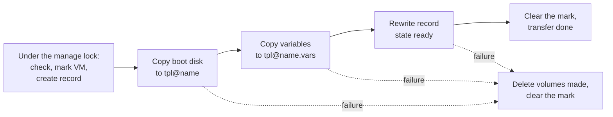

# Custom templates and images: design

Status: draft, awaiting approval. Its decisions came from an interview, and two of them are provisional until the
test-bed probes under Checks settle them. The text is revised for a plan-critic review and its scoped re-review, whose
findings changed no decision. Once built, the code wins and this design follows it.
Basis: roadmap outcome 5 in [`fork-roadmap.md`](fork-roadmap.md). It extends
[`disposable-vms-design.md`](disposable-vms-design.md), whose overlays, seeds, reset, expiry and invariants still hold
unless this design changes them. The terms image, volume and template are used as the
[README's Terms section](../../README.md#terms) defines them.

## Summary

Agents test images built anywhere and keep prepared VMs as templates. Behind a config switch, an agent seals a
shut-off VM the server created into a template, or imports a disk image file from a share directory as one, and deletes
templates agents made. A template is a disk together with the UEFI variables and the hardware it was built with, so a
fully updated Windows keeps its Secure Boot certificates in every VM made from it and after every reset. `create_vm`
boots a built image directly, takes more CD-ROMs, and offers Secure Boot setup mode and hibernation. Every UEFI VM the
server creates keeps its variables as a volume in the pool, which is what lets the server copy them for seals and
snapshots.

Two needs drive it. A dotfiles repository builds a Windows 11 VM with every update, WSL and SSH, keeps that state as a
template, and runs each test in a fresh VM from it. A Nix configuration repository boots each ISO and disk image it
builds, under BIOS, UEFI and UEFI with its own Secure Boot keys and a TPM, and tests hibernation.

## Decisions

Device passthrough was settled in the same interview but is its own roadmap item, follow-up 36, outside this design.

| Decision | Recommended | Chosen | Why | Status |
| -- | -- | -- | -- | -- |
| Where agent-made templates are recorded | A metadata volume `tpl@<name>.meta` in `disk_pool`, beside `tpl@<name>.qcow2` and `tpl@<name>.vars` (the `@` names follow review finding B2) | As recommended | Keeps every part of a template in one known location that every server using the pool sees, and that outlives any server's own state | resolved |
| Switch and caps for agent-made templates | `manage.agent_templates` (off by default, also needs `manage.create`), `max_templates = 4`, `max_template_gib = 100` counting allocated space of every agent-made template; checked before a seal or import, which is refused with the numbers | As recommended | Space is the real limit; a virtual-size cap would block a mostly empty 80 GiB Windows disk | resolved |
| Deleting templates | `template_delete` removes an agent-made template's disk, variables and record; needs `manage.delete`; refuses while any VM on the host backs onto it (count in the reply, names in the log); config templates are never deleted by a tool; any agent may delete any agent-made template | As recommended | Versioned templates pile up otherwise and the caps would block new seals; sharing matches how VMs work | resolved |
| Which VMs can be sealed | Only VMs the server created (owned), not `manage_vms` | As recommended | Sharing an operator VM's contents with every agent must be an explicit act: import its disk, or seal a copy a create tool made | resolved |
| What a seal copies | The boot disk as one standalone qcow2, chain merged and internal snapshots dropped; no seed disk, no CD-ROMs; a VM with a second writable disk is refused until it is detached; hardware the template cannot record, such as a host device added by hand, is left out and named in the reply | As recommended | The template must not depend on an older one, nothing the guest relies on is lost silently, and host devices belong to one host and moment | resolved |
| Seal in the call or in the background | Background: `template_create` returns a transfer ID, the agent waits with `wait_for` `transfer_done`; the template is listed only when complete; a failure deletes the partial volumes; starting the VM being sealed is refused | As recommended | A copy of 30 GB or more can outlast an MCP client's call timeout | resolved |
| Host device passthrough | Its own roadmap item, outside this design: operator-named devices in `[manage.devices.<name>]`, either `serial` (a host serial device such as a `/dev/serial/by-id/` path, shown to the guest as a serial port, attach while shut off) or `usb` (vendor, product, optional serial number resolved to the bus address at each attach, hot-pluggable); `list_devices`, `attach_device`, `detach_device` on owned VMs with `manage.reconfigure`; one VM per device across the host; templates never carry devices; tested with a USB-to-serial adapter and a spare USB device; PCI passthrough stays parked | As recommended | A guest driving physical hardware is a new trust boundary, so each device is named by the operator with no wildcards | resolved |
| Tying a template to its firmware build | Variables stored as `tpl@<name>.vars`; each VM names the sealed VM's firmware code file and starts from a copy through `<nvram template=…>`; the code file's path is pinned and its hash recorded; a changed hash warns in the reply and the VM still starts | As recommended | A routine `ovmf` upgrade must not break every template, and the variable store format is stable; the Secure Boot template test catches a breaking firmware change | resolved |
| Where VM variables live, and snapshots | Each UEFI VM the server creates keeps its variables as `<vm>.vars` in `disk_pool`, which the server creates from the firmware descriptor's variables file (or the template's) and names in `<nvram>`; seal copies it to `tpl@<name>.vars`; a snapshot of a shut-off UEFI VM copies it to `<vm>@<snapshot>.vars`, revert copies it back, snapshot and VM deletion delete the copies; UEFI VMs made earlier cannot be sealed and their snapshots stay without variables | As recommended | libvirt's own NVRAM path is root-owned and has no API to read or write it, so the server could neither seal nor snapshot variables there | provisional: the first probe under Checks must show that libvirt uses a variable file the server created in the pool without overwriting it, and that the per-VM AppArmor profile lets QEMU write it; a failure returns the design to the owner |
| Hardware a template records, and per-VM overrides | A template records OS, firmware, Secure Boot mode (off, Microsoft keys, setup), TPM, memory and vCPUs (disk size from the volume); seal takes them from the VM, import from the call, config templates may set them; a VM defaults to them and may override memory and vCPUs within limits, grow the disk, add or drop the TPM; firmware and Secure Boot are fixed for a sealed template and chosen per VM for an imported or config template; values above a limit are refused with the limit named | As recommended | The Windows template needs its build hardware back, one imported image must boot in every mode, and a sealed template's variables belong to one firmware | resolved |
| Cloud-init seed per template | `seed = "nocloud"` or `"none"`, default `nocloud` for Linux and `none` for Windows, set at seal, import or in the config; with `none` the VM keeps the template's hostname and identity and `user_data` is refused; `nocloud` on Windows is the cloudbase-init opt-in, which its first user verifies | As recommended | Windows shows the seed as a stray drive, and images without cloud-init gain nothing from it | resolved |
| Importing an image, and `disk_image` | Source inside `host_share_dirs`, resolved like `copy_to_vm` (a `/nix/store` result is copied in with `cp -L`); raw or qcow2 kept as-is, so a template may be raw; a qcow2 naming a backing file or an external data file is refused; virtual size within `max_disk_gib`, space counted toward the template cap; runs in the background with a transfer ID; `create_vm` `disk_image` makes the copy the VM's own disk, deleted with it, with `disk_bus` `virtio` (default), `sata` or `usb`; every upload is sparse: zero runs and holes go as holes through `virStreamSendHole` with `VIR_STORAGE_VOL_UPLOAD_SPARSE_STREAM`, and a seal's `qemu-img convert` copy already skips zeros; non-sparse sources are accepted | As recommended, with sparse uploads | One copy path serves both uses; a backing reference would let QEMU open host files; sparse uploads keep raw images small without asking agents to prepare them | resolved |
| Secure Boot setup mode, and TPM state on reset | `secure_boot` takes `"off"`, `"on"` (Microsoft keys) or `"setup"` (no keys enrolled), with `true` and `false` still read as on and off, in `create_vm`, templates and per-VM choices; setup mode combines with `tpm: true`, and keys the guest enrolls live in its variables, so a seal carries them; `reset_vm` gives an empty TPM by default and keeps it with `keep_tpm: true`; TPM state persists across reboots and shutdowns | As recommended | Lanzaboote and `sbctl` need firmware with no keys; a reset must return to the template, which never carries TPM state, while TPM-bound disks opt in to keep it | provisional: a test-bed check settles how a reset clears TPM state, since a reset keeps the UUID that libvirt files TPM state under |
| More CD-ROMs | `create_vm` `extra_isos`: up to 4 ISOs from `iso_dirs`, each a read-only SATA CD-ROM after the installer and driver drives, never booted from; `set_cdrom` on a shut-off VM adds a drive at a free named target | As recommended | An unattended Windows install needs the installer, virtio-win and an answer-file ISO; an existing VM can only gain a drive through `set_cdrom` | resolved |
| Hibernation per VM | `hibernate` on `create_vm` and templates, off by default, sets `<suspend-to-disk enabled='yes'/>` with suspend to memory still off; a hibernating guest shuts the VM off, `vm_events` records it, `start_vm` resumes it; a seal records it; `vm_events` shows what libvirt reports, since libvirt keeps no hibernated state for a shut-off VM | As recommended | nix-config's hibernate-and-resume path with LUKS swap needs a VM to cover it | resolved |
| Nested virtualization | No new setting: `host-passthrough` with the host's `kvm_intel nested=Y` already exposes it; a test-bed check shows `/dev/kvm` in a Linux template VM, and the dotfiles WSL 2 run covers Windows | As recommended | It already works but nothing proves it | resolved |

## Behaviour

### Names

Agent-made template volumes and variable copies use `@`, which no VM or snapshot name can contain, because
`check_name` allows only `A-Z`, `a-z`, `0-9`, `.`, `_` and `-`. A VM can therefore never be named so that its volumes
land on a template's:

| Volume | Holds |
| -- | -- |
| `tpl@<name>.qcow2` or `tpl@<name>.img` | An agent-made template's disk, qcow2 or raw. VMs back onto it and never write it. |
| `tpl@<name>.vars` | A UEFI template's firmware variables, which every VM made from it starts from. |
| `tpl@<name>.meta` | An agent-made template's record. |
| `<vm>.vars` | A UEFI VM's own firmware variables. |
| `<vm>@<snapshot>.vars` | The variables saved with a snapshot of a shut-off UEFI VM. |

Templates from the config keep the volume names the operator gave them. Template names follow the hostname rule, and
one name space covers config and agent-made templates.

### The record

The record is a JSON document padded to a fixed 64 KiB, with its SHA-256 inside, written in one upload. It holds the
template's origin (`sealed` or `imported`), its state (`building` or `ready`), the seal's ID and the sealed VM's
UUID, OS, machine type, disk bus, firmware,
firmware code file path and SHA-256, Secure Boot mode, TPM, memory, vCPUs, seed choice, hibernation setting and creation
time. The server never trusts it further than it must:

- volume names come from the template name, never from the record;
- a firmware code path is used only when one of the host's firmware descriptors in `/usr/share/qemu/firmware` names it;
- a record that does not parse, or whose checksum fails, makes the template unusable, and `template_delete` still
  removes the volumes its name derives.

A template from the config has no record and keeps working as today. It may now set the same hardware fields, `seed`,
`hibernate`, and a raw disk. A template is usable when its record says `ready`, or it comes from the config, and every
volume it needs exists. `list_templates` lists usable templates, with origin, hardware, firmware, Secure Boot mode,
seed choice, space on disk and the number of owned VMs using each, and lists separately, as incomplete, the names whose
record says `building` or does not parse.

### Sealing a VM

`template_create` with `vm` and `name` seals a VM. It needs `manage.agent_templates` and `manage.create`.

1. Under the manage lock, the server checks, marks and claims in one step. The checks refuse: a VM whose owner element
   the server did not write, read with `owner_of` and not `can_manage`, so a VM in `manage_vms` is refused; a VM that
   is not shut off; a UEFI VM without a `<vm>.vars` volume, which covers UEFI VMs made before this design such as
   `t-win11`; a VM with a second writable disk; a name in use; and a seal that would pass `max_templates`,
   `max_template_gib` or the pool's free space. The space estimate is the boot disk's allocated size, its chain
   included.
2. The mark is a `sealing` attribute on the VM's owner element, holding the seal's ID and start time. Every management
   call that changes a VM refuses a marked one, in both `manage_domain` and `power_domain`, so `start_vm` and
   `stop_vm` refuse it too, and so does the expiry sweep. Only the server writes
   owner attributes, as for `generation` and `expires`.
3. The record is created with state `building` and the volume-existence check, which claims the name. A seal cut short
   by a crash leaves a `building` record. While the copy runs, its process holds an advisory lock on
   `~/.cache/virtmanager-mcp/seal-<name>.lock`, beside the manage lock. `template_delete` of a `building` record
   refuses while that lock is held, so it never deletes under a running copy; once the lock is free, it deletes the
   volumes and clears the mark on the VM the record names. A mark whose seal ID names a record that is not `building`
   is stale and ignored.
4. The boot disk is copied with libvirt's volume copy into a standalone qcow2, which merges the overlay chain, drops
   internal snapshots and skips zero blocks. The seed disk and CD-ROMs are not copied.
5. `<vm>.vars` is copied to `tpl@<name>.vars`, and the record takes the hardware, machine type and disk bus from the
   VM's definition. Hardware the record cannot hold, such as a host device added by hand, is left out and named in the
   result.
6. The call returns a transfer ID at once. The copy runs on its own libvirt connection, so it does not hold the shared
   connection's lock for minutes. `wait_for` with `transfer_done` ends with the result or the failure. A failure deletes
   the volumes the seal made and clears the mark.

### Importing an image

`template_create` with `image`, `name`, `os` and the hardware fields imports a file. It needs the same switches as a
seal and runs in the background the same way, with the template name as the transfer's owner, so `wait_for` with only a
`transfer_done` condition no longer needs `vm`.

- The source is resolved with `Config::share_file`, which follows symlinks and checks `host_share_dirs`, and is
  refused when it resolves into a storage pool's directory.
- The server opens the file once, reads its first cluster, at least 4 KiB, checks that buffer, and sends the same
  buffer as the first part of the upload, so the file cannot change between the check and the copy. A qcow2 image is
  refused when it names a backing file, sets the external-data-file feature bit or carries a data-file header
  extension, or is encrypted. A
  raw image that begins with the qcow2 magic is refused, because libvirt would probe it as qcow2. Any other format is
  refused.
- The virtual size must fit `max_disk_gib`, and the data size the caps and the pool's free space.
- The server creates the volume with the declared format and the exact capacity, then uploads in libvirt's sparse mode:
  holes, and runs of zero blocks found while reading, travel as holes through `virStreamSendHole` with
  `VIR_STORAGE_VOL_UPLOAD_SPARSE_STREAM`, a trailing hole included, so the volume is sparse whatever the source was.
  `virt` 0.4.3 has no wrapper for it, so the call goes through `virt-sys` 0.3.1. The stream is aborted on every error
  path.
- After the upload, the server reads the volume's libvirt XML and deletes the volume when it shows a `<backingStore>` or
  a format other than the declared one.
- An imported template has no variables. Its VMs start from the firmware's stock variables, and each VM may choose
  firmware and Secure Boot mode.

### Firmware in a VM's definition

No VM relies on libvirt's firmware autoselection. The server reads the host's firmware descriptors in
`/usr/share/qemu/firmware` and picks one for the mode's features, in the descriptors' priority order, as libvirt would:

| Mode | Features | Code file on this host | Variables file |
| -- | -- | -- | -- |
| `off` | neither | `OVMF_CODE_4M.fd` | `OVMF_VARS_4M.fd` |
| `on` | `secure-boot`, `enrolled-keys` | `OVMF_CODE_4M.ms.fd` | `OVMF_VARS_4M.ms.fd` |
| `setup` | `secure-boot` without `enrolled-keys` | `OVMF_CODE_4M.secboot.fd` | `OVMF_VARS_4M.fd` |

The VM gets `<loader readonly='yes' secure='yes|no' type='pflash' format='raw'>` with the descriptor's code file,
`<nvram template='…' templateFormat='raw' format='raw'>` naming `<vm>.vars` with the descriptor's variables file as
its template, and `<smm state='on'/>` when `secure` is yes. Before it defines the VM, the server creates `<vm>.vars`
itself, with the volume-existence check, from that same variables file, so code and variables always come from one
descriptor, and a leftover file of the same name fails the create loudly instead of being reused. libvirt finds the
file in place and does not copy one.

A VM from a sealed template gets the recorded code file instead, `tpl@<name>.vars` as its `<nvram>` template, and a
`<vm>.vars` created from it. A recorded code file that no longer exists, or that no descriptor names, refuses the
create.

`reset_start`, `describe_vm` and the Secure Boot reader read the loader and nvram elements, so every UEFI VM gets
`VIR_DOMAIN_START_RESET_NVRAM` on reset, which copies its `<nvram>` template again: the template's variables for a VM
from a sealed template, the descriptor's for any other.

### Creating VMs

`create_vm_from_template` takes the template's recorded values as defaults:

- memory and vCPUs may be overridden within the limits, the disk grown but not shrunk, and `tpm` and `hibernate` set
  either way;
- for an imported or config template, `firmware` and `secure_boot` may be chosen per VM; for a sealed template they are
  fixed, because its variables belong to that firmware;
- the machine type and disk bus come from the record;
- a recorded value above a current limit refuses the call and names the limit, rather than shrinking the VM;
- a template with `seed = "none"` gets no seed disk.

When the code file's SHA-256 differs from the record, the result warns that the firmware changed since the seal, and
the VM still starts.

`create_vm` gains:

- `disk_image`: a file checked and uploaded as for an import, which becomes the VM's own disk in place of a new empty
  one, and goes with `delete_vm`;
- `disk_bus`: `virtio` (the default), `sata` or `usb`, for that disk;
- `extra_isos`: up to 4 ISOs from `iso_dirs`, each a read-only SATA CD-ROM after the installer and driver drives,
  never booted from. q35's SATA controller has 6 ports, so a VM whose SATA devices would pass 6 is refused, and
  `set_cdrom` stops at the same limit;
- `hibernate`: off by default, which writes `<suspend-to-disk enabled='yes'/>` and leaves suspend to memory off.

`secure_boot` in `create_vm`, in templates and in per-VM choices takes `"off"`, `"on"` (Microsoft's keys enrolled) or
`"setup"` (Secure Boot firmware with no keys enrolled), and still reads `true` and `false` as on and off. Setup mode
combines with `tpm: true`, and keys a guest enrolls stay in its variables, so a seal carries them.

`set_cdrom` on a shut-off VM adds a drive at a free target it names, where it refuses today.

### Snapshots

A snapshot of a shut-off UEFI VM takes libvirt's snapshot, then copies `<vm>.vars` to `<vm>@<snapshot>.vars`; a failed
copy deletes the snapshot again. Snapshot names of UEFI VMs follow `check_name`. `snapshot_revert` first saves the
current variables as `<vm>@@revert.vars`, which no snapshot name can produce, then copies the snapshot's variables in,
then reverts the disk; a failed disk revert copies the saved variables back. `snapshot_delete` deletes the copy, and
`delete_vm`, `reset_vm` and the expiry sweep delete every copy. A running UEFI VM still cannot be snapshotted on hosts
whose firmware variables are raw files, as today. A UEFI VM made before this design keeps its variables where libvirt
put them; its snapshots stay without them, and the result says so.

### TPM state

A template never carries TPM state. `reset_vm` gives the VM an empty TPM, and keeps the old one with `keep_tpm: true`,
for a guest whose disk unlocks through the TPM. TPM state persists across reboots and shutdowns as today. The probe
that settles how a reset clears the state may choose only a method that never leaves the VM undefined while its disks
exist; if none exists, the decision returns to the owner.

### Hibernation

A guest that hibernates shuts its VM off, and `start_vm` boots the VM, whose guest resumes from its swap. libvirt keeps
no hibernated state for a shut-off VM, so `vm_events` is where an agent sees it: the `pmsuspended` event, if libvirt
emits one for suspend to disk, which the hibernation check confirms. `reset_vm` and `delete_vm` on such a VM discard the
saved state without a warning.

### Deleting templates

`template_delete` needs `manage.agent_templates` and `manage.delete`. It refuses a template from the config. Under the
manage lock, which `create_vm_from_template` also takes while it creates an overlay, it reads the `<backingStore>` of
every volume in every libvirt pool and refuses while any volume backs onto the template's disk; the result gives the
count and the server log names the volumes. An unreadable volume refuses the delete. It then deletes the volumes and the
record, last, and clears a seal mark the record names. Any agent may delete any agent-made template.

### Gating

`template_create` and `template_delete` are advertised only when `manage.agent_templates` is on with `create` or
`delete` respectively, and read-only mode hides them. Configs without `agent_templates` behave as today, apart from the
new `create_vm` options and the variables volume of new UEFI VMs.

## Invariants

- No code path writes, boots or attaches a template volume. Only `template_delete` deletes one, and only volumes whose
  names derive from an agent-made template's name, while no pool volume backs onto them.
- An agent-made template comes only from a copy of an owned VM's disk or of a file in `host_share_dirs`, into new
  volumes. No call turns an existing volume into a template.
- No imported image or `disk_image` names a backing file or an external data file, before or after its upload.
- No VM or snapshot name can produce a template's volume name or another VM's or snapshot's variables volume.
- A template is usable only when its record says `ready`, its checksum holds, and every volume it needs exists.
- Templates never carry TPM state or host devices.
- A VM being sealed is refused by every management call that changes it and by the expiry sweep.
- The guardrails in `AGENTS.md` hold: `is_owned`, `can_manage` and deletion only within `disk_pool` are unchanged. The
  `sealing` attribute is written only by the server, on a VM that already carries the owner element, and the
  guardrail text in `AGENTS.md` gains it when the code lands.

## Risks

1. Variables in the pool are a departure from libvirt's default. On paper libvirt keeps a user `<nvram>` path and
   virt-aa-helper allows QEMU to write it; the first probe confirms both on this host.
2. An `ovmf` upgrade changes the code file under sealed templates. The variable store format is stable, so VMs usually
   still boot, and the warning names the cause when one does not.
3. Secure Boot certificate and revocation updates live in the variables. A sealed template keeps them; an imported
   template starts from the host's stock variables, which may refuse an updated Windows boot manager.
4. A broken or tampered template spreads to every VM made from it. That stays inside the agents' own VMs and the pool.
5. `max_template_gib` can exceed the pool's free space, which the free-space check covers; other users of the
   filesystem can still fill it during a copy.
6. Any agent can delete a template another agent's workflow relies on, and another agent can then reuse its name for
   different contents.
7. A sealed Windows whose disk is bound to the TPM, such as with BitLocker, does not unlock in VMs from the template,
   because templates carry no TPM state.
8. The backing check sees only volumes in libvirt pools; a disk outside every pool that backs onto a template is
   invisible to it. `max_vms` and the manage lock are per account, as in the disposable design.
9. cloudbase-init reading a NoCloud seed is unverified; its first user checks it.

## Open questions

| Question | Kind | Recommendation |
| -- | -- | -- |
| How a reset clears TPM state | Probe | A method that never leaves the VM undefined while its disks exist; otherwise back to the owner. |

## Checks

- First, a probe on the test bed, with the exact definitions for `off`, `on`, `setup` and the sealed form: a UEFI VM
  whose `<vm>.vars` the server created boots, QEMU writes it (a variable set in the guest survives a restart), libvirt
  does not overwrite the file at start, the volume copies with libvirt's storage calls, and a VM backing onto a
  `tpl@` volume starts under the AppArmor profile libvirt generates. The probe also confirms that q35's SATA controller
  has 6 ports.
- A Windows 11 VM installed fresh through `create_vm`, with every update applied, shows Microsoft's 2023 certificate in
  its firmware database; it is sealed, and a VM from the template boots with Secure Boot on, before and after
  `reset_vm`. `t-win11` cannot be sealed, because its variables are not in the pool.
- A seal of a template VM gives a standalone qcow2: `qemu-img info --backing-chain` shows no backing file, and the
  source template's checksum is unchanged.
- An imported raw image of 4 GiB with 1 GiB of data occupies about 1 GiB in the pool.
- Each is refused: a qcow2 naming a backing file or an external data file, an encrypted qcow2, a raw file with the qcow2
  magic, an image outside the share directories or inside a pool, a seal of a VM in `manage_vms`, of a running VM or
  over the caps, `template_delete` of a config template or of a template in use, and a start, snapshot, disk change,
  reset, delete or expiry of a VM being sealed.
- One imported image boots in three VMs: BIOS, UEFI without Secure Boot, and UEFI in setup mode with a TPM, where
  `sbctl status` reports setup mode.
- A shut-off UEFI VM's snapshot keeps a boot entry made after it: after the revert, the entry is gone.
- `reset_vm` leaves an empty TPM, and one with `keep_tpm` keeps a sealed TPM object.
- A VM with `hibernate` resumes a process after `systemctl hibernate` and `start_vm`, and `vm_events` shows what libvirt
  reported.
- A Linux VM from a template shows `/dev/kvm`.
- Unit tests cover the record's parsing and checksum, the qcow2 header check on one buffer, the hole detection, the
  caps, the SATA limit, the hardware defaults and limits, the `secure_boot` values, and the XML for each firmware mode
  and the sealed form.
