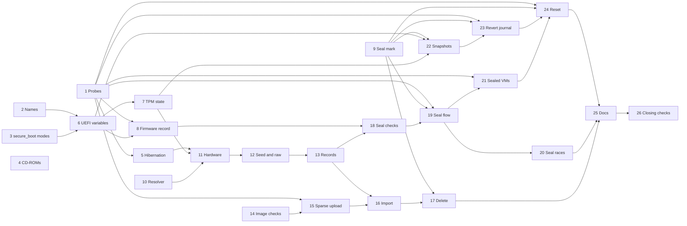

# Custom templates and images: implementation plan

Status: approved, with the five decisions below; reviewed twice by plan-critic. Built from
[`custom-templates-design.md`](custom-templates-design.md) at `078da8a`, which owns behaviour, and from its probes in
[`2026-11-24-custom-templates-probes.md`](../research/2026-11-24-custom-templates-probes.md). Roadmap outcome 5 in
[`fork-roadmap.md`](fork-roadmap.md) is the outcome. This plan owns order and checks. Progress goes in the execution
record at the end.

## Decisions the design left open

The design is silent on five points that the build has to settle. The plan builds each as stated here. A different
answer changes only the units named, and the rejected options are listed so that the review can weigh them.

1. **Volume name clash (units 2, 22, 24).** A VM named `tpl` with a snapshot `s1` makes the volume `tpl@s1.vars`,
   which is also the variables volume of a template named `s1`. The design's Names text and its invariant that no VM
   or snapshot name can produce a template's volume name carry this amendment. Decided: no new VM may be named `tpl`,
   with a refusal test; `snapshot_create` refuses a VM that already has that name; and copies and
   journals are deleted by their exact derived names, never by an `<vm>@` prefix. Rejected: a template prefix that no
   VM name can match, such as `@tpl@`, which renames every template volume the design names.
2. **`describe_vm` output (unit 3).** Decided: `secure_boot` stays a boolean, where setup mode reads as false,
   and a new field `secure_boot_mode` holds `"off"`, `"on"` or `"setup"`. Rejected: replacing the boolean with a
   string, which breaks every reader of the field.
3. **`create_vm` with `disk_image` (unit 15).** Decided: a synchronous upload on its own libvirt connection,
   under a new key `limits.max_disk_image_gib` with the fixed default 8 GiB, counted on the image's data size, which
   keeps it inside a client's call timeout at disk speed. The manage lock is taken only to define the VM, after a
   recheck of the name and `max_vms`, and `disk_gib` is refused beside `disk_image`. Larger images go through
   `template_create` and then a VM from that template. Rejected: the whole upload under the manage lock, which blocks
   every other management call for its length, and a background transfer, which needs a claim on the name and on
   `max_vms` while it runs.
4. **Format of an image (units 14, 15, 16).** Decided: the server probes the content. The qcow2 magic means
   qcow2, and no magic means raw. An optional `format: "raw"` forces raw, and a forced-raw file that carries the magic
   is refused, as the design says. A qcow2 is still refused when it names a backing file or an external data file, or
   is encrypted, which is what makes the probe safe. Rejected: a required `format` parameter, which asks every caller
   for what the file already says, and the file extension, which cannot tell a raw file that carries the magic from a
   qcow2 file.
5. **Revert of a running VM (unit 23).** The design describes only the revert of a shut-off VM. Decided: a
   revert of a running VM to a snapshot that has variable or TPM copies is refused, with the advice to run `stop_vm`
   first. Rejected: copying the files after libvirt stops the VM, because libvirt stops it inside the revert call and
   no step of the server runs between the stop and the disk revert.

The design or the code settles the other questions, and the units hold the answers. In `wait_for`, `vm` is optional
for a lone `transfer_done`, and an import's owner is the template name (unit 16). `disk_bus` applies to the boot disk,
imported or new (unit 15). Both caps live in `[manage]` (unit 16). No call undefines a VM it keeps, so the
`--keep-tpm` rule has no site (units 6 and 7). Delete, reset and expiry skip the journal check and delete the
journal (units 9, 23 and 24). A sealed template uses autoselection when unit 1 shows that libvirt accepts a user
`<nvram template>` (unit 21).

## Overview

The outcome lets an agent boot images built anywhere and keep prepared VMs as templates, with their UEFI variables
and hardware. The work divides into four layers, and the order follows their dependencies.

- **Foundations (units 2 to 9).** Volume names, the three `secure_boot` modes, more CD-ROMs, hibernation, UEFI
  variables and TPM state as pool volumes, the firmware record in the owner element, and the seal mark with its
  refusals. Each is a `create_vm` or management feature that has its own result. The design lists the variables and
  TPM volumes after the sealing flows, but seal, snapshot and reset copy those volumes, so they come first.
- **Template sources (units 10 to 13).** One resolver answers every question about templates. It starts over the
  config's entries, gains the hardware fields, the seed choice and raw disks, and then reads the pool's records.
- **Images and the agent-made flows (units 14 to 21).** Image checks and the sparse upload serve `create_vm`
  `disk_image` first and then the import. Delete follows the import, because the caps would otherwise block the test
  bed. Seal comes after, in checks, flow and races, and VMs from a sealed template close the layer.
- **Snapshots, reset, docs and the closing checks (units 22 to 26).** Delete and expiry have no unit of their own:
  each volume kind is deleted by the unit that creates it, and the closing checks cover the rest.

Unit 1 holds every probe the build needs, including the design's open question, whether firmware autoselection accepts a
user `<nvram template>`. It needs no repository code, and each later unit that depends on a probe names it. The design's
other open checks sit where they can be run: the raw sparse import in unit 15, the Windows sealed template and
cloudbase-init in unit 26.



## Shared preflight

These apply to every unit, which names only its additions.

- **Rules.** Follow `AGENTS.md` (`CLAUDE.md` links to it), including its Guardrails. A change to a guardrail or to a
  refusal the design lists needs a test that shows the refusal still happens. Units 6, 8, 9, 14, 17 and 22 touch
  the guardrails, and each says which. Load `rust-style`, `rust-error-handling` and `rust-testing` before editing Rust,
  `rust-unix-processes` before units that run `swtpm_setup` or use `rustix` or `flock`, `bash-shell` before editing
  `run-all.sh`, and `security-review` for a pass over the diff of units 14 to 16, 19 and 21, which read agent-chosen
  host files or follow data an agent controls. Load `writing-for-humans` before any prose, and
  `git-commits-and-recovery` before committing. Use `LSP` `findReferences` before changing a signature, then confirm
  with `rg`.
- **Gate.** Every commit passes the build gate in `AGENTS.md`: `cargo fmt --check`, `cargo build --locked`,
  `cargo test --locked`, `cargo clippy --locked --all-targets -- -D warnings`, `cargo deny check advisories` and
  `pre-commit run --all-files`. CI also tests on the `rust-version` toolchain, so run `cargo +1.94 test --locked`.
  The `mdformat` and `pretty-format-json` hooks may rewrite a file during a commit; add it again and commit again.
- **Dead code.** The crate is a binary, so an item with no caller fails clippy. Add an item in the unit that first
  calls it. Where a unit has to land an item before its caller, mark it
  `#[cfg_attr(not(test), expect(dead_code, reason = "first caller: unit N"))]`, as `owner_in_domain_xml` does. The
  unit that adds the caller removes the attribute, and clippy fails if it forgets, because the expectation is then
  unfulfilled.
- **New tools and parameters.** Every tool carries `annotations`, every parameter struct carries
  `#[serde(deny_unknown_fields)]`, and the tests `every_tool_with_parameters_refuses_unknown_ones` and the
  tool-visibility tests in `src/server.rs` list each new tool and each gating rule. `hidden_tools` hides a new tool
  in read-only mode. A tool that takes a secret, a path outside `host_share_dirs` or a volume name from an agent is a
  defect.
- **Config keys.** A key lands with the first code that reads it, in `config.example.toml` (the test
  `example_config_parses` reads it), and in `Config::validate` with a refusal test.
- **Dependencies.** Only unit 15 adds a crate: `virt-sys` 0.3.1, the version `virt` 0.4.3 already locks, through
  `cargo add virt-sys@0.3.1`. It needs the `cargo deny` and Rust 1.94 checks, and its licence goes in the unit's row.
  Unit 1's spike checks the call signatures against the versions in `Cargo.lock` first.
- **FFI.** The only new `unsafe` is `virStreamSendHole` in unit 15, proven first by unit 1's spike. Its block carries a
  `SAFETY` comment, and every error path aborts the stream, because `virt`'s `Stream` panics on drop when it frees an
  unfinished stream.
- **Seams.** Unit tests never touch libvirt. Pure functions take parsed XML, bytes or plain structs. Where a sequence
  needs failure injection, the unit names the trait (a store of records, volumes or journals) and tests drive a fake
  that fails at each step.
- **Test bed.** Run cases with `tests/testbed/run-all.sh` and `mcp_call.py --check`, and give every call an `expect`.
  Add each case to `UNITS` or `MEMBERS` in `run-all.sh` and to the case table in `tests/testbed/README.md`. Touch only
  `trial-deb13`, and VMs and volumes named `t-*`, `tpl-*` or `tpl@t-*` in the `agent-vms` pool on `qemu:///system`.
  Test templates are named `t-<x>`, so their volumes are `tpl@t-<x>.*`; the cleanup trap in `run-all.sh` learns that
  pattern in unit 13. The cases for agent-made templates use `tests/testbed/config-agent-templates.toml` (unit 10),
  whose `host_share_dirs` entry `run-all.sh` points at a directory on the disk filesystem, `.scratch/testbed-share/`
  in the repository, not at `/tmp`, which is tmpfs and uses RAM. Delete large host files when a case ends. Check
  `free -m` before starting a VM, and `df -h /` before a case that writes more than 1 GiB.
- **TPM gate.** Positive TPM cases need the gate in "Host prerequisites": a VM whose state is a `.tpm` file in the pool
  starts on the host. Reading the rule file would not show that the AppArmor profile is loaded, so unit 7 adds
  `tests/testbed/tpm-gate.sh`, which runs the gate for real, and `run-all.sh` runs it once. Positive cases run when it
  passes and report a skip otherwise. The refusal case, which expects a failed start that names the rule, runs only
  when it fails.
- **Review.** Each unit marked "reviewed" gets one `code-reviewer` pass over its commits, with the test evidence, before
  a dependent unit starts, and its blocking findings are fixed first. Reviews run on `model: sonnet` until subagent
  safeguards allow more; units marked "(Opus)" are where an Opus review is worth its cost when it is allowed. Unmarked
  units are self-reviewed against the unit's list, and the final review covers them.
- **Commits.** One logical change per commit, Conventional Commits, explicit pathspecs, and a `CHANGELOG.md` entry
  under `## Unreleased` for each change operators or agents notice. Mark the roadmap only in unit 26. Nothing is
  pushed in the run.
- **Worker brief.** A Sonnet worker builds one unit from this plan, the design sections the unit names and the files
  it lists, with the gate commands above. The worker loads `test-driven-development` and writes the unit tests first.

## Host prerequisites

- **libvirt.** The design needs 10.10 or later for `<tpm>` with a file source and for `templateFormat`. The host runs
  12.0.0, so the code refuses older versions through `Connect::get_lib_version` (10.10.0 reads 10010000), and no case
  can test the floor. That is a named exception.
- **`swtpm-tools`.** `swtpm_setup` is at `/usr/bin/swtpm_setup` and `/etc/swtpm_setup.conf` exists. The `swtpm` user is
  114 with group 117 on this host; the code looks both up and hard-codes neither.
- **AppArmor rule and the gate before unit 7.** The line `owner /var/lib/libvirt/images/agent-vms/*.tpm rwk,` in
  `/etc/apparmor.d/local/usr.bin.swtpm` is deployed through the dotfiles, and a manual run of the gate has passed
  (see the probe notes). Unit 7 still opens with the gate: a VM that names a hand-made `.tpm` volume in the pool starts
  and shows `/dev/tpm0`. Only a start shows that the profile is loaded. If the gate fails, units 7, 11, 22, 23 and 24
  still land with their unit tests and their refusal cases, and their positive cases run once the gate passes. Unit
  26 runs every waiting case. If the gate still fails then, they stay named exceptions in the execution record, and
  the roadmap marks the outcome done only with that exception written beside it.
- **Memory and disk.** The Windows check in unit 26 needs 9 GiB available for `t-win11net` and about 65 GiB of free
  pool space. Check both first.

## Units

### 1. Probes

**Result.** One dated note, `docs/research/<date>-custom-templates-build-probes.md`, answers the questions that later
units rely on, before any of them is written. Each answer names the unit it feeds and the unit it can stop.

**Changes.** No repository code. Probe VMs are named `t-pr*`, on overlays of `tpl-debian13.qcow2` as in the earlier
probe note, and probe volumes `t-pr*` or `tpl@t-probe*`. `TPLVARS` is the path of `tpl@t-probe.vars`, a
`virsh vol-clone` of a variables file that holds a marker variable, and `POOL` is the pool's directory. The probes:

1. **Autoselection with a user template (feeds unit 21).** Define a VM with `<os firmware='efi'>`, `<firmware>` features
   for Secure Boot off, and `<nvram template=TPLVARS templateFormat='raw' format='raw'>POOL/t-pr1.vars</nvram>`. Record
   whether define and start succeed and whether the guest sees the marker variable. Repeat with Secure Boot on
   (`enrolled-keys`). The host's libvirt is 12.0.0, so the note says that this proves nothing about 10.10.
2. **Loader path after a first start (feeds unit 8).** After each first start, compare `virsh dumpxml` with
   `virsh dumpxml --inactive`, and record whether the inactive definition holds the resolved `<loader>` path.
3. **Hibernation (feeds unit 5).** On a VM from the Debian template with `<pm><suspend-to-disk enabled='yes'/></pm>`
   defined by `virsh`, a swap file with the resume parameters set, and `systemctl hibernate`, record the state, the
   reason and the events from `virsh event --all --timestamp`: whether libvirt reports a shut-off VM, or a suspended one
   with suspend to disk as the reason, and whether it emits `pmsuspended`. The swap and resume set-up is time-boxed to
   two hours. After that the probe is recorded as inconclusive, and hibernation is left out of the run (unit 5).
4. **Seal copy (feeds unit 19).** `virsh vol-clone` of an overlay volume into a new volume. Check with `vol-dumpxml`
   that the clone has no `<backingStore>` and that its allocation is about the data's, and that the checksum of the
   overlay's backing template is unchanged.
5. **Volume timestamps (feeds unit 19, step 5 of the seal).** Read `vol-dumpxml` for a VM's boot disk and `.vars`
   before and after the guest writes a file and a variable and the VM shuts down, and record whether `<mtime>` moves.
   The seal's confirm step compares those times.
6. **Replacing a volume (feeds units 23 and 24).** Record whether `vol-clone` onto an existing name works or fails, and
   what `vol-upload` of a shorter file over a longer existing volume leaves: its size, its tail and its owner. This
   decides whether a revert and a TPM reset replace a volume in place or delete and recreate it.
7. **FFI spike (feeds units 7, 15 and 19).** A throwaway crate under `.scratch/`, pinned to `virt` 0.4.3 and
   `virt-sys` 0.3.1 as `Cargo.lock` resolves them. It confirms that `Stream::as_ptr`, `StorageVol::create_xml_from`
   and `Connect::get_lib_version` have the signatures the later units assume, and that `virStreamSendHole` links
   through `virt-sys`. On a 64 MiB raw `t-pr7` volume uploaded with `VIR_STORAGE_VOL_UPLOAD_SPARSE_STREAM` (a data run,
   a hole, a data run and a trailing hole), `virsh vol-info` shows the capacity and an allocation that covers only the
   data. The spike's useful lines go into the note, and the crate is deleted.

Delete every probe VM (`undefine --nvram`), volume and crate afterwards.

**Verification.** The note holds each probe with its commands, its result and the unit it feeds, and `virsh list --all`
and `vol-list` show no `t-pr` or `tpl@t-probe` leftovers.

**Recovery.** A bad answer stops only the unit that depends on it, and the stop goes back as a design question. Probe 4
stops unit 19 if the clone keeps a backing reference. Probe 5 stops it if the times do not move. Probe 7 stops unit 15
if the hole call fails. Probe 1 changes unit 21, as the unit says.

**Leaves out.** Any code or design change. Unit 25 edits the design's open question from probe 1.

### 2. Volume names

**Result.** One module, `src/volnames.rs` (the name is free), builds every pool volume name of the design's Names
table, and a test proves that no VM or snapshot name can produce another kind's name. No new VM can be named `tpl`.
Design: Names; Invariants (names).

**Changes.** Functions for `<vm>.vars`, `<vm>.tpm`, `<vm>@<snapshot>.vars` and `.tpm`, the revert journals
`<vm>@@revert@<snapshot>.vars` and `.tpm`, and `tpl@<name>.qcow2`, `tpl@<name>.img`, `tpl@<name>.vars` and
`tpl@<name>.meta`. A parser, `copy_of(vm, volume)`, reads a copy or journal name back by rebuilding it from the parsed
VM, snapshot and kind and comparing for equality, so that units 22 to 24 list leftovers without a prefix match. The VM
name `tpl` is reserved: a VM named `tpl` with a snapshot `s1` would make `tpl@s1.vars`, the variables volume of a
template named `s1`. `check_vm_name` wraps `check_name` and refuses the exact name `tpl`; `create` and
`create_from_template` use it for VM names, and snapshot names keep `check_name`. Each function is
`cfg_attr(not(test), expect(dead_code))` until its first caller. `check_name` and `is_hostname` are otherwise as
they are.

**Verification.** Unit tests: each name has the designed shape. Over a set of valid VM and snapshot names (one
character, 64 characters, `.`, `_`, `-` inside, a name ending in `.vars` or `.tpm`, and `tpl` as a snapshot name), no
variable, TPM, copy or journal name equals a `tpl@` name, another kind's name, another VM's name of the same kind, or
an existing disk name (`<vm>.qcow2`, `<vm>-g<n>.qcow2`, `<vm>-g<n>-seed.img`, `<vm>-vd<c>.qcow2`). The set includes the
VM `tpl` with a snapshot named like each valid template name, which clashes, and the test shows `check_vm_name`
refuses that VM, so the clash cannot arise. Refusal tests: `check_name` refuses `@`; `is_hostname` refuses `@` and
`.`; `check_vm_name` refuses `tpl` and accepts `tpl2` and `my-tpl`. A journal name cannot equal a snapshot copy's,
because the second `@` would have to open a snapshot name. `copy_of` accepts exactly the names the builders make. No
test-bed case: nothing calls the module yet.

**Leaves out.** Every caller, which later units add.

### 3. `secure_boot` takes off, on and setup

**Result.** `create_vm`, `create_vm_from_template` (through the template) and config templates accept
`secure_boot` as `"off"`, `"on"` or `"setup"`, and still read `true` and `false`. A setup-mode VM has Secure Boot
firmware with no keys enrolled. Design: Decisions (Secure Boot setup mode); Creating VMs.

**Changes.**

- `src/config.rs`: a `SecureBoot` enum with a `Deserialize` that takes a boolean or one of the three strings and
  refuses anything else, used by `Template.secure_boot`. `src/server.rs`: `CreateVmParams.secure_boot` takes the same
  values, with a schema that offers the boolean and the three strings.
- `src/manage.rs`: `DomainSpec` and `NewVm` carry the mode. `domain_xml` writes the design's feature table: `off` sets
  `secure-boot` and `enrolled-keys` to no, `on` sets both to yes, and `setup` sets `secure-boot` yes and
  `enrolled-keys` no, each with `<loader type='pflash'/>`. `check_secure_boot` refuses `off` and `setup` with BIOS,
  with the message `secure_boot "off" and "setup" need firmware "uefi"`. `secure_boot_state` reads the three modes
  from the definition. `describe_vm` keeps `secure_boot` as a boolean, where setup mode reads as false, and adds the
  field `secure_boot_mode` with `"off"`, `"on"`, `"setup"` or `null` (decision 2).
- `tests/testbed/cases/firmware-secure-boot.json` and `config-templates.toml` follow the new message and output.

**Verification.** Unit tests: every accepted and refused input form, including `"yes"` and `1`; the XML of each mode, as
`firmware_features` reads it; the BIOS refusals, which keep the rule that a BIOS VM has no Secure Boot to change;
`describe_vm`'s reader for each mode, for both fields; and a config template with each form. The test-bed case expects
`secure_boot_mode` beside the unchanged boolean. A new template entry
`debian13-uefi-setup` with `secure_boot = "setup"` makes a VM whose guest reads `SetupMode` 1 and `SecureBoot` 0 from
`efivars`, while `debian13-uefi` still reads `SecureBoot` 1. The BIOS case expects the new message.

**Leaves out.** The per-VM choice of the mode (unit 11), `<nvram>` (unit 6), and setup mode with a TPM (unit 7).

### 4. More CD-ROMs

**Result.** `create_vm` takes up to four `extra_isos`, and `set_cdrom` adds a drive at a named free target on a shut-off
VM, both within q35's six SATA ports. Design: Creating VMs; Decisions (More CD-ROMs); the earlier probe note, probe 1,
result 6.

**Changes.** `NewVm.extra_isos` is resolved through `Config::iso_file` like the other ISOs. `disk_xml` writes each as a
read-only SATA CD-ROM after the installer and driver drives, with no `<boot>` element. A helper counts SATA devices in
a definition (CD-ROMs and disks on bus `sata`), and `create` and `set_cdrom` refuse a count above six, naming it.
`set_cdrom` with a `target` of the form `sd<letter>` that is free adds a drive there on a shut-off VM, as it refuses
today; on a running VM it still refuses.

**Verification.** Unit tests: five extra ISOs refused; the order of drives and that only the first drive boots; the
SATA count with a driver ISO and extras; `set_cdrom` adding at a free target, refusing a used one, a non-`sd` name, a
running VM and a seventh SATA device. Test bed `extra-isos.json`: `create_vm` with the installer, a driver ISO and three
extras shows targets `sda` to `sde` in `describe_vm`, and a VM from a template gets a drive at `sdc` through
`set_cdrom`, starts, and shows `/dev/sr1` in the guest. The ISOs are zero-filled files that the case's config puts in
`iso_dirs`.

**Leaves out.** SATA and USB boot disks (unit 15).

### 5. Hibernation

**Result.** `create_vm` takes `hibernate`, which writes `<suspend-to-disk enabled='yes'/>` and leaves suspend to
memory off, and `start_vm` handles the state libvirt reports for a hibernated VM. Design: Hibernation.

**Changes.** The unit starts only if unit 1's probe 3 was conclusive. If it was not, this unit, the `hibernate` fields
of units 11 and 19, and the resume case are left out and recorded in the execution record. Unit 1's hibernation probe
settled which state libvirt reports for a guest that hibernates and whether it
emits `pmsuspended`. This unit follows that note:

- `NewVm.hibernate` and `DomainSpec.hibernate` set the `<pm>` element; `describe_vm` shows `hibernate`.
- `start::decide` gets the arm the probe shows it needs. If libvirt reports a shut-off VM, nothing changes. If it
  reports a suspended VM with suspend to disk as the reason, `start_vm` boots it and never calls `pm_wakeup`. Unit 1's
  note says which, and the unit test follows it.

**Verification.** Unit tests: the `<pm>` XML for both values, and `decide` for the state the probe found, plus the
existing cases. Test bed: `describe_vm` of a `create_vm` VM with `hibernate: true` shows it. The resume case, a
process surviving `systemctl hibernate` and `start_vm`, needs a template VM with `hibernate`, so it runs in unit 11.

**Leaves out.** Templates' `hibernate` field and the resume case (unit 11), and the seal's record of it (unit 19).

### 6. UEFI variables in the pool (reviewed)

**Result.** Every UEFI VM the server creates keeps its variables as `<vm>.vars` in `disk_pool`, which libvirt creates at
the first start, and the VM's definition, reset and delete work with it. Design: Decisions (Where VM variables live);
Firmware in a VM's definition; Probe 1 results 1 to 3.

**Changes.**

- `src/manage.rs`: `DomainSpec.nvram` gives `<os firmware='efi'>` the element
  `<nvram format='raw'>POOL/<vm>.vars</nvram>`, where `POOL` is the parent of the new disk volume's path. `create` and
  `create_from_template` refuse a create while a `<vm>.vars` volume exists, after a pool refresh, with an error that
  names the volume and the `virsh vol-delete` command.
- A helper `refresh_pool` and a lookup of the variables volume, both used by units 8, 19 and 22. `State::boot_claimed`
  in `src/start.rs` refreshes the pool after a successful start.
- `reset_start` reads a UEFI VM from `firmware='efi'` or from `<loader type='pflash'>` with an `<nvram>`, and passes
  `VIR_DOMAIN_START_RESET_NVRAM` for both. `describe_vm` and `secure_boot_state` already read the loader form.
- `UNDEFINE_FLAGS` keeps `VIR_DOMAIN_UNDEFINE_NVRAM`, which deletes the file at the pool path. Both undefines, in
  `manage::delete` and `manage::expire`, delete the VM, and no call undefines a VM it keeps, so the design's keep rule
  has no site and needs no test.

**Verification.** Unit tests: the `<nvram>` element in the XML of each of the three modes from unit 3; no element for
BIOS; the leftover refusal; `reset_start` for both forms. Refusal test for the guardrail on deletion: a `delete` of a
VM never names a volume outside `disk_pool`, as before. Test bed `uefi-vars.json`: a UEFI `create_vm` has no
`<vm>.vars` before its first start and one after, owned by the QEMU user; the guest keeps a variable it writes
across a shutdown and start; `delete_vm` leaves no `<vm>.vars` after a pool refresh; a pre-made `t-lv.vars`
(`virsh vol-create-as agent-vms t-lv.vars 1M --format raw`) makes `create_vm` refuse naming it. The existing
`templates-reset-uefi.json` and `firmware-secure-boot.json` pass unchanged.

**Leaves out.** Firmware records (unit 8), TPM (unit 7), snapshot copies (unit 22), and the check that `RESET_NVRAM`
restores a variable from a pool path, which unit 24 runs with its own case.

### 7. TPM state in the pool (reviewed)

**Result.** A VM with a TPM keeps its state as the volume `<vm>.tpm`, which the server makes with `swtpm_setup`, owns by
the host's swtpm user and deletes with the VM. A start without the AppArmor rule is refused with a message that names
the rule. Design: Decisions (Secure Boot setup mode, and TPM state); TPM state; Probe 2 questions 1 to 6.

**Changes.** Step 0 is the gate from "Host prerequisites", run by hand before any code: define a VM `t-tpmgate` by
`virsh` whose `<tpm>` names `POOL/t-tpmgate.tpm`, make that volume as the swtpm user with state from `swtpm_setup` as in
the probe note, start it, and check that it runs. Delete both afterwards. The steps become
`tests/testbed/tpm-gate.sh`, which exits 0 when the VM starts and 1 when it fails, cleans up, and touches only `t-*`
names. Then a module `src/tpm.rs`:

- `swtpm_ids()` reads uid and gid from `getent passwd swtpm`; it refuses when the user is missing, naming `swtpm`.

- `generate_state()` runs `swtpm_setup`, as in the probe note, as the server's own user in a mode 0700 temporary
  directory under `~/.cache/virtmanager-mcp/`, reads the state file and removes the directory. It refuses when
  `swtpm_setup` is missing and names `swtpm-tools`:

  ```sh
  swtpm_setup --tpm2 --tpmstate file://DIR/state.tpm --createek --lock-nvram --not-overwrite \
    --pcr-banks sha256 --config /etc/swtpm_setup.conf
  ```

- `create_volume()` makes `<vm>.tpm` with raw format, owner and group from `swtpm_ids`, mode 0600 and capacity equal
  to the state's size, and uploads it with the existing `upload`. It refuses an existing `<vm>.tpm`.

- `domain_xml` writes the file source below, with the path the server built. `create` makes the state before it
  defines the VM and deletes it when the define fails. A libvirt older than 10.10 refuses `tpm: true`:

  ```xml
  <tpm model='tpm-crb'>
    <backend type='emulator' version='2.0'><source type='file' path='POOL/<vm>.tpm'/></backend>
  </tpm>
  ```

- In `LibvirtBoot::start_paused`, a failed start of a VM whose definition names a pool `.tpm` file, with
  `swtpm_setup` in libvirt's message, becomes a refusal that names `/etc/apparmor.d/local/usr.bin.swtpm` and the line
  `owner <pool dir>/*.tpm rwk,` as the first thing to check.

- `delete` and `expire` keep `VIR_DOMAIN_UNDEFINE_TPM`, so libvirt removes the pool file. Nothing undefines a VM it
  keeps.

- `CHANGELOG.md` says that `tpm: true` now needs `swtpm-tools` and the AppArmor rule on the host, and that a VM made
  before this change keeps its state in libvirt's own location.

**Verification.** Unit tests: the `getent` parse (user missing, malformed line), the XML, the version gate, the missing
tool messages, the leftover refusal, and the start-error mapping on a string fixture of libvirt's message. A guardrail
test shows that no tool parameter takes a TPM path and that the generated path always sits in the pool next to the
disk volume. Test bed `tpm-refused.json` (gate fails): `create_vm` with `tpm: true` succeeds, `start_vm` is refused
naming the rule, and `delete_vm` removes `<vm>.tpm`. `tpm-state.json` (gate passes): the same VM starts, and
`virsh vol-dumpxml` shows the volume owned by the swtpm user with mode 0600.

**Leaves out.** Guest-level TPM checks (unit 11), snapshot copies (unit 22), reset (unit 24), and an EK certificate.

### 8. Firmware record in the owner element (reviewed)

**Result.** When the server makes a UEFI VM's first start, it records the firmware code file's path and SHA-256 in the
VM's owner element. A seal reads it later. Design: Sealing a VM (step 1, firmware bullet); Risks 02.

**Changes.** `Owner` gains `firmware_code` and `firmware_sha256`, written by `element()` and read by `from_node`. The
unit follows unit 1's note on what the live and inactive definitions hold. Before a start, `State::boot_claimed`
refreshes the pool and looks up the VM's `.vars` volume, so the later "no `.vars` yet" decision rests on a current
listing, not on libvirt's cached one. After a successful start, it checks whether the VM is owned, has an `<nvram>`
naming its pool `.vars`, had no `.vars` volume before the start and carries no record. If so, under the manage lock, it
refreshes the pool, reads the loader path from the live definition, hashes the file with `sha2`, and rewrites the owner
element through `replace_owner` and `define_xml`. A failure is logged and does not fail the start.

This unit rewrites owner attributes on an existing VM, as a reset does, so it carries the guardrail change. The
`AGENTS.md` Guardrails sentence now says that the server rewrites owner attributes (`generation`, `expires` and the
firmware record) only on a VM that already carries the element, and unit 9 adds `sealing` to it.

**Verification.** Unit tests: the owner element round trip with the new attributes, a missing attribute reading as
absent, a path with quotes escaped, and the decision function (first start, second start, `.vars` already listed before
the start, BIOS, unowned, a stale listing refreshed). Refusal test for the guardrail on the owner element: writing the
record to a domain XML without an owner element fails, so the attribute can never create ownership. Test bed: the
`uefi-vars.json` case extends, and `run-all.sh` reads the element with
`virsh metadata t-x http://virtmanager-mcp/owner/1`: a VM first started by `start_vm` carries both attributes and the
hash equals `sha256sum` of the file; a VM first started with `virsh start` carries neither.

**Leaves out.** Reading the record (unit 18), and VMs from sealed templates (unit 21).

### 9. Seal mark, seal lock and the refusals they drive (reviewed, Opus)

**Result.** Every management call that changes a VM, `start_vm`, `stop_vm` and the expiry sweep included, refuses a VM
under a live seal mark and clears a stale one, through one function. Nothing writes a mark until unit 19, so this unit
changes no behaviour for existing configs. Design: Sealing a VM (step 2); Invariants (live seal; Guardrails).

**Changes.**

- `Owner` gains the `sealing` attribute: the template name, seal ID, start time, uid and lock path in one value, with a
  tested encoding that no field can break. `Mark::live(now, lock_probe)` follows the design: a mark with this process's
  uid and lock path is live while the lock `~/.cache/virtmanager-mcp/seal-<name>.lock` is held, and stale when it is
  free; any other mark is live until it is 24 hours old. The probe is a trait, so tests need no files.
- **Two entry points.** Only they take the manage lock, besides `start_guard`'s fallback below.
  - `manage::lock_for_change(hv, target, checks)` serves a call on an existing VM. `target` is a name, a UUID or a
    domain. It looks the VM up, takes the lock once, runs the seal-mark check by the template's name, clears a stale
    mark through `replace_owner`, and returns `Changing { dom, guard }`. `checks` is `Checks::Mark` or
    `Checks::MarkAndJournal`; the journal check is a no-op until unit 23, and delete, reset and expiry use
    `Checks::Mark`. For a VM without an owner element, such as one in `manage_vms` or `power_vms`, it skips both
    checks, because such a VM can have no mark and no journal. Callers are `set_resources`, `attach_disk`,
    `detach_disk`, `set_cdrom`, `attach_nic`, `detach_nic`, `snapshot_create`, `snapshot_delete`, `reset`, `delete`,
    `expire`, `State::revert`, `Hypervisor::stop` and `LibvirtBoot::start_paused`.
  - `manage::lock_for_create(hv)` serves a call with no VM yet: `create`, `create_from_template`, and, as they land,
    the `disk_image` recheck (unit 15), `import_template` (unit 16) and `delete_template` (unit 17). It takes the lock
    and nothing else.
- **No nesting.** `manage::lock()` is a per-open `flock`, so a second take in one process waits `LOCK_WAIT` (30 s) and
  fails. `State::revert` already holds the lock through `start_guard` today. The guard is therefore passed down and
  never retaken: `lock()` becomes private to the two entry points and `start_guard`, functions below them take `&Held`
  as proof of the lock, and `start_guard` takes `Option<&Held>`, so a caller that holds the guard passes it and
  `start_guard` takes the lock only when none is passed. `State::revert` takes the guard from `lock_for_change` once and
  hands it to `LibvirtRevert`. `State::start_vm` and `State::boot` take no lock; they make a check-only call,
  `manage::check_sealing(dom)`, which reads the owner element and refuses a live mark without locking or clearing
  anything. Only `LibvirtBoot::start_paused` takes the lock, through `lock_for_change`, and holds it for the
  authoritative check and libvirt's create call, not for the rest of the boot.
- **`stop_vm`.** `Hypervisor::stop` reaches the VM through `power_domain`, which also covers `power_vms` VMs the server
  does not manage, and it waits up to `wait` for a graceful shutdown. The lock covers only the mark check and the
  `shutdown` or `destroy` call, never the wait, so a slow guest cannot hold every other management call for the wait's
  length.
- `set_mark` and `clear_mark` rewrite the attribute through `replace_owner` and `define_xml` and refuse a VM without
  an owner element; both are `expect(dead_code)` until unit 19.
- `AGENTS.md` Guardrails gain `sealing` in the sentence unit 8 wrote: written only by the server, on a VM that already
  carries the owner element.

**Verification.** Unit tests: liveness for each case (same uid and path with the lock held, same with the lock free,
another uid, another path, 23 and 25 hours old); the encoding round trip. Both entry points are generic over a `Locker`
that tests build on a temporary lock file with a 200 ms wait, so two functions carry the refusal tests: a live mark is
refused naming the template, a stale or absent mark proceeds and a stale one is cleared, a VM without an owner element
skips both checks and is never given a mark, and a body that tries to take the lock again from inside the guard fails
within the 200 ms. These tests need no split of each path into a lock part and a body. They are backed by a source test
that counts the calls of `lock()` in `src/manage.rs` and fails when one appears outside the two entry points and
`start_guard`, and by types: every function below the entry points takes `&Held` or `&Changing`. `start_guard` is
tested with `Some(&held)` and with `None`, and a revert test through the existing `FakeBoot` seam shows that
`State::revert`'s guard reaches `start_guard` without a second take. `check_sealing` is tested to take no lock. Refusal
test for the guardrail: `set_mark` on a domain XML without an owner element fails, and a VM made by `create_vm`
carries no mark. Test bed: no new case; `lifecycle-guardrails.json`, `memory-cap.json`, `templates-create.json` and
`manage-lock.json` pass unchanged. Unit 20 runs the mark end to end.

**Leaves out.** Writing a mark (unit 19), the seal lock's holder (unit 19), and the journal check (unit 23).

### 10. One resolver over config templates, and the `agent_templates` switch

**Result.** A single resolver, `src/templates.rs`, answers every template question from the config, and
`manage.agent_templates` exists as a switch. With it on and no config template, the template tools are advertised and
the expiry sweep runs. Design: Finding templates; Gating; Decisions (Switch and caps).

**Changes.**

- `src/config.rs`: `manage.agent_templates`, off by default, refused unless `manage.create` is on.
- `src/templates.rs`: `has_source(config)`, `names`, and `resolve(conn, config, name) -> Resolved`, which holds what
  `check_template` returned (volume path, capacity, user data) plus the origin. `check_template`, `list_templates`,
  `log_template_problems`, `create_from_template` and `reset` call it, so the module is the only place that reads
  `manage.templates`.
- `sweep::refusal` and `hidden_tools` use `has_source`: `list_templates`, `create_vm_from_template` and `reset_vm`
  are advertised when a config template exists or `agent_templates` is on, with the same `create` and `delete` rules as
  today. The server instructions text follows.
- `tests/testbed/config-agent-templates.toml`: the template config with `agent_templates = true`, no
  `[manage.templates]` and, from unit 15, a share directory that `run-all.sh` writes in.

**Verification.** Unit tests: `agent_templates` without `create` refused; `hidden_tools` for each combination, with
read-only mode, and the sweep gate allowing a run with no config template. Existing template tests pass through the
resolver. Test bed `agent-templates-gating.json`, with `__list__`: the template tools are advertised under the new
config and under `config-templates.toml`, and `list_templates` returns an empty list under the new one.

**Leaves out.** Pool records (unit 13), the caps and the new tools.

### 11. Config templates: hardware, limits and per-VM choices

**Result.** A config template may set memory, vCPUs, TPM and hibernation; a VM from it defaults to them; and
`create_vm_from_template` may override memory, vCPUs, TPM, hibernation, firmware and Secure Boot within limits.
Design: Decisions (Hardware a template records); Creating VMs.

**Changes.** `Template` gains `memory_mib`, `vcpus`, `tpm` and `hibernate`. `Resolved` carries a `Hardware` struct that
unit 13 fills for agent-made templates too. `NewTemplateVm` and `CreateFromTemplateParams` gain `tpm`, `hibernate`,
`firmware` and `secure_boot`; the disk may grow and never shrink, as today. A recorded memory or vCPU value above the
current limit refuses the call and names the limit; absent values keep today's defaults. `create_from_template` makes
the TPM state with unit 7's function when the VM has a TPM, and writes `hibernate` and the Secure Boot mode into the
XML. `list_templates` shows OS, firmware, Secure Boot mode, TPM, memory and vCPUs.

**Verification.** Unit tests: defaults, overrides, each limit refusal, growth and shrink of the disk, the TPM state made
and cleaned up when the define fails, and `list_templates` fields. Test bed (`config-templates.toml` gains entries):
`templates-hardware.json` runs overrides of memory and vCPUs, refusals above the limits, and a `/dev/kvm` check, which
proves the nested virtualization the design lists. `hibernate.json` makes a VM from a template with `hibernate`,
prepares swap and the resume parameters over `exec`, runs `systemctl hibernate`, calls `start_vm` and shows a process
that survived, then records what `vm_events` reported. `templates-tpm.json` (gate passes) makes a VM with `tpm` whose
guest has `/dev/tpmrm0`.

**Leaves out.** Seed choice and raw disks (unit 12), and `seal_id` and sealed firmware (unit 21).

### 12. Config templates: seed choice and raw disks

**Result.** A config template may set `seed` and name a raw volume. With `seed = "none"`, its VMs get no seed disk and
keep the template's identity. Design: Decisions (Cloud-init seed per template; Importing an image); The record.

**Changes.** `Template.seed`, with the default `nocloud` for Linux and `none` for Windows, and a refusal at load of
`user_data` with `seed = "none"`. `resolve` accepts a raw or qcow2 volume, and `overlay_xml` takes the backing format
from the volume. `create_from_template` and `reset` skip the seed disk and seed volume for `none`; `replace_disks`
copes with an overlay alone. `list_templates` shows the seed.

**Verification.** Unit tests: seed defaults per OS, the `user_data` refusal, the overlay XML with a raw backing, a VM
definition with one disk for `none`, and a reset of that VM. Test bed `templates-seed-raw.json`, with a setup step in
`run-all.sh` that makes `t-tpl-raw.img` from `tpl-debian13.qcow2` with `virsh vol-create-from` and an XML naming the raw
format: a VM from a raw template starts and its agent answers; a template with `seed = "none"` makes a VM that keeps
the template's hostname and has no seed disk; `reset_vm` of each works.

**Leaves out.** Agent-made templates (unit 13 on).

### 13. Template records and the pool resolver (reviewed)

**Result.** The resolver reads agent-made templates from `tpl@<name>.meta` records in the pool, lists the usable ones,
and lists separately as incomplete the names whose record says `building` or does not parse. Design: The record; Finding
templates; Invariants (usable template).

**Changes.**

- `src/record.rs`: the `Record` struct with the design's fields (origin, state, ID, sealed VM's UUID, OS, machine, disk
  bus, firmware, code path and hash, Secure Boot mode, TPM, memory, vCPUs, seed, hibernation, creation time).
  `encode` writes JSON padded to exactly 64 KiB with its SHA-256 inside; `decode` refuses a wrong length, a bad
  checksum or a parse error. `write` uploads, reads back and compares, retrying twice.
  A trait `RecordStore` (write, read) separates it from libvirt.
- `src/templates.rs` lists `tpl@*.meta` volumes in `disk_pool`, reads each, and builds `Resolved` for a usable one:
  state `ready`, checksum good, every needed volume present (`tpl@<name>.qcow2` or `.img`, and `.vars` for a UEFI sealed
  template). Volume names come from the template name through unit 2, never from the record. A name that a config
  template also uses is listed as incomplete with that reason. `list_templates` adds origin, ID, hardware, space on disk
  and the count of owned VMs, with an `incomplete` list. `log_template_problems` logs both kinds.
- `run-all.sh`'s cleanup trap deletes `tpl@t-*` volumes the run did not find at the start.

**Verification.** Unit tests with a fake store: encode and decode round trip, a flipped byte, a truncated record and a
record of the wrong length; the write retried after a bad read-back and failing after two retries; a record whose
fields name other volumes, which the resolver ignores; each usability rule; a `building` record listed as incomplete;
the name collision with a config template. Test bed, added to `agent-templates-gating.json`'s run: a junk volume
`tpl@t-broken.meta` made with `virsh vol-create-as` and `vol-upload` appears under `incomplete` and not in the usable
list, and `run-all.sh` deletes it.

**Leaves out.** Any code that writes a record (units 16 and 19), and `template_delete`.

### 14. Image source checks and the free-space figure (reviewed)

**Result.** One module, `src/image.rs`, opens a host image safely, validates it from its first cluster, and reports the
space an unprivileged user can write on the pool's filesystem. Design: Importing an image; Free space; Invariants
(backing and data files).

**Changes.**

- `open_source(config, pool_dirs, path, forced_raw)`: resolve with `Config::share_file`, refuse a path that resolves
  inside a storage pool's directory, open the resolved path with `O_NOFOLLOW` through `rustix`, and check the open
  file's path from `/proc/self/fd/<n>` against the same rules. The format comes from the content (decision 4): the qcow2
  magic means qcow2, no magic means raw, and an optional `format: "raw"` forces raw. A name ending in `.zst`, `.gz`,
  `.xz`, `.bz2` or `.zip` is refused with the advice to decompress first.
- `read_head`: read at least 4 KiB from the open file and return that buffer, which unit 15 sends as the first part of
  the upload.
- `check_head(buf, forced_raw, file_len)`: a buffer that begins with the qcow2 magic is qcow2, and with `forced_raw`
  the file is refused instead. For qcow2, require version 2 or 3, refuse a backing file offset, the
  external-data-file incompatible bit, a data-file header extension, an encryption method other than none, and an
  unparseable extension list; read the virtual size. A buffer without the magic is raw, and its size is the file's.
- `unprivileged_free_bytes(dir)`: `rustix::fs::statvfs`, available blocks times fragment size.
  `pool_dir(conn, m)` reads the pool target from its XML.
- Items carry `expect(dead_code)` until unit 15.

**Verification.** Unit tests with hand-built headers: a clean qcow2 passes, and a file without the magic reads as raw;
each refusal in the design (backing file, data-file bit, data-file extension, encrypted, bad version, truncated
extension, a forced-raw file with the qcow2 magic, a compressed file name). Refusal tests for the invariant: a symlink
swapped in after `share_file` is refused by `O_NOFOLLOW`; a path that resolves into a pool directory is refused; the
`/proc/self/fd` check refuses a path moved outside the share after the open; a path outside `host_share_dirs` is
refused. The free-space function on a temporary directory is positive and at most the filesystem size, and the
arithmetic on stubbed `statvfs` values is exact.

**Leaves out.** The upload and every caller.

### 15. Sparse upload, `create_vm` `disk_image` and `disk_bus` (reviewed, Opus)

**Result.** `create_vm` boots a built image: `disk_image` makes a checked, sparse copy of a share file the VM's own
disk, deleted with it, and `disk_bus` puts the boot disk, imported or new, on `virtio`, `sata` or `usb`, for example
SATA for a Windows installer. Design: Importing an image; Creating VMs; Decisions (Importing an image).

**Changes.**

- `cargo add virt-sys@0.3.1`. `src/image.rs` gains `chunks(buf)`, a pure splitter into data runs and zero runs at 4 KiB
  granularity, and `upload_sparse(conn, vol, first, rest, total)`, which opens the volume's upload with
  `VIR_STORAGE_VOL_UPLOAD_SPARSE_STREAM`, sends zero runs with `virStreamSendHole` and data with `Stream::send`, sends a
  trailing hole, and aborts the stream on every error. `send_hole` is the only `unsafe` function, as unit 1's spike
  showed it.
- After the upload, `verify_volume` reads the volume's XML and deletes it when it shows a `<backingStore>` path or a
  format other than the probed one.
- `create_vm` takes `disk_image` and an optional `format: "raw"` (decision 4), refuses `disk_gib` beside `disk_image`,
  and builds the VM as decision 3 says: the checks and caps (virtual size within `max_disk_gib`, data size within the
  new key `limits.max_disk_image_gib`, free space); a volume named `<vm>.qcow2` or `<vm>.img` of the probed format and
  exact capacity, which claims the name and refuses an existing volume of that name, naming it and the
  `virsh vol-delete` command as the `.vars` leftover check does, so an orphan that a crash left is neither reused nor
  silent; the upload on its own connection (`Hypervisor::open_private`, added here and reused by units 16 and 19);
  `verify_volume`; and only then the manage lock, to recheck the name and `max_vms` and define the VM. A failure deletes
  the volume. An image over the cap is refused with the advice to import it with `template_create`.
  `limits.max_disk_image_gib` defaults to 8 and is fixed (decision 3). The unit measures the upload rate with the 1 GiB
  image below and records it in the unit's row; a rate at which 8 GiB would pass `max_wait_secs` goes back to the owner,
  and the default does not move.
- `disk_bus` (no pending decision): `virtio` as today; `sata` and `usb` on `sd` targets from
  one counter shared with CD-ROM drives, and a `usb` disk with `removable='on'`. The SATA count of unit 4 includes a
  `sata` disk. It applies whether the disk is imported or new.
- `tests/testbed/config-agent-templates.toml` gets `host_share_dirs`, and `run-all.sh` builds the images below in
  `.scratch/testbed-share/`: it downloads the Debian template volume with `virsh vol-download` (the pool file is not
  readable by the account), and makes `debian13.img` with `qemu-img convert -O raw`, which skips zero blocks.

**Verification.** Unit tests: `chunks` on leading, trailing, embedded and boundary-straddling zero runs and on a source
with no zeros; the disk XML for each bus and the shared `sd` counter, for an imported and a new disk; refusals of
`disk_gib` beside `disk_image`, of a forced-raw file with the qcow2 magic, of an image over `max_disk_image_gib`, and of
a seventh SATA device; the lock taken only after the upload, and a failed define deleting the volume. Test bed
`image-disk.json`: `debian13.img` boots through `create_vm` with `firmware: "bios"`, then as UEFI without Secure Boot.
Unverified until this case runs: that the guest agent answers with no seed disk, because the template's cloud-init may
wait for a data source. The case therefore waits for the agent up to 120 s and records the result; if it fails, the unit
stops and reports before unit 16, which imports the same image. The raw sparse check, a 4 GiB raw file with 1 GiB of
random data at its start, makes a volume whose `virsh vol-info` Allocation is about 1 GiB and Capacity 4 GiB; a qcow2
image reports Capacity equal to its virtual size. Refused with the messages of unit 14: a qcow2 naming a backing file or
an external data file (both made with `qemu-img create`), an encrypted qcow2, a file with the qcow2 magic sent with
`format: "raw"`, a path outside the share, a symlink in the share to a file outside it, and an image over the cap. After
a refusal `vol-list` shows no new volume.

**Leaves out.** Templates and records (unit 16), and a background `create_vm`.

### 16. `template_create` imports an image (reviewed, Opus)

**Result.** With `manage.agent_templates` and `manage.create` on, an agent imports an image from the share as a template
in the background, waits for it with `wait_for` and `transfer_done`, and makes VMs from it. Design: Importing an image;
Decisions (Switch and caps; Hardware a template records); Free space; Gating.

**Changes.**

- `src/config.rs`: `manage.max_templates` (4) and `manage.max_template_gib` (100), both positive.
- `src/manage.rs`: `import_template` takes the name, image, an optional `format: "raw"` (decision 4), OS and hardware
  fields named as in `create_vm`: `firmware`, `secure_boot`, `tpm`, `memory_mib`, `vcpus`, `seed` and `hibernate`. Under
  the manage lock it checks the name (the hostname rule, unused by a config template, a record or a `tpl@<name>.*`
  volume), the caps (count of agent-made templates, sum of their allocated GiB plus the image's data size, refused with
  the numbers), the free space, and then writes the record in state `building`, which claims the name. A transfer then
  runs the upload of unit 15 on its own libvirt connection (`Hypervisor::open_private`) and, on success, writes the
  record as `ready`. The call waits up to `max_wait_secs` and returns the template's reply or the running reply. The
  transfer's owner is the template name.
- A failure deletes the volumes and the record it made. When `max_transfers` is reached, the record is rolled back
  before the call returns the refusal. A record that cannot be read back after the retries stays `building`.
- `src/server.rs`: the tool `template_create` (its `vm` field comes in unit 19), `hidden_tools` entry for
  `agent_templates` with `create`, annotations, and `WaitForParams.vm` optional for a lone `transfer_done`. When `vm`
  is given it must match the owner's VM name, UUID or template name, and when it is omitted the 128-bit random ID is
  enough.
- `Hypervisor::open_private` returns a new connection to the configured URI.

**Verification.** Unit tests: name checks, cap arithmetic at the edges with the numbers in the message, the order of
steps and the cleanup after a failure at each, driven through a fake backend; `wait_for` with only `transfer_done` and
no `vm`, with a wrong `vm`, and with an unknown ID; `hidden_tools` for the tool; the tool-hint tests. Test bed
`template-import.json`, with `max_wait_secs` 2: an import of `debian13.img` replies with a transfer, `transfer_done`
reports it, `list_templates` shows it as imported with its ID and space, and two VMs from it, BIOS and UEFI without
Secure Boot, answer on their agents. A third, UEFI in setup mode with a TPM, runs in unit 26. Refusals: each image of
unit 15's refusal list through `template_create`, a name in use, a second import under a lowered `max_templates`, and
a lowered `max_template_gib`, with the numbers in the messages.

**Leaves out.** Seal (units 18 to 20), delete (unit 17), and a backing check on the volumes it makes beyond unit 15's.

### 17. `template_delete` (reviewed)

**Result.** An agent deletes an agent-made template that no volume backs onto, including a failed or half-built one.
Design: Deleting templates; Decisions (Deleting templates); Invariants (templates deleted only by `template_delete`).

**Changes.** `manage::delete_template`, under the manage lock: refuse a config template; for a `building` record,
refuse while the seal lock is held (unit 9's probe); read the `<backingStore>` of every volume in every active pool and
refuse while one backs onto the template's disk, giving the count and logging the volume names; refuse and name a
volume it cannot read; then delete `tpl@<name>.qcow2` or `.img`, `.vars`, and the record last. Names come from unit 2,
and only the volumes of `disk_pool` are touched. It works on an unparseable record. The tool `template_delete` is
advertised when `agent_templates` and `delete` are on.

**Verification.** Unit tests: backing detection over volume XMLs (a match, a miss, a chain, an unreadable volume); the
config-template refusal; a record whose fields name other volumes, which are never deleted; the `building` record with
the lock held and free; the order of deletes with the record last; `hidden_tools`. Refusal test for the guardrail on
deletion: a template name never yields a volume outside `disk_pool`. Test bed `template-delete.json`: a template in use
is refused with the count, and deleted after its VM is; a config template is refused; `t-broken` from unit 13, with
no disk, is deleted by the tool.

**Leaves out.** Deleting a template while a VM it made runs on a copy elsewhere (design risk 8).

### 18. Seal checks (reviewed)

**Result.** One pure function decides whether a VM may be sealed, and refuses each case the design lists. Design:
Sealing a VM (step 1); Decisions (Which VMs can be sealed; What a seal copies).

**Changes.** `src/seal.rs`: `SealFacts` (owner element, state, UEFI, `<vm>.vars` present, firmware record and the
current hash of the code file, writable disks, the boot disk's format in the definition and in the volume, whether a raw
boot disk's first 4 KiB begin with the qcow2 magic, the boot disk's allocated size with its chain, the name's use, the
caps, the free space, libvirt's version) and `check(facts, config) -> Result<Plan>`, with the refusals below.
`expect(dead_code)` until unit 19.

**Verification.** One unit test per refusal, each with a message that names its cause: not owned by `owner_of`, which
covers a VM only in `manage_vms`; running; a UEFI VM without `.vars`; a record missing, or its hash changed; a second
writable disk, where a read-only seed and CD-ROMs do not count; a format mismatch; a raw disk with the qcow2 magic;
a name in use; `max_templates`; `max_template_gib`; free space; an older libvirt; a live mark. A passing VM, BIOS and
UEFI, gives a plan with the space estimate.

**Leaves out.** Reading the facts from libvirt, the mark and every copy (unit 19).

### 19. Seal in the background (reviewed, Opus)

**Result.** `template_create` with `vm` and `name` seals an owned, shut-off VM into a template in the background:
a standalone qcow2 of the boot disk, a copy of the variables and a record, listed only when complete. Design: Sealing
a VM; Decisions (What a seal copies; Seal in the call or in the background).

**Changes.** The unit follows unit 1's probes 4 and 5: the volume copy gives a standalone qcow2, and the volume
times move after a guest write. If either failed, the unit does not start.

- `seal::gather` reads the facts from libvirt, with the pool refreshed first. For the raw boot-disk head it downloads
  4 KiB through a stream.
- `manage::seal` follows the design's six steps: under the manage lock, take the seal lock
  `~/.cache/virtmanager-mcp/seal-<name>.lock`, check, mark with `set_mark`, and write the `building` record; roll all
  back when the transfer cannot start. The transfer holds the lock and runs on its own connection: copy the boot disk
  with `StorageVol::create_xml_from` into `tpl@<name>.qcow2`, copy `<vm>.vars`, confirm that the VM is still shut off
  and that the modification times of the disk and `.vars` are the ones read at the mark, write `ready`, clear the mark
  and release the lock. A failure at any step deletes the volumes made and clears the mark. The record takes hardware,
  machine type and disk bus from the definition, the firmware record from unit 8, and the seed from the call. Hardware
  the record cannot hold, such as a `<hostdev>`, is left out and named in the result.
- `template_create` gains `vm`, exclusive with `image`. `set_mark` and `clear_mark` lose their `expect(dead_code)`.
- A trait `SealIo` covers the volume copies, the record, the confirm step and the mark, so tests can fail each step.

**Verification.** Unit tests: the full sequence with a fake `SealIo` and the order of calls; a failure injected at each
step leaves no volumes, no mark and a released lock; the confirm step failing on a changed time or a started VM; the
rollback when `max_transfers` is reached; `vm` and `image` together refused; the result naming left-out hardware. Test
bed `template-seal.json`, on a UEFI VM from `debian13-uefi`: set an EFI variable and a marker file, stop, seal as
`t-seal`, `wait_for` `transfer_done`; `list_templates` shows it as sealed with its ID; the sealed disk has no
`<backingStore>` in `vol-dumpxml`, `tpl@t-seal.vars` equals the source VM's `.vars` by checksum, and the source
template's checksum is unchanged. Refusals: a VM in `manage_vms`, a running VM, a UEFI VM made with `virsh` first (no
record), over the caps, and a name in use. A BIOS VM from `create_vm` with `tpm: true`, never started, is sealed
without the rule, and `vol-list` shows no `tpl@t-*.tpm` while the record says TPM, which shows that a template never
carries TPM state.

**Leaves out.** Races and stale marks (unit 20) and VMs from the template (unit 21).

### 20. Seal races, stale marks and the raw-disk refusal (test bed only)

**Result.** The refusals and the recovery paths of the mark are shown against a real seal, and a seal of a raw disk that
carries the qcow2 magic is refused. Design: Sealing a VM (steps 1, 2, 3 and 5); Checks (live seal, killed seal, raw
disk).

**Changes.** Cases and `run-all.sh` steps only, with code fixes if a case finds a defect. A seal of a VM with 3 GiB of
random data on its disk lasts long enough, with `max_wait_secs` 2, for the calls of one case to land inside it. Before
each racing call, the case checks that the seal still runs: `wait_for` with only `transfer_done` and `timeout_secs` 0
must answer `timed_out`, and the case fails loudly when it answers a match, because the seal ended too early to prove
anything. The run-all steps that act outside the case poll for the transfer's volume `tpl@t-race.qcow2` for 60 s and
fail the unit with a message when it never appears.

**Verification.**

- `template-seal-live.json`: during a seal, `start_vm`, `stop_vm`, `snapshot_create`, `configure_vm`, `set_cdrom`,
  `attach_disk`, `detach_disk`, `reset_vm` and `delete_vm` of the VM are each refused naming the template, and the
  expiry sweep leaves it alone.
- `template-seal-race`: `run-all.sh` starts `template-seal-race.json` in the background, waits until
  `tpl@t-race.qcow2` appears, runs `virsh start` on the VM, and the case's last `wait_for` reports the seal failed
  because the VM changed. The template's volumes are gone and the mark is cleared.
- `template-seal-kill`: `run-all.sh` kills the server process (`kill -9`) during a seal. The next call on the VM clears
  the stale mark and succeeds, and `template_delete` removes the `building` template, and refuses while a seal holds
  the lock.
- `template-seal-magic.json`: a VM made by `create_vm` with the raw `disk_image` of unit 15 has its guest write the
  qcow2 magic and a backing path to the start of its disk. After a shutdown, `template_create` refuses the seal naming
  the raw disk, and no `tpl@t-*` volume is left.

**Leaves out.** A seal that outlasts 24 hours under another account (design risk 8).

### 21. VMs from a sealed template (reviewed, Opus)

**Result.** `create_vm_from_template` makes VMs from a sealed template with its firmware, hardware and variables, warns
when the firmware changed, and takes an optional `seal_id`. Design: Firmware in a VM's definition; Creating VMs;
Decisions (Tying a template to its firmware build; Hardware a template records); Probe 1 results 4 and 5.

**Changes.**

- `src/firmware.rs`: reads the firmware descriptors in `/usr/share/qemu/firmware` and `/etc/qemu/firmware` and answers
  whether one names a code file path.

- `domain_xml` gains the sealed form. Unit 1's probe 1 chooses it. If libvirt accepted a user template under
  autoselection, the VM keeps `firmware='efi'` with the Secure Boot features and the
  `<nvram template=… templateFormat…>` element below, with no `<loader>` and no pinned code file; the descriptor check
  does not apply, and the hash warning moves to the first start, where unit 8 already reads the code file libvirt
  picked. Otherwise the explicit-loader form below applies. `CODE` is the recorded code file, and `<smm state='on'/>`
  joins the features when `secure` is yes:

  ```xml
  <loader readonly='yes' secure='yes' type='pflash' format='raw'>CODE</loader>
  <nvram template='POOL/tpl@<name>.vars' templateFormat='raw' format='raw'>POOL/<vm>.vars</nvram>
  ```

- `create_from_template` for a sealed template: refuse a libvirt older than 10.10, and, in the explicit-loader form, a
  code file that is missing or that no descriptor names, a `seal_id` that no longer matches, an override of `firmware`
  or `secure_boot`, and values above the limits with the limit named; take the machine type and disk bus from the
  record; default memory, vCPUs, TPM and hibernation to the record's; skip the seed for `none`. When the code file's
  SHA-256 differs from the record, the reply warns and the VM is still made. The reply and the owner element carry the
  seal ID, and the owner element carries the code path and hash so such a VM can be sealed in turn.

- `create_vm_from_template` gains `seal_id`.

**Verification.** Unit tests: the XML for each of the three Secure Boot modes of the sealed form (the form unit 1
chose), with the descriptor fixtures in the test where they apply; each refusal above; the hash warning; the owner
element's attributes; a record naming a path outside every descriptor refused. Refusal test for the record's trust rule:
a record whose `firmware code path` names a file in the pool is refused. Test bed `template-sealed.json`, on `t-seal`
from unit 19: a VM from it starts, its marker variable and marker file are present, `SecureBoot` agrees with the
template, a second VM works, and a stale `seal_id` is refused. `describe_vm` shows the loader form.

**Leaves out.** Reset (unit 24) and the Windows template (unit 26).

### 22. Snapshots keep variables and TPM state (reviewed)

**Result.** A snapshot of a shut-off UEFI VM saves its variables, and of a shut-off VM with `<vm>.tpm` its TPM state, as
pool volumes that go with the snapshot and the VM. Design: Snapshots (create, list and delete); Names.

**Changes.** `snapshot_create` and `snapshot_delete` go through unit 9's funnel with `Checks::MarkAndJournal` and hold
the manage lock for their whole sequence. `snapshot_list` and `describe_vm` take no lock and stay read-only. A snapshot
of a shut-off VM takes libvirt's snapshot and then copies `<vm>.vars` and `<vm>.tpm` to `<vm>@<snapshot>.vars` and
`.tpm` after a pool refresh, with `create_xml_from`, which keeps the owner; a failed copy deletes the snapshot and any
copy made. `snapshot_create` refuses a VM named `tpl` (decision 1). A UEFI VM without `<vm>.vars` is snapshotted as
before, and the reply says no variables were saved. `snapshot_delete` deletes the snapshot's copies by their derived
names. `delete_vm` and `expire` delete the copies of each of the VM's snapshots by derived name, and every leftover that
`copy_of` (unit 2) recognises for the VM, which includes copies whose snapshot is gone and journals; neither uses a
prefix match, and a VM named `tpl` has none to delete. `snapshot_list` and `describe_vm` list the copies and journals
that exist and which snapshots have copies. A running VM is unchanged, so a running UEFI VM is still refused.

**Verification.** Unit tests, through a fake volume store: the copies made and named, the cleanup after a failed second
copy, no copies for a VM without `.vars` or `.tpm`, delete removing them, and no delete of another VM's volumes (a VM
`a` and a VM `ab`, a VM `tpl` and a template `s1`, whose `tpl@s1.vars` stays). Refusal tests: `snapshot_create` of a VM
named `tpl` is refused; the delete names only volumes of `disk_pool`, as the deletion guardrail requires. Test bed
`snapshot-vars.json`: a snapshot of a shut-off UEFI VM creates `<vm>@s1.vars`; `snapshot_list` shows it;
`snapshot_delete` removes it; `delete_vm` removes the copies of two snapshots; a VM defined by hand with
`firmware='efi'` and no `<nvram>` path is snapshotted with the note. With the gate passing, a TPM VM also gets
`<vm>@s1.tpm`.

**Leaves out.** Reverts (unit 23).

### 23. Snapshot revert with a journal (reviewed, Opus)

**Result.** `snapshot_revert` of a shut-off VM restores its disk, variables and TPM state, and a revert cut short leaves
a journal that the next call names, that a repeated revert completes, and that `abandon: true` rolls back. Design:
Snapshots (revert and journal); Invariants.

**Changes.** `manage::snapshot_revert` for a shut-off VM runs: refuse if a journal exists for a different revert; write
`<vm>@@revert@<snapshot>.vars` in full from the current variables and read it back (never overwriting an existing one);
copy the snapshot's variables in; revert the disk; delete the journal; a failed disk revert copies the journal back.
Unit 1's probe 6 decides whether a copy replaces a volume in place or deletes and clones. The TPM state has its own
journal and the same rules. A snapshot without copies reverts the disk only, and the result says the variables or TPM
state were not restored.

A revert of a running VM to a shut-off snapshot that has copies is refused, with the advice to run `stop_vm` first
(decision 5). The design describes only the revert of a shut-off VM, and libvirt stops the VM inside the revert call,
so the server has no step between the stop and the disk revert at which to copy the files. A snapshot without copies
still reverts a running VM as today.

`snapshot_revert` gains `abandon`, which copies the journal's variables back and deletes it, also after the snapshot is
gone. The funnel's journal check, a no-op since unit 9, now refuses every call that changes a VM except delete, reset
and expiry, which use `Checks::Mark` and delete the journal with the VM's other volumes, so that a journal can never
keep a VM alive. The refusal names the snapshot; `snapshot_revert` itself checks the journal on its own terms; read-only
calls are not refused. `describe_vm` and `snapshot_list` show journals. A revert of a running snapshot is unchanged. A
trait `RevertIo` covers the copies and the disk revert.

**Verification.** Unit tests: a table that stops the sequence after each step, for variables alone and with TPM state,
and checks that the next call refuses naming the snapshot, a repeated revert completes, `abandon` restores the
variables, and `abandon` works when the snapshot was deleted; the journal read-back failing before anything else
changes; an existing journal never overwritten; read-only calls proceeding; `delete`, `reset` and `expire` proceeding
with a journal present and deleting it; the running-VM refusal and the copyless exception. Test bed
`snapshot-revert-vars.json`: a shut-off UEFI VM with a variable A, snapshot `s1`, a variable B made after, stop, revert,
start: B is gone and A stays. A journal made by `virsh vol-clone` of the current `.vars` makes `start_vm`,
`snapshot_create` and `configure_vm` refuse naming `s1`, and `delete_vm` of the VM
succeeds and removes the journal; a repeated
`snapshot_revert` completes, and a second journal made the same way is rolled back by `abandon`, also after
`snapshot_delete`. A running VM refuses the revert. With the gate passing and network in the guest: a TPM object made
after the snapshot is gone after the revert.

**Leaves out.** Killing the server between steps in the test bed; the table covers it.

### 24. `reset_vm` returns variables and TPM state

**Result.** `reset_vm` starts a UEFI VM from its template's variables and gives it an empty TPM unless `keep_tpm` is
set, keeping the UUID and never undefining the VM. Design: TPM state (reset); Firmware in a VM's definition (reset);
Decisions (Secure Boot setup mode, and TPM state on reset).

**Changes.** `ResetVmParams.keep_tpm`. `manage::reset` goes through the funnel with `Checks::Mark`, so a journal never
blocks it. Among its checks, before the power-off, it generates the new TPM state with unit 7's `generate_state` for a
VM that has `<vm>.tpm` and not `keep_tpm`, so a `swtpm_setup` failure refuses the reset with the old file untouched.
After the power-off it replaces the volume's content with that state, in place or by delete and create as unit 1's
probe 6 decided, and keeps the owner. It deletes the VM's copies and journals by derived name through `copy_of` (units
2 and 22), never by prefix, and for a VM named `tpl` deletes none. A VM whose TPM state sits in libvirt's own location
gets the reply that a reset cannot clear it. `reset_start` already passes `RESET_NVRAM` (unit 6): this unit shows it
restores the template's variables from a pool path, for a sealed template's `.vars` and for a descriptor's. The reply
and `reset_vm`'s description say that Secure Boot keys enrolled since the VM was made are gone after a reset.

**Verification.** Unit tests: a generation failure leaving the old file and the VM running; the TPM file replaced and
kept with `keep_tpm`; the old-location reply; copies and journals deleted by derived name; a journal not blocking a
reset; a VM named `tpl` deleting no copies. Test bed `reset-vars-tpm.json`: a VM from `t-seal` carries its own variable
C made after creation; `reset_vm` removes C and keeps the template's marker; the VM boots Secure Boot as before. With
the gate passing: a VM with `tpm` has an object made, and after `reset_vm` the object is gone, the EK hash differs and
`virsh domuuid` is unchanged and `virsh list --all` shows the VM throughout; with `keep_tpm: true` the object stays.
`templates-reset-uefi.json` still passes.

**Leaves out.** An EK certificate and a reset of a TPM VM made before this change beyond its message.

### 25. Docs

**Result.** The documentation describes what was built, and the design follows the code. Design: all of it; the
repository rules on docs.

**Changes.** `docs/vm-management.md` and `docs/templates.md` cover agent-made templates, `template_create`, the import
and seal flows, `template_delete`, `extra_isos`, `disk_image`, `disk_bus`, `secure_boot` modes, `hibernate`, snapshots
with variables, journals and `abandon`, and `reset_vm`'s `keep_tpm`; `docs/how-to/agent-test-vms.md` gains the switch
and the caps; `docs/tools.md` lists the tools; `docs/limitations.md` gains the risks that apply; a "Host setup for a
TPM" section in `docs/vm-management.md` documents `swtpm-tools` and the AppArmor rule with its path;
`config.example.toml` holds every key; `docs/file-transfer.md` mentions the import's use of share directories. The
README's Terms entry for template says that an agent can also register one, by sealing a VM or importing an image, and
its tool table gains the new tools; the wording of that Terms entry is for the plan review. The design takes every
detail the build settled differently (the reserved VM name `tpl` is already in its Names text and invariants), marks its
open question answered by unit 1, and changes `AGENTS.md` for the guardrails, as unit 9 did. `CHANGELOG.md` is complete,
including the notes the design asks for (rollback past this change is unsupported for VMs from a sealed template) and
the new `secure_boot_mode` field of `describe_vm`.

**Verification.** `rg` finds no stale statement that a template is only a config entry; every tool in `docs/tools.md`
exists and every new tool is listed; `config.example.toml` parses; `pre-commit run --all-files` passes. A read as the
Nix configuration project's agent, using only the docs, finds how to import an image and boot it in three modes.

**Leaves out.** Roadmap changes, which unit 26 makes.

### 26. Closing checks and final gate

**Result.** The outcome is shown against the design on the test bed, the reviews close, and the roadmap records it.
Design: Checks; Risks 03, 09, 10.

**Changes.** The checks below, a research note `docs/research/<date>-windows-sealed-template.md` for the Windows run and
the cloudbase-init probe, and the roadmap edit.

**Verification.** In order:

1. **Waiting TPM cases.** With the TPM gate passing, run `templates-tpm.json`, `tpm-state.json`, the TPM parts of
   `snapshot-vars.json`, `snapshot-revert-vars.json` and `reset-vars-tpm.json`, and the third boot of the imported
   image, UEFI in setup mode with a TPM, where `sbctl status` reports setup mode.
2. **Windows sealed template.** Install a Windows 11 VM fresh through `create_vm` as `tests/testbed/README.md` describes
   for `t-win11net`, with a TPM, every update applied, and a PowerShell check that the firmware database holds the
   Windows UEFI CA 2023 certificate. Shut it down, seal it, and make a VM from the template with Secure Boot on. Start
   it before and after `reset_vm` and read the same certificate. `t-win11` cannot be sealed: its variables are not in
   the pool.
3. **cloudbase-init, time-boxed.** On the Windows VM before sealing, install cloudbase-init with the NoCloud
   configuration, seal with `seed = "nocloud"`, and look for the hostname from the seed in the new VM. Record the
   result. A failure or a skip is design risk 09 and stays unverified in the exceptions below.
4. **The design's check list.** `run-all.sh` passes in full, twice, and these remain proven by the units named:
   `delete_vm` and expiry remove `<vm>.vars` and `<vm>.tpm` (6, 7); a seal gives a standalone qcow2 (19); the raw sparse
   import (15); every refusal in the design's list (14, 15, 16, 17, 19, 20); a start without the rule is refused naming
   it (7); and expiry with no config template: in `config-agent-templates.toml`, a VM with `lifetime_minutes` 1 from an
   imported template is deleted by the sweep within 130 s, which is shown here.
5. **Gate.** The build gate and `cargo +1.94 test --locked` pass at the last commit, and CI passes once the branch is
   pushed.
6. **Reviews.** A `code-reviewer` pass over the whole run, and a separate `conformance-review` against
   `custom-templates-design.md` at `078da8a` and this plan, with the base revision before unit 2 and the head after
   unit 25. Their material findings are fixed and rechecked.
7. **Roadmap.** Outcome 5 in `fork-roadmap.md` is marked done, with the exceptions below beside it, and the "Next"
   section follows.

**Leaves out.** Device passthrough (follow-up 36) and the EK certificate.

## Exceptions the run records

Each exception names the check, why it cannot run here, and the evidence that stands in.

- **libvirt 10.10 as the floor.** The host runs 12.0.0. A unit test covers the version gate, and unit 1 states that
  12.0.0 proves nothing about 10.10.
- **Positive TPM cases while the gate fails.** The AppArmor rule is deployed separately. The refusal case runs on a
  host where the gate fails, unit tests cover the rest, and unit 26 runs the cases once the gate passes.
- **The refusal case once the gate passes.** The refusal only occurs without the rule. Unit 7's tests of the error
  mapping stand in.
- **A seal that outlasts 24 hours under another account.** The test bed has no second account. Unit 9's liveness tests
  at 23 and 25 hours stand in.
- **A changed firmware hash on a real host.** An `ovmf` upgrade cannot be forced. Unit 21's unit test of the warning
  stands in.
- **A disk outside every pool that backs onto a template.** The backing check sees only pool volumes (design risk 8).
  Unit 17 checks volume XMLs.
- **cloudbase-init reading a NoCloud seed.** Step 3 of unit 26 is time-boxed. Design risk 09 stays open, and its first
  user checks it.

## Traceability

| Design section | Units |
| -- | -- |
| Summary; the two needs | 26 (Windows, three boot modes) |
| Decisions: record location, switch and caps | 10, 13, 16 |
| Decisions: deleting templates | 17 |
| Decisions: which VMs can be sealed; what a seal copies; background | 18, 19, 20 |
| Decisions: host device passthrough | none (its own roadmap item) |
| Decisions: tying a template to its firmware build | 8, 21 |
| Decisions: where VM variables live, and snapshots | 6, 22, 23 |
| Decisions: hardware a template records; seed | 11, 12, 13, 21 |
| Decisions: importing an image, `disk_image` | 14, 15, 16 |
| Decisions: Secure Boot setup mode, TPM on reset | 3, 7, 24 |
| Decisions: more CD-ROMs; hibernation; nested virtualization | 4; 5, 11; 11 |
| Behaviour: Names | 2 |
| Behaviour: The record | 13, 19 |
| Behaviour: Finding templates; Gating | 10, 13, 16, 17 |
| Behaviour: Free space | 14, 16, 18 |
| Behaviour: Sealing a VM | 9, 18, 19, 20 |
| Behaviour: Importing an image | 14, 15, 16 |
| Behaviour: Firmware in a VM's definition | 1, 6, 8, 21, 24 |
| Behaviour: Creating VMs | 3, 4, 5, 11, 15, 21 |
| Behaviour: Snapshots | 22, 23 |
| Behaviour: TPM state | 7, 24 |
| Behaviour: Hibernation | 5, 11 |
| Behaviour: Deleting templates | 17 |
| Invariants | 2 (names), 9 (live seal, guardrails), 14 (images), 17 (deletion), 7 (TPM), 21 (usable) |
| Risks 01 to 12 | 6, 8, 13, 17, 20, 26, and the exceptions table |
| Open question: autoselection | 1, 21 |
| Checks | See the list in unit 26 and the verification of the units named there |

## Execution record

The run's goal:

- **Objective.** Units 1 to 26 are committed on `main`, each with its row here.
- **Success.** After the last change:
  - the build gate and `cargo +1.94 test --locked` exit 0;
  - `tests/testbed/run-all.sh` exits 0, with `t-win11` present, and the cases that wait for the AppArmor rule are run or
    named in the exceptions table;
  - a code review and a separate conformance review find no material mismatch.
- **Boundaries.** Nothing is pushed. Only `trial-deb13`, `t-*` VMs and `t-*`, `tpl-*` and `tpl@t-*` volumes in
  `agent-vms` are touched, and large host files stay under `.scratch/`.
- **Stop.** Stop and report when a step needs root, a design change, a decision above that the owner has not confirmed,
  or another VM or pool.

| Unit | Commits | Evidence | Review |
| -- | -- | -- | -- |
| 1 Probes | `7820b5d` | [Build probes](../research/2026-11-24-custom-templates-build-probes.md): autoselection refuses a user `<nvram template>` (unit 21 uses the explicit form); autoselection also refuses `<suspend-to-disk>` (unit 5 waits for a decision); `vol-clone` gives a flat qcow2 but `vol-dumpxml` shows a stale `<backingStore>` until `pool-refresh` (unit 19); `<mtime>` moves and must be read after shut-off (unit 19); no volume can be cloned or created over an existing name, so revert and reset delete and recreate (units 23, 24); the FFI calls and the sparse upload work (units 7, 15, 19) | Read by the main session |
| 2 Volume names | `805602b` | Gate green, 446 tests; `check_vm_name` refuses `tpl`, tested at the function, not through `create`, which needs libvirt | Self-review by the main session |
| 3 `secure_boot` modes |  |  |  |
| 4 More CD-ROMs |  |  |  |
| 5 Hibernation |  |  |  |
| 6 UEFI variables in the pool |  |  |  |
| 7 TPM state in the pool |  |  |  |
| 8 Firmware record in the owner element |  |  |  |
| 9 Seal mark, seal lock and refusals |  |  |  |
| 10 Resolver and `agent_templates` |  |  |  |
| 11 Config templates: hardware |  |  |  |
| 12 Config templates: seed and raw disks |  |  |  |
| 13 Template records and the pool resolver |  |  |  |
| 14 Image source checks |  |  |  |
| 15 Sparse upload, `disk_image`, `disk_bus` |  |  |  |
| 16 `template_create` imports an image |  |  |  |
| 17 `template_delete` |  |  |  |
| 18 Seal checks |  |  |  |
| 19 Seal in the background |  |  |  |
| 20 Seal races, stale marks, raw-disk refusal |  |  |  |
| 21 VMs from a sealed template |  |  |  |
| 22 Snapshots keep variables and TPM state |  |  |  |
| 23 Snapshot revert with a journal |  |  |  |
| 24 `reset_vm` returns variables and TPM state |  |  |  |
| 25 Docs |  |  |  |
| 26 Closing checks and final gate |  |  |  |
