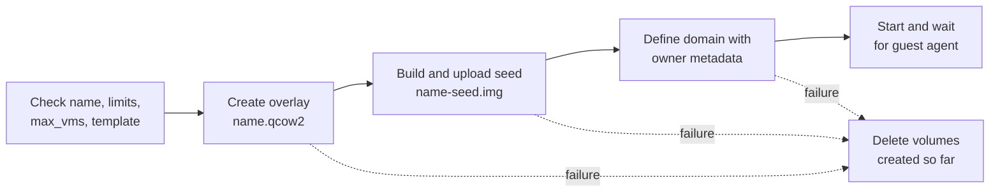

# Disposable VMs from templates: design

Status: proposed, 2026-11-09, awaiting the user's review. Once built, the code wins and this design follows it.
Basis: roadmap outcome 1 in [`fork-roadmap.md`](fork-roadmap.md), shaped by the confirmed draft
[`disposable-vms-draft.md`](disposable-vms-draft.md), with evidence in
[`2026-11-09-cloud-init-overlay-probe.md`](../research/2026-11-09-cloud-init-overlay-probe.md).

## Summary

An agent gets a fresh VM in seconds by asking for one from a template. The operator prepares template volumes and lists
them in the config. The server gives each VM a thin qcow2 overlay on its template and a small NoCloud seed disk that
sets the VM's identity. Three new tools cover it: `list_templates`, `create_vm_from_template` and `reset_vm`. A VM can
have a lifetime, after which the server deletes it. The ISO-based `create_vm` stays as it is.

## Decisions

The user decided that templates are operator-prepared and that VMs live on `qemu:///system`, with the URI kept
configurable. The rest are recommendations:

- **Overlays, not clones.** An overlay costs no copy, and the probe booted one to a responding guest agent in 7.6 s.
- **A FAT seed built in memory with the `fatfs` crate** (0.3.6, MIT). NoCloud reads a `vfat` or `iso9660` filesystem
  labelled `CIDATA` (cloud-init 25.1 docs). An ISO would need `xorriso` on the host. The SMBIOS form needs a
  `seedfrom` URL and discourages its hostname and instance-ID keys. This choice stays provisional until the first
  build slice boots a VM with it; the fallback is an ISO writer in Rust.
- **The seed is a read-only disk, not a CD-ROM,** so the existing `delete_vm`, which deletes every pool volume attached
  as a disk, removes it with the overlay.
- **New tools rather than new `create_vm` parameters,** because the ISO, TPM and firmware parameters do not apply to a
  template.
- **Reset replaces the disks and keeps the domain,** so the VM's name, UUID and MAC address survive.
- **Expiry by a sweep in every server process,** at start and once a minute, plus a `virtmanager-mcp sweep` command for
  an optional systemd timer. No new daemon.
- **User data comes from the operator only.** Agents already have root in the guest through `exec`.

## Behaviour

### Templates

The operator adds one table per template:

```toml
[manage.templates.debian13]
volume = "tpl-debian13.qcow2"                    # in manage.disk_pool
os = "linux"
firmware = "bios"                                # or "uefi"
description = "Debian 13 with qemu-guest-agent"
user_data = "/etc/virtmanager-mcp/debian13.yaml" # optional, must start with #cloud-config
```

A template is usable when its volume exists in `manage.disk_pool`, is qcow2, and is no defined domain's disk. The
server checks this at startup and on every use; a template that fails is hidden from `list_templates`, and creating
from it fails with the reason. `list_templates` also reports how many owned VMs use each template.

The operator must never boot, change or delete a template while VMs use it. A new version gets a new volume name. A
tracked script, `scripts/make-template.sh`, with a short how-to, builds a template: it downloads and verifies an
official cloud image, clones it into the pool, boots it once with a seed that installs the guest agent, runs
`cloud-init clean --logs --machine-id`, powers it off and removes the temporary domain.

### Creating a VM

`create_vm_from_template` takes a name, a template, and optional vCPUs, memory, disk size, network, lifetime in
minutes, `start` (default true) and `wait_for_agent_secs` (default 60). It needs `manage.create` and at least one
template.



- The overlay's capacity is the requested disk size or the template's, never smaller than the template. Cloud-init
  grows the root filesystem on first boot.
- The seed is a 2 MiB FAT image labelled `CIDATA`. Its `meta-data` holds `instance-id: <UUID>-<generation>` and
  `local-hostname: <name>`. Its `user-data` is the template's file, or a bare `#cloud-config`.
- The owner element gains `template`, `generation` and, with a lifetime, `expires` attributes. Only the server writes
  them, at create and reset.
- A new volume name may not match a template volume.
- The result names the VM, its template, its expiry, and whether the guest agent responds.

### Resetting a VM

`reset_vm` returns a VM made from a template to the template's state. It needs `manage.create` and `manage.delete`,
because it destroys the VM's disk state, and it refuses VMs made by `create_vm`. It forces the VM off, deletes its
snapshots' metadata (their data lives in the overlay), replaces the overlay and seed, increments the generation, and
starts the VM again. The expiry does not change. If the template has gone, the reset stops with the old disks deleted,
and only `delete_vm` remains useful.

### Expiry

Each server process sweeps at start and every 60 s: it forces off and deletes every owned VM whose `expires` has
passed. Two processes may sweep the same VM; the one that finds it gone treats that as done. Expiry runs whether or not
`manage.delete` is on, because the lifetime is the operator's policy, but it touches only owned VMs that have
`expires`. Each deletion is logged on stderr.

## Invariants

- No code path attaches, writes, boots or deletes a template volume.
- Every multi-step operation deletes the volumes it created when a later step fails.
- Deleting, resetting or expiring a VM leaves no volume of its old state in the pool.
- Configs without `[manage.templates]` behave as today, and the new tools stay hidden.

## Risks

1. A template changed by hand under its VMs corrupts all of them. The server's checks and the versioned names reduce
   this, but cannot prevent it.
2. cloud-init may reject the `fatfs` image; the first slice tests that before anything builds on it.
3. `max_vms` holds only within one process, so several agent sessions can exceed it, until outcome 6.
4. An expired VM lingers while no server process and no timer runs.

## Open questions

| Question | Kind | Recommendation |
| -- | -- | -- |
| Default and maximum lifetime | User decision | No default; a maximum of 1440 minutes when an agent sets one. |
| Which templates first | User decision | Debian 13 only. |
| Can agents extend a lifetime? | Deferred | Not in this version; revisit if agents lose work to expiry. |
| Does cloud-init accept the `fatfs` seed? | Assumption | The first build slice boots one on the test bed. |

## Checks

- With a Debian 13 template, `create_vm_from_template` reports the guest agent responding within about 10 s.
- After `delete_vm`, `reset_vm` and an expiry, `virsh vol-list` shows no volume of the VM's old state.
- The template volume's checksum is unchanged after a create, a reset and a delete.
- Unit tests cover the config parsing, the seed contents and the expiry selection; failure paths cover a failed
  upload, a failed define, a missing template, a template in use as a disk, and two processes sweeping one VM.
