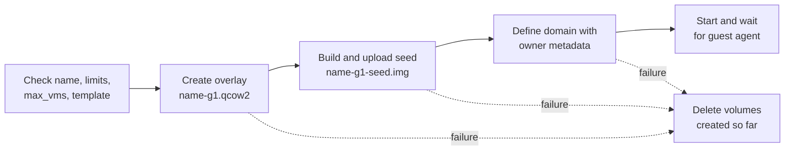

# Disposable VMs from templates: design

Status: accepted, with the recommended lifetime policy and Debian 13 as the first template, and revised for two
plan-critic reviews, which settled the reset, expiry-order and lifetime-cap choices. Once built, the code wins and this
design follows it.
Basis: roadmap outcome 1 in [`fork-roadmap.md`](fork-roadmap.md), shaped by the confirmed draft
[`disposable-vms-draft.md`](disposable-vms-draft.md), with evidence in
[`2026-11-09-cloud-init-overlay-probe.md`](../research/2026-11-09-cloud-init-overlay-probe.md).

## Summary

An agent gets a fresh VM in seconds by asking for one from a template. The operator prepares template volumes and lists
them in the config. The server gives each VM a thin qcow2 overlay on its template and a small NoCloud seed disk that
sets the VM's identity. Three new tools cover it: `list_templates`, `create_vm_from_template` and `reset_vm`. A VM can
have a lifetime, after which the server deletes it. The ISO-based `create_vm` stays as it is.

## Decisions

Two are settled: templates are operator-prepared, and VMs live on `qemu:///system`, with the URI kept configurable.
The rest are recommendations:

- **Overlays, not clones.** An overlay costs no copy, and the probe booted one to a responding guest agent in 7.6 s.
- **A FAT seed built in memory with the `fatfs` crate** (0.3.6, MIT). NoCloud reads a `vfat` or `iso9660` filesystem
  labelled `CIDATA` (cloud-init 25.1 docs). An ISO would need `xorriso` on the host. The SMBIOS form needs a
  `seedfrom` URL and discourages its hostname and instance-ID keys. cloud-init applied such a seed in the first build
  slice ([`2026-11-10-fatfs-seed-boot.md`](../research/2026-11-10-fatfs-seed-boot.md)).
- **The seed is a read-only disk, not a CD-ROM,** so the existing `delete_vm`, which deletes every pool volume attached
  as a disk, removes it with the overlay.
- **New tools rather than new `create_vm` parameters,** because the ISO, TPM and firmware parameters do not apply to a
  template.
- **Reset replaces the disks and keeps the domain,** so the VM's name, UUID and MAC address survive. Volumes carry
  the generation in their names (`<name>-g<N>.qcow2`, `<name>-g<N>-seed.img`), so a reset builds the new disks before
  it removes the old ones.
- **Names of VMs from templates are hostnames:** lowercase letters, digits and hyphens, starting with a letter, not
  ending with a hyphen, at most 63 characters. The name becomes the guest's hostname unchanged. Template names follow
  the same rule.
- **Expiry by a sweep in every server process,** at start and once a minute, plus a `virtmanager-mcp sweep` command for
  an optional systemd timer. No new daemon. `expires` holds UTC epoch seconds, and `manage.max_lifetime_minutes`
  (default 1440) caps what an agent may ask for; a longer lifetime is refused.
- **User data comes from the operator only.** Agents already have root in the guest through `exec`.

## Behaviour

### Templates

The operator adds one table per template:

```toml
[manage.templates.debian13]
volume = "tpl-debian13.qcow2"                    # in manage.disk_pool
os = "linux"
firmware = "bios"                                # or "uefi"
description = "Debian 13 with qemu-guest-agent"
user_data = "/etc/virtmanager-mcp/debian13.yaml" # optional, must start with #cloud-config
```

A template is usable when its volume exists in `manage.disk_pool`, is qcow2, and is no domain's disk, in the stored
or the running configuration, given by path or as a pool volume. Its user data must be readable, start with a
`#cloud-config` line and fit the seed. The server checks this at startup and on every use; a template that fails is
hidden from `list_templates`, and creating from it fails with the reason. Details that would show the agent other VMs'
names or host paths go to the server log only. `list_templates` also reports how many owned VMs use each template.

The operator must never boot, change or delete a template while VMs use it. A new version gets a new volume name. A
tracked script, `scripts/make-template.sh`, with a short how-to, builds a template: it downloads and verifies an
official cloud image, clones it into the pool, boots it once with a seed that installs the guest agent, runs
`cloud-init clean --logs --machine-id`, powers it off and removes the temporary domain. Its check is the Debian 13
template that the first build slice boots.

### Creating a VM

`create_vm_from_template` takes a name, a template, and optional vCPUs, memory, disk size, network, lifetime in
minutes, `start` (default true) and `wait_for_agent_secs` (default 60). vCPUs default to 2 and memory to 1024 MiB,
each capped by its limit. It needs `manage.create` and at least one template.



- The overlay's capacity is the requested disk size or the template's, never smaller than the template. Cloud-init
  grows the root filesystem on first boot.
- The seed is a 2 MiB FAT image labelled `CIDATA`. Its `meta-data` holds `instance-id: <UUID>-<generation>` and
  `local-hostname: <name>`. Its `user-data` is the template's file, or a bare `#cloud-config`.
- The owner element gains `template`, `generation` and, with a lifetime, `expires` attributes. Only the server writes
  them, at create and reset.
- If starting or the agent wait fails after the domain is defined, the VM is kept and the result says so, as
  `start_vm` does today.
- The result names the VM, its template, its expiry, and whether the guest agent responds.

### Resetting a VM

`reset_vm` returns a VM made from a template to the template's state. It needs `manage.create` and `manage.delete`,
because it destroys the VM's disk state, and it refuses VMs made by `create_vm`. In order:

1. Check the template, check that the next generation's volume names are free, and read the old overlay's capacity.
   A VM whose expiry has passed is refused, because a sweep may be deleting it. A failed check stops the reset with
   nothing changed.
2. Force the VM off, discard any saved memory state, and delete its snapshots' metadata. Snapshots are internal, so
   their data lives in the overlay. A failure from here on reports that the VM is off and that its snapshots may be
   gone. The VM's console session is closed.
3. Create the next generation's overlay, with the old capacity, and its seed.
4. Redefine the domain from its own inactive XML, with the new disks and owner attributes. The name, UUID, MAC
   address, vCPUs, memory and network interfaces stay as they are. If this fails, delete the new volumes; the old ones
   are still in place.
5. Delete the old overlay, the old seed, and every other pool disk an agent attached with `attach_disk`, so nothing of
   the old state is left. A volume that cannot be deleted is named in the result, and a disk outside the pool is
   detached and left in place.
6. Start the VM and wait for the agent, as at creation. A UEFI VM starts with its firmware variables reset to the
   template's. The expiry does not change.

### Expiry

The sweep runs when `manage.create` is on, at least one template is configured, and `read_only` is off; the `sweep`
command uses the same config and the same gate. It does not need `manage.delete`, because the lifetime is the
operator's policy, but it touches only owned VMs that have `expires`.

The server starts one sweep thread in `main`, at start and then every 60 s, not one per HTTP session. For each owned VM
whose `expires` has passed, the sweep:

1. Notes the VM's UUID, then looks the domain up again by that UUID and re-reads `expires` just before acting. A VM
   deleted and recreated under the same name in the meantime is therefore left alone.
2. Forces the VM off through its own path, because `delete_vm` refuses running VMs.
3. Deletes its volumes in `manage.disk_pool`, then undefines it and logs the deletion on stderr. Deleting first means
   a crash in between leaves a domain the next sweep finds again. A volume outside the pool is left in place and logged
   by name. A volume whose deletion fails keeps the domain: the expiry counts as failed, so `virtmanager-mcp sweep`
   exits non-zero, and the next sweep retries it.

Two processes may sweep the same VM; the one that finds it gone treats that as done.

## Invariants

- No code path attaches, writes, boots or deletes a template volume.
- Every multi-step operation deletes the volumes it created when a later step fails.
- Deleting, resetting or expiring a VM leaves no volume of its old state in the pool.
- Configs without `[manage.templates]` behave as today, and the new tools stay hidden.
- A reset never leaves the VM without disks: the new disks exist before the old ones are removed.

## Code changes

These follow from the design and the code as it stands:

- `domain_xml` in `src/manage.rs` takes a list of disks, the firmware and the owner attributes instead of one disk and
  an empty CD-ROM. Every disk refers to its volume by file path: a seed given as a pool-volume reference failed to
  open on a later start.
- Volume creation gains a raw volume sized in bytes, for the seed, and a qcow2 volume with a `<backingStore>`, for the
  overlay. The seed upload aborts its libvirt stream on every error path, because `virt`'s `Stream` panics on drop
  when freeing fails.
- Tool gating in `src/server.rs` gains combined conditions: all three tools need a configured template, and `reset_vm`
  needs both `create` and `delete`. The server's instructions text names the new tools.
- The command line gains subcommands: serving stays the default, and `sweep` runs one sweep and exits.

## Risks

1. A template changed by hand under its VMs corrupts all of them. The server's checks and the versioned names reduce
   this, but cannot prevent it.
2. `max_vms` holds only within one process, so several agent sessions can exceed it, until outcome 6.
3. An expired VM lingers while no server process and no timer runs.

## Open questions

| Question | Kind | Recommendation |
| -- | -- | -- |
| Default and maximum lifetime | Decided | No default; a maximum of 1440 minutes when an agent sets one. |
| Which templates first | Decided | Debian 13 only. |
| Can agents extend a lifetime? | Deferred | Not in this version; revisit if agents lose work to expiry. |

## Checks

- The first build slice boots a VM from a `fatfs` seed and the Debian 13 template, and cloud-init applies its
  hostname, before anything else builds on the seed.
- With a Debian 13 template, `create_vm_from_template` reports the guest agent responding within about 10 s; the
  test bed measured 11.9 s from the call, with 2 vCPUs and 1 GiB.
- After `delete_vm`, `reset_vm` and an expiry, `virsh vol-list` shows no volume of the VM's old state, including disks
  added with `attach_disk`.
- The template volume's checksum is unchanged after a create, a reset and a delete.
- Without `[manage.templates]`, the new tools are not advertised; `reset_vm` refuses a VM made by `create_vm`; the
  sweep skips owned VMs without `expires`; a template that fails its checks is hidden; `virtmanager-mcp sweep` deletes
  an expired VM and exits.
- Unit tests cover the config parsing, the hostname rule, the seed contents and the expiry selection. Failure paths
  cover a missing template at create and at reset, and a template in use as a disk. A failed upload, a failed define,
  a start failure after define and two processes sweeping one VM rest on code review: the test bed cannot inject
  those faults, or would need a memory overcommit the host cannot afford.
- A failed volume deletion during expiry keeps the VM: unit tests cover the decision, and the test-bed README lists a
  manual check that needs root. `templates-outside-disk.json` shows reset and expiry leaving a disk outside the pool
  in place, and the reset cases show a refused reset keeping the console open and a reset that goes ahead closing it.
