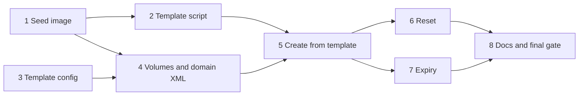

# Disposable VMs from templates: implementation plan

Status: plan for roadmap outcome 1, built from [`disposable-vms-design.md`](disposable-vms-design.md) and revised for
the plan-critic review of 2026-11-09. The design owns behaviour; this plan owns order and checks. Progress goes in
the execution record at the end.

## Overview

The work adds a seed-image builder, a template recipe and template config, then the three tools and expiry. The order
follows risk and dependencies. The `fatfs` seed is the one unproven assumption, so the first unit builds it and boots
a VM with it before anything depends on it. The template script comes next, because every later test-bed check needs
a real template. The config and the libvirt plumbing follow, and the tools build on both.

## Preflight

These apply to every unit, which names only its additions.

- **Rules.** Follow `AGENTS.md`, including its guardrails section: a change to ownership, `is_allowed` or
  `can_manage` needs a test that shows a refusal still happens. Load `rust-style`, `rust-error-handling` and
  `rust-testing` before editing Rust, and `bash-shell` before the template script.
- **Gate.** Every commit passes the build gate in `AGENTS.md`, plus `cargo +1.89 test --locked`, because CI also
  tests on the declared `rust-version`.
- **Test bed.** Run cases as `tests/testbed/README.md` describes. The client has no assertions, so a case passes when
  a reader of its replies sees each expected result; record what was seen in the execution record. Touch only
  `trial-deb13` and VMs and volumes named `t-*` or `tpl-*` in the `agent-vms` pool on `qemu:///system`.
- **Memory.** The host shares its RAM with the user's work and once crashed when memory ran out. Give each test VM at
  most 1 GiB, run at most three throwaway VMs at once, check `free -m` before starting several, and shut a VM down as
  soon as its check is done. No test asks for more memory than the host has free.
- **Template config.** Template cases use `tests/testbed/config-templates.toml`, so the existing cases keep their
  `max_vms = 1` config. It leaves `trial-deb13` out of `allowed_vms`, sets `create`, `delete`, `reconfigure` and
  `snapshots` on, `max_vms = 3`, `max_memory_mib = 1024`, and lists `t-listed` in `allowed_vms`, `power_vms` and
  `manage_vms`. Its templates are `debian13` on `tpl-debian13.qcow2`, `debian13-uefi` on the same volume with
  `firmware = "uefi"`, `scratch` on
  `tpl-scratch.qcow2`, and `missing` on a volume that does not exist.
- **Template safety.** Never delete or rebuild `tpl-debian13.qcow2` during a test. A failure path that needs a
  missing template deletes `tpl-scratch.qcow2`, a `virsh vol-clone` of it.
- **Locking.** Every operation that picks names, counts VMs or replaces disks holds `LOCK` in `src/manage.rs` up to
  the domain's define. Starting a VM and waiting for its agent happen after the lock is released.
- **Review.** After each unit marked "reviewed", dispatch `code-reviewer` on the unit's commits with the test
  evidence; units 4, 6 and 7 use `model: opus`, because they touch ownership metadata, destructive paths or a
  background thread. Fix blocking findings before the next dependent unit starts.
- **Commits.** One logical change per commit, Conventional Commits, explicit pathspecs.

## Units

### 1. Seed image (reviewed)

**Outcome.** A function builds a 2 MiB FAT image labelled `CIDATA` holding `meta-data` and `user-data`, and
cloud-init in Debian 13 applies it. This settles the design's open assumption.

**Changes.** Add `fatfs` 0.3.6. Try default features off with `std` and `alloc`, which keeps its `chrono` and
`bitflags` 1 additions out; take the defaults if that does not build on 1.89. Add a `seed` module in `src/seed.rs`
with a function from instance ID, hostname and user data to the image bytes. It refuses user data that does not fit
the image. Unit tests read the image back with `fatfs` and check the label, both files and their contents. An
`#[ignore]`d test writes an image to the path in `SEED_OUT`, for the boot check; the crate has no library target, so
an example could not reach the module.

**Verification.** `cargo deny check advisories` stays clean with the new crate, and the 1.89 build passes. On the test
bed, upload the plain Debian 13 cloud image as `t-seed-base.qcow2`, create an overlay `t-seed.qcow2` on it, and define
`t-seed` with `virsh`, as in the probe, but with the written seed as a read-only virtio disk. The user data sets the
hostname and installs `qemu-guest-agent`. Expected: `cloud-init status --long` reports `done` with
`DataSourceNoCloud` and no errors, and `hostname` prints `t-seed`. Delete `t-seed` and the three volumes afterwards.

**Recovery.** If cloud-init does not read the image, stop: the design's fallback is an ISO writer, and the switch is
a design change for the user to approve.

### 2. Template script (self-reviewed)

**Outcome.** `scripts/make-template.sh` builds a template volume in a pool, and a short how-to explains it.

**Changes.** The script takes the pool and volume name, and refuses an existing volume, so it never rebuilds a template
in use. It downloads the Debian 13 `genericcloud` image, verifies it against `SHA512SUMS`, uploads it, boots it once
as `t-tpl-build` with 1 vCPU and 1 GiB and a seed that installs the guest agent, runs
`cloud-init clean --logs --machine-id` through the agent, powers off and undefines the domain. It builds that seed
with `xorriso`, as the probe did, because the script runs before the server is configured. It uses one vCPU because
the fresh cloud image reset in a loop on its first boots with two
([`2026-11-10-fatfs-seed-boot.md`](../research/2026-11-10-fatfs-seed-boot.md)). The how-to goes in
`docs/templates.md`, linked from the README.

**Verification.** `shellcheck` and `shfmt` pass through `pre-commit`. Running the script for `tpl-debian13.qcow2`
leaves the volume in the pool, no `t-tpl-build` domain, and no domain using the volume; a second run refuses. Record
the volume's checksum, from `virsh vol-download` piped to `sha256sum`, in the execution record. A self-review is
enough: the script runs only operator-side, and unit 5 boots the result.

### 3. Template config (reviewed with unit 4)

**Outcome.** The config accepts `[manage.templates.<name>]` and `manage.max_lifetime_minutes`, and rejects bad input
at load.

**Changes.** In `src/config.rs`, add a `Template` struct (`volume`, `os`, `firmware`, `description`, `user_data`) and
the two `Manage` fields, with `max_lifetime_minutes` defaulting to 1440. `Config::validate` rejects an unknown firmware
or `os`, a template name that is not a hostname label, and a zero lifetime cap. Unit tests cover each rejection and a
config without templates.

### 4. Volumes and domain XML (reviewed, Opus)

**Outcome.** `src/manage.rs` can create an overlay and a seed volume, upload the seed, and write a domain with several
disks, the chosen firmware, a given UUID and MAC address, and the new owner attributes. `create_vm` behaves as before.

**Changes.** `domain_xml` takes a list of disks, the firmware, the owner attributes and an optional UUID and MAC;
`create_vm` passes its one disk and CD-ROM and no UUID. The server generates a VM's UUID before building its seed,
because the seed's instance ID contains it; add `uuid` 1.x as a direct dependency with its `v4` feature, the version
`Cargo.lock` already holds. Every disk is a `<disk type='file'>` with the volume's path, as `create_vm` writes today,
because a seed given as a pool-volume reference failed to open on a later start. Volume creation gains a qcow2
overlay with `<backingStore>` and a raw volume sized in bytes. The upload uses `Stream::new` and
`StorageVol::upload`, loops on `send` until every byte is sent, then calls `finish`, and calls `abort` on every error
path. Owner attributes (`template`, `generation`, `expires` in UTC epoch seconds) get a parser next to `is_owned`.
Rename `trial-new*` in `tests/testbed/cases/lifecycle-guardrails.json` to `t-new*`, to keep that case inside the
test-bed names.

**Verification.** The existing `domain_xml` tests pass unchanged in meaning; new tests cover a template domain's XML,
the owner attributes round trip, and that a domain without the owner element still counts as not owned.
`lifecycle-guardrails.json` passes, which shows `create_vm` and its refusals unchanged.

### 5. Create from template (reviewed)

**Outcome.** `list_templates` and `create_vm_from_template` work as the design's "Templates" and "Creating a VM"
sections describe, including the lifetime, and an agent gets a responding guest agent in about 10 s.

**Changes.** Template checks run on every use: the volume is present and qcow2, no domain uses it, and the user-data
file still starts with `#cloud-config` and fits the seed. "Uses it" means a direct disk source in a domain's inactive
XML, read with `parse_disks`; a running overlay's nested `<backingStore>` does not count. Add the use count, the
hostname rule for names, and the lifetime parameter, refused above `max_lifetime_minutes`. Creation cleans up the
volumes it made when a step fails, and keeps the VM when start or the agent wait fails after define. In
`src/server.rs`, the two tools appear only with `manage.create` and a configured template, and `manage_instructions`
names them. Add `tests/testbed/config-templates.toml` and the case `templates-create.json`.

**Verification.** Unit tests cover the hostname rule, the lifetime cap and the in-use check on XML with a nested
`<backingStore>`. The case:

- lists the templates, without `missing`, and shows creating from `missing` failing with the reason;
- creates `t-vm1` with 2 vCPUs between two `__time__` marks, expecting a responding agent in about 10 s, then `t-vm2`
  from the same template while `t-vm1` runs;
- creates `t-uefi` from `debian13-uefi` and sees its agent respond;
- refuses an invalid hostname, `max_vms`, memory above `max_memory_mib`, and a lifetime above the cap;
- attaches a disk to `t-vm1`, then deletes every VM it made.

Afterwards `virsh vol-list agent-vms` shows no `t-vm*` or `t-uefi` volume. A run with the default test-bed
config shows the tools are not advertised. The template's checksum matches unit 2's.

### 6. Reset (reviewed, Opus)

**Outcome.** `reset_vm` follows the design's six steps and keeps the name, UUID, MAC address, hardware and expiry.

**Changes.** The reset in `src/manage.rs` takes `LOCK` for steps 1 to 5. It checks for itself that the VM is owned and
has a `template` attribute, because `can_manage` also passes VMs listed in `manage_vms`. It edits the domain's
inactive XML, replacing the disks and owner attributes, so vCPU, memory and NIC changes survive; a UEFI VM starts with
`VIR_DOMAIN_START_RESET_NVRAM`, so its firmware variables return to the template's. The tool in `src/server.rs` needs
`create`, `delete` and a template. Unit tests cover the generation naming and the XML edit.

**Verification.** The case `templates-reset.json` creates `t-r` with a lifetime, writes a marker file, takes a
snapshot, attaches a disk, and resets. Expected: the marker is gone, `snapshot_list` is empty, UUID, MAC and `expires`
are unchanged, the generation is 2, and no generation-1 or attached volume is left. Refusals:

- `t-listed`, defined with `virsh` and no owner element, is refused, and its disk is untouched;
- `t-plain`, made by `create_vm`, is refused;
- `trial-deb13` is refused at lookup, because this config does not allow it.

A failure path creates `t-s` from `scratch`, deletes `tpl-scratch.qcow2`, and expects the reset to stop with the old
disks in place. A run with `delete = false` does not advertise `reset_vm`.

### 7. Expiry (reviewed, Opus)

**Outcome.** Expired owned VMs are deleted by one sweep thread per server process and by `virtmanager-mcp sweep`, as
the design's "Expiry" section describes.

**Changes.** A `sweep` module with the selection, pure and unit-tested on owner attributes and the clock, and the
destroy path: UUID lookup, `expires` re-read, force off, deletion of pool volumes, then undefine, with logging. It
deletes volumes before undefining, so a crash between them leaves a domain the next sweep finds again. The destroy
path takes `LOCK`. In `src/main.rs`, the CLI gains an optional subcommand, `sweep`, and serving starts the sweep thread
once before the transport starts.

**Verification.** Unit tests: selection skips VMs without `expires` and VMs not yet expired; the gate refuses with
`read_only` or no templates; a VM whose `expires` changed after selection is left alone. The case
`templates-expiry.json` creates `t-exp` with a 1-minute lifetime and an attached disk and `t-keep` without a lifetime,
waits 130 s, which covers one 60 s sweep after expiry, and lists VMs: `t-exp` is gone with its volumes, and `t-keep`
and `t-listed` remain. For the command, a short case creates `t-exp2` with a 1-minute lifetime and exits; after 70 s
with no server running, `virtmanager-mcp --config ... sweep` exits 0, and `t-exp2` and its volumes are gone.

Two processes sweeping one VM, a failed upload, a failed define and a start failure after define have no test-bed
case, because they need fault injection in libvirt or a memory overcommit the host cannot afford. Their handling is
reviewed in code, and the unit tests cover the logic that does not need libvirt.

### 8. Docs and final gate

**Outcome.** The README documents the three tools and the template config, the design matches the code, and the
roadmap marks outcome 1 done.

**Verification.** The full build gate and `cargo +1.89 test --locked` pass at the final commit. Every test-bed case,
old and new, passes on a fresh build. After the cases, `virsh list --all` shows no `t-*` VM other than `t-listed`,
which the run then removes, and `virsh vol-list agent-vms` shows no `t-*` volume. The template checksum matches unit
2's. Then two separate reviews: `code-reviewer` (Opus) over the whole outcome, and a fresh `conformance-review`
against the design and this plan. Both close before the outcome counts as done.

## Execution record

| Unit | Commits | Evidence | Review |
| -- | -- | -- | -- |
| 1 Seed image | `aacafce`, `6a92967`, `bae9a5a` | `fatfs` seed applied: [`2026-11-10-fatfs-seed-boot.md`](../research/2026-11-10-fatfs-seed-boot.md) | `code-reviewer`: approved; its three optional findings applied (flush errors, plain meta-data tokens, exact header line) |
| 2 Template script | `0a9f510` | built `tpl-debian13.qcow2` (3 GiB) in 57 s; no `t-tpl-build` domain or seed left; a second run refused; bad names and missing pools refused; SHA-256 `c280796e3989db6bb1331cd76344730afd889fd6302a750e424449ce08d101c9`. The README link to `docs/templates.md` lands with unit 8's README section, because the tools it describes do not exist before then | self-review |
| 3 Template config | `65d83ed` | unit tests: defaults, parsing, refusals (firmware, os, unknown key, template names, volume paths, zero lifetime), hostname rule; the example config parses | `code-reviewer` (Opus, with unit 4): approved, no findings |
| 4 Volumes and domain XML | `25e43c0` | unit tests: create_vm XML (targets, boot order, firmware, no UUID), template XML (seed read-only raw vdb, UUID, MAC, owner attributes), owner round trip, foreign and renamed owner elements not owned, overlay XML; `lifecycle-guardrails.json` (VMs renamed `t-new*`) shows create_vm and its refusals unchanged and leaves no volume | `code-reviewer` (Opus, with unit 3): approved, no findings; its note on the `AGENTS.md` ownership text is fixed in `14a3d5e` |
| 5 Create from template | `51c032e`, review fixes `ed2b7e5` | `templates-create.json`: `missing` hidden and refused with its reason; `t-vm1` (2 vCPUs) created, started and agent responding in 11.9 s, hostname `t-vm1`, cloud-init `done`, root grown to 2.8 G; `t-vm2` from the same template while `t-vm1` ran; `t-uefi` booted under UEFI; refusals for `Bad_Name`, 2048 MiB, a 61-minute lifetime and `max_vms`; use counts 2 and 1; `delete_vm` removed overlays, seeds and the attached `vdc`. Default config advertises no template tool. Template SHA-256 unchanged. Unit tests: in-use check ignores nested `backingStore`, lifetime cap, volume names and format, example config parses | `code-reviewer`: changes requested. Fixed: a template attached as a pool-volume disk now counts as in use (unit test, and live: attached to `t-listed`'s stored config it hid both templates and refused creation); volumes are deleted when getting their paths fails after creation; errors no longer show the agent other VMs' names or the user-data path, which go to the log. Its note that the descriptions promise expiry before the sweep exists is met by unit 7 landing before any push. Its unverified note, a domain deleted between listing and reading its XML, is left as is |
| 6 Reset | `24ebb6f`, review fixes `a94120a` | `templates-reset.json`: reset in 7.9 s to a responding agent; marker file gone, `snapshot_list` empty, UUID `6dfefe1b-…`, MAC `52:54:00:86:2b:9a` and hostname unchanged, owner `generation="2"` with the same `expires`, disks `t-r-g2*` only and no `t-r-g1*` or `t-r-vdc` volume left; refusals for `t-listed` (its disk untouched), `t-plain` and `trial-deb13`. `templates-reset-missing.json`: with `tpl-scratch.qcow2` deleted, the reset of `t-s` failed and its `g1` disks stayed. With `delete = false`, `reset_vm` is not advertised. Template SHA-256 unchanged. Unit tests: disk replacement keeps CD-ROM, MAC, UUID and memory; owner rewrite refused where no owner element exists. Committed before the unit-5 review fixes, which touch the same files. After the review: `templates-reset-uefi.json` reset a UEFI VM, which booted under UEFI with the marker gone; `templates-reset-saved.json` reset a VM after `virsh managedsave` and it booted fresh; a `create_vm` VM named `t-u-g4` made the next reset refuse with the VM still running on its `g3` disks | `code-reviewer` (Opus): changes requested. Fixed: the error after a failure past the power-off now says the VM is off and its snapshots are gone; the UEFI start was exercised live; next-generation volume names are checked before anything changes; a managed save is discarded; the start-failure hint points to `reset_vm` for fresh firmware variables; the in-use check also reads running VMs' live XML and skips, with a log line, a VM that disappeared. The design's reset steps 1 and 2 now name the volume-name check, the discarded saved state and the error text |
| 7 Expiry | `e27084c`, review fixes `d7acd42` | `templates-expiry.json`: the server's sweep deleted `t-exp` (1-minute lifetime) with `t-exp-g1.qcow2`, its seed and the attached `t-exp-vdc.qcow2` one minute after creation; `t-keep` (no lifetime) and the unowned `t-listed` remained. `templates-expiry-command.json` then `virtmanager-mcp sweep` with no server running: deleted `t-exp2` and its three volumes, exit 0. With the default test-bed config the command refuses ("no template is configured") and exits 1. Unit tests: selection, recheck of a changed expiry, the gate. After the review: with an expired `t-exp2` and a scratch config naming a missing pool, `sweep` logged the failure and exited 1; the real config then deleted it and exited 0 | `code-reviewer` (Opus): changes requested. Fixed: the `sweep` command exits non-zero when any deletion fails; a VM found gone at any step counts as done, and other lookup errors are reported; a disk that is no pool volume is logged as "already deleted, or outside it"; a poisoned lock or a panic no longer ends the sweep thread; the act-or-skip decision is a tested function covering unowned, unexpiring and recreated VMs |
| 8 Docs and final gate | `bd468c3` (README, roadmap), `077da84` and `ec0a3a4` (final-review fixes), and the closing `docs(plans)` commit (design synced to the code) | Every test-bed case, old and new, ran on `bd468c3`: each `[isError]` result was an intended refusal, no `t-*` VM or volume was left, and `virtmanager-mcp sweep` exited 0. On the final build, `templates-create.json` (agent responding 10.6 s after the call) and `templates-reset-uefi.json` passed again; `make-template.sh` replaced a partial cached image and built a template, which was then deleted. The fixture `t-listed` was removed afterwards. Template SHA-256 unchanged. At `ec0a3a4`: `cargo fmt --check`, `cargo build --locked`, `cargo test --locked` and `cargo +1.89 test --locked` (50 passed), `cargo clippy --locked --all-targets -- -D warnings`, `cargo deny check advisories` and `pre-commit run --all-files` passed, and the `agents-context-docs` checker reported 0 findings | `code-reviewer` (Opus) over `c4af2de..bd468c3`: approved; its two optional findings fixed in `077da84` and `ec0a3a4`, and its unverified reset-versus-sweep race closed by refusing to reset an expired VM. `conformance-review` (Opus): no material mismatch in the code; its ledger finding is met by this row, and its design findings (`fatfs` confirmed, failure paths resting on code review, the measured 11.9 s, missing details) are applied in the closing commit |
