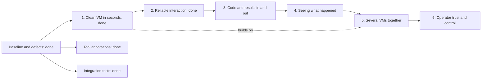

# Fork roadmap

This fork, `jonatsu/virt-manager-mcp`, adapts
[`KubeRl/MCP-Server-For-VirtManager-AI`](https://github.com/KubeRl/MCP-Server-For-VirtManager-AI) so that coding
agents can create, snapshot and destroy throwaway test VMs on a libvirt host. It branched from upstream commit
`f47d3c3`, does not merge upstream regularly, and takes upstream changes case by case. The evidence behind the plan is
in [`2026-11-09-vm-management-mcp-evaluation.md`](../research/2026-11-09-vm-management-mcp-evaluation.md), and the
test bed is in [`tests/testbed/`](../../tests/testbed/README.md).

Work lands in this order: the baseline, because every later change needs a gate it can trust, then the defects, then
the outcomes. Each item is done when its evidence holds.

## Baseline

None of these items changes the server's behaviour.

1. **Done: a build and test gate.** `CLAUDE.md` lists the gate, and every commit passes it.
2. **Done: default rustfmt.** Upstream did not use default settings. The fork reformatted once, in a commit of its
   own, and `cargo fmt --check` passes.
3. **Done: a project `AGENTS.md`, with `CLAUDE.md` as a symlink to it.** It states the build gate, the guardrails a
   change must not weaken, and the rule that tests touch only test-bed VMs. It marks the two `example-global-*.md`
   files as templates for the server's users.
4. **Done: the README matches the code.** It names the real template files and builds with `--locked`. A paragraph
   under the title names the fork, its upstream and this roadmap, in place of upstream's joke first line. To undo
   that, restore the first line from commit `f47d3c3`.
5. **Done: hygiene files.** `.editorconfig`, `.gitattributes`, `.pre-commit-config.yaml` and the hook configs come
   from the `repo-management` baseline, adapted to Rust. Node hooks use the host's Node.js, because nodeenv in
   pre-commit 4.7.0 crashed while choosing a download. Betterleaks stays on its stable `v1.10.0` rather than a
   release candidate. The Markdown formatters skip `docs/research/` and the `example-global-*.md` templates.
6. **Done: GitHub settings and CI.** Issues are the inbox for outside reports, and accepted work moves into this
   roadmap. CI runs the build gate on stable, the tests on the minimum supported Rust version (1.94, which the OCR
   engine needs), the pre-commit hooks, and `cargo deny check advisories`.

## Defects

1. **Done: serial console reads appeared to stall.** The stream never stalled: `console_read` ignored `wait_ms` when
   bytes existed after `since`, so the trial's reads returned before the guest answered. A waiting read now waits for
   output no earlier read returned, then until the output pauses for 500 ms. `console-stall.json` shows a full login.
   Evidence: [`2026-11-09-console-read-wait.md`](../research/2026-11-09-console-read-wait.md).
2. **Done: `console_read` reports a console closed by a power-off.** A forced `stop_vm` deleted the session, so the
   next read said "no console open". `stop_vm` now keeps the session, and its reader records the stream's end. In
   `console-closed-on-power-off.json`, a guest power-off and a forced `stop_vm` both read as closed.
3. **Done: `write_file` no longer creates world-writable files.** The guest agent creates files with mode 666. On
   Linux guests, a new file now gets mode 644, or the optional octal `mode`, before any data is written. An existing
   file keeps its mode unless `mode` is given. New files from `copy_to_vm` get 644 too. `write-file-mode.json` shows
   it.
4. **Dropped: `start_vm` on a running VM does wait for the guest agent.** The trial's guest had no agent.
   `start-vm-waits-for-agent.json` restarts the agent after 20 s, and `start_vm` waits for it.

## Follow-ups

Reviews of earlier work found these. None blocks the server's use.

01. **Done: a stale console session can be replaced.** `force: true` replaces this server's own session too, and a
    session whose reader has stopped counts as closed. `console-reopen.json` shows it.
02. **Done: the README says file writes need `guest-exec`.** On Linux guests, `write_file` and `copy_to_vm` run
    `test`, `chmod` and `rm` through it.
03. **Done: an overwrite with `mode` no longer truncates first.** An existing file gets its mode before it is opened,
    so a failed `chmod` leaves it intact.
04. **Done: unit tests cover `write_from`'s ordering.** A scripted guest behind the `Channel` trait shows that a failed
    `chmod` never opens an existing file, and that a new file gets its mode before any data or is removed unwritten.
05. **Done: `console_read` with `wait_ms: 0` right after `stop_vm` reports the console closed.** `stop_vm` waits up to
    2 s for the reader to record the stream's end, and records it itself otherwise.
    `console-closed-on-power-off.json` reads with `wait_ms: 0`.
06. **Done: the documents use the short, plain style.** This roadmap, the test-bed README and the research notes' own
    prose follow it, and the research notes keep their copied text. The disposable-VMs brainstorm draft was removed,
    because the design and the plan carry its decisions and this roadmap its parked ideas.
07. **Done: an expiry no longer hides a failed volume deletion.** The domain stays, the sweep exits non-zero, and the
    next sweep retries. Producing the failure needs root, so it is a manual check in the test-bed README.
08. **Done: a refused `reset_vm` keeps the console open.** `reset_vm` closes the console only after every check has
    passed. `templates-reset-saved.json` and `templates-reset-uefi.json` show both sides.
09. **Done: reset and expiry leave a disk outside `disk_pool` alone.** `templates-outside-disk.json` attaches a
    user-owned file, and its owner and checksum survive both. A reset reports such a disk as no pool volume.
10. **Done: a slow `console_open` no longer stalls every wait.** Opening and closing hold the sessions lock only to
    check and swap entries. A separate lock, which waits never take, runs opens one at a time.
11. **Done: an unterminated OSC sequence no longer hides the output after it.** CAN or SUB aborts an OSC sequence,
    and a newline, another escape sequence or 4 KiB of body ends it.
12. **Done: console conditions share one stripped scan.** A poll strips its scan once, and each condition matches from
    its own start. A unit test checks that, from every start at a sequence boundary, this matches stripping the span
    alone. From a start inside a sequence, the sequence's tail no longer counts as text.
13. **Done: an expiry kept after a failed deletion keeps the boot disk.** The sweep deletes disks boot disk last and
    stops at the first failure. A disk attached after the failed one may already be gone.
14. **Done: the apparent console stall was a race in `owrt-pacing.json`.** The case wrote before the guest's shell
    left raw, no-echo mode, and the server delivered every byte. The case now waits, and `console_write`'s
    description and the README tell agents to wait for the prompt. Evidence:
    [`2026-11-10-owrt-pacing-stall.md`](../research/2026-11-10-owrt-pacing-stall.md).
15. **`exec` returns PowerShell errors on Windows as CLIXML.** An error reaches `exec`'s stderr as a `#< CLIXML`
    block, which an agent has to decode. Probe whether `-OutputFormat Text`, or redirecting the error stream in the
    script, gives plain text, then fix it with a test.
16. **A restart of `QEMU-GA` can leave a Windows guest's agent unreachable.** With `virtio-win` 0.1.302, 4 of about 22
    restarts left libvirt reporting the channel disconnected until a power cycle
    ([probe note](../research/2026-11-11-windows-jobs-probe.md)). Retry with a newer `virtio-win`, and report it
    upstream if it persists. `win-jobs-restart.json` reproduces it.
17. **`exec` ignores `args` given with `command`.** It runs the command line without the arguments and reports no
    error, so `sha256sum` with `args` hashed empty input
    ([probe note](../research/2026-11-11-transfer-probe.md)). Refuse the combination, with a test.
18. **Change how the OCR models are obtained.** Today the operator runs `scripts/fetch-ocr-models.sh` by hand and sets
    `display.ocr_models` ([how-to](../how-to/ocr-models.md)). The logic changes slightly; the details are still to
    come, so settle them before this is planned. Handle it soon, ahead of the remaining outcomes.

## Outcomes

Planned features are grouped by what they let an agent do, in this order. Each outcome needs an approved design before
it is built.

1. **Done: a clean VM in seconds, not minutes.** `create_vm_from_template` gives an agent a disposable VM from an
   operator-prepared template: a qcow2 overlay with a NoCloud seed. Its guest agent answered 11.9 s after the call on
   the test bed. `reset_vm` returns a VM to its template's state, and VMs with a lifetime expire through a sweep.
   `scripts/make-template.sh` builds a Debian 13 template. Design:
   [`disposable-vms-design.md`](disposable-vms-design.md). Evidence:
   [`disposable-vms-implementation-plan.md`](disposable-vms-implementation-plan.md), whose execution record holds each
   unit's commits, test-bed results and reviews, and
   [`2026-11-10-fatfs-seed-boot.md`](../research/2026-11-10-fatfs-seed-boot.md).
2. **Done: reliable interaction with a live guest.** An agent knows when a guest is ready and does not lose input, with
   or without a guest agent: installers, bootloaders, kernels, Windows and appliances. `wait_for` waits on console
   text, screen text, a settled screen, the guest agent, a command or a job. The server also has the mouse, region
   screenshots, paced console input, and background jobs on Linux and Windows. Design:
   [`live-interaction-design.md`](live-interaction-design.md). It was built in three runs, and each plan's execution
   record holds the commits, test-bed results and reviews:
   - [run 1](live-interaction-run-1-implementation-plan.md): console, guest-agent, command and job waits, paced
     `console_write`, and Linux jobs, with the OpenWrt guest `t-owrt`;
   - [run 2](live-interaction-run-2-implementation-plan.md): screen waits through `ocrs` 0.14, region screenshots and
     the `mouse` tool, with the guests `t-inst` and `t-win`;
   - [run 3](live-interaction-run-3-implementation-plan.md): Windows jobs, started through WMI and run as `SYSTEM`,
     and the command and job conditions on Windows, with the Windows 11 guest `t-win11`
     ([probe note](../research/2026-11-11-windows-jobs-probe.md)).
3. **Moving code and results in and out.** An agent pushes a checkout in and pulls artifacts or logs back without
   passing them through its context, and reaches services in the guest at its address. Design:
   [`guest-transfer-design.md`](guest-transfer-design.md), accepted. It covers pulling files and directories into
   operator-set pull directories, pushing directories, background copies, and `vm_addresses`, in two runs. Port
   forwarding is left to outcomes 5 and 6, where the host cannot route to a guest.
   - Done: [run 1](guest-transfer-run-1-implementation-plan.md) built `copy_from_vm`, `copy_dir_to_vm`,
     `copy_dir_from_vm`, background copies with `transfer_done`, and `vm_addresses`, for Linux guests. On `t-win11`
     the file tools work, and `vm_addresses` returns an empty list because that guest has no network interface. Its
     execution record holds the commits, test-bed results and reviews.
   - Next: run 2, directory transfers on Windows through the guest's `tar.exe`.
4. **Seeing what happened.** When something fails in the guest, an agent can find out why. This covers console output
   buffered from VM start, guest resource usage, and events such as a crash or reboot.
5. **Several VMs together.** An agent can test small networks, such as a client and a server. It builds on outcome 1,
   and it needs a network policy for each VM, which outcome 6 would otherwise bring.
6. **Operator trust and control.** An operator can let agents run with less supervision. This covers an audit log of
   mutating calls (following `akarasulu/nested-mcp-server`), network policies for each VM, scoping per session, and
   tested `qemu:///session` support. The survey rates session scope as the strongest guardrail, because VMs there
   cannot reach the system VMs at all. `uri` is already a config key, but untested. Done ahead of the rest: `max_vms`
   holds across every server process of one account through a lock file, and `manage-lock.json` shows a create
   waiting on another process.

Two items stand outside the outcomes:

- **Done: MCP tool annotations.** Every tool sets `readOnlyHint`, `destructiveHint` and `idempotentHint`, so clients
  can gate destructive tools apart from reads. Tools that send input to the guest count as destructive, and so does
  `wait_for`, whose command condition runs a shell command. Tools that replace state, such as `set_cdrom`, count as
  destructive too. A unit test checks every tool's hints and the tools that read-only mode hides.
- **Done: integration tests against real libvirt.** Every test-bed case carries expectations that
  `mcp_call.py --check` enforces. `tests/testbed/run-all.sh` runs every case, and skips cleanly without the test bed.
  Only the root-only expiry check stays manual.

Open question for the designs: should outcome 5 bring its own network policy, or wait for outcome 6?

Parked ideas, which no outcome includes yet:

- **Agents promote a configured VM to a template.** It builds on outcome 1, but adds a trust boundary, because a bad
  template spreads to every VM built on it.
- **The server builds templates from a cloud image URL and checksum.** It means trusting outside images, and the first
  boot needs network access.

## Next

Run 2 of outcome 3, directory transfers on Windows, needs its plan. Follow-up 18
comes soon, once its details are settled. Follow-ups 15 to 17 can land at any time.
