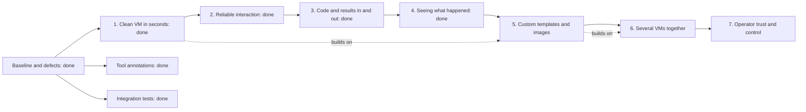

# Fork roadmap

This fork, `jonatsu/virt-manager-mcp`, adapts
[`KubeRl/MCP-Server-For-VirtManager-AI`](https://github.com/KubeRl/MCP-Server-For-VirtManager-AI) so that coding
agents can create, snapshot and destroy throwaway test VMs on a libvirt host. It branched from upstream commit
`f47d3c3`, does not merge upstream regularly, and takes upstream changes case by case. The project's purpose, success
signals and scope are in the [README's goals](../../README.md#goals). The evidence behind the plan is
in [`2026-11-09-vm-management-mcp-evaluation.md`](../research/2026-11-09-vm-management-mcp-evaluation.md), and the
test bed is in [`tests/testbed/`](../../tests/testbed/README.md).

Work lands in this order: the baseline, because every later change needs a gate it can trust, then the defects, then
the outcomes. Each item is done when its evidence holds.

## Baseline

None of these items changes the server's behaviour.

1. **Done: a build and test gate.** `CLAUDE.md` lists the gate, and every commit passes it.
2. **Done: default rustfmt.** Upstream did not use default settings. The fork reformatted once, in a commit of its
   own, and `cargo fmt --check` passes.
3. **Done: a project `AGENTS.md`, with `CLAUDE.md` as a symlink to it.** It states the build gate, the guardrails a
   change must not weaken, and the rule that tests touch only test-bed VMs. It marks the two `example-global-*.md`
   files as templates for the server's users.
4. **Done: the README matches the code.** It names the real template files and builds with `--locked`. A paragraph
   under the title names the fork, its upstream and this roadmap, in place of upstream's joke first line. To undo
   that, restore the first line from commit `f47d3c3`.
5. **Done: hygiene files.** `.editorconfig`, `.gitattributes`, `.pre-commit-config.yaml` and the hook configs come
   from the `repo-management` baseline, adapted to Rust. Node hooks use the host's Node.js, because nodeenv in
   pre-commit 4.7.0 crashed while choosing a download. Betterleaks stays on its stable `v1.10.0` rather than a
   release candidate. The Markdown formatters skip `docs/research/` and the `example-global-*.md` templates.
6. **Done: GitHub settings and CI.** Issues are the inbox for outside reports, and accepted work moves into this
   roadmap. CI runs the build gate on stable, the tests on the minimum supported Rust version (1.94, which the OCR
   engine needs), the pre-commit hooks, and `cargo deny check advisories`.

## Defects

1. **Done: serial console reads appeared to stall.** The stream never stalled: `console_read` ignored `wait_ms` when
   bytes existed after `since`, so the trial's reads returned before the guest answered. A waiting read now waits for
   output no earlier read returned, then until the output pauses for 500 ms. `console-stall.json` shows a full login.
   Evidence: [`2026-11-09-console-read-wait.md`](../research/2026-11-09-console-read-wait.md).
2. **Done: `console_read` reports a console closed by a power-off.** A forced `stop_vm` deleted the session, so the
   next read said "no console open". `stop_vm` now keeps the session, and its reader records the stream's end. In
   `console-closed-on-power-off.json`, a guest power-off and a forced `stop_vm` both read as closed.
3. **Done: `write_file` no longer creates world-writable files.** The guest agent creates files with mode 666. On
   Linux guests, a new file now gets mode 644, or the optional octal `mode`, before any data is written. An existing
   file keeps its mode unless `mode` is given. New files from `copy_to_vm` get 644 too. `write-file-mode.json` shows
   it.
4. **Dropped: `start_vm` on a running VM does wait for the guest agent.** The trial's guest had no agent.
   `start-vm-waits-for-agent.json` restarts the agent after 20 s, and `start_vm` waits for it.

## Follow-ups

Reviews of earlier work found these. None blocks the server's use.

01. **Done: a stale console session can be replaced.** `force: true` replaces this server's own session too, and a
    session whose reader has stopped counts as closed. `console-reopen.json` shows it.
02. **Done: the README says file writes need `guest-exec`.** On Linux guests, `write_file` and `copy_to_vm` run
    `test`, `chmod` and `rm` through it.
03. **Done: an overwrite with `mode` no longer truncates first.** An existing file gets its mode before it is opened,
    so a failed `chmod` leaves it intact.
04. **Done: unit tests cover `write_from`'s ordering.** A scripted guest behind the `Channel` trait shows that a failed
    `chmod` never opens an existing file, and that a new file gets its mode before any data or is removed unwritten.
05. **Done: `console_read` with `wait_ms: 0` right after `stop_vm` reports the console closed.** `stop_vm` waits up to
    2 s for the reader to record the stream's end, and records it itself otherwise.
    `console-closed-on-power-off.json` reads with `wait_ms: 0`.
06. **Done: the documents use the short, plain style.** This roadmap, the test-bed README and the research notes' own
    prose follow it, and the research notes keep their copied text. The disposable-VMs brainstorm draft was removed,
    because the design and the plan carry its decisions and this roadmap its parked ideas.
07. **Done: an expiry no longer hides a failed volume deletion.** The domain stays, the sweep exits non-zero, and the
    next sweep retries. Producing the failure needs root, so it is a manual check in the test-bed README.
08. **Done: a refused `reset_vm` keeps the console open.** `reset_vm` closes the console only after every check has
    passed. `templates-reset-saved.json` and `templates-reset-uefi.json` show both sides.
09. **Done: reset and expiry leave a disk outside `disk_pool` alone.** `templates-outside-disk.json` attaches a
    user-owned file, and its owner and checksum survive both. A reset reports such a disk as no pool volume.
10. **Done: a slow `console_open` no longer stalls every wait.** Opening and closing hold the sessions lock only to
    check and swap entries. A separate lock, which waits never take, runs opens one at a time.
11. **Done: an unterminated OSC sequence no longer hides the output after it.** CAN or SUB aborts an OSC sequence,
    and a newline, another escape sequence or 4 KiB of body ends it.
12. **Done: console conditions share one stripped scan.** A poll strips its scan once, and each condition matches from
    its own start. A unit test checks that, from every start at a sequence boundary, this matches stripping the span
    alone. From a start inside a sequence, the sequence's tail no longer counts as text.
13. **Done: an expiry kept after a failed deletion keeps the boot disk.** The sweep deletes disks boot disk last and
    stops at the first failure. A disk attached after the failed one may already be gone.
14. **Done: the apparent console stall was a race in `owrt-pacing.json`.** The case wrote before the guest's shell
    left raw, no-echo mode, and the server delivered every byte. The case now waits, and `console_write`'s
    description and the README tell agents to wait for the prompt. Evidence:
    [`2026-11-10-owrt-pacing-stall.md`](../research/2026-11-10-owrt-pacing-stall.md).
15. **Done: `exec` returns PowerShell errors on Windows as plain text.** `powershell.exe` 5.1 writes error records
    as CLIXML whenever it runs `-EncodedCommand`, whatever `-OutputFormat` says. An agent's command now runs through
    `-Command -OutputFormat Text` as a script block decoded from base64, which keeps the command line ASCII, and a
    last line keeps the exit status `-Command` gives. On `t-win11`, ten probe commands kept their exit codes, and
    `win-exec.json` checks a failing command's text ([run record](followups-run-2-implementation-plan.md)).
16. **A restart of `QEMU-GA` can leave a Windows guest's agent unreachable.** With `virtio-win` 0.1.302, 4 of about 22
    restarts left libvirt reporting the channel disconnected until a power cycle
    ([probe note](../research/2026-11-11-windows-jobs-probe.md)). Retry with a newer `virtio-win`, and report it
    upstream if it persists. `win-jobs-restart.json` reproduces it.
17. **Done: `exec` refuses `args` given with `command`.** It ran the command line without the arguments and reported
    no error, so `sha256sum` with `args` hashed empty input
    ([probe note](../research/2026-11-11-transfer-probe.md)). It now refuses the combination before any guest call
    ([plan](transfer-followups-implementation-plan.md)).
18. **Done: `VIRTMANAGER_OCR_DOWNLOAD=1` downloads the OCR models.** While `display.ocr_models` is unset, the server
    downloads the models after startup, with `curl`, into `$XDG_DATA_HOME/virtmanager-mcp/ocr-models`. It runs in
    the background so that the client's handshake never waits for it, and a failure never stops the server.
    `screen_text` replies that the models are still downloading, or names the failure. The pinned sums are those of
    `scripts/fetch-ocr-models.sh`, which stays for offline hosts and a directory of the operator's choice, and a test
    keeps the two equal. `curl` avoids a TLS library in the dependency tree
    ([how-to](../how-to/ocr-models.md)).
19. **Done: a Windows push unpacks into a staging directory that only `SYSTEM` and `Administrators` can write.**
    `tar.exe` unpacks through a junction, so a guest user who could add entries to `.vmm-<id>.d` could have made the
    push write anywhere. The push creates the directory with a protected access list, checks it, and gives the tree
    its inherited list back after the unpack
    ([probe note](../research/2026-11-13-windows-followups-probe.md),
    [plan](transfer-followups-implementation-plan.md)). Follow-up 23 holds what stays open.
20. **Done: Windows directory transfers work with paths that are not ASCII.** Pushes to `C:\Windows\Temp\vmm-日本`
    and `vmm-été` already worked. Pulls from them failed, because the guest agent fails a `guest-exec` whose arguments
    are not ASCII, so such a pull now runs `tar.exe` from PowerShell. A pull of a tree holding a name outside the
    guest's ANSI code page fails with a message naming that cause
    ([probe note](../research/2026-11-13-windows-followups-probe.md),
    [plan](transfer-followups-implementation-plan.md)).
21. **Done: a Windows push retries its cleanup after a timed-out unpack.** A timeout is now an error type of its own,
    and after a timed-out unpack or inherit step the cleanup tries again every second for up to 10 s, as the pull
    retries removing its archive ([plan](transfer-followups-implementation-plan.md)).
22. **Done: `exec` refuses text the Windows guest agent cannot pass.** The guest agent fails a `guest-exec` whose
    program path or arguments are not ASCII, and libvirt reports only `failed to parse JSON: invalid utf-8 string`
    ([probe note](../research/2026-11-13-windows-followups-probe.md)). On `t-win11`, a non-ASCII `env` entry fails
    the same way, with `program` and with `command` alike. `exec` now refuses all three on Windows, before any
    `guest-exec`, and suggests `command`, which passes any text. `win-exec.json` checks both refusals and an `echo été`
    through `command`.
23. **Done: a guest user who may delete or rename entries in a Windows push's parent can no longer redirect it.**
    Such a user, the owner of `C:\Users\alice` for example, could replace the staging directory or the archive
    directory with a junction between two guest calls, and so make the push write elsewhere as `SYSTEM`. A push now
    writes its archive and unpacks it in `%SystemRoot%\Temp`, where no other user may delete or rename its entries.
    One `Place` step then runs a C# helper that PowerShell compiles with `Add-Type`: it opens each directory of the
    target's path without following reparse points, moves the tree into place, or copies it when the target is on
    another drive, gives it the parent's access list, and deletes a replaced tree, all on open handles
    ([design](windows-push-staging-design.md), [plan and run record](windows-push-staging-implementation-plan.md)).
    Refusing such parents would have blocked pushes into a user's own folders. `win-push-place.json` and
    `win-push-volume.json` cover user-owned parents, junctions and a second volume.
24. **Done: the Windows transfer scripts write their error text as UTF-8.** Every script in `src/winsteps/` that
    writes to stderr does so through a UTF-8 writer with `AutoFlush`, as `pull-pack.ps1` did, so a non-ASCII path in
    a message arrives intact. `pull-prepare.ps1` writes no error text. `win-transfer.json` checks one such message
    under code page 437 ([run record](followups-run-2-implementation-plan.md)).
25. **Done: a Windows push's archive no longer inherits its parent's access list.** The guest agent wrote
    `.vmm-<id>.tar` beside the target before the staging directory existed. Under `C:\Users\Public`, files that
    `SYSTEM` creates inherit `INTERACTIVE:(M,DC)`, so an interactive user could rewrite the archive before `tar.exe`
    unpacked it as `SYSTEM`. A probe on `t-win11` confirmed that list, and found that `tar.exe -x -o` keeps crafted
    symbolic-link, hard-link, `..` and absolute entries inside the staging directory
    ([probe note](../research/2026-11-23-windows-archive-probe.md)); a rewritten archive could still change what the
    push delivers. The push now creates a second directory, `.vmm-<id>.a`, beside the target with `push-mkdir.ps1`,
    which grants access only to `SYSTEM` and `Administrators` and checks the result, and writes `push.tar` inside it;
    the cleanup removes it. `win-transfer.json` sees both access lists while a push to `C:\Users\Public` runs.
26. **Done: an agent installs a VM from scratch.** A recorded run installed CachyOS from its ISO through
    `create_vm`, the screen, mouse, keyboard and wait tools, and `set_cdrom`, then logged in to the installed desktop
    and ran a command there ([run record](../research/2026-11-23-cachyos-install-from-scratch.md)). It needed
    `firmware: "bios"`; follow-ups 29 and 30 hold the gaps it found.
27. **`deny.toml` ignores the unmaintained-`chrono` advisory.** RUSTSEC-2026-0543 marks `chrono` unmaintained, and
    `rmcp` 3.9.0 and `schemars` 1.2.3 depend on it; this crate does not use it. Once neither depends on `chrono`,
    remove the entry, and `cargo deny check advisories` must still pass.
28. **Done: `job_stop` on Windows no longer fails when the tree is already going.** `taskkill /T /F` exits 255 when
    the root exits while it walks the tree, and 128 when the root is gone before it starts, which can leave a child
    running ([probe note](../research/2026-11-23-taskkill-race-probe.md)). `stop.ps1` lists the tree first and, after
    a failed `taskkill`, ends what is left of the list itself; `job_stop` then reports the job ended and names the
    status.
29. **Done: `create_vm` can make a UEFI VM without Secure Boot.** libvirt picks the `secure-enrolled` firmware
    descriptor, so an unsigned installer such as CachyOS's was refused at boot
    ([run record](../research/2026-11-23-cachyos-install-from-scratch.md)). `create_vm` and template entries take a
    `secure_boot` flag, true by default; false writes the `secure-boot` and `enrolled-keys` firmware features off
    and asks for a flash loader, because with the features alone libvirt picked the stateless `OVMF.amdsev.fd`.
    `create_vm` and the config refuse `secure_boot: false` with BIOS. `firmware-secure-boot.json` boots both kinds.
30. **Done: the tools refuse unknown arguments.** A `screenshot` given `x`, `y`, `width` and `height` instead of
    `region` returned the whole screen without an error, so an agent did not learn its mistake. Every tool's
    parameters now use `deny_unknown_fields`, so the error names the field and the published schemas declare
    `additionalProperties: false`; tools that take no arguments still ignore any they are sent. A unit test checks
    every listed tool's schema.
31. **Done: `templates-reset-saved.json` waits for the login prompt.** In the last full run of follow-ups run 2, the
    Enter sent to `t-u`'s serial console just after a refused reset got no answer within the case's 3 s
    `console_read` wait. The case now waits up to 30 s with `wait_for` for a `login:` printed after the Enter.
32. **The event worker has three narrow gaps.** The final code review of outcome 4 approved the worker and found them,
    each optional. First, a batch the worker has taken is not yet in flight for a few microseconds, so a reconnect from
    a tool call in that window records a `during_gap` stop beside the real one. Second, a VM that libvirt reports as
    not found is cached as hidden, and only its `undefined` event clears that entry; when that event is lost to a queue
    overflow or a reconnect, a VM defined again under the same UUID and name records nothing until the server
    restarts. Third, no test covers a waiting event from an earlier pass followed by its VM's undefine. The fixes are
    to publish the batch as in flight under the queue's lock, to drop a not-found event without caching it, and to add
    the test. They land with the next change to `src/events/worker.rs`, after the 0.3.0 release.
33. **A cap on the memory of all the server's VMs together.** A Windows test VM needs 12 GiB, 6 vCPUs and an 80 GiB
    disk, and the 30 GiB host also runs builds and has run out of memory before, so `max_vms` times `max_memory_mib` is
    a poor guard. `max_total_memory_mib` caps the memory of every VM the server created, checked at `create_vm`,
    `create_vm_from_template`, `start_vm` and `configure_vm`, and a refusal names the numbers. Once it lands, the live
    config sets `max_total_memory_mib = 16384`, `max_memory_mib = 12288`, `max_vcpus = 6`, `max_disk_gib = 80` and
    `max_vms = 2`: one Windows VM and one small Linux VM fit together, and two desktop VMs do not.
34. **A console log that outlives its VM.** The console captured from boot lives in the server's memory, at most
    `limits.console_buffer_bytes` (256 KiB), and goes with `delete_vm`, so an agent that tears a VM down after a failed
    boot loses the log before anyone reads it. The server writes each run's console output to a file in
    `host_pull_dirs` as well, and the result of the boot names the file. Each file is named by VM and run, a later run
    never overwrites an earlier one, and a file stays until someone deletes it.
35. **Windows guests with networking are proven.** `t-win11` has no network interface, so no test shows a Windows
    guest's address in `vm_addresses`, SSH from the host to it, WSL 2 nested inside it, or a revert of a shut-off
    UEFI VM with a TPM. A Windows install through `create_vm` on the `default` network, with virtio-win as the driver
    ISO and the answer files merged into it, proves all four, and a test-bed case keeps the address and SSH checks.
    It waits on follow-up 33.
36. **Host devices for VMs.** An agent testing hardware needs a USB-to-serial adapter or a whole USB device in a
    guest. The operator names each allowed device under `[manage.devices.<name>]`, either `serial` (a host serial
    device path such as `/dev/serial/by-id/…`, shown to the guest as a serial port and attached while the VM is shut
    off) or `usb` (vendor, product and an optional serial number, resolved to the device's bus address at each attach).
    `list_devices`, `attach_device` and `detach_device` act on owned VMs with `manage.reconfigure`; one VM holds a
    device at a time across the host; templates never carry devices. It needs a short design and a USB-to-serial
    adapter and a spare USB device on the test bed. PCI passthrough stays a parked idea.
37. **Importing an ISO for agents without a shell.** libvirt gives an ISO to `libvirt-qemu:kvm` at first use and keeps
    it, so it cannot be overwritten, but the owner of the ISO directory can delete it and copy the new file under the
    same name once no VM holds it in a CD-ROM; the how-to guide says so. An agent that reaches the host only through
    MCP has no way to do that, and a tool that copies an ISO from `host_share_dirs` into an ISO directory would give it
    one. Low priority.

## Outcomes

Planned features are grouped by what they let an agent do, in this order. Each outcome needs an approved design before
it is built.

1. **Done: a clean VM in seconds, not minutes.** `create_vm_from_template` gives an agent a disposable VM from an
   operator-prepared template: a qcow2 overlay with a NoCloud seed. Its guest agent answered 11.9 s after the call on
   the test bed. `reset_vm` returns a VM to its template's state, and VMs with a lifetime expire through a sweep.
   `scripts/make-template.sh` builds a Debian 13 template. Design:
   [`disposable-vms-design.md`](disposable-vms-design.md). Evidence:
   [`disposable-vms-implementation-plan.md`](disposable-vms-implementation-plan.md), whose execution record holds each
   unit's commits, test-bed results and reviews, and
   [`2026-11-10-fatfs-seed-boot.md`](../research/2026-11-10-fatfs-seed-boot.md).
2. **Done: reliable interaction with a live guest.** An agent knows when a guest is ready and does not lose input, with
   or without a guest agent: installers, bootloaders, kernels, Windows and appliances. `wait_for` waits on console
   text, screen text, a settled screen, the guest agent, a command or a job. The server also has the mouse, region
   screenshots, paced console input, and background jobs on Linux and Windows. Design:
   [`live-interaction-design.md`](live-interaction-design.md). It was built in three runs, and each plan's execution
   record holds the commits, test-bed results and reviews:
   - [run 1](live-interaction-run-1-implementation-plan.md): console, guest-agent, command and job waits, paced
     `console_write`, and Linux jobs, with the OpenWrt guest `t-owrt`;
   - [run 2](live-interaction-run-2-implementation-plan.md): screen waits through `ocrs` 0.14, region screenshots and
     the `mouse` tool, with the guests `t-inst` and `t-win`;
   - [run 3](live-interaction-run-3-implementation-plan.md): Windows jobs, started through WMI and run as `SYSTEM`,
     and the command and job conditions on Windows, with the Windows 11 guest `t-win11`
     ([probe note](../research/2026-11-11-windows-jobs-probe.md)).
3. **Done: moving code and results in and out.** An agent pushes a checkout in and pulls artifacts or logs back
   without passing them through its context, and reaches services in the guest at its address. Design:
   [`guest-transfer-design.md`](guest-transfer-design.md), accepted. It covers pulling files and directories into
   operator-set pull directories, pushing directories, background copies, and `vm_addresses`, in two runs. Port
   forwarding is left to outcomes 6 and 7, where the host cannot route to a guest.
   - Done: [run 1](guest-transfer-run-1-implementation-plan.md) built `copy_from_vm`, `copy_dir_to_vm`,
     `copy_dir_from_vm`, background copies with `transfer_done`, and `vm_addresses`, for Linux guests. On `t-win11`
     the file tools work, and `vm_addresses` returns an empty list because that guest has no network interface. Its
     execution record holds the commits, test-bed results and reviews.
   - Done: [run 2](guest-transfer-run-2-implementation-plan.md) built `copy_dir_to_vm` and `copy_dir_from_vm` for
     Windows guests through the guest's own `tar.exe`, tested on `t-win11`
     ([probe note](../research/2026-11-12-windows-tar-probe.md)). Its execution record holds the commits, test-bed
     results and reviews.
4. **Done: seeing what happened.** When something fails in the guest, an agent can find out why. A VM this server
   boots has its console captured from the first byte, and each VM keeps one earlier run's output. `vm_events` lists
   starts, stops, crashes, reboots and similar events with what caused each, a reply that names the VM announces one
   that happened outside any tool call, and `wait_for` can wait on them. `vm_stats` reports CPU, memory, disk, network
   and filesystem use. Created VMs get a panic device, balloon statistics and the crash action `manage.on_crash`.
   Design: [`seeing-what-happened-design.md`](seeing-what-happened-design.md). Its
   [plan](seeing-what-happened-implementation-plan.md)'s execution record holds each unit's commits, test-bed results
   and reviews, with the [crash and events probe](../research/2026-11-23-crash-and-events-probe.md).
5. **Custom templates and images.** An agent tests images built anywhere, such as installer ISOs and disk images from
   a Nix build, and keeps a prepared VM as a template: a fully updated Windows 11 with WSL, or a desktop to compare
   settings against. A template is a VM's disk together with its UEFI variables, so a Secure Boot certificate update
   carries into every VM made from it and survives `reset_vm`. Behind `manage.agent_templates`, agents seal a shut-off
   VM the server created into a template or import a disk image from `host_share_dirs`, and delete the templates
   agents made. `create_vm` boots a built image with `disk_image` and takes `extra_isos`; `secure_boot` gains a setup
   mode with no keys enrolled, for enrolling one's own keys; snapshots of a shut-off UEFI VM keep its variables; and a
   VM may hibernate. It takes in the parked idea of agents promoting a VM to a template. Design:
   [`custom-templates-design.md`](custom-templates-design.md), awaiting approval.
6. **Several VMs together.** An agent can test small networks, such as a client and a server, including mDNS between
   guests. It builds on outcomes 1 and 5. The server creates and deletes networks of its own, owned and capped like
   VMs, limited to a configured name prefix and address range, as NAT or isolated networks with multicast between
   guests; only networks listed in `manage.networks` are usable today. Guests on one network reach each other, and
   mDNS on UDP port 5353 is the multicast case its checks test.
7. **Operator trust and control.** An operator can let agents run with less supervision. This covers an audit log of
   mutating calls (following `akarasulu/nested-mcp-server`), network policies for each VM, scoping per session, and
   tested `qemu:///session` support. The survey rates session scope as the strongest guardrail, because VMs there
   cannot reach the system VMs at all. Session mode runs as a second server beside the `qemu:///system` one, which
   stays the main mode: the Windows and Nix tests need guests the host reaches by address and multicast between
   guests, and on this host passt gave a Windows guest no address and AppArmor kept libvirt from stopping it, while
   user-mode networking broke a nixos-anywhere install after its kexec. `uri` is already a config key, but untested.
   Done ahead of the rest: `max_vms` holds across every server process of one account through a lock file, and
   `manage-lock.json` shows a create waiting on another process.

Two items stand outside the outcomes:

- **Done: MCP tool annotations.** Every tool sets `readOnlyHint`, `destructiveHint` and `idempotentHint`, so clients
  can gate destructive tools apart from reads. Tools that send input to the guest count as destructive, and so does
  `wait_for`, whose command condition runs a shell command. Tools that replace state, such as `set_cdrom`, count as
  destructive too. A unit test checks every tool's hints and the tools that read-only mode hides.
- **Done: integration tests against real libvirt.** Every test-bed case carries expectations that
  `mcp_call.py --check` enforces. `tests/testbed/run-all.sh` runs every case, and skips cleanly without the test bed.
  Only the root-only expiry check stays manual.

Open question for the designs: should outcome 6 bring its own network policy, or wait for outcome 7?

Parked ideas, which no outcome includes yet:

- **The server builds templates from a cloud image URL and checksum.** It means trusting outside images, and the first
  boot needs network access.
- **PCI device passthrough.** Follow-up 36 covers serial and USB devices only.

## Next

Follow-ups 33 and 34 come first: the memory cap lets the live server run a Windows VM, and the console log keeps a
failed boot's output. Follow-up 35's Windows install comes next. Outcome 5 follows once its design is approved, then
outcome 6, which needs a design that settles the open question above. Of the other open follow-ups, 36 needs a short
design, 16 waits on a newer `virtio-win`, 27 waits on `rmcp` and `schemars`, 32 lands with the next change to the
event worker, and 37 waits until an agent without a shell needs it.
