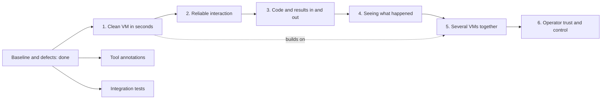

# Fork roadmap

This fork, `jonatsu/virt-manager-mcp`, adapts
[`KubeRl/MCP-Server-For-VirtManager-AI`](https://github.com/KubeRl/MCP-Server-For-VirtManager-AI) so that coding
agents can create, snapshot and destroy throwaway test VMs on a libvirt host. It branched from upstream commit
`f47d3c3`. The evidence for every item below is in
[`docs/research/2026-11-09-vm-management-mcp-evaluation.md`](../research/2026-11-09-vm-management-mcp-evaluation.md),
and the manual test bed is in [`tests/testbed/`](../../tests/testbed/README.md). The fork goes its own way: it
does not merge upstream regularly, and it takes upstream changes case by case.

Work lands in the order below: the baseline first, because every later slice needs a build and test gate it can
trust, then the defects, then the outcomes in their listed order. Each item is done when its evidence line holds.

## Baseline

The fork audit on 2026-11-09 found the items below. None of them changes the server's behavior.

1. **Build and test gate: passing.** `cargo build --locked`, `cargo test --locked` (10 unit tests at the audit, none
   touching libvirt) and `cargo clippy --locked --all-targets` pass with no warnings on rustc 1.99.1.
2. **Done: reformatted once with default rustfmt.** Upstream did not run rustfmt with default settings. The fork
   diverges from upstream rather than tracking it, so it reformatted in a commit of its own and keeps default
   settings. `cargo fmt --check` passes.
3. **Done: project `AGENTS.md`, with `CLAUDE.md` as a symlink to it.** It states the build gate, the guardrails a
   change must not weaken, and the rule that testing never touches VMs outside the test bed. It also marks the two
   `example-global-*.md` files as templates for the server's users, not instructions for contributors. The
   `agents-context-docs` checker passes.
4. **Done: README drift fixed.** The README now names the real template files, `example-global-CLAUDE.md` and
   `example-global-AGENTS.md`, builds with `--locked`, and says that this fork publishes no release binaries.
   Upstream's own release is `v1.0`, while `Cargo.toml` says `0.1.0`. Judgement call: upstream's joke first line
   gave way to a paragraph under the title that names the fork, its upstream and this roadmap. To undo it, remove
   that paragraph and restore upstream's first line from commit `f47d3c3`.
5. **Done: hygiene files.** `.editorconfig`, `.gitattributes`, `.pre-commit-config.yaml` and the hook configs
   (`.markdownlint-cli2.jsonc`, `.mdformat.toml`, `.secretlintrc.json`, `.yamlfmt.yaml`, `.yamllint.yaml`) come from the
   `repo-management` baseline, adapted to Rust with report-only `cargo fmt --check` and `cargo clippy` hooks. Node
   hooks use the host's Node.js, because nodeenv in pre-commit 4.7.0 crashed while choosing a download. Betterleaks
   stays on its latest stable release, `v1.10.0`, rather than the `v2.0.0-rc.7` that `pre-commit autoupdate` picked.
   The research copies and the `example-global-*.md` templates are excluded from the Markdown formatters. A second
   `pre-commit run --all-files` pass changes nothing.
6. **Done: GitHub settings and CI.** Issues are enabled as the inbox for outside reports; accepted work moves into
   this roadmap. The description and topics name the fork's purpose and its upstream. CI runs the build gate on
   stable, the tests on the minimum supported Rust version (1.89, the highest among the locked dependencies), the
   pre-commit hooks, and `cargo deny check advisories` against the RustSec database.

## Defects

1. **Done: serial console reads appeared to stall.** The stream never stalled. `console_read` honoured `wait_ms`
   only when no bytes existed after `since`, so a reread from `since: 0` returned at once. The trial's reads
   therefore came back within milliseconds of each write, before the guest answered; a libvirt client debug log
   showed the whole trial sequence finishing in about 70 ms. With real pauses, a full login over the console worked
   unchanged, and the stream-event hypothesis was refuted. The fix makes a waiting read wait for output that no
   earlier read returned, then until the output pauses for 500 ms, whatever `since` is. `console-stall.json`, run
   unchanged against `trial-deb13`, now shows the `Password:` prompt, the motd and a root shell prompt. The evidence
   is in [`docs/research/2026-11-09-console-read-wait.md`](../research/2026-11-09-console-read-wait.md).
2. **Done: `console_read` reports a console closed by a power-off.** The trial's `closed: null` came from reads that
   finished before the power-off (agent-setup correction `f2e697c0`). A power-off from inside the guest already
   worked. A forced `stop_vm` deleted the session, so the next read said "no console open"; `stop_vm` now keeps the
   session, and its reader records the stream's end. In `tests/testbed/cases/console-closed-on-power-off.json`, both
   a guest power-off and a forced `stop_vm` make the next read return `closed: "console stream ended ..."`.
3. **Done: `write_file` no longer creates world-writable files.** The guest agent creates files with mode 666.
   On Linux guests, `write_from` in `src/agent.rs` now sets the mode right after opening a new file, before any data
   is written: 644 by default, or the new optional octal `mode` parameter, which refuses bits above 777. An existing
   file keeps its mode unless `mode` is given. `copy_to_vm` shares the path, so its new files get 644 too.
   `tests/testbed/cases/write-file-mode.json` shows 644, 600, a kept 640 after append and overwrite, and a refused
   `4755`.
4. **Dropped: `start_vm` on a running VM does wait for the guest agent.** The trial's guest had no agent installed,
   and the call was never timed (agent-setup correction `d346adb4`). In
   `tests/testbed/cases/start-vm-waits-for-agent.json`, the agent is stopped and restarts 20 s later; `start_vm` with
   `wait_for_agent_secs: 60` returns about 17 s after the call, reporting the agent responding. The wait loop is now
   `agent::wait_for`, with unit tests.

## Follow-ups

The conformance reviews of the second autopilot run found these. None blocks the server's use.

1. **Done: a stale console session could not be replaced.** After `stop_vm` keeps a session, a stream that never
   reports its end left `console_open` answering "already open". `force: true` now replaces this server's own
   session too, and a session whose reader has stopped counts as closed. `tests/testbed/cases/console-reopen.json`
   shows it.
2. **Done: the README says file writes need `guest-exec`.** `write_file` and `copy_to_vm` run `test`, `chmod` and
   `rm` through `guest-exec` on Linux guests, so a guest agent that blocks `guest-exec` but allows file operations
   fails on writes.
3. **An overwrite with `mode` truncates first.** `write_from` opens with `wb` before `chmod`, so a failed `chmod`
   leaves an existing file empty. Either set the mode after the first write or document it.
4. **No test covers `write_from`'s ordering.** Only the pure helpers are unit-tested; setting the mode before the
   data, and the clean-up after a failed `chmod`, rest on the test bed. A seam over the agent calls would allow it.
5. **`console_read` with `wait_ms: 0` right after `stop_vm`** can return `closed: null`, because the reader records
   the stream's end a moment later. A non-zero wait reports it.

## Outcomes

A brainstorm on 2026-11-09 grouped the planned features by what they let an agent do. The user set the order below.
Each outcome needs a design agreed with the user before it is built, and each feature from the earlier list now sits
under one of them.

1. **A clean VM in seconds, not minutes.** An agent gets a fresh, disposable VM per task instead of waiting for an ISO
   or preseed install. This covers disposable VMs cloned or overlaid from an operator-listed base image or template
   VM, a reset-to-snapshot loop, and automatic expiry of abandoned VMs. Its first question is answered: cloud-init
   applies a NoCloud seed disk on this host, and an overlay on a base that already has the guest agent answers about
   8 s after power-on, against 44 s when cloud-init installs the agent
   ([`2026-11-09-cloud-init-overlay-probe.md`](../research/2026-11-09-cloud-init-overlay-probe.md)). Its direction
   is drafted in [`disposable-vms-draft.md`](disposable-vms-draft.md) and designed in
   [`disposable-vms-design.md`](disposable-vms-design.md).
2. **Reliable interaction with a live guest.** An agent knows when the guest is ready and does not lose input. This
   covers the wait tool (console text, screen text or the guest agent), long-running processes whose output streams
   back, and expect-style console sessions. `type_text` returns at once, and the trial lost input that way.
3. **Moving code and results in and out.** An agent pushes a checkout in and pulls artifacts or logs back without
   passing them through its context, and reaches services running in the guest. This covers copying from the VM,
   directory sync, the guest's IP address and port forwarding. Each new path out of the guest needs a guardrail.
4. **Seeing what happened.** When something fails in the guest, an agent can find out why. This covers console output
   buffered from VM start, guest resource usage, and events such as a crash or reboot.
5. **Several VMs together.** An agent can test small networks, such as a client and a server. It builds on outcome 1,
   and it needs a network policy for each VM, which outcome 6 would otherwise bring.
6. **Operator trust and control.** An operator can let agents run with less supervision. This covers an audit log of
   mutating calls (following `akarasulu/nested-mcp-server`), `max_vms` enforced across processes (today only an
   in-process lock guards it, so several stdio instances can race past it), network policies for each VM, scoping per
   session, and tested `qemu:///session` support. Session scope is the survey's strongest guardrail: VMs there cannot
   reach the user's system VMs at all, and `uri` is already a config key but untested.

Two items stand outside the outcomes, because their result is already clear. Either can land at any time.

- **MCP tool annotations.** Set `readOnlyHint`, `destructiveHint` and `idempotentHint` on every tool, so that clients
  and permission layers can gate `delete_vm`, `snapshot_revert`, `detach_disk` and similar tools apart from reads.
  `src/` sets none today.
- **Integration tests against real libvirt.** Turn the test-bed call lists into automated tests that run only when
  the test bed is present, and skip otherwise.

Open questions for the designs:

- Outcome 1: should disposable VMs live on `qemu:///system`, as today, or on `qemu:///session`, which outcome 6 would
  otherwise test?
- Outcome 5: should it bring its own network policy, or wait for outcome 6?

## Current goal

The user armed a second autopilot run on 2026-11-09, over the advisory gate and defects 2 to 4. The first run, over
baseline items 2 to 5 and defect 1, landed in `21c547d` to `bd175b1`.

- **Objective:** `AGENTS.md` lists `cargo deny check advisories` in its build gate, and defects 2, 3 and 4 are each
  settled on local `main` in their own commit, with a test, and marked done here.
- **Success criteria:**
  - Defect 2 is settled. A test-bed run opens a console on `trial-deb13`, forces `stop_vm`, then reads. The read
    reports the console closed, and the item is dropped; or the reader is fixed until it does.
  - Defect 3: a new file written by `write_file` gets mode 644 by default, or the mode given in a new optional
    `mode` parameter. Appending keeps the existing file's mode. A test-bed case in `tests/testbed/cases/` shows all
    three.
  - Defect 4: `start_vm` on a running VM whose guest agent is down waits up to `wait_for_agent_secs` and reports
    when the agent answers. A test-bed run shows it.
  - Unit tests cover the logic of defects 3 and 4 wherever it does not need libvirt.
  - The gate passes at the final commit: `cargo fmt --check`, `cargo build --locked`, `cargo test --locked`,
    `cargo +1.89 test --locked`, `cargo clippy --locked --all-targets -- -D warnings` and
    `cargo deny check advisories` all exit 0. A second `pre-commit run --all-files` pass and the
    `agents-context-docs` checker both pass.
  - A fresh conformance review against this roadmap, dispatched after the last commit, finds no material mismatch.
- **Verification:** run the gate and the test-bed cases as the last step, after the last change.
- **Boundaries:** touch only `trial-deb13` and the `agent-vms` pool on `qemu:///system`. Leave `trial-deb13`
  running, with its guest agent up and no console session logged in. Commit locally; the user decides on the push.
- **Stop conditions:** stop and ask when a fix needs root on the host, a host or libvirt configuration change, a VM
  other than `trial-deb13`, a push, or a GitHub setting, or when a defect's root cause cannot be found.
