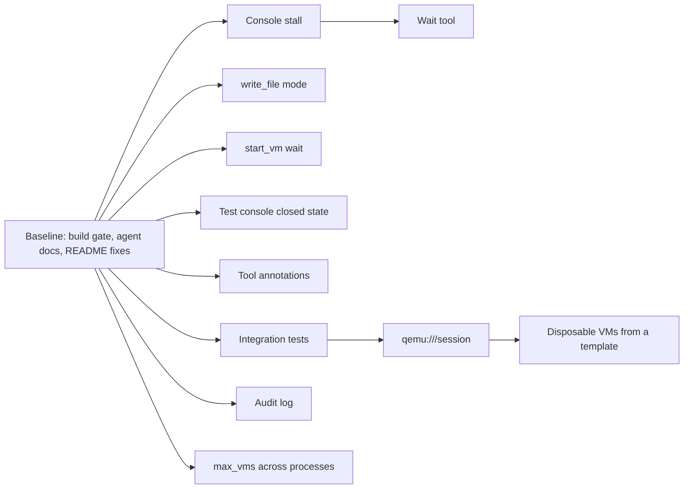

# Fork roadmap

This fork, `jonatsu/virt-manager-mcp`, adapts
[`KubeRl/MCP-Server-For-VirtManager-AI`](https://github.com/KubeRl/MCP-Server-For-VirtManager-AI) so that coding
agents can create, snapshot and destroy throwaway test VMs on a libvirt host. It branched from upstream commit
`f47d3c3`. The evidence for every item below is in
[`docs/research/2026-11-09-vm-management-mcp-evaluation.md`](../research/2026-11-09-vm-management-mcp-evaluation.md),
and the manual test bed is in [`tests/testbed/`](../../tests/testbed/README.md). The fork goes its own way: it
does not merge upstream regularly, and it takes upstream changes case by case.

Work lands in the order below: the baseline first, because every later slice needs a build and test gate it can
trust, then the four defects, then the features. Each item is done when its evidence line holds.

## Baseline

The fork audit on 2026-11-09 found the items below. None of them changes the server's behavior.

1. **Build and test gate: passing.** `cargo build --locked`, `cargo test --locked` (10 unit tests at the audit, none
   touching libvirt) and `cargo clippy --locked --all-targets` pass with no warnings on rustc 1.99.1.
2. **Done: reformatted once with default rustfmt.** Upstream did not run rustfmt with default settings. The fork
   diverges from upstream rather than tracking it, so it reformatted in a commit of its own and keeps default
   settings. `cargo fmt --check` passes.
3. **Done: project `AGENTS.md`, with `CLAUDE.md` as a symlink to it.** It states the build gate, the guardrails a
   change must not weaken, and the rule that testing never touches VMs outside the test bed. It also marks the two
   `example-global-*.md` files as templates for the server's users, not instructions for contributors. The
   `agents-context-docs` checker passes.
4. **Done: README drift fixed.** The README now names the real template files, `example-global-CLAUDE.md` and
   `example-global-AGENTS.md`, builds with `--locked`, and says that this fork publishes no release binaries.
   Upstream's own release is `v1.0`, while `Cargo.toml` says `0.1.0`. Judgement call: upstream's joke first line
   gave way to a paragraph under the title that names the fork, its upstream and this roadmap. To undo it, remove
   that paragraph and restore upstream's first line from commit `f47d3c3`.
5. **Done: hygiene files.** `.editorconfig`, `.gitattributes`, `.pre-commit-config.yaml` and the hook configs
   (`.markdownlint-cli2.jsonc`, `.mdformat.toml`, `.secretlintrc.json`, `.yamlfmt.yaml`, `.yamllint.yaml`) come from the
   `repo-management` baseline, adapted to Rust with report-only `cargo fmt --check` and `cargo clippy` hooks. Node
   hooks use the host's Node.js, because nodeenv in pre-commit 4.7.0 crashed while choosing a download. Betterleaks
   stays on its latest stable release, `v1.10.0`, rather than the `v2.0.0-rc.7` that `pre-commit autoupdate` picked.
   The research copies and the `example-global-*.md` templates are excluded from the Markdown formatters. A second
   `pre-commit run --all-files` pass changes nothing.
6. **Done: GitHub settings and CI.** Issues are enabled as the inbox for outside reports; accepted work moves into
   this roadmap. The description and topics name the fork's purpose and its upstream. CI runs the build gate on
   stable, the tests on the minimum supported Rust version (1.89, the highest among the locked dependencies), and
   the pre-commit hooks.

## Defects

1. **Done: serial console reads appeared to stall.** The stream never stalled. `console_read` honoured `wait_ms`
   only when no bytes existed after `since`, so a reread from `since: 0` returned at once. The trial's reads
   therefore came back within milliseconds of each write, before the guest answered; a libvirt client debug log
   showed the whole trial sequence finishing in about 70 ms. With real pauses, a full login over the console worked
   unchanged, and the stream-event hypothesis was refuted. The fix makes a waiting read wait for output that no
   earlier read returned, then until the output pauses for 500 ms, whatever `since` is. `console-stall.json`, run
   unchanged against `trial-deb13`, now shows the `Password:` prompt, the motd and a root shell prompt. The evidence
   is in [`docs/research/2026-11-09-console-read-wait.md`](../research/2026-11-09-console-read-wait.md).
2. **Untested: does `console_read` report a console closed by a power-off?** The trial reported `closed: null`
   after a power-off, but its reads all finished before the power-off happened, so the claim is withdrawn (see the
   correction in agent-setup `f2e697c0`). Test it first: open a console, force `stop_vm`, then read. Evidence: the
   read reports the console closed, or this item is dropped.
3. **`write_file` creates new files with mode 666.** Tighten the default, set the mode after writing, and consider a
   `mode` parameter. Evidence: a new file has the chosen mode, and an appended existing file keeps its own.
4. **`start_vm` on a running VM ignores `wait_for_agent_secs`.** It returns "already running" at once, even when the
   guest agent is not yet up. Evidence: `start_vm` on a running VM whose agent is down waits up to the given time.

## Features

These are in priority order. Each one needs a design agreed with the user before it is built.

1. **MCP tool annotations.** Set `readOnlyHint`, `destructiveHint` and `idempotentHint` on every tool, so that
   clients and permission layers can gate `delete_vm`, `snapshot_revert`, `detach_disk` and similar tools apart from
   reads. `src/` sets none today.
2. **A wait tool.** Wait until console output or screen text matches, or until the guest agent answers.
   `type_text` returns at once, so input can land mid-boot or mid-login and be lost; the trial lost input that way.
3. **Integration tests against real libvirt.** Turn the test-bed call lists into automated tests that run only when
   the test bed is present, and skip otherwise.
4. **Tested `qemu:///session` support.** The survey's strongest guardrail is structural: VMs in session scope cannot
   reach the user's system VMs at all. `uri` is already a config key, but session mode is untested.
5. **Disposable VMs from a template.** `create_vm` makes only a blank disk plus an ISO install, which is slow for
   agents. Add a clone or qcow2 overlay of an operator-listed base image or template VM, optionally with a
   cloud-init seed. The trial's cloud-init attempts never applied their user data, so that path needs its own
   investigation; the test bed's preseed install works.
6. **An audit log of mutating calls**, following `akarasulu/nested-mcp-server`.
7. **`max_vms` across processes.** The cap is enforced under an in-process lock only, so several stdio instances,
   one per agent session, can race past it.

## Current goal

The user armed an autopilot run on 2026-11-09 over baseline items 2 to 5 and the first defect.

- **Objective:** baseline items 2 to 5 and the serial console stall are fixed on local `main`, one commit per item,
  and this roadmap marks each one done.
- **Success criteria:** `cargo fmt --check`, `cargo build --locked`, `cargo test --locked` and
  `cargo clippy --locked --all-targets -- -D warnings` all exit 0. `AGENTS.md` exists and the `agents-context-docs`
  checker passes on it. The README names only files that exist. `pre-commit run --all-files` passes on a second
  run. The stall's root cause is recorded here, and `tests/testbed/cases/console-stall.json` run against
  `trial-deb13` shows the password prompt and a shell prompt after login. A conformance review against this
  roadmap finds no material mismatch.
- **Verification:** run the commands above as the last step, after the last change, plus the test-bed case run.
- **Boundaries:** touch only `trial-deb13` and the `agent-vms` pool on `qemu:///system`. Commit locally and do not
  push. Leave baseline item 6 and the GitHub settings alone.
- **Stop conditions:** stop and ask when a fix needs root, a host or libvirt configuration change, a VM other than
  `trial-deb13`, a push, or a GitHub setting, or when systematic debugging of the stall finds no root cause.
