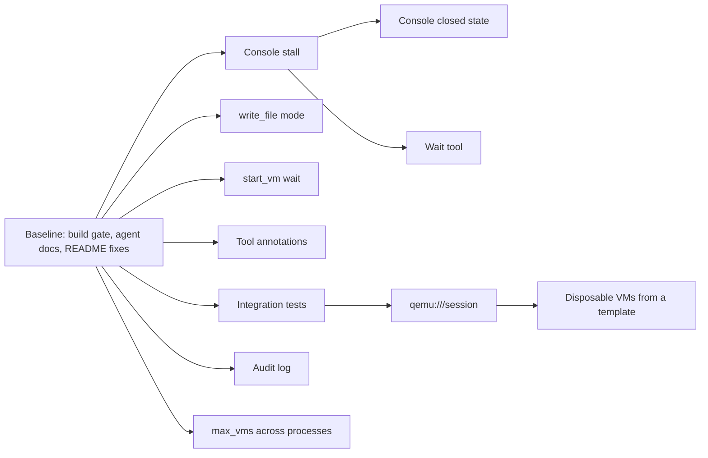

# Fork roadmap

This fork, `jonatsu/virt-manager-mcp`, adapts
[`KubeRl/MCP-Server-For-VirtManager-AI`](https://github.com/KubeRl/MCP-Server-For-VirtManager-AI) so that coding
agents can create, snapshot and destroy throwaway test VMs on a libvirt host. It branched from upstream commit
`f47d3c3`. The evidence for every item below is in
[`docs/research/2026-11-09-vm-management-mcp-evaluation.md`](../research/2026-11-09-vm-management-mcp-evaluation.md),
and the manual test bed is in [`tests/testbed/`](../../tests/testbed/README.md). The fork goes its own way: it
does not merge upstream regularly, and it takes upstream changes case by case.

Work lands in the order below: the baseline first, because every later slice needs a build and test gate it can
trust, then the four defects, then the features. Each item is done when its evidence line holds.

## Baseline

The fork audit on 2026-11-09 found the items below. None of them changes the server's behavior.

1. **Build and test gate: passing.** `cargo build --locked`, `cargo test --locked` (10 unit tests, none touching
   libvirt) and `cargo clippy --locked --all-targets` pass with no warnings on rustc 1.99.1.
2. **Done: reformatted once with default rustfmt.** Upstream did not run rustfmt with default settings. The fork
   diverges from upstream rather than tracking it, so it reformatted in a commit of its own and keeps default
   settings. `cargo fmt --check` passes.
3. **Add a project `AGENTS.md`.** The repository has no instruction file for agents working on this code. The two
   `example-global-*.md` files are templates for the server's users, not for contributors. The new file states the
   build gate, the libvirt test bed and its limits, and the rule that tests never touch VMs outside the test bed.
   Evidence: the `agents-context-docs` checker passes.
4. **Fix README drift.** The README names `global-CLAUDE.md` and `global-AGENTS.md`, but the files are
   `example-global-CLAUDE.md` and `example-global-AGENTS.md`. Its build step omits `--locked`. It points users at the
   upstream `v1.0` release binary, while `Cargo.toml` says `0.1.0`. Its first line is upstream's joke, which this
   fork should either keep with attribution or replace with a line that names the fork and its upstream.
5. **Add hygiene files.** `.gitignore` holds only `/target`. Add `.editorconfig`, `.gitattributes` and a pre-commit
   configuration from the `repo-management` baseline, adapted to Rust. Evidence: a second pre-commit pass changes
   nothing.
6. **Follow-ups outside the repository**, each a separate decision: enable Issues on the fork (currently disabled),
   set the GitHub description, and add CI.

## Defects

1. **Serial console reads stall after the first burst.** `console_write("root")` reaches the guest and its echo comes
   back, then no further bytes arrive, not even the password prompt. `virsh console` on the same guest works.
   `read_loop` in `src/console.rs` polls `virStreamRecv` on a `VIR_STREAM_NONBLOCK` stream every 30 ms. The default
   event loop is registered before connecting, in `src/main.rs`. `virsh` drives its stream from
   `virStreamEventAddCallback` instead, but that this difference causes the stall is a hypothesis. Find the root cause
   before choosing a fix. Evidence: `tests/testbed/cases/console-stall.json` shows the password prompt and a
   completed login.
2. **`console_read` keeps reporting `closed: null` after the VM powers off.** Depends on the first defect, because
   both live in the same reader. Evidence: after a forced `stop_vm`, `console_read` reports the console closed.
3. **`write_file` creates new files with mode 666.** Tighten the default, set the mode after writing, and consider a
   `mode` parameter. Evidence: a new file has the chosen mode, and an appended existing file keeps its own.
4. **`start_vm` on a running VM ignores `wait_for_agent_secs`.** It returns "already running" at once, even when the
   guest agent is not yet up. Evidence: `start_vm` on a running VM whose agent is down waits up to the given time.

## Features

These are in priority order. Each one needs a design agreed with the user before it is built.

1. **MCP tool annotations.** Set `readOnlyHint`, `destructiveHint` and `idempotentHint` on every tool, so that
   clients and permission layers can gate `delete_vm`, `snapshot_revert`, `detach_disk` and similar tools apart from
   reads. `src/` sets none today.
2. **A wait tool.** Wait until console output or screen text matches, or until the guest agent answers.
   `type_text` returns at once, so input can land mid-boot or mid-login and be lost; the trial lost input that way.
3. **Integration tests against real libvirt.** Turn the test-bed call lists into automated tests that run only when
   the test bed is present, and skip otherwise.
4. **Tested `qemu:///session` support.** The survey's strongest guardrail is structural: VMs in session scope cannot
   reach the user's system VMs at all. `uri` is already a config key, but session mode is untested.
5. **Disposable VMs from a template.** `create_vm` makes only a blank disk plus an ISO install, which is slow for
   agents. Add a clone or qcow2 overlay of an operator-listed base image or template VM, optionally with a
   cloud-init seed. The trial's cloud-init attempts never applied their user data, so that path needs its own
   investigation; the test bed's preseed install works.
6. **An audit log of mutating calls**, following `akarasulu/nested-mcp-server`.
7. **`max_vms` across processes.** The cap is enforced under an in-process lock only, so several stdio instances,
   one per agent session, can race past it.

## Current goal

The user armed an autopilot run on 2026-11-09 over baseline items 2 to 5 and the first defect.

- **Objective:** baseline items 2 to 5 and the serial console stall are fixed on local `main`, one commit per item,
  and this roadmap marks each one done.
- **Success criteria:** `cargo fmt --check`, `cargo build --locked`, `cargo test --locked` and
  `cargo clippy --locked --all-targets -- -D warnings` all exit 0. `AGENTS.md` exists and the `agents-context-docs`
  checker passes on it. The README names only files that exist. `pre-commit run --all-files` passes on a second
  run. The stall's root cause is recorded here, and `tests/testbed/cases/console-stall.json` run against
  `trial-deb13` shows the password prompt and a shell prompt after login. A conformance review against this
  roadmap finds no material mismatch.
- **Verification:** run the commands above as the last step, after the last change, plus the test-bed case run.
- **Boundaries:** touch only `trial-deb13` and the `agent-vms` pool on `qemu:///system`. Commit locally and do not
  push. Leave baseline item 6 and the GitHub settings alone.
- **Stop conditions:** stop and ask when a fix needs root, a host or libvirt configuration change, a VM other than
  `trial-deb13`, a push, or a GitHub setting, or when systematic debugging of the stall finds no root cause.
