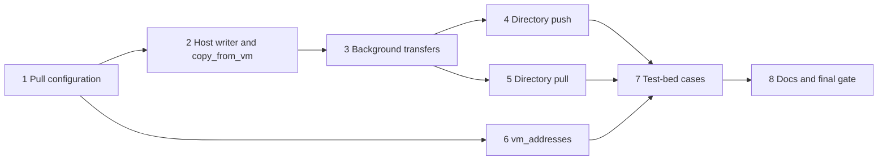

# Moving code and results, run 1: implementation plan

Status: approved with its design amendment, revised for a plan-critic review. Built from
[`guest-transfer-design.md`](guest-transfer-design.md) at `1e15bdc`. The design owns behaviour; this plan owns order and
checks. Progress goes in the execution record at the end. Run 2, directory transfers on Windows guests, gets its own
plan once this run has landed.

## Overview

Run 1 gives agents four new tools on Linux guests and moves the existing `copy_to_vm` onto background transfers:

- `copy_from_vm` pulls one file into an operator-set pull directory;
- `copy_dir_to_vm` pushes a directory, such as a checkout;
- `copy_dir_from_vm` pulls a directory of results;
- `vm_addresses` lists a VM's addresses.

`copy_from_vm`, `copy_to_vm` and `vm_addresses` also work on Windows guests in this run, and `t-win11` tests them.

The order follows the trust boundary. Pulls write host files that a guest controls, so the configuration that confines
them comes first, then the host-side writer with one tool that uses it. Background transfers come next, because every
copy tool after that runs on them. The directory push and the directory pull follow, each through transfers. The
address tool is independent and can land at any point after unit 1. Test-bed cases and the docs close the run.

### Design amendment this plan needs

In raw mode, the `tar` crate 0.4.46 reads past each entry by the size in its ustar header and ignores a PAX `size`
record (`archive.rs:387`). An unpacker that merged PAX records and honoured `size` would lose its place in the stream.
The unpacker therefore refuses an entry that carries a PAX `size` record, and any PAX global header. Real guest
archives need neither below 8 GiB per file, and `max_pull_bytes` defaults to 1 GiB: GNU tar and busybox write their
own formats, and bsdtar writes PAX records only for long or non-ASCII names and sizes over 8 GiB. The design's list
of unpacker checks takes this in unit 5's commit.

## Preflight

These apply to every unit, which names only its additions.

- **Rules.** Follow `AGENTS.md`, including its guardrails. Every invariant in the design's "Invariants" section needs a
  test that shows its refusal still happens. Load `rust-style`, `rust-error-handling` and `rust-testing` before
  editing Rust, `rust-unix-processes` before the `rustix` file calls, and `bash-shell` before editing `run-all.sh`.
- **Gate.** Every commit passes the build gate in `AGENTS.md`, plus `cargo +1.94 test --locked`.
- **Dependencies.** Unit 1 adds `rustix` with its `fs` feature, unit 4 adds `ignore` (0.4.33 needs Rust 1.88), and
  units 4 and 5 add `tar`, all with `cargo add`. Each must pass `cargo deny check advisories` and build on Rust 1.94.
  Record each crate's version and licence in the unit's row.
- **Dead code.** The crate is a binary, so an item without a caller fails clippy, a config field nobody reads
  included. Add each item in the unit that first reads or calls it: `max_pull_bytes` in unit 2, `max_transfers` in
  unit 3, `max_pull_entries` in unit 5.
- **Host memory and disk.** `/tmp`, and with it `run-all.sh`'s work directory, is tmpfs on this host, so files there use
  RAM. Test files stay at 128 MiB or less, the caps are lowered in the cases' configs rather than filled, and each case
  deletes its large host files when it ends. Check `df -h /` in `trial-deb13` before a case that builds a tree there,
  and delete the tree afterwards.
- **Seams.** Unit tests never touch libvirt. Guest calls go through the agent's `Channel` trait in `src/agent.rs`, which
  tests implement with a scripted guest. Host file code takes the pull or share directory as an opened handle, so tests
  run it in a `tempfile` directory. Crafted archives for the unpacker are built in the tests with the `tar` crate's
  builder or by writing headers by hand.
- **Test bed.** Run cases with `tests/testbed/run-all.sh` and `mcp_call.py --check`, and give every new call an
  `expect`. Touch only `trial-deb13` and VMs and volumes named `t-*` or `tpl-*` in the `agent-vms` pool on
  `qemu:///system`. Pull directories live under the run's scratch directory, never in the repository.
- **Memory.** Check `free -m` before starting a VM. `t-win11` needs 5 GiB available; run no other guest beside it except
  `trial-deb13`, and shut it down once its cases are done.
- **Review.** After each unit marked "reviewed", dispatch `code-reviewer` on its commits with the test evidence. Units
  1 to 5 use `model: opus`, because they guard the host against a guest or change how calls block. Fix blocking
  findings before a dependent unit starts.
- **Commits.** One logical change per commit, Conventional Commits, explicit pathspecs, and a `CHANGELOG.md` entry
  under `## Unreleased` for each change users notice. Pushing waits for the maintainer.

## Units

### 1. Pull configuration (reviewed, Opus)

**Outcome.** The server accepts `host_pull_dirs`, and refuses to start on a pull directory that overlaps anything a
guest must not write. Every pull directory has a usable staging directory, and leftovers of a
dead server are gone at start. This realizes the design's "Configuration" section and the staging cleanup under "Host
rules for every pull".

**Changes.**

- `src/config.rs`: `host_pull_dirs`, canonicalized like `host_share_dirs`, so each entry must exist. The overlap
  check against share directories, the project directory and `manage.iso_dirs` runs when the config loads.
- A new module, `src/transfer/host.rs` (the name is the implementer's choice), holding the staging directory: it
  creates `.vmm-staging/` with mode 700, tries `renameat2` with `RENAME_NOREPLACE` and `RENAME_EXCHANGE` on two scratch
  entries there, and deletes staged entries whose lock file no process holds an `flock` on.
- `src/main.rs` or the server's start-up: after connecting to libvirt, the check against the target path of every
  directory-type storage pool, then the staging set-up for each pull directory. A failure stops the server with a
  message that names the directory and the reason.
- `README.md` documents `host_pull_dirs` in the configuration section, with the overlap rules.

**Verification.** Unit tests show each refusal: a pull directory equal to, inside, or containing a share directory,
the project directory, an ISO directory, and a pool target, each in both directions. The cleanup test holds a lock in
one handle and shows that entry survives while an unlocked one goes. A filesystem without `renameat2` support cannot be
made here, so a test injects the failure into the probe function and shows the refusal. On the host, a server started
with `host_pull_dirs = ["/var/lib/libvirt/images/agent-vms"]`, the `agent-vms` pool's existing target, refuses to
start with a message that names that pool, and the pool's volume list is unchanged.

**Review.** Opus `code-reviewer`, for the overlap logic with symlinked and relative paths, and for the pool check
reading every pool rather than only `manage.disk_pool`.

### 2. Host writer and `copy_from_vm` (reviewed, Opus)

**Outcome.** `copy_from_vm` pulls one guest file into a pull directory, under every host rule in the design: the
handle walk without symlinks, staging, fixed modes, `renameat2`, the type rule, the per-process destination conflict,
and `max_pull_bytes`. The call still blocks until the copy ends; unit 3 adds the time limit.

**Changes.**

- `src/transfer/host.rs`: opening the destination's parent from the pull directory's handle one component at a time
  with `O_NOFOLLOW` through `rustix`, creating missing directories with mode 755; refusing a destination inside
  `.vmm-staging/` or whose last component is a symlink; a staged file created with `O_EXCL` beside its `flock`ed lock
  file; `fchmod` to 644; `renameat2` with `RENAME_NOREPLACE`, or `RENAME_EXCHANGE` with `overwrite` after checking the
  old entry is a file; deleting the staged entry on every failure. After an exchange, the server checks the type of
  the entry that came back into staging. If another process had put a directory at the destination meanwhile, it swaps
  back and fails, and it deletes a returned entry only as a single file, never recursively.
- `src/config.rs`: `limits.max_pull_bytes`, default 1 GiB.
- An in-process set of running destinations, refusing a destination equal to, above or below a running one.
- `src/agent.rs`: a streaming read into a writer, mirroring `write_from`, which stops once `max_pull_bytes` is passed.
- `src/server.rs`: the `copy_from_vm` tool, advertised only when `host_pull_dirs` is set and read-only mode is off,
  with `read_only_hint` false, `destructive_hint` true and `idempotent_hint` false, and listed in `MUTATING_TOOLS`,
  which read-only mode hides (`server.rs:46`). `copy_to_vm` is already on that list. Units 4 and 5 add their tools to
  it the same way.

**Verification.** Unit tests against a scripted guest and a `tempfile` pull directory:

- a file arrives with mode 644 whatever the umask, and its content matches;
- an existing destination is refused, and replaced with `overwrite`; a directory at the destination is refused even
  with `overwrite`;
- a symlink as the destination or as any parent inside the pull directory is refused, and nothing is written through
  it;
- a guest file larger than `max_pull_bytes` fails and leaves no entry at the destination or in the staging directory;
- a guest read error mid-copy leaves nothing behind;
- two pulls to the same path, or to a path and its parent, conflict in one process;
- a directory placed at the destination between the type check and the exchange, simulated through a hook in the
  test, is swapped back intact and the pull fails;
- read-only mode advertises neither `copy_from_vm` nor `copy_to_vm`.

On `trial-deb13`, a pull of `/etc/os-release` matches `sha256sum` in the guest.

**Review.** Opus `code-reviewer`, for every path from guest data to a host write.

### 3. Background transfers (reviewed, Opus)

**Outcome.** Every copy tool returns within `limits.max_wait_secs`. A copy that runs longer continues in the server,
and `wait_for` with a `transfer_done` condition returns its result. This realizes the design's "Long transfers"
section.

**Changes.**

- A transfer table beside the jobs: random IDs; per transfer its VM name and UUID, kind, bytes moved, state and result;
  the 64 most recent finished results kept; at most `limits.max_transfers` (default 4, added to `src/config.rs` here)
  running, a further copy refused.
- A transfer outlives the call that started it, so it owns its `Domain` rather than borrowing one, as `Agent` does
  today (`server.rs:1784`); `Domain` is `Send + Sync` in `virt` 0.4.3.
- `copy_to_vm` and `copy_from_vm` start a transfer on a blocking thread and wait for it up to the call's limit. A copy
  that finishes in time replies as before; otherwise the reply gives the transfer ID, the bytes so far and `running`.
  A cancelled call leaves the transfer running.
- `src/server.rs`: `wait_for` answers a `transfer_done` condition from the table before it looks up the VM, through a
  function over the table that takes the call's VM argument and the ID, so unit tests reach it without libvirt. It
  refuses
  `transfer_done` combined with any other condition, an ID of another VM by name or UUID, and an unknown ID, which it
  reports as a transfer that ended with its server process or never existed. While the transfer runs, the wait polls
  the table until it finishes or the wait's own limit passes.
- The `wait_for` and copy tool descriptions explain the transfer ID and the condition.

**Verification.** Unit tests with a scripted guest that delays its replies:

- a short copy replies with its result; a long one replies with an ID within the limit, and `transfer_done` later
  returns the same result the copy would have given;
- a transfer whose VM was stopped mid-copy reports its failure through the table function, which never looks the VM
  up;
- `transfer_done` with another condition, with another VM's name, and with an unknown ID is refused;
- a fifth concurrent copy is refused with the default limit;
- after 65 finished transfers, the oldest result is gone.

On `trial-deb13`, with `max_wait_secs` set to 2 in a scratch config, a 128 MiB `copy_to_vm` replies with an ID, and
`transfer_done` reports the copy complete; the guest's checksum matches. The host and guest files are deleted
afterwards.

**Review.** Opus `code-reviewer`, for the blocking-thread use, cancellation and the table's locking.

### 4. Directory push (reviewed, Opus)

**Outcome.** `copy_dir_to_vm` pushes a directory from a share directory into a new or replaced guest directory, as the
design's "Pushing a directory" and "Paths" sections describe, through a transfer.

**Changes.**

- `src/transfer/push.rs` (name free): selection with `ignore::WalkBuilder` (`follow_links(false)`, `git_global(false)`,
  parent `.gitignore` files only inside the share, `exclude` as overrides); opening each selected path from the share's
  handle with `O_NOFOLLOW`; the symlink rule resolved through real directories only; skipping and naming other links,
  devices, FIFOs and sockets; `.git/` left out unless `include_git`; a count of ignored files; and an archive built
  with the `tar` crate, every entry owned by uid and gid 0, modes without setuid and setgid.
- The guest side, through the agent: refuse an existing target without `replace`, and a `replace` of `/` or of a
  directory directly below it; create missing parents; write the archive as `.vmm-<random>.tar` beside the target;
  run `tar -x -o -f <archive> -C .vmm-<random>.d`; move the old tree aside, move the new one in, and delete the old one
  and the archive. Any failure deletes the temporary entries and leaves the old tree. A guest without `tar` fails with
  a message that says so.
- `src/server.rs`: the tool, hidden in read-only mode and without `host_share_dirs`, destructive and not idempotent.

**Verification.** Unit tests in a `tempfile` share:

- `.gitignore` files in the tree and in a parent inside the share apply, and one above the share does not;
- a symlink to a file inside the tree goes in; one to `../outside`, one to an absolute path, and the pair
  `b -> .`, `a -> b/../x` are skipped and named;
- a directory swapped for a symlink between selection and reading is not followed;
- a FIFO is skipped and named; a setuid file arrives without the bit;
- the guest commands are refused for `/`, `/usr` and an existing target without `replace`, and `replace` onto a file
  is refused;
- with a scripted guest, a failure at each guest step (writing the archive, `tar -x`, each move) leaves the old tree in
  place and deletes the temporary entries.

On `trial-deb13`, a push of a copy of this repository's `src/` and `tests/` in a scratch share matches by checksum,
an ignored file is absent, and a second push with `replace` after deleting a host file leaves no copy of that file.

**Review.** Opus `code-reviewer`, for the walk and the guest-side command construction.

### 5. Directory pull (reviewed, Opus)

**Outcome.** `copy_dir_from_vm` pulls a guest directory into a pull directory, as the design's "Pulling a directory"
section describes, through a transfer.

**Changes.**

- `src/agent.rs`: the helpers the pull needs. `kill` becomes callable from the transfer code; a size query seeks to
  the end of a file (`read_file` seeks only from the start today); and `tar` runs through the existing start and
  status calls rather than the synchronous `exec`, so the transfer can poll while it runs.
- `src/config.rs`: `limits.max_pull_entries`, default 100,000.
- The guest side: refuse a `guest_path` that is not a directory; run `tar -c -f <archive> -C <guest_path> .` with the
  archive in `/var/tmp`, or `/tmp` where `/var/tmp` is missing; poll the archive's size and kill `tar` once it passes
  `max_pull_bytes`; treat exit status 1 with GNU tar's "file changed as we read it" as a
  warning and any other non-zero status as failure; stream the archive out and delete it.
- `src/transfer/pull.rs` (name free): the unpacker over `tar::Entries` in raw mode, merging long-name and PAX headers
  itself with a 64 KiB limit; failing on an absolute path, a `..` component, a repeated path, a file and directory at
  one path, a GNU sparse entry, a PAX entry with `GNU.sparse.*` keys or a `size` record, a PAX global header, or a
  passed cap; skipping and naming links,
  devices, FIFOs and sockets; applying `exclude` in gitignore syntax; writing into a staged directory with modes 644
  and 755 set by `fchmod`, then moving it into place as unit 2 does, with `overwrite` replacing only a directory.
- `src/server.rs`: the tool, hidden in read-only mode and without `host_pull_dirs`, destructive and not idempotent.

**Verification.** Unit tests feed the unpacker crafted archives: each failure above writes nothing and leaves the
staging directory empty; a tree with a symlink, a hard link and a FIFO arrives without them and names them; an archive
of 100,001 empty files fails on the entry cap; a sparse entry declaring 1 TiB fails before any write; `exclude`
patterns match as in `.gitignore`; a PAX `size` record and a PAX global header each fail the pull. Scripted-guest
tests show that `tar` exit status 1 with "file changed as we read it" succeeds with the warning, that status 1 with
another message and status 2 fail, that `overwrite` onto a file at the destination is refused, and that a growing
archive is killed once it passes the cap.

On `trial-deb13`, a pulled tree matches the guest's checksums with every mode 644 or 755. With `max_pull_bytes` set
to 64 MiB in a scratch config, a pull of a 128 MiB tree built in `/var/tmp` stops `tar` and leaves no archive; the
tree is deleted afterwards. The pull's rate is measured with a 128 MiB file.

**Review.** Opus `code-reviewer`, for the unpacker against the design's list and for the size polling.

The same commit adds the plan's design amendment to the design's unpacker list.

### 6. `vm_addresses` (reviewed)

**Outcome.** `vm_addresses` returns each interface's addresses and their source, as the design's "Addresses" section
describes.

**Changes.**

- `src/hypervisor.rs`: `Domain::interface_addresses` with the lease, agent and ARP sources; a merge per interface by
  MAC address that takes the lease, then the agent, then ARP; loopback and IPv6 link-local addresses dropped; in
  read-only mode, the agent source skipped.
- `src/server.rs`: the read-only, idempotent tool, whose description says that `agent` and `arp` answers are the
  guest's own claims.

**Verification.** Unit tests on the merge with hand-built answers: a lease wins over a different agent address; an
interface with only an agent answer keeps it; loopback and `fe80::` go; read-only mode never calls the agent. On
`trial-deb13`, the reply holds its 192.168.122.x address with source `lease`.

**Review.** `code-reviewer` on Sonnet: the tool reads only.

### 7. Test-bed cases (self-reviewed)

**Outcome.** `run-all.sh` covers the run's tools on `trial-deb13` and the file tools and `vm_addresses` on `t-win11`,
with every call checked.

**Changes.**

- `run-all.sh` writes a transfer config with a pull directory and a share directory under its work directory. It builds
  a small, deterministic test tree there, with a `.gitignore`, a symlink inside and one outside the tree, and a FIFO,
  so the cases can expect known checksums. `mcp_call.py` fills saved values only into `args`, not into `expect`, and
  `run-all.sh` deletes `vars.json` between units, so `run-all.sh` writes the paths into `vars.json` right before each
  transfer case.
- `mcp_call.py` cannot see host files, so after each case `run-all.sh` checks the host side in Bash: the pulled files'
  checksums, every mode 644 or 755, nothing executable, and an empty `.vmm-staging/`. A failed check fails the unit.
- New cases: `transfer-file.json` (file pull, refusals, `overwrite`, the type rule), `transfer-push.json` (push,
  ignored files, skipped links, `replace`, the root guard), `transfer-pull.json` (pull, skipped entries, the caps),
  `transfer-background.json` (with `max_wait_secs` of 2: a long push and a long pull of 128 MiB through
  `transfer_done`, and a VM stopped during a push). The stop leaves `.vmm-*` entries beside the push target on the
  guest's disk (design risk 1), so `run-all.sh` starts `trial-deb13` again through its existing readiness check and
  deletes the entries under the known target before the next case. The remaining case is `addresses.json`:
  `trial-deb13` by lease, then again with its guest agent stopped for 30 s, as `start-vm-waits-for-agent.json` does,
  still by lease. No test-bed guest without a guest agent has a network interface, so the agent-stopped run stands in
  for one.
- `win-transfer.json` on `t-win11`: `copy_to_vm` and `copy_from_vm` of a file under `C:\Windows\Temp` with matching
  checksums, and `vm_addresses`, which returns an empty list because `t-win11` has no network interface.
- The test-bed README lists the cases.

**Verification.** `run-all.sh` with the new units passes twice in a row, and leaves no `.vmm-*` entry in the guests'
temporary directories, under the push targets, or in the pull directory's staging directory. The work directory holds
no file over 1 MiB once the run ends.

### 8. Docs and final gate

**Outcome.** The README, the design and the probe note describe what was built, the roadmap marks run 1 done, and the
final reviews close.

**Changes.** The README gains a section on moving files: the four tools, `host_pull_dirs` and its overlap rules, the
pull rules, transfers and `transfer_done`, and the trust note on addresses. The design takes any detail the build
settled differently. The probe note gains the measured pull rate. The roadmap's outcome 3 entry records run 1 and names
run 2 next. `CHANGELOG.md` holds the run's entries.

**Verification.**

- The gate and `cargo +1.94 test --locked` pass at the last commit.
- `run-all.sh` exits 0.
- An Opus `code-reviewer` review of the whole run, and a separate `conformance-review` against the design and this
  plan, find no material mismatch, with their findings fixed and rechecked.
- CI passes once the maintainer pushes.

## Exceptions the run records

| Check | Why it cannot run here | Stand-in evidence |
| -- | -- | -- |
| A pull directory on NFS or FUSE without `renameat2` | No such filesystem on the test bed | A unit test injects the failure into the start-up probe |
| Several server processes using one guest's agent at once | The test-bed client runs one server | Risk 5 in the design; one process's interleaving shows in `transfer-background.json` |
| A shared HTTP-transport server with several clients | The test bed uses stdio | Random transfer IDs, covered by unit tests |
| Directory transfers on Windows | Run 2 | Run 2's plan |
| `vm_addresses` on a Windows guest with a network | `t-win11` has no network interface | The merge is OS-neutral and unit-tested |

## Execution record

The run's goal:

- **Objective.** Units 1 to 8 are committed on `main`, each with its row here.
- **Success.** After the last change:
  - the gate and `cargo +1.94 test --locked` exit 0;
  - `tests/testbed/run-all.sh` exits 0, with `t-win11` present;
  - an Opus code review and a separate conformance review find no material mismatch.
- **Boundaries.** Nothing is pushed. Only `trial-deb13`, `t-*` VMs and `t-*` or `tpl-*` volumes in `agent-vms` are
  touched, and pull directories stay under the run's scratch directory.
- **Stop.** Stop and report when a step needs root, a design change, or another VM or pool.

| Unit | Commits | Evidence | Review |
| -- | -- | -- | -- |
| 1 Pull configuration | `eef715a` (config, staging, pool check), `e27bf78` (review fixes), `bd06ea6` (staging mode through a handle) | Adds `rustix` 1.1.6 (Apache-2.0 WITH LLVM-exception OR Apache-2.0 OR MIT). Unit tests refuse a pull directory equal to, inside or containing a share directory, the project directory, an ISO directory and pool targets, in both directions and through a symlink; refuse a symlinked or foreign staging directory; make a world-readable one private; inject a missing `RENAME_NOREPLACE` and `RENAME_EXCHANGE`; and clean up only unlocked staged entries, without hanging on a FIFO lock or following a symlinked one. On the host, `host_pull_dirs = ["/var/lib/libvirt/images/agent-vms"]` stopped the server with "overlaps /var/lib/libvirt/images in storage pool default", and the pool's volume list was unchanged; a valid pull directory got an empty `.vmm-staging/` with mode 700. Deviation: the refusal named the `default` pool, whose target contains `agent-vms`'s, rather than `agent-vms`; the error now names every overlapping directory | Opus `code-reviewer`: approve, with two required fixes before unit 2 (cleanup stopping start-up on a vanished or odd entry; missing tests for a pull directory inside a pool and for the project directory) and three optional points (staging mode, error context, missing pool targets), all fixed in `e27bf78`; the recheck approved and raised changing the mode through a handle, fixed in `bd06ea6`. The `share_project_dir` branch itself is not run by a test, because that needs a different working directory; it only adds to `host_share_dirs` |
| 2 Host writer and `copy_from_vm` | `dd649da` (writer and tool), `ecbbce2` (review fixes) | Unit tests in a temporary pull directory: a pulled file arrives whole with mode 644 in new directories with mode 755; an existing file is replaced only with `overwrite`, and a directory never; symlinks on the way or at the destination, relative, `..`, outside and staging paths, a nested pull directory's staging and the pull directory itself are refused; an abandoned pull leaves staging empty; a directory swapped in before the swap is put back; a file or directory that appears meanwhile is not replaced and is named for what it is; a file that vanishes before the swap is placed anew; running pulls of a path, its parent or a path inside it are refused; `read_to` stops at `max_pull_bytes` and closes its handle on every path; `copy_from_vm` is hidden without `host_pull_dirs` and in read-only mode. On `trial-deb13`, a pulled file matched the guest's checksum with mode 644 and new parents 755; a second pull was refused until `overwrite: true`; a directory destination and a path outside the pull directory were refused; staging was empty afterwards | Opus `code-reviewer`: request changes for a blocking hole (a pull directory nested in another let a pull write into the inner one's staging), plus no sync before the rename, directories created before the VM lookup, a refusal that advised `overwrite` where it would not help, and two untested paths; all fixed in `ecbbce2`, and the recheck approved. Accepted: a server crash between the swap and the swap back, during an operator's own rename, leaves that directory in staging for the next start-up to delete; unit 5 needs the recursive cleanup |
| 3 Background transfers | `d4066ab` (transfers and `transfer_done`), `2271fae` (review fixes) | Unit tests over the transfer table with scripted work in place of a guest: a short transfer answers within the wait and a long one later with the same result; a failed transfer reports why without a VM lookup; another VM's transfer and an unknown ID are refused; a fifth running transfer is refused under the default limit; only the newest 64 finished results are kept; `transfer_done` reports a result, a failure or a timeout with the bytes so far; a cancelled wait returns at once; a panicking transfer finishes and frees its slot; `transfer_done` beside another condition is refused. On `trial-deb13` with `max_wait_secs = 2`, a 128 MiB `copy_to_vm` replied with a transfer ID after 2 s; `transfer_done` refused a screenshot, another condition beside it and an unknown ID, timed out once with the bytes so far, then matched with the copy's reply; the guest's SHA-256 matched the host's. A 128 MiB `copy_from_vm` of the same file also went to the background and arrived with the same checksum, mode 644 and an empty staging directory. The host and guest files were deleted. Deviation: the tests drive the table with closures rather than a scripted guest, because the table never calls the agent | Opus `code-reviewer`: approve, with two optional points, both fixed in `2271fae`: a panic in a transfer's work left it running and holding a slot, and the `transfer_done` schema named the directory tools before they exist |
| 6 `vm_addresses` | `af11259` (tool), `c569261` (agent through the server's channel), `bd06ea6` (lease and ARP only with named NICs) | Unit tests cover the merge (a lease wins over the agent's and ARP's answers, an interface without a lease keeps the agent's or ARP's), the filter (loopback, unspecified, link-local and IPv4-mapped loopback dropped), agent replies without a MAC, read-only mode never asking the agent, the reply's `unavailable` names, and the NIC-name check. On `trial-deb13`, the reply held 192.168.122.141/24 from `lease` with name `enp1s0`; in read-only mode the same, without the name. Deviation: the guest agent is asked with `guest-network-get-interfaces` through the server's own channel, and the lease and ARP sources run only when every NIC has a host-side device name, because `virt` 0.4.3 reads the MAC address and the name of an answer without a NULL check and libvirt 12.0.0 can return NULL for both | Sonnet `code-reviewer`: request changes for a crash on an agent interface without a MAC, fixed in `c569261` with the read-only wiring test and two optional filter points; the recheck approved and raised the NULL device name in lease and ARP answers, confirmed in libvirt's `domain_conf.c` and fixed in `bd06ea6` |
