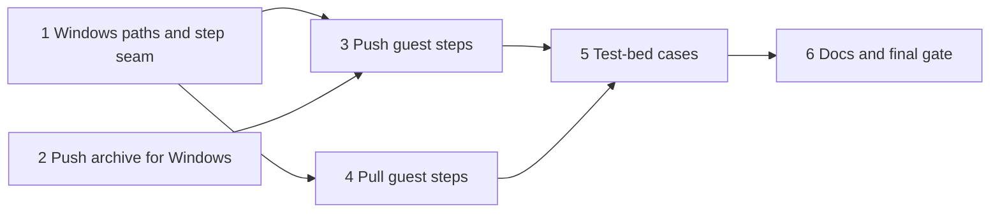

# Moving code and results, run 2: implementation plan

Status: approved, after a plan-critic review and its recheck, and two probes. Built from
[`guest-transfer-design.md`](guest-transfer-design.md) at `3079c0e`, with evidence in
[`2026-11-12-windows-tar-probe.md`](../research/2026-11-12-windows-tar-probe.md). The design owns behaviour; this plan
owns order and checks. Progress goes in the execution record at the end.

## Overview

Run 2 makes `copy_dir_to_vm` and `copy_dir_from_vm` work on Windows guests, through the guest's own `tar.exe`. Run 1
built both tools for Linux and refuses Windows in `refuse_windows` in `src/server.rs`. Everything on the host side
stays: the push walk and archive builder in `src/push.rs`, the untrusted unpacker and the host rules in
`src/dirpull.rs` and `src/pull.rs`, and the background transfers. What run 2 adds is the Windows half of three things:

- the guest path rules, because a Windows path has a drive, two separators and names that Windows rewrites;
- the archive a push sends, which drops the host's modes and skips what Windows cannot hold;
- the guest steps around `tar.exe`, which on Linux are constant `sh` scripts behind the `Guest` traits in
  `src/push.rs` and `src/dirpull.rs`.

The probes settled how `tar.exe` and Windows behave on `t-win11`. `tar.exe` accepts `-o`, writes forward slashes and
PAX `path` records the unpacker already reads, follows junctions, and loses a file named `CON` without an error. Paths
with spaces reach it intact when the guest agent runs it directly. While it writes an archive, the agent cannot open
that archive, but a PowerShell length query sees it grow. The server therefore runs `tar.exe` itself, with each path
as a separate argument, and uses PowerShell for the steps around it.

The order follows what each unit consumes. A shared seam for Windows steps and the path rules come first, because both
tools use them. The push archive and the push's guest steps come next, then the pull's guest steps. Test-bed cases
and the docs close the run.

### Design amendments this plan needs

The probes found four things the design does not yet say. Each lands in the design in the commit of the unit named.

1. **Names that are not valid UTF-8 (unit 2).** Linux allows any bytes in a name, while Windows names are UTF-16, so
   `tar.exe` cannot create such a file under its name. A push to Windows skips and names it, as the other names
   Windows cannot hold.
2. **Symlinks in a push to Windows (unit 2).** A tar archive does not say whether a link points to a file or a
   directory, and `tar.exe` made a directory symlink from the host into a broken file symlink. A push to Windows
   therefore skips every symlink and names it, as it already does for links that leave the tree.
3. **The size cap while a Windows pull packs (unit 4).** The design has the server poll the archive's size and stop
   `tar` past `max_pull_bytes`. On Windows the agent cannot open the archive while `tar.exe` writes it, so the server
   reads its length through PowerShell instead. Each poll starts a process, so an archive can pass the cap by about
   one second of writing, 0.8 GB on `t-win11`, before `tar.exe` stops. The host still writes nothing past the cap,
   because the finished archive is measured before it is sent. Risk 2 gains this overshoot.
4. **Junction loops and long paths (unit 4).** `tar.exe` followed a junction to its own tree for 64 levels, then
   failed at a path of 317 characters. A pull of such a tree fails with `tar.exe`'s message rather than at a cap.
   Risk 4 says so, and a new risk notes that a push of a tree with paths too long for Windows fails in `tar.exe`.

## Preflight

These apply to every unit, which names only its additions.

- **Rules.** Follow `AGENTS.md`, including its guardrails. Every invariant in the design's "Invariants" section that a
  unit touches keeps a test that shows its refusal still happens. Load `rust-style`, `rust-error-handling` and
  `rust-testing` before editing Rust, and `bash-shell` before editing `run-all.sh`.
- **Gate.** Every commit passes the build gate in `AGENTS.md`, plus `cargo +1.94 test --locked`.
- **PowerShell steps.** Each script is a constant. The paths it needs come first, as variables assigned from
  `agent::ps_quote` literals, so no path is parsed as PowerShell code. The script runs through `agent::powershell`,
  which sends it as `-EncodedCommand`. It starts with `$ErrorActionPreference = 'Stop'` and
  `$ProgressPreference = 'SilentlyContinue'`, as `agent::shell_spec` does, so stderr carries no CLIXML progress
  records. It maps each failure to its own exit code and ends with `exit <code>`. Every cmdlet that takes a path gets
  it through `-LiteralPath`, because `[` and `]` are legal in Windows names and `-Path` reads them as wildcards; the
  path parser already refuses `*` and `?`. Removing a tree uses
  `Remove-Item -Recurse -Force`, which the probe showed removes read-only entries and junctions without following
  them. Moving a tree uses `[IO.Directory]::Move`, which refuses an existing destination.
- **The Windows directory.** Scripts use `$env:SystemRoot`, never `C:\Windows`, because Windows may live on another
  drive. The first step of each tool prints the full paths of `tar.exe` and of the temporary directory, and the server
  runs `tar.exe` by that path.
- **Script parse test.** `pwsh` is installed on the development host. The new Windows scripts live as `.ps1` files in
  `src/winsteps/`, included with `include_str!`. A unit test parses every `.ps1` file in that directory and the job
  launcher in `src/jobs/launcher.ps1`, so a new script cannot be missed, with `pwsh`'s
  `[System.Management.Automation.Language.Parser]::ParseInput` and fails on any parse error. Without `pwsh` it skips
  with a printed reason, unless `VIRTMANAGER_REQUIRE_PWSH=1` is set; CI sets it, so CI fails if its runner lacks
  `pwsh`. Unit 1 adds the test and the CI setting. The test checks syntax only: PowerShell 7 on Linux is not the
  guest's PowerShell 5.1, and Windows file behaviour runs only on `t-win11`.
- **Scripted guests.** Unit tests drive the Rust side with a scripted guest that returns chosen exit codes and output,
  and check the steps' order, their arguments and the error each code maps to. Each script runs for real on `t-win11`
  in the unit that adds it, through a scratch case under `.scratch/`, before unit 5 turns the cases into test-bed
  cases.
- **Seams.** Unit tests never touch libvirt. Host file code takes the share or pull directory as a handle, so tests run
  it in temporary directories, as in run 1.
- **Test bed.** Run cases with `tests/testbed/run-all.sh` and `mcp_call.py --check`, and give every new call an
  `expect`. Touch only `trial-deb13` and VMs and volumes named `t-*` or `tpl-*` in the `agent-vms` pool on
  `qemu:///system`. Guest test trees live under `$env:SystemRoot\Temp\vmm-*` on `t-win11`, and host pull directories
  under the run's scratch directory.
- **Memory.** Check `free -m` before starting `t-win11`, which needs 5 GiB available. Run no other guest beside it
  except `trial-deb13`, and shut it down once its cases are done.
- **Review.** After each unit marked "reviewed", dispatch `code-reviewer` on its commits with the test evidence. Units
  1 to 4 use `model: opus`, because they parse guest-controlled paths, build what lands in a guest, or run commands
  there. Fix blocking findings before a dependent unit starts.
- **Commits.** One logical change per commit, Conventional Commits, explicit pathspecs, and a `CHANGELOG.md` entry
  under `## Unreleased` for each change users notice. Pushing waits for the maintainer.

## Units

### 1. Windows paths and the step seam (reviewed, Opus)

**Outcome.** Both directory tools parse a Windows guest path under the design's rules, and both modules have one
place where a guest step is built for the guest's OS. This realizes the path paragraph of the design's "Windows
guests" section, and gives units 3 and 4 their seam.

**Changes.**

- `push::Target::parse` takes the guest's `GuestOs`. For Windows it accepts a drive path whose drive is an ASCII
  letter, with `\` or `/` between components, and normalizes it to backslashes. It refuses a relative path, `C:`
  alone, a drive-relative path such as `C:work`, UNC and device paths (`\\server\share`, `\\?\C:\`, `\\.\pipe`), `..`,
  a `:` after the drive letter, and a component that ends in a dot or a space. It refuses the drive root always, as
  Linux refuses `/`, and with `replace` also any directory directly below it, compared without regard to case.
  `Target::temp` joins with `\` for Windows, and a target directly below the root, such as `C:\work`, gets its
  temporary names in `C:\`.
- `copy_dir_from_vm`'s guest path check moves into a shared function with the same rules.
- The seam: both `Guest` traits take a step and its arguments instead of a script, and each module gets a `Steps`
  value for Linux or Windows that turns a step into an `ExecSpec`. A step's result carries its stdout in both modules,
  since the push's `Ran` has none yet. The pull's size query returns "absent", a size, or an error, so the caller can
  treat a missing archive as empty and a failed query as a failure; Linux keeps today's behaviour, where any failed
  query reads as empty. Linux steps keep their `sh` scripts unchanged, and the tests' local guest keeps running them.
  Windows steps are added in units 3 and 4, and until then a Windows guest is still refused by `refuse_windows`.
- The script parse test, with `VIRTMANAGER_REQUIRE_PWSH=1` in `.github/workflows/ci.yml`, covering the job launcher
  for now.

**Verification.** Unit tests accept `C:\work\app`, `c:/work/app` and mixed separators, and show the normalized path,
parent and temporary names, including for `C:\work`. They refuse each form in the list above, `C:\` and `1:\x`, and
with `replace` refuse `C:\Windows`, `c:\windows\`, `C:\Windows.` and `C:\Windows` followed by a space by their own
rules. Linux parsing and the Linux push and pull tests pass unchanged after the seam change. The parse test passes on
the launcher, and fails when a scratch copy has an unclosed brace.

**Review.** Opus `code-reviewer`, for any path form that reaches outside the named directory or past the root guard,
and for a behaviour change on Linux.

### 2. Push archive for Windows (reviewed, Opus)

**Outcome.** A push to a Windows guest sends an archive with fixed modes, without symlinks, and without the entries
Windows cannot hold, each named in the reply. This realizes the design's mode and name rules for Windows pushes, with
amendments 1 and 2.

**Changes.** `push::write_archive` takes the target's `GuestOs`. For Windows it writes mode 644 for every file and 755
for every directory, and skips every symlink with the reason "Windows links need a type the archive cannot carry".
Before an entry is written, it checks the entry's name and skips it with its reason when the name is a reserved
device name (`CON`, `PRN`, `AUX`, `NUL`, `COM0` to `COM9`, `LPT0` to `LPT9`, and the `COM` and `LPT` names ending in
`¹`, `²` or `³`, without regard to case, also with an extension); holds a control character or one of
`< > : " | ? *`; ends in a dot or a space; is not valid UTF-8; or differs from an earlier name in the same directory
only in case. A skipped directory skips its subtree, named once. Case comparison folds each character to its uppercase
form only when that form is a single character, so `ß` stays `ß`, which agrees with NTFS for ASCII names; the plan's
exceptions record where the two can differ. The walk is sorted by name, so of two names that differ only in case the
one that sorts first is kept. The Linux archive is unchanged.

**Verification.** Unit tests in temporary shares: a Windows archive lists every file as 644 and every directory as 755
whatever the host modes; a symlink inside the tree is skipped and named; `CON`, `con.txt`, `Lpt1`, `COM¹`, `a?b`,
`tail.`, `tail` followed by a space, a name with a newline and one with invalid UTF-8 are skipped and named; of
`Readme` and `README` in one directory `README` is kept, as it sorts first; `straße` and `STRASSE` are both kept; a
skipped directory takes its files with it; `CONSOLE`, `COM10` and `a.b.c` are kept. The Linux archive tests pass
unchanged. The design gains amendments 1 and 2, and its list of reserved names gains `COM0`, `LPT0` and the
superscript forms.

**Review.** Opus `code-reviewer`, for a name that slips past the check and for walk-order dependence.

### 3. Push guest steps on Windows (reviewed, Opus)

**Outcome.** `copy_dir_to_vm` pushes a tree into a Windows guest with the same guarantees as on Linux: nothing is
sent when the target exists without `replace`, `replace` swaps a complete tree in, and a failure leaves the old tree
and no `.vmm-*` entry. This realizes the design's push steps for Windows and the "tree in use" part of risk 3.

**Changes.** The push's Windows `Steps`:

- the probe, in PowerShell: it prints the path of `tar.exe`, exits with its own code when `tar.exe` is missing, checks
  that the target is absent, or with `replace` a directory that is not a reparse point, and creates missing parents;
- the archive goes to `.vmm-<random>.tar` beside the target through `guest-file-write`, as on Linux;
- unpacking: PowerShell creates `.vmm-<random>.d`, then the server runs `tar.exe -x -o -f <archive> -C <dir>` directly;
- the swap, in PowerShell with `[IO.Directory]::Move` and the exit codes of the Linux `SWAP`, plus one code for a
  first move refused with "access denied", which has changed nothing. The server runs the swap once more after 1 s on
  that code, because a scanner may hold a freshly unpacked file, and then maps it to "the guest refused to move the
  tree, usually because a file in it is open; the old tree is unchanged";
- cleanup, in PowerShell with `Remove-Item -Recurse -Force`.

`server.rs` drops `refuse_windows` from `copy_dir_to_vm`, and the tool's description names Windows.

**Verification.** Unit tests with a scripted guest show the step order and arguments for Windows, each exit code's
message, the retry, and that a failure at each step leaves the old tree and runs cleanup. The parse test covers every
new script. A scratch case on `t-win11` pushes the test-bed tree to `$env:SystemRoot\Temp\vmm-push`, checks every
file by `Get-FileHash` against the host's SHA-256, is refused without `replace`, and pushes again with `replace` while
the old tree holds a junction to a sentinel directory outside it; the sentinel's file survives. A further `replace`
while a job holds a file in the tree open with no sharing, after the job prints that it holds it, fails with the
open-file message and leaves the old tree. Afterwards the temporary directory holds no `.vmm-*` entry.

**Review.** Opus `code-reviewer`, for a path reaching PowerShell as code, a swap that loses the old tree, and
leftovers.

### 4. Pull guest steps on Windows (reviewed, Opus)

**Outcome.** `copy_dir_from_vm` pulls a Windows directory into a pull directory under every host rule of run 1,
including the size cap while `tar.exe` runs. This realizes the design's pull steps for Windows, its exit-status rule,
and amendments 3 and 4.

**Changes.** The pull's Windows `Steps`:

- preparing, in PowerShell: it prints the paths of `tar.exe` and of `$env:SystemRoot\Temp`, and exits with its own
  codes when `tar.exe` is missing or the guest path is not a directory;
- packing: the server starts `tar.exe -c -f <archive> -C <dir> .` directly, with the archive at
  `<temp>\.vmm-<random>.tar`, and stops it with the agent's existing `taskkill /F /T`;
- the size while packing: a PowerShell step prints `[IO.FileInfo]::new(<archive>).Length`, or 0 while the archive
  does not exist yet, and a failed query fails the pull and stops `tar.exe`. The Linux size query is unchanged;
- any non-zero exit of `tar.exe` fails the pull with its message, so the Linux changed-file warning has no Windows
  counterpart;
- removing the archive, in PowerShell. The server repeats the step every second for up to 10 s while it fails,
  because `tar.exe` may still hold the archive just after `taskkill`.

The probe's archive, 11 KiB of synthetic test data, becomes a test fixture under `tests/fixtures/`. `server.rs` drops
`refuse_windows`, and with it the helper, and the tool's description names Windows. The design gains amendments 3
and 4.

**Verification.** A unit test unpacks the fixture: the files arrive with modes 644 and 755, `été.txt` under its name,
the junction's copy as a plain directory, and both symlinks skipped and named. Unit tests with a scripted guest show
the steps, a size past the cap stopping `tar.exe`, a failed size query failing the pull, a `tar.exe` exit 1 failing
the pull, and the removal retry. The parse test covers every new script. A scratch case on `t-win11` pulls a tree with
a non-ASCII name, a symlink and a junction inside it, matches the guest's SHA-256 sums, and refuses a second pull
without `overwrite`. With `max_pull_bytes` at 64 MiB, a pull of a 4 GiB file fails at the cap. The probe's archive
grew about 0.85 GB/s with polls 1.5 s apart, so the file is large enough for a poll to stop `tar.exe` midway; the
record notes which of the two cap messages appeared. A pull with a file held open by a job fails with `tar.exe`'s
message, and a pull of a tree whose junction points to itself fails with `tar.exe`'s "Cannot stat" message.
Afterwards the temporary directory holds no `.vmm-*` entry, no `tar.exe` runs, and staging is empty.

**Review.** Opus `code-reviewer`, for leftovers in the guest, a `tar.exe` left running, and the cap path.

### 5. Test-bed cases (self-reviewed)

**Outcome.** `run-all.sh` covers both directory tools on `t-win11`, with every call checked.

**Changes.**

- `transfer_setup` adds `${share}/win-tree`, a tree only the Windows cases push. It holds `CON`, `nul.txt`, `a?b`,
  `tail.`, `Case.txt` beside `case.txt`, a directory named `aux` with a file inside, an inside symlink, and ordinary
  files, so the cases can expect the skipped names.
- `win-transfer.json` replaces its two refusals with transfers: a push of `${tree}` with checksums, the refusal
  without `replace`, `replace` over an old tree holding a junction to a sentinel, and the root guard (`C:\`,
  `C:\Windows` with `replace`, `C:\Windows.`, a UNC path); a push of `win-tree` that names every skipped entry; a pull
  of the pushed tree to `${pull}/win-dir`; and the open-file `replace`.
- A new `win-transfer-caps.json` runs under a Windows caps config: the 4 GiB pull failing at the cap, which expects
  only the text `limits.max_pull_bytes` that both cap messages share, and the junction loop failing in `tar.exe`.
- `run-all.sh` checks on the host that `pull/win-dir` holds the expected files with modes 644 and 755, and that
  staging is empty. The cases check that the temporary directory and the push targets hold no `.vmm-*` entry, and
  delete their guest trees and the 4 GiB file.
- The test-bed README lists the cases.

**Verification.** `run-all.sh` with the Windows units passes twice in a row. A full `run-all.sh` passes once with
`t-win11` present.

### 6. Docs and final gate

**Outcome.** The README, the design and the CHANGELOG describe Windows directory transfers, the roadmap marks outcome 3
done, and the final reviews close.

**Changes.** The README's "Moving files" section covers Windows: `tar.exe`, the path rules, the skipped names and
links, the fixed modes, a tree in use, the cap's overshoot, and junctions in pulls. The CHANGELOG entries for both
tools drop "Linux" and name the Windows rules. The design takes any detail the build settled differently. The
roadmap's outcome 3 entry records run 2 and marks the outcome done.

**Verification.**

- The gate and `cargo +1.94 test --locked` pass at the last commit.
- `run-all.sh` exits 0 with `t-win11` present.
- An Opus `code-reviewer` review of the whole run, and a separate `conformance-review` against the design and this
  plan, find no material mismatch, with their findings fixed and rechecked.
- CI passes once the maintainer pushes, including the script parse test with `pwsh` required.

## Exceptions the run records

| Check | Why it cannot run here | Stand-in evidence |
| -- | -- | -- |
| Windows file behaviour in unit tests | `pwsh` on Linux parses the scripts but is not Windows PowerShell 5.1 on NTFS | The parse test, scripted-guest unit tests, and each script run on `t-win11` |
| Windows 10 and older `tar.exe` builds | The test bed has only `t-win11` with bsdtar 3.8.8 | The steps use only `-c`, `-x`, `-o`, `-f` and `-C`, which bsdtar has had since Windows 10 1803 |
| Case folding exactly as NTFS does it | NTFS uses its own uppercase table, which differs from Unicode's for some characters | Single-character uppercase folding; a pair that NTFS alone folds together unpacks onto one file, as without the check |
| A filesystem other than NTFS, such as ReFS | The test bed has only NTFS | None |
| A replace while another user's program holds a file | The test bed's programs run as `SYSTEM` | A job holding a file open with no sharing, which fails the move the same way |
| Windows on a drive other than `C:` | `t-win11` runs from `C:` | Scripts use `$env:SystemRoot`; the parse test and the root-guard unit tests |

## Execution record

The run's goal:

- **Objective.** Units 1 to 6 are committed on `main`, each with its row here.
- **Success.** After the last change:
  - the gate and `cargo +1.94 test --locked` exit 0;
  - `tests/testbed/run-all.sh` exits 0, with `t-win11` present;
  - an Opus code review and a separate conformance review find no material mismatch.
- **Boundaries.** Nothing is pushed. Only `trial-deb13`, `t-*` VMs and `t-*` or `tpl-*` volumes in `agent-vms` are
  touched, guest trees stay under `$env:SystemRoot\Temp\vmm-*` on `t-win11`, and pull directories stay under the
  run's scratch directory.
- **Stop.** Stop and report when a step needs root, a design change beyond the amendments above, another VM or pool,
  or when the host runs short of memory.

| Unit | Commits | Evidence | Review |
| -- | -- | -- | -- |
| 1. Windows paths and step seam | `3bf9d73`, `3de37ea` | Unit tests for `GuestPath`, `Target` and the size-query failures; the `pwsh` parse test runs in CI | Opus: wildcard characters, an untested size failure and a lost error cause, fixed in `3de37ea`; approved |
| 2. Push archive | `5463d0d` and the fix after it | Unit tests for modes, skipped names, 8.3 aliases and PAX records; the third `t-win11` probe showed GNU-header names garbled and PAX names intact | Opus: names shaped like 8.3 aliases and `CONIN$`/`CONOUT$` missing, fixed |
