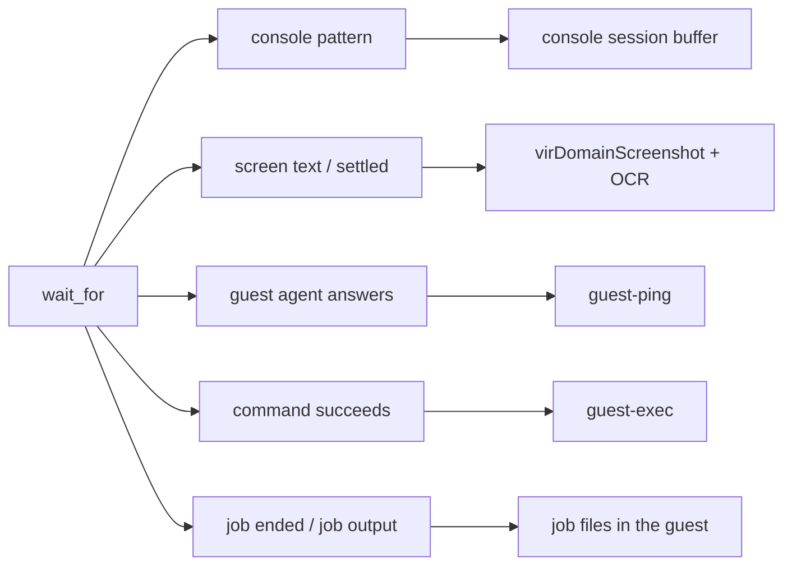

# Reliable interaction with a live guest: design

Status: accepted, after a plan-critic review. Once built, the code wins and this design follows it.
Basis: roadmap outcome 2 in [`fork-roadmap.md`](fork-roadmap.md), with evidence in
[`2026-11-09-vm-management-mcp-evaluation.md`](../research/2026-11-09-vm-management-mcp-evaluation.md).

## Summary

An agent can drive any guest, with or without a guest agent, without losing input and without guessing when the guest
is ready. One new tool, `wait_for`, blocks until the first of several conditions holds: console output, screen text, a
settled screen, the guest agent, a command, or a background job. A mouse tool and region screenshots complete the
screen as a channel. Job tools run long commands in agent-equipped guests and read their output as it grows. The
outcome lands in three runs: waits, console and Linux jobs; then OCR, screen and mouse; then Windows.

## Decisions

| Decision | Chosen | Why | Status |
| -- | -- | -- | -- |
| Guests served | Agentless guests on equal footing with agent-equipped ones: installers, bootloaders, kernels, Windows, appliances | These are planned test targets, and the console and screen are their only channels | resolved |
| Reading screen text | OCR in the server with `ocrs` 0.14, which needs Rust 1.94, so the crate's `rust-version` rises to 1.94; plus a wait until the screen settles | A server-side match lets an agent wait without receiving repeated images. In the probe ([`2026-11-10-ocr-probe.md`](../research/2026-11-10-ocr-probe.md)), `ocrs` read 31 of 44 key strings exactly, against Tesseract's 21, and Tesseract dropped every button label and highlighted row | resolved |
| Mouse | QEMU monitor `input-send-event`, sent through libvirt, with a USB tablet for absolute positions | Works with SPICE and VNC displays; the server builds the one command form itself | resolved |
| Waiting | One `wait_for` tool with a list of conditions, returning on the first that holds | An agent waiting for success must also stop at a failure such as a kernel panic, across channels | resolved |
| Call length | At most `limits.max_wait_secs` (default 50 s) per wait; a wait that runs out returns resume points | Codex and some Claude Code paths cut calls at 60 s | resolved |
| Expect-style sessions | The agent composes `console_write`, `type_text` or `send_keys` with `wait_for`; no script tool | Each step's result lets the agent react; `jonatsu/serial-mcp-server`'s script runner is the model if one is wanted later | resolved |
| Input pacing and layout | `console_write` gains per-character or per-chunk pacing with a cap, as in `serial-mcp-server`; `type_text` stays US layout | Waiting removes the main input loss; `send_keys` reaches any key | resolved |
| Long jobs | `job_start`, `job_read`, `job_stop`, `job_list`, with output in a log file per job in the guest | `guest-exec-status` returns output only after the process exits (QEMU guest agent protocol reference) | resolved |
| Job platforms | Linux and Windows, both within this outcome | Windows is a named target | resolved |
| Test guests | Debian netinst, OpenWrt x86, a kernel-panic boot on a template VM, Windows 11 Pro | Covers every channel and both job platforms | resolved: the Windows guest agent runs with the `virtio-win` serial driver and `qemu-ga`, installed at first logon |
| Delivery | Three runs, each landed and pushed before the next | Each run is a safe stopping point; `wait_for` is proven before later runs extend it | resolved |
| Test-guest memory | Watched and kept reasonable, with no strict cap; Windows may use more | No builds run on the host now | resolved |

Three defaults follow from the guardrails. The operator downloads the OCR models with a script and names their path in
the config; the server never fetches from the network. Patterns use the `regex` crate, which matches in linear time, so
no pattern can stall a wait. The server sends only `input-send-event` commands it builds itself; no tool accepts raw
monitor text.

## Behaviour

### `wait_for`

It takes a VM, a timeout and a list of conditions. The timeout is capped by `limits.max_wait_secs`, which must be
above 0. A timeout of 0 checks console conditions once, and is refused with any other kind, which needs at least one
probe. The call returns one of four results:

- **matched:** the index and kind of the first condition that holds, the matched text, and, for console and job
  conditions, `next`, the offset just past the match. When several hold in the same poll, the lowest index wins. On
  request the result adds a screenshot taken at the match.
- **closed:** a console condition's session ended, or the VM stopped. The result says which, at once, instead of
  running to the timeout.
- **timed out:** the result returns each console and job condition's resume point, the start of the last unfinished
  line, so the next call still matches output that arrived in between, including a prompt split across the two calls.
  It also returns each `screen_text` condition's last OCR text, so an agent can loosen its pattern.
- **cancelled:** the client cancelled the request; the wait stops at its next poll.

Condition kinds, by run:

| Kind | Holds when | Run |
| -- | -- | -- |
| `console` | the console session's output from `since` matches a pattern | 1 |
| `agent` | the guest agent answers `guest-ping` | 1 |
| `command` | a command run through the agent exits 0 | 1 (Linux), 3 (Windows) |
| `job_done` | a job has exited, or has ended without writing its status | 1 (Linux), 3 (Windows) |
| `job_output` | a job's output from `since` matches a pattern | 1 (Linux), 3 (Windows) |
| `screen_text` | OCR of the screen, or of a region, matches a pattern | 2 |
| `screen_settled` | at most a threshold of pixels change between consecutive frames for a given time | 2 |

Read-only mode refuses `command`, `screen_text`, `screen_settled` and the screenshot attachment, because it disables
command execution and screenshots today. `wait_for` checks the client's cancellation on every poll, so a cancelled
wait stops its polling and drops a running OCR's result. It sends progress notifications when the client sends a
progress token.

Each agent probe is bounded by the time left, at most 2 s, and runs on its own thread, so a hung guest agent, as after
a kernel panic, neither delays the console check nor stretches the call. A call therefore returns within
`max_wait_secs` plus 2 s. A `command` that is still running at the end is left to finish in the guest and reported.

### Console

Console offsets count raw bytes, and each session has a generation number, returned next to every offset the tools
return. Every `console_open` starts a new generation; `reset_vm` and `snapshot_revert` close the session, so the agent
opens a new one after them. A read or wait from an offset above 0 must name its generation, and an offset from an
older one is refused with that reason, instead of being clamped silently as today.

Each session keeps a wait cursor. `console_write` sets it to the buffer's end just before its bytes go out and returns
that offset, so the echo and the guest's answer fall after it. A match moves the cursor past the match. A `console`
condition without `since` starts at the cursor, so a write followed by a wait neither misses the answer nor matches an
old prompt again.

Patterns match ANSI-stripped text by default, as `console_read` returns it, with positions mapped back to raw offsets.
A wait never changes what `console_read` returns or waits for: it reads the buffer without marking output delivered.

`console_write` gains `inter_char_delay_ms`, or `chunk_size` with `chunk_delay_ms`, each up to 1000 ms. It refuses a
write whose paced duration would exceed `limits.max_wait_secs`. `type_text` keeps `delay_ms` and its US layout.

### Screen and mouse (run 2)

Screen coordinates are pixels of a full-screen image the agent got from `screenshot` without a region, or from a
wait's attachment. `mouse`, a `region` on `screenshot`, and the region of `screen_text` and `screen_settled` take `x`
and `y`, plus `width` and `height` for a region, with that image's `image_width` and `image_height`, and `screen` for
the display head (default 0). A region without the image's size, of zero size, or outside the image is refused. The
server maps coordinates proportionally: to QEMU's absolute axis range of 0 to 32767 for the mouse, and to the current
framebuffer for a region. A region's start rounds down and its end up, so a crop is never empty and never leaves the
frame. The server crops at full resolution before any downscaling. A resolution change between the screenshot and the
call therefore keeps the point at the same relative place, and the agent takes a new screenshot when the layout
changed. A region screenshot's reply gives the region's origin and size in the full-screen image, and states that its
pixels are not click coordinates.

`mouse` moves, clicks (left, right, middle), double-clicks, drags and scrolls, through `input-send-event` on the
domain's USB tablet. Each action is a sequence of separate commands with pauses: a move, a press and its release go
about 50 ms apart, because the tablet merges the events of one command, and a press and release sent together only
move the pointer ([`2026-11-10-qmp-click-probe.md`](../research/2026-11-10-qmp-click-probe.md)). A double-click
spaces its two clicks within a guest's double-click interval, and a drag presses, moves in steps, then releases. After
a failed step, the tool tries once to release a held button. `send_one`, which sends every command, refuses anything
but `input-send-event`. The tool reads the live XML for a tablet, and refuses a VM without one with that reason; VMs
made by `create_vm` and `create_vm_from_template` have one. Only display head 0 is supported, and another head is
refused, because addressing it needs the video device's identifier. libvirt marks a domain that receives monitor
commands as tainted (`custom-monitor`), and the tool description and the README say so.

A wait with screen conditions captures their display head on a probe thread, once per 500 ms poll, and every screen
condition of that wait reads the same frame. All screen conditions of one wait name the same head. Two waits on one
VM capture separately, since sharing frames across calls would need a cache. A failed capture, for example on a VM
without graphics, ends the wait with an error naming the cause, and captures stop after it. A VM check that starts
after the failure decides the outcome: a stopped VM ends the wait as `closed`. A match in the same poll, or found at
the deadline, still wins over the error.

`screen_settled` holds once no pair of consecutive frames over `settle_secs` differs in more than
`max_changed_pixels` pixels, compared exactly: by default 600 pixels for 3 s. A change of frame size counts as a
change. `settle_secs` is at least 0.5 s, one frame interval, and at most the call's timeout less 0.5 s. The threshold
counts pixels, not a share, because idle noise is fixed in pixels whatever the frame or region size: in the probe a
blinking cursor changed 16 pixels and a firmware spinner up to 415, while a progress-bar step changed over 1100 and a
page change far more. One typed character changes about 70, so typing does not count as change.

`screen_text` takes a `pattern` in Rust `regex` syntax, and matches it against the OCR lines joined by newlines; the
result returns the matched text. A time-out returns each `screen_text` condition's `last_text`, cut at a character
boundary to 4096 bytes. Each condition hashes the frame, or its region, and runs OCR only when the hash changed since
its last read. OCR runs on a probe thread bounded by the time left. A read never starts at or after the deadline. One
still running at the deadline or on cancellation is dropped, because `ocrs` cannot interrupt a run in progress; one
that finished after the last poll still counts. Each `screen_text` condition runs its own OCR, so one pattern with
alternatives costs less than several conditions on the same area. A frame whose mean luminance is below one half is
inverted first, because `ocrs` misreads light text on black, as on a text console.

The models are the `ocrs` project's ONNX detection and recognition models, at `display.ocr_models`.
`scripts/fetch-ocr-models.sh` downloads them and checks SHA-256 sums pinned in the script, since upstream publishes
none. The setting is optional. When it is set, it must be an absolute path to a directory that holds both model
files, or the server refuses to start. When it is unset, `screen_text` is refused with that reason before the wait
starts; `screen_settled` needs no models. The recogniser loads on the first `screen_text` wait, and every later wait
shares it; a failed load is not kept, so the next call tries again. `ocrs` runs in `rten`'s process-wide thread pool.
`main` sizes that pool to 4 threads by setting `RTEN_NUM_THREADS` before any other thread starts, so a wait on a busy
screen leaves the host's other cores to its VMs.

`wait_for` gains `screenshot: true`. On a match of any condition, the result attaches a PNG downscaled to 1280 pixels
wide, as `screenshot` does, with its size in the result's JSON. A screen match attaches the frame it matched on; any
other match captures display head 0 then. The capture and the encoding run on a probe thread inside the call's 2 s
margin. A failed or late capture keeps the match and adds a note. Read-only mode refuses the attachment, and
`wait_for` checks this itself, since the condition checks see only the conditions.

### Jobs

`job_start` returns a UUID v4 job ID; the tools refuse any other form, so an ID never becomes a path. The job runs
detached from the guest agent's own service, so restarting `qemu-guest-agent` does not end it: through `systemd-run`
where systemd exists, otherwise `setsid`. Its directory holds the merged stdout and stderr as bytes, the root process
ID with its start time and the boot ID, and the exit code once the job ends.

- Linux: `/var/lib/virtmanager-mcp/jobs/<id>/`, created with mode 700; the launcher refuses a parent that is not a
  root-owned directory with mode 700, or is a link, so no guest user can redirect it. The command reaches the guest on
  stdin and is stored as a file. The wrapper that runs it also runs from a file, because systemd expands `$` variables
  in a unit's command line. A background command starts with SIGINT and SIGQUIT ignored, and systemd ignores SIGPIPE
  in services; the unit sets `IgnoreSIGPIPE=no`, and the wrapper resets all three
  where the guest's `env` supports `--default-signal`.
- Windows: `C:\ProgramData\virtmanager-mcp\jobs\<id>\`. The command is PowerShell, as `exec`'s default is there. It
  reaches the guest as raw bytes on the launcher's standard input and is stored as UTF-8 with a byte-order mark, so
  PowerShell 5.1 reads it as UTF-8; it never appears on a command line. The launcher, sent like `exec`, writes a fixed
  PowerShell wrapper beside it and starts the wrapper with `Win32_Process.Create`, so the WMI service, not the guest
  agent, is its parent. The wrapper runs `cmd /d /c "chcp 65001 >nul & powershell -File <command> 2>&1"`, so stdout and
  stderr arrive merged and native programs write UTF-8, and appends that stream to the log in chunks. The agent cannot
  open a file another process holds open for writing, so the wrapper holds the log only while it appends, and keeps
  output in memory while a reader holds the log. It waits for the job's process, not for the end of its output: a
  process the job started in the background may keep the output open, so the wrapper copies output for 2 s after the
  job's process exits, then records the exit code. If the wrapper itself fails, it ends the job's process tree and
  records no exit code.
- Windows directories: `C:\ProgramData\virtmanager-mcp` and its `jobs` directory are owned by `SYSTEM` or
  `Administrators`, have inheritance removed, and grant access only to those two. The launcher creates a missing level
  in that form, and refuses a level that is a reparse point (a junction or symbolic link), has another owner, or whose
  access list names any other principal, leaving it as it found it. Ordinary users may create folders in
  `C:\ProgramData`, and an owner can rewrite an access list, so the owner check matters.
- Windows exit codes follow `powershell -File`: the code passed to `exit`, 1 after an uncaught error, and 0 otherwise,
  even after a failing native program. A job ends with `exit $LASTEXITCODE` to pass on a native program's code. The
  `command` condition runs like `exec`, through `-EncodedCommand`, where a failing native program or cmdlet as the last
  command gives 1. In both, `$false` is not a failure, so a test needs `exit [int](-not (...))`.

`job_read` returns output from an offset, up to `max_bytes` (by default `max_output_bytes`), the next offset, and
the exit code once the job has ended. A job whose process is gone without an exit code, after a reboot or a kill,
reads as "ended without status". On Linux the start time and the boot ID guard against a reused process ID. On Windows
the wrapper holds a lock file in the job directory open without sharing while it runs, and writes the exit code before
it lets go; the agent cannot open that file while it is held, so a read needs only file calls, and neither a reboot nor
a reused process ID passes for a running job. A read that finds no exit code reads it once more after checking the
process, so a job that ended in between reports its code.

`job_stop` signals the job's process group on Linux. On Windows a console process has no equivalent of SIGTERM, so
`job_stop` ends the wrapper's process tree with `taskkill /T /F` whether or not `force` is set, and says so; it first
checks that the recorded process ID still has its recorded start time, so a reused ID is never killed. A stopped
Windows job reads "ended without status", as a killed job does on Linux, and processes it detached from its tree
survive. `job_list` lists the jobs in the guest, so an agent finds its jobs again after losing context. The jobs live
in the guest, so they outlive a server restart, and a reset or deletion of the VM removes them. On Windows they run as
`SYSTEM` in session 0, without a desktop.

The Windows mechanisms are recorded in
[`2026-11-11-windows-jobs-probe.md`](../research/2026-11-11-windows-jobs-probe.md).

## Invariants

- Every new tool obeys `allowed_vms`. `job_start`, `job_stop` and `mouse` are hidden in read-only mode with the other
  mutating tools, and `wait_for` refuses there the conditions that run commands or take screenshots.
- The server sends the QEMU monitor nothing but `input-send-event` commands it builds, and `send_one` checks this.
- The server makes no network request. OCR models come from the operator.
- A `wait_for` call returns within `max_wait_secs` plus 2 s. Calls that existed before, such as `start_vm` and
  `exec`, keep their own limits.
- A wait never changes what `console_read` returns.

## Code changes

- `src/console.rs`: session generation, wait cursor, a scan that does not mark output delivered, and the closed state
  reported to waits.
- `src/server.rs`: `wait_for`, the job tools and `mouse`, with `RequestContext` passed to `wait_for` for cancellation
  and progress; `screenshot` with `region`; gating in `MUTATING_TOOLS` and the read-only refusals.
- `src/display.rs`: frame capture, regions and their mapping, the PNG encoder, the frame hash and the OCR
  recogniser. `src/wait.rs` gains the frame probe and the screen conditions, and `src/main.rs` sizes OCR's pool.
- A new `src/mouse.rs` for the `input-send-event` builder, the axis mapping, the tablet check and the sender.
- A new `src/jobs.rs` for the Linux and Windows launchers and the job file layout; `src/config.rs` gains
  `limits.max_wait_secs` and `display.ocr_models`.

## Test bed

Each run adds cases to `tests/testbed/`, with guests from official sources, checksum-verified where a checksum is
published.

- Run 1:
  - `wait_for` on a template VM for the agent, a command and console `login:`.
  - A kernel panic forced with `echo c > /proc/sysrq-trigger` stops a `[login:, Kernel panic]` wait at its second
    condition, with `__time__` showing the call bound while the hung agent probe runs.
  - A `console_read` after a wait returns the same output.
  - A VM stopped during a wait ends it as closed, and an offset from before a `force` reopen is refused.
  - An OpenWrt x86 image, uploaded into `agent-vms` with `virsh vol-upload` and defined with `virsh`, boots to a
    console-only shell.
  - Paced writes reach the OpenWrt shell intact. Where an unpaced long line at the GRUB command line loses characters,
    the case shows that loss and the paced write fixing it; otherwise pacing is shown harmless.
  - A Linux job streams output and is stopped. A second case file, run as a new server process, reads the same job
    after the restart and lists it.
- Run 2:
  - The OCR probe on screenshots of GRUB, the Debian installer and Windows 11 setup, in
    [`2026-11-10-ocr-probe.md`](../research/2026-11-10-ocr-probe.md), picked the engine and the settle threshold.
    `trial-deb13` keeps GRUB on its serial console, so GRUB screens come from the Debian netinst ISO booted under UEFI.
  - The Debian netinst and Windows 11 ISOs are in `agent-vms` as `tpl-debian13-netinst.iso` and
    `tpl-win11-26h2.iso`, because QEMU on `qemu:///system` cannot read the user's home directory. A VM boots the
    Windows ISO to the setup screen.
  - The Debian netinst installer is driven by screen waits, keys and the mouse to its partitioning screen.
  - A VM without a tablet refuses `mouse`.
- Run 3:
  - `t-win11`, a persistent Windows 11 Pro VM installed unattended by `tests/testbed/win11/build.sh` from the 26H2
    business editions ISO, `tpl-win11-26h2.iso`. It uses UEFI with Secure Boot and Microsoft's enrolled keys, an
    emulated TPM 2.0, 4 GiB of memory, a 64 GiB SATA disk, and Microsoft's public KMS client key for Pro, so it stays
    unactivated with a watermark. It has no network, which keeps it out of Windows Update and account sign-in, and no
    serial console. Its local administrator logs on automatically with a test password. A template would also exercise
    `create_vm_from_template` on Windows, but the domains it builds have no TPM and do not ask for Secure Boot.
  - At first logon its answer file installs the `virtio-win` 0.1.302 serial driver with `pnputil` and `qemu-ga` from
    its MSI.
  - Windows jobs, the `command` condition, screen waits and the mouse are checked on it.

## Checks

- Unit tests cover:
  - the read-only refusals of `command`, the screen conditions and the screenshot attachment;
  - the refusal of a malformed job ID and of a VM outside `allowed_vms` for every new tool;
  - console resume points, the wait cursor, generations and the tie-break;
  - the paced-write duration;
  - the coordinate mapping.
- Cancellation and progress rest on unit tests and code review: the test-bed client sends neither.
- Each run passes the gate in `AGENTS.md` and its test-bed cases.

## Risks

1. OCR misreads some text-mode fonts: in the probe, `ocrs` read "SeaBIOS" as "seaBinS" and dropped trailing dots.
   On `trial-deb13`'s console, a full-screen read gave "log in:" for "login:", while a region read matched exactly.
   Inverting dark frames fixes most of it, and regions or tolerant patterns such as `log ?in:` help. `ocrs` 0.14 read
   as many of the probe's key strings exactly as 0.12 did.
2. Hardened hosts may deny monitor access. The mouse then fails with libvirt's reason; keyboard input still works.
3. The Windows guest agent depends on the `virtio-win` serial driver, which is signed, and on `qemu-ga.exe`, which
   carries no Authenticode signature; the test bed pins the SHA-256 of the `virtio-win` ISO it comes from. On the
   first boot after setup, the agent answered `guest-ping` before it could start processes, so the first `exec` timed
   out.
4. A guest that fills its disk can lose job output. Job logs are not capped in the guest.
5. OCR on a busy screen loads the host, which also runs other VMs. The 4-thread pool bounds it. Several `screen_text`
   conditions each run OCR on the same frame, so one pattern with alternatives is cheaper.
6. Inverting dark frames damages the small text of the Windows setup screen: "Next" read as "Nex". Run 3 drives that
   screen and has to work around it.
7. The Debian installer drops input sent within about 2 s of a new screen. An agent waits for the screen's text, then
   for `screen_settled`, before it types.

The run-2 evidence for risks 1, 6 and 7 is in the execution record of
[`live-interaction-run-2-implementation-plan.md`](live-interaction-run-2-implementation-plan.md), and the OCR probe is
[`2026-11-10-ocr-probe.md`](../research/2026-11-10-ocr-probe.md).

## Open questions

None. The Windows guest agent gets its serial driver and `qemu-ga` from the `virtio-win` ISO at first logon, as the
run 3 test bed describes.
