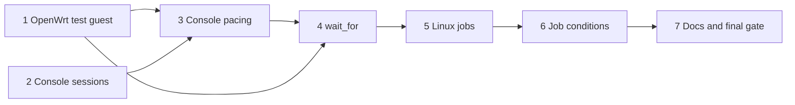

# Live interaction, run 1: implementation plan

Status: plan for the first of outcome 2's three runs, built from
[`live-interaction-design.md`](live-interaction-design.md) at `d7124a0` and revised for a plan-critic review. The
design owns behaviour; this plan owns order and checks. Progress goes in the execution record at the end. Runs 2
(OCR, screen and mouse) and 3 (Windows) get their own plans.

## Overview

Run 1 gives agents `wait_for` with console, guest-agent, command and job conditions, paced console writes, and
background jobs on Linux guests. An OpenWrt guest joins the test bed first, because the console checks need a guest
whose only channel is the serial console. The console comes next, because every console wait depends on its offsets:
a session gains a generation number and a wait cursor, and a scan that marks nothing delivered. Pacing is a small
change to the same write path, and it brings `limits.max_wait_secs`, which `wait_for` uses too. `wait_for` builds on
the console, with agent and command probes on their own threads. Jobs come last, because their two wait conditions
extend `wait_for`.

These interface details follow from the design and are fixed here:

- **Generation as a field.** Results that return a console offset also return `generation`. `console_read` and a
  `console` condition require `generation` whenever `since` is above 0, and refuse a stale one; `since: 0` and an
  omitted `since` keep working. This is a visible change to `console_read`: a caller that passes `next` from an
  earlier read must now pass its `generation` too, and the refusal says so.
- **Read-only mode, as the design says.** `job_start` and `job_stop` are hidden. `job_read`, `job_list` and the
  `job_done` and `job_output` conditions stay available: they read files through the guest agent's file calls, and
  `job_list` runs a fixed helper, as `list_dir` does. `wait_for` refuses only `command` there.
- **Windows refused for now.** Every job tool and the `command` condition refuse a Windows guest with a message
  that names run 3.
- **Screenshot attachment in run 2.** The `wait_for` option to attach a screenshot comes with the screen conditions.

## Preflight

These apply to every unit, which names only its additions.

- **Rules.** Follow `AGENTS.md`, including its guardrails: a change to `is_allowed`, `can_manage` or read-only gating
  needs a test that shows the refusal still happens. Load `rust-style`, `rust-error-handling` and `rust-testing`
  before editing Rust, `rust-async` before units 4 and 6, and `posix-shell` before writing the job launcher.
- **Gate.** Every commit passes the build gate in `AGENTS.md`, plus `cargo +1.89 test --locked`.
- **Seams.** Unit tests never touch libvirt. Gating is tested through two pure functions: `hidden_tools(&Config)`,
  which `VirtServer::new` uses, and `validate_conditions(&Config, &[Condition])`, which `wait_for` runs before any
  libvirt call. The `allowed_vms` refusal of each new tool is shown on the test bed.
- **Test bed.** Run cases as `tests/testbed/README.md` describes. The client runs calls one after another and asserts
  nothing, so each case file's README entry states the expected reply of each step, and a case passes when the
  replies match. Record what was seen in the execution record. Touch only `trial-deb13` and VMs and volumes named
  `t-*` or `tpl-*` in the `agent-vms` pool on `qemu:///system`. Run 1's cases use
  `tests/testbed/config-templates.toml`, with `t-owrt` added to `allowed_vms` and `power_vms`; recheck the existing
  template cases' `list_vms` replies, which then list `t-owrt` too.
- **Memory.** Check `free -m` before starting VMs, size each VM to its need (1 GiB for a template VM, 256 MiB for
  OpenWrt), and shut VMs down once their check is done.
- **Downloads.** The OpenWrt image comes from `downloads.openwrt.org`, checked against the release's `sha256sums`.
- **Review.** After each unit marked "reviewed", dispatch `code-reviewer` on its commits with the test evidence. Units
  2, 4, 5 and 6 use `model: opus`: they touch shared console state, threads, cancellation, and a launcher that runs as
  root in the guest. Fix blocking findings before a dependent unit starts.
- **Commits.** One logical change per commit, Conventional Commits, explicit pathspecs. Adding the `regex` crate
  changes `Cargo.toml` and `Cargo.lock`, and `cargo deny check advisories` covers it.

## Units

### 1. OpenWrt test guest (self-reviewed)

**Outcome.** The test bed has an appliance whose only channel is the serial console: `t-owrt`, OpenWrt x86-64 on
`qemu:///system`, 256 MiB, booting to a shell on `ttyS0`.

**Changes.** Add the steps to `tests/testbed/README.md`:

1. Download the current stable release's `generic-ext4-combined.img.gz` and its `sha256sums`, and verify the file.
2. Decompress it, accepting `gunzip`'s exit status 2 for trailing data, which OpenWrt images carry.
3. Upload it with `virsh vol-create-as` and `vol-upload` as `t-owrt.img` in `agent-vms`.
4. Define `t-owrt` with `virsh` from `tests/testbed/t-owrt.xml`: the disk by path, a serial console and no network.

Add `t-owrt` to the template config's `allowed_vms` and `power_vms`.

**Verification.** `console_open` on `t-owrt` right after `start_vm` shows the boot log, and a shell prompt after
Enter. This uses only existing tools.

**Recovery.** If the image does not boot under q35, try the i440fx machine type and record it. If neither boots,
stop: the design's appliance check needs another serial-only guest, which is the user's choice.

### 2. Console sessions (reviewed, Opus)

**Outcome.** Console offsets can be trusted across reopens and between a write and a wait (design, Console).

**Changes.** In `src/console.rs`:

- `Consoles` holds a generation counter that starts at a value derived from the process start time, so a new server
  process does not reuse an old process's numbers. Only `Consoles::open` takes the next value. `stop_vm` and
  `start_vm` keep or open no session, so the generation changes only when a session opens.
- `snapshot_revert` in `src/server.rs` always closes the session, so a revert to a running snapshot also needs a new
  `console_open`.
- Each session records the domain ID it opened on and holds a wait cursor, starting at 0. `write` sets the cursor to
  the buffer's end just before sending, and returns that offset with the generation.
- A new `scan(vm, since, generation)` returns the bytes from `since` to the buffer's end, with `dropped`, the
  generation, the closed reason and the domain ID, and leaves `delivered` unchanged.
- `read` takes the generation rule above.

In `src/server.rs`, `console_read` and `console_write` report `generation`, and `console_write` reports the offset its
answer starts at. The tool descriptions explain both.

**Verification.** Unit tests:

- a new session's generation is higher than the last, and the counter's start differs between two process starts;
- a stale generation is refused, and `since` above 0 without one is refused;
- `write` moves the cursor to the end before sending;
- `scan` reports `dropped` after the scrollback trims, and leaves `delivered` unchanged, so a waiting `read` afterwards
  still waits for new output.

Test bed: the existing console cases on `trial-deb13` show the same replies plus `generation`, with their `since`
calls given `generation`. A new case reopens with `force` and shows the old generation refused. Another reverts a
snapshot of a running VM and shows `console_read` answering "no console open".

### 3. Console pacing (reviewed)

**Outcome.** A slow receiver gets every character: `console_write` paces by character or by chunk (design, Console).

**Changes.**

- `src/config.rs` gains `limits.max_wait_secs`, default 50, refused when 0.
- `ConsoleWriteParams` gains `inter_char_delay_ms`, or `chunk_size` with `chunk_delay_ms`, each delay up to 1000 ms.
  Character and chunk pacing together are refused.
- A pure function computes the paced duration, and a write longer than `limits.max_wait_secs` is refused before any
  byte is sent.
- `Consoles::write` sends one segment at a time with the delay, and its 10 s deadline for a full stream applies to
  each segment.

**Verification.** Unit tests: the duration in both modes, the refusals at the cap and above 1000 ms, the segment
split, and the config refusal of 0. On `t-owrt`, a 4000-byte text written to `cat > /tmp/x` with pacing, then
Ctrl-D, gives the expected `wc -c` and `md5sum`. The same write without pacing is recorded either way; if it also
arrives intact, pacing is shown harmless, as the design allows. GRUB's line editor redraws a long line, so its echo
cannot show loss, and the case does not use it.

### 4. `wait_for` (reviewed, Opus)

**Outcome.** One call waits for the first of several conditions, returns within `max_wait_secs` plus 2 s, and never
loses or rematches console output (design, `wait_for`).

**Changes.**

- **Tool.** A new `src/wait.rs` holds the condition types and the loop; `src/server.rs` holds the tool, which takes
  `vm`, `timeout_secs` and `conditions`. Conditions are `{kind: "console", pattern, since?, generation?, strip_ansi?}`,
  `{kind: "agent"}` and `{kind: "command", command}`. `validate_conditions` compiles each pattern with the `regex`
  crate and checks the read-only and Windows rules before any wait. A `console` condition with no open session is
  refused with "call console_open first".
- **Console matching.** Each poll scans from `since`, or from the wait cursor, to the buffer's end, so a match that
  spans two reads is found. A byte-level ANSI stripper, built on the raw bytes, returns the stripped bytes and a map
  back to raw offsets, and holds back an escape sequence that the buffer's end cuts off. It replaces `strip_ansi`, so
  `console_read` and waits strip alike. Patterns run as `regex::bytes`. On a match, the result's `next` is the raw
  offset just past it, and the session's wait cursor moves there, so a repeated wait does not match the same prompt.
- **Probes.** The `agent` probe is one `guest-ping`. The `command` probe starts the command once with `guest-exec`,
  then calls `guest-exec-status` once per probe. It never kills the command: when the call ends with the command still
  running, the result reports its PID. After a non-zero exit, it starts the command again. Each condition has at most
  one probe in flight, on its own thread with a cloned `Domain`, and probes run about once a second. Each agent call
  uses a timeout of the time left, between 1 and 2 s. The OS check for the Windows rule runs inside the probe thread,
  under the same bound.
- **Loop and results.** The loop runs on the blocking thread every 30 ms, with an injected clock. The lowest index
  wins when several conditions hold in one poll. The call ends as `closed` when the session closes, when the VM stops
  running, or when the domain ID differs from the session's, as after a stop and start. A timeout returns each
  console condition's resume point, the start of its last unfinished line, with the generation.
- **Cancellation and progress.** The tool takes the `RequestContext`. The loop checks its cancellation token on every
  poll, and it sends a progress notification every 5 s through a runtime handle when the request carries a progress
  token.

**Verification.** Unit tests, with a fake clock and fake probes:

- the ANSI map, including an escape sequence and a UTF-8 sequence split across two scans;
- the resume point, including a prompt split across two calls;
- the tie-break, `next`, and a repeated wait that does not rematch;
- the closed result for a closed session and for a changed domain ID;
- the time bound with a probe that never returns;
- `validate_conditions`: a bad pattern, `command` in read-only mode, and a missing generation all refused.

Test-bed cases, with each step's expected reply in the README:

- On `t-w`, created with `wait_for_agent_secs: 0`, `[agent]` returns once the agent answers.
- On `t-w`, after `console_write` of Enter, `[console "login:"]` matches, and a `console_read` from the same offset
  returns the same output.
- On `t-w`, `[command "test -e /tmp/ready"]` times out with resume information, then matches after `exec` creates the
  file.
- On `t-w`, `exec` starts `(sleep 3; echo c > /proc/sysrq-trigger) &`. The wait
  `[console "login:" from the current end, console "Kernel panic", command "false"]` stops at index 1, and `__time__`
  shows it within `max_wait_secs` plus 2 s while the hung agent leaves the `command` probe waiting. Force-stop `t-w`
  afterwards.
- On a fresh `t-w`, `exec` starts `(sleep 5; poweroff) &`, and a wait for a pattern that never appears ends as
  `closed`.
- A 5 s wait that times out returns resume points; a second call matches output written in between.
- On `t-owrt`, a console wait finds the shell prompt.
- `wait_for` on a VM outside `allowed_vms` is refused.

### 5. Linux jobs (reviewed, Opus)

**Outcome.** An agent runs a long command in a Linux guest and reads its output as it grows, and the job survives a
server restart and a guest-agent restart (design, Jobs).

**Changes.** A new `src/jobs.rs` holds the launcher and the file layout. `src/server.rs` holds `job_start`,
`job_read`, `job_stop` and `job_list`. `job_start` and `job_stop` go into `MUTATING_TOOLS`.

`job_start` makes a UUID v4 and runs the launcher through `guest-exec`, capturing its output, with a short timeout. The
command travels as data, never as script text: the launcher writes it to a `cmd` file in the job directory, and the
wrapper runs that file. The launcher:

1. checks `/var/lib/virtmanager-mcp` and its `jobs` directory one at a time. Each must be a root-owned directory and
   not a link. Each missing one is created with `mkdir -m 700`, and the launcher stops at the first that fails;
2. creates the job's directory and its `cmd` file;
3. starts the wrapper with its stdin, stdout and stderr away from the agent's pipes: through `systemd-run --collect`
   when `/run/systemd/system` exists, falling back to `setsid` if `systemd-run` fails;
4. returns at once, and its output says which path it took or why it refused.

The wrapper writes `pid` (its PID and start time) and runs `cmd` as a child, with stdout and stderr merged into
`out`. Its TERM handler forwards the signal to the child, waits for it, and writes the exit code to `exit` through a
rename. It does not ignore the signal, because the child would inherit that.

`job_read` reads `out` from an offset, and `exit` and `pid`, through the agent's file calls. Without an exit code, it
reads `/proc/<pid>/stat`, parsed after its last `)`, and reports:

- "starting" while `pid` is still missing;
- "running" while the PID and start time match;
- "ended without status" otherwise.

`job_stop` runs a fixed helper that checks the PID and start time and signals the process group only when they match.
`SIGTERM` lets the wrapper record the exit code, while `force` sends `SIGKILL`, after which the job reads "ended
without status". `job_list` runs a fixed helper that lists the job directories with their state. Every tool refuses an
ID that is not a UUID, and a Windows guest.

**Verification.** Unit tests:

- the ID check;
- the command never appears in the launcher text, even with quotes, `$`, `${VAR}`, newlines and `;`;
- parsing `/proc/<pid>/stat` with a process name holding spaces and parentheses;
- the state rules above;
- `hidden_tools` in read-only mode.

Test-bed cases on `t-w`, with each step's expected reply in the README:

- A job printing a line a second is read twice, with growing output and offsets.
- `systemctl restart qemu-guest-agent` leaves it running.
- `job_stop` ends it, and `job_read` shows its exit code.
- A second case file, run as a new server process, lists and reads a job that the first started.
- A job whose process is killed with `kill -9` through `exec` reads "ended without status".
- With `/var/lib/virtmanager-mcp` replaced by a link to `/tmp` through `exec`, `job_start` is refused with the reason,
  and `ls /tmp` shows nothing new.
- A command holding `$HOME` and quotes prints them literally.
- `job_start` on a VM outside `allowed_vms` is refused.

### 6. Job conditions (reviewed, Opus)

**Outcome.** `wait_for` stops when a job ends or its output matches (design, `wait_for`).

**Changes.** `src/wait.rs` gains `{kind: "job_done", job}` and `{kind: "job_output", job, pattern, since?}`. They read
the job files once a second on the probe threads of unit 4, with the same one-in-flight rule and time bound, and
`job_output` has the same resume points as console output. Both are allowed in read-only mode.

**Verification.** Unit tests for the resume point of job output, and for both conditions passing `validate_conditions`
in read-only mode. On `t-w`, a wait for `[job_output "step 3", console "Kernel panic"]` stops at index 0. A wait for
`job_done` returns with the exit code.

### 7. Docs and final gate

**Outcome.** The run is documented, checked and pushed.

**Changes.**

- The README lists the new tools, `max_wait_secs`, pacing and the `generation` rule.
- The server's instructions text names `wait_for` and the job tools.
- `tests/testbed/README.md` holds the new cases with their expected replies.
- The design follows any change the build forced.
- The roadmap records run 1.

**Verification.**

- The gate and `cargo +1.89 test --locked` pass at the last commit.
- The test-bed cases that need no root pass: the existing ones on `trial-deb13`, the template cases, and run 1's new
  cases. No `t-*` VM or volume is left, except `t-owrt` and its disk, which stay for runs 2 and 3. The template
  checksum is unchanged.
- Two separate reviews close: `code-reviewer` (Opus) over the whole run, and a fresh `conformance-review` against the
  design and this plan.
- The commits are pushed to `origin main` under the standing authorization, and CI passes.

## Exceptions the run records

The unattended run cannot execute these checks. Each stands on the evidence named here, and the execution record
carries each one:

| Check | Why the run cannot execute it | Evidence instead |
| -- | -- | -- |
| A failed volume deletion during expiry | Needs root (`sudo chattr`) | Unit tests; the user runs the README steps by hand |
| A client cancelling a wait | The test-bed client cannot cancel | Unit test with a cancelled token, and code review |
| Progress notifications | The test-bed client sends no progress token | Unit test of the timer, and code review |
| The `setsid` fallback for jobs | The template guest runs systemd | Unit test of the launcher text, and code review |
| Windows refusals | No Windows guest until run 3 | `validate_conditions` unit tests; run 3 checks them live |
| Two server processes reading one job at once | The client drives one server at a time | Code review: reads are file reads with no shared state |

## Execution record

| Unit | Commits | Evidence | Review |
| -- | -- | -- | -- |
| 1 OpenWrt test guest | `a935abd` | OpenWrt 25.12.6 `generic-ext4-combined` image verified against the release `sha256sums`; `gunzip` exited 0; uploaded as `t-owrt.img` (126 MB) and defined from `tests/testbed/t-owrt.xml` on q35; `owrt-boot.json` showed the kernel log, "Please press Enter", the BusyBox banner and `root@OpenWrt:~#` | self-review |
| 2 Console sessions | `d8d386f`; review notes in the unit-3 commit | 57 unit tests pass (generation rules, wait cursor, scan leaves `delivered`, scan reports `dropped`). `console-generation.json` on `t-g`: generations `…417001` then `…417002` after a forced reopen; `since 10` with generation 1 refused as an earlier session; `since 10` without a generation refused; `snapshot_revert` of the running VM closed the session and the next read said "no console open". The existing console cases on `trial-deb13` gave the same replies plus `generation` (`console-stall` reached `root@trial-deb13:~#` once run on a booted guest) | `code-reviewer` (Opus): approved. Its two minor notes are applied in the unit-3 commit: "already open" names the generation, and a failed write's error names the answer's offset and generation |
| 3 Console pacing | this commit | 61 unit tests pass (segments, durations, option refusals at 1000 ms and at `max_wait_secs`, `max_wait_secs = 0` refused). `owrt-pacing.json` on `t-owrt`: 4000 bytes written to `cat` paced (16-byte chunks, 20 ms) and unpaced both gave `wc -c` 4000 and MD5 `3f59f6f6f02f857841c375830e5edeb1`, so unpaced input lost nothing on this guest and pacing is shown harmless; 1001 ms and a 4000 s paced write refused |  |
| 4 `wait_for` |  |  |  |
| 5 Linux jobs |  |  |  |
| 6 Job conditions |  |  |  |
| 7 Docs and final gate |  |  |  |
| Exceptions |  |  |  |
