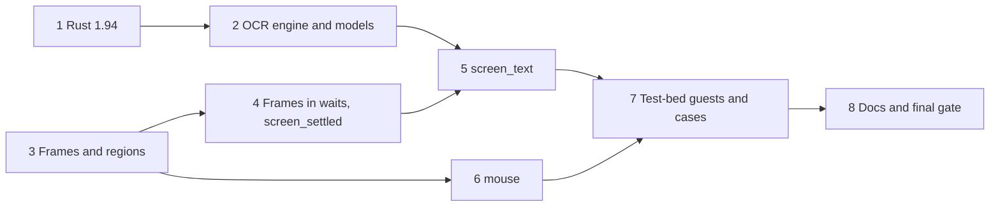

# Live interaction, run 2: implementation plan

Status: plan for the second of outcome 2's three runs, built from
[`live-interaction-design.md`](live-interaction-design.md) at `306b59b`, which records the OCR probe's result
([`2026-11-10-ocr-probe.md`](../research/2026-11-10-ocr-probe.md)), and revised for a plan-critic review. The design
owns behaviour; this plan owns order and checks. Progress goes in the execution record at the end. Run 3 (Windows
jobs and guest agent) gets its own plan.

## Overview

Run 2 makes the screen a channel an agent can wait on and act through. `wait_for` gains `screen_settled`, which holds
once the screen stops changing, and `screen_text`, which matches OCR of the screen or a region; a wait can attach a
screenshot. `screenshot` gains a `region`, and a new `mouse` tool moves, clicks, drags and scrolls through QEMU's
`input-send-event`.

The order follows the dependencies. `ocrs` 0.14 needs Rust 1.94, so the toolchain rises first, and the engine is
checked on the probe's screenshots before anything relies on it. Frame capture and regions come next, because the
screen conditions build on them. The screen conditions land in two steps: frames in the wait loop with
`screen_settled` and the attachment, which need no OCR, then `screen_text`. The mouse needs only the shared coordinate
validation. The test-bed guests and cases come last, with the docs and the final gate.

### Interface details fixed here

- **Coordinates.** `mouse`, `screenshot`'s `region` and the screen conditions' `region` take pixel `x` and `y` (and
  `width` and `height` for a region) in a full-screen image the agent received from `screenshot` without a region or
  from a wait's attachment, plus that image's `image_width` and `image_height`, and `screen` for the display head
  (default 0). A region without `image_width` and `image_height` is refused. A region screenshot's reply states that
  its pixels are not click coordinates and gives the region's origin and size in the full-screen image.
- **Frames.** A wait with screen conditions captures the display head they name on a probe thread, every 500 ms (the
  interval the probe calibrated the threshold on), and every screen condition of the wait reads that capture.
- **`screen_settled`.** `max_changed_pixels` (default 600) and `settle_secs` (default 3, at least 0.5 and at most the
  call's timeout), with an optional `region`. It holds once no pair of consecutive frames over `settle_secs` differs
  in more than `max_changed_pixels` pixels, compared exactly. A change of frame size counts as a change.
- **`screen_text`.** `pattern` (Rust `regex` syntax), an optional `region` and `screen`. It matches the OCR lines
  joined by newlines; the result returns the matched text. A time-out returns the last OCR text, cut to the result's
  text limit, so an agent can loosen its pattern.
- **A failed capture,** for example on a VM without graphics, ends the wait with an error naming the cause.
- **Attachment.** `wait_for` gains `screenshot: true`. On a match of any condition it attaches a PNG of display head
  0, or of the matched screen condition's head, downscaled to 1280 pixels wide as `screenshot` does, with its size in
  the result's JSON. For a non-screen match the capture happens then, bounded by the call's 2 s margin; a failed
  capture keeps the match and adds a note. Read-only mode refuses it; `wait_for` checks this itself, since
  `validate_conditions` sees only the conditions.
- **Read-only mode.** `screen_text`, `screen_settled` and the attachment are refused; `mouse` is hidden with the other
  mutating tools.
- **Models.** `display.ocr_models` is optional. When it is set, the directory and both model files must exist, or the
  server refuses to start. When it is unset, `screen_text` is refused with that reason before the wait starts;
  `screen_settled` needs no models.
- **OCR load.** OCR runs in its own thread pool of 4 threads, so a wait on a busy screen does not take every core of
  the host, which also runs the user's VMs. A cancelled wait stops polling and drops a running OCR's result; `ocrs`
  cannot interrupt a run in progress.
- **Mouse.** Each action is a sequence of `input-send-event` commands with pauses: a press and its release go as
  separate commands about 50 ms apart, because QEMU's USB tablet merges events sent in one command; a double-click
  spaces its two clicks within a guest's double-click interval; a drag presses, moves in steps, then releases. Run 2
  supports display head 0 only and refuses others with that reason, because addressing another head needs the video
  device's identifier.

### Design amendments this plan needs

The design changes as follows in unit 8, or earlier if a unit depends on it. Each is approved with the plan.

1. "One capture per VM and poll serves every wait on that VM" becomes "one capture per poll serves every screen
   condition of a wait": two waits on one VM at once are rare, and sharing frames across calls would need a cache.
2. "`wait_for` checks the client's cancellation on every poll, so a cancelled wait stops its polling and its OCR"
   becomes "... stops its polling and drops a running OCR's result".
3. The coordinate, frame, settle, failed-capture, attachment, OCR-load and mouse details above join the design's
   screen section, and the time-out result of `screen_text` gains the last OCR text.
4. A risk joins the design: OCR on a busy screen loads the host, bounded by the 4-thread pool.

## Preflight

These apply to every unit, which names only its additions.

- **Rules.** Follow `AGENTS.md`, including its guardrails: a change to `is_allowed`, `can_manage` or read-only gating
  needs a test that shows the refusal still happens. Load `rust-style`, `rust-error-handling` and `rust-testing`
  before editing Rust, `rust-async` before units 4 and 5, and `posix-shell` before writing the model fetch script.
- **Gate.** Every commit passes the build gate in `AGENTS.md`, plus `cargo +1.94 test --locked` from unit 1 on.
- **Dead code.** The crate is a binary, so an item without a caller fails clippy. Add each item in the unit that first
  calls it; where a unit must land an item before its caller, mark it `#[expect(dead_code, reason = "...")]` naming
  the unit that removes the mark.
- **Seams.** Unit tests never touch libvirt or the models. The coordinate mapping, the pixel diff, the settle logic
  and the `input-send-event` builder are pure functions with their own tests. Frame capture is a method on the
  `Guest` seam in `src/wait.rs`, which runs on probe threads. OCR is a recogniser shared behind an `Arc`, a function
  from an image to its text lines that is `Send` and `Sync`, so tests use fake frames and a fake recogniser that can
  block.
- **Models in tests.** Tests that run real OCR carry `#[ignore = "needs the OCR models; set VIRTMANAGER_OCR_MODELS"]`,
  run with `cargo test -- --ignored`, and fail when the variable is unset rather than passing silently. CI does not
  run them; the execution record notes each run.
- **Test bed.** Run cases with `tests/testbed/run-all.sh` and `mcp_call.py --check`, and give every new call an
  `expect`. Touch only `trial-deb13` and VMs and volumes named `t-*` or `tpl-*` in the `agent-vms` pool on
  `qemu:///system`. The ISOs `tpl-debian13-netinst.iso` and `tpl-win11-26h2.iso` are already there.
- **Memory.** Check `free -m` before starting VMs. The installer VM gets 1 GiB, the Windows VM 4 GiB; run one of them
  at a time and shut it down once its case is done.
- **Disk.** Check `df -h /` before builds, and remove any extra build directory or worktree once its result is
  recorded.
- **Downloads.** The Rust 1.94 toolchain comes from rustup; the OCR models from the `ocrs` project's bucket, checked
  against the SHA-256 sums the probe recorded.
- **Review.** After each unit marked "reviewed", dispatch `code-reviewer` on its commits with the test evidence. Units
  4, 5 and 6 use `model: opus`: units 4 and 5 add threads, deadlines and cancellation to the wait loop, and unit 6
  sends commands to the QEMU monitor, a trust boundary. Fix blocking findings before a dependent unit starts.
- **Commits.** One logical change per commit, Conventional Commits, explicit pathspecs. Pushing waits for the
  maintainer, who answers the push prompt.

## Units

### 1. Rust 1.94 (self-reviewed)

**Outcome.** The crate declares `rust-version = "1.94"`, CI's minimum-version job uses 1.94, and the gate passes on
both toolchains.

**Changes.** Install the toolchain with `rustup toolchain install 1.94`. Set `rust-version` in `Cargo.toml`, and drop
the part of its comment that names `uuid` as the reason; unit 2 names `rten` once it is a dependency. Set the
toolchain of the minimum-version job in `.github/workflows/ci.yml` to 1.94. `AGENTS.md` refers to "the
`rust-version` toolchain" and needs no change.

**Verification.** `cargo +1.94 test --locked` and the gate pass. CI passes once the maintainer pushes.

**Recovery.** If 1.94 fails to build a locked dependency, record it and stop: the engine choice rests on 1.94.

### 2. OCR engine and models (reviewed)

**Outcome.** A recogniser built from the ONNX models reads text lines from an image with `ocrs` 0.14, at least as well
as `ocrs` 0.12 did in the probe, and reads every string a test-bed case will wait for.

**Changes.**

- Add `ocrs = "0.14"` and `rten = "0.28"`, the release line `ocrs` 0.14 uses, whose `Model` type the server passes to
  it. ONNX loading comes from `ocrs`'s default features. The `Cargo.toml` comment now names `rten` as the reason for
  the minimum Rust version.
- `scripts/fetch-ocr-models.sh` (POSIX sh) takes a target directory. For each of `text-detection.onnx` and
  `text-recognition.onnx` it checks an existing file against the SHA-256 sum pinned in the script and keeps it when
  the sum matches. Otherwise it downloads from `https://ocrs-models.s3-accelerate.amazonaws.com/` to a temporary
  name, checks the sum, and moves the file into place. It never leaves an unverified file under the final name, and
  exits non-zero on a mismatch.
- `src/config.rs` gains `display.ocr_models`, with the rule the overview fixes.
- `src/display.rs` gains the recogniser: the `ocrs` engine, built once from the models, running in its own 4-thread
  pool, with the inversion of frames whose mean luminance is below one half. Until unit 5 calls it, it carries a
  `dead_code` expectation naming unit 5.

**Verification.**

- Unit tests, without models: the inversion rule on synthetic images, and the config rule (set and missing refuses to
  start, unset is accepted).
- An ignored test with the models reads the probe's 10 saved PNGs in `docs/research/2026-11-10-ocr-probe/`, first
  without inversion, and counts the exact reads of the key strings the probe listed for those screens. It passes when
  that count is at least 0.12's on the same screens. A second check, through the recogniser with inversion, asserts
  every string a run-2 case will wait for: "Graphical install" on the UEFI GRUB menu, the installer's language
  screen title, "Select your location", and "Windows 11 Setup".
- The fetch script, run twice into a temporary directory, downloads once and keeps the verified files the second
  time; with one file corrupted it replaces that file; with a wrong pinned sum it exits non-zero and leaves no file
  under the final name. ShellCheck and shfmt pass.
- `cargo deny check advisories` passes; record the new crates and their licenses.

**Recovery.** If the raw count is below 0.12's, or a case string is not read, stop and report: the choice of 0.14 on
1.94 assumed it reads no worse, and a case string that cannot be read needs another wait in the case or a different
screen.

### 3. Frames and regions (reviewed)

**Outcome.** One function captures a display head at full resolution from a domain, and `screenshot` takes an optional
`region`, cropped at full resolution before any downscaling.

**Changes.** Split `display::screenshot` into a capture that returns the full-resolution frame, taking its
connection from the domain rather than from `Hypervisor`, and an encoder that crops and downscales. Add the `Region`
type and the shared coordinate validation: positive size, inside the image it refers to, `image_width` and
`image_height` given. Map a region proportionally onto the current frame, rounding so it never leaves the frame. The
region reply states its origin and size in the full-screen image and that its pixels are not click coordinates.

**Verification.** Unit tests for the region mapping: corners, a frame larger and smaller than the image the agent saw,
regions at the right and bottom edges, rounding, and the refusals. On the test bed, a region screenshot of
`trial-deb13`'s login text returns an image of the region's size, and a full screenshot still reports `WxH`.

### 4. Frames in waits and `screen_settled` (reviewed, Opus)

**Outcome.** `wait_for` accepts `screen_settled` and the `screenshot` attachment, as the overview fixes them.

**Changes.**

- `Guest` gains frame capture. A wait with screen conditions runs a capture probe every 500 ms on the head they name.
- `Condition` and `Check` gain `screen_settled`; `validate_conditions` checks its parameters against the call's
  timeout and refuses it in read-only mode; `wait_for` refuses the attachment in read-only mode. The zero-timeout
  refusal's message names the screen kinds too.
- The settle state keeps the previous frame and the time the screen last changed beyond the threshold; a size change
  counts as a change.
- A failed capture ends the wait with an error naming the cause.
- On a match with `screenshot: true`, the result gains the image and its size.

**Verification.** Unit tests with fake frames:

- settle timing, including a sequence that changes again just before `settle_secs` and a size change;
- the threshold at, just below and just above `max_changed_pixels`;
- `settle_secs` below 0.5 or above the timeout refused;
- a hung capture at the deadline: the wait returns timed out within its bound;
- a failed capture;
- the read-only refusals of the condition and the attachment;
- the attachment on a console match, and a failed attachment capture keeping the match.

### 5. `screen_text` (reviewed, Opus)

**Outcome.** `wait_for` accepts `screen_text`, as the overview fixes it.

**Changes.**

- `Condition` and `Check` gain `screen_text`, refused in read-only mode and without models.
- Each screen-text condition keeps the hash of the frame, or region, it last read, and runs the recogniser only when
  the hash changed.
- The recogniser runs on its own probe thread, bounded by the time left. An OCR that is still running at the deadline
  is abandoned, and its result is not used. One that finished after the last poll still counts, as job and command
  probes do.
- A time-out returns the last OCR text.

**Verification.**

- Unit tests with fake frames and the fake recogniser cover:
  - the recogniser running only on a changed frame or region;
  - a blocking recogniser at the deadline;
  - a recognition that finished just before the time-out;
  - the tie-break against a console condition in the same poll;
  - the refusals in read-only mode and without models;
  - the last OCR text on a time-out.
- An ignored test with the models runs `screen_text` against the probe's installer language PNG through the fake
  frame source.

### 6. `mouse` (reviewed, Opus)

**Outcome.** A `mouse` tool moves, clicks (left, right, middle), double-clicks, drags and scrolls on a VM's USB
tablet, refuses a VM without one, and is hidden in read-only mode.

**Changes.**

- First, check the host's QEMU by hand on `t-inst` with `virsh qemu-monitor-command`: a press and release in one
  `input-send-event` against the same two as separate commands. Record which one clicks. The builder follows the
  observed behaviour if it differs from the overview's assumption.
- A pure builder turns an action into a sequence of QMP `input-send-event` commands with the pauses between them. It
  maps coordinates onto QEMU's absolute axis of 0 to 32767. No caller-supplied text reaches a command: every field is
  a number or an enum the server writes.
- The tool checks the domain's live XML for `<input type='tablet'>`, refuses a `screen` other than 0, and sends each
  command through `Domain::qemu_monitor_command` with flags 0, which is QMP.
- `mouse` joins `MUTATING_TOOLS`, with annotations: not read-only, destructive, not idempotent.
- Its description and the README say that libvirt marks a domain that receives monitor commands as tainted
  (`custom-monitor`).

**Verification.**

- Unit tests cover:
  - the builder's sequence for each action, including the pauses;
  - the axis mapping at the corners and centre;
  - the tablet check on XML with and without a tablet;
  - the refusal of another head;
  - read-only hiding;
  - the `allowed_vms` refusal, through the existing gating seam.
- The live checks are in unit 7.

**Recovery.** If the host's libvirt denies monitor commands, record the error. The design's risk 2 covers that case:
the keyboard still works.

### 7. Test-bed guests and cases (self-reviewed)

**Outcome.** Cases with expectations show the new conditions and the mouse on real guests, and `run-all.sh` runs
them, skipping the OCR cases when no models are given.

**Changes.**

- **Guests.**
  - `tests/testbed/t-inst.xml` and `tests/testbed/t-win.xml` are generated once with
    `/usr/bin/python3 /usr/bin/virt-install ... --print-xml`, with the probe's options, and committed.
  - `t-inst`: 1 GiB, UEFI, q35, no network, a USB tablet, SPICE with a video device, the netinst ISO as its CD-ROM,
    and an 8 GiB `t-inst.qcow2` that `run-all.sh` creates with `vol-create-as`.
  - `t-win`: UEFI with Secure Boot and SMM, an emulated TPM, 4 GiB, a tablet, SPICE with a video device, the Windows
    ISO, and no disk.
  - The README gives the `virsh define` steps.
- **Configs.** The tracked configs stay without `display.ocr_models`. When `VIRTMANAGER_OCR_MODELS` is set,
  `run-all.sh` writes a screen config into its work directory: the template config plus `t-inst` and `t-win` in
  `allowed_vms` and `power_vms`, and the models. When the variable is unset, it skips the OCR cases and says why.
- **Cases.**
  - `screen-installer.json` (screen config):
    - Boots `t-inst` and waits for `screen_text` "Graphical install" on the UEFI GRUB menu, attaching a screenshot.
    - Presses Enter and waits for `screen_settled` on the language screen.
    - Scrolls the language list with `mouse` and waits for a language further down.
    - Clicks "Continue" at fixed coordinates taken from the probe's `deb-installer-language.png` at 1280x800,
      because the client cannot pass coordinates from an image reply, and waits for `screen_text` "Select your
      location".
    - Goes on with keys to the partitioning screen.
    - Takes a region screenshot of the title.
    - Brackets a `screen_text` wait that cannot match with `__time__`, to show the call bound on a changing screen.
  - `screen-windows.json` (screen config): boots `t-win`, sends a key several times a second apart while "Press any
    key" may show, and waits for `screen_text` "Windows 11 Setup".
  - `mouse-refusals.json` (template config, run through the `t-owrt` unit): starts `t-owrt` and expects `mouse` to be
    refused with "tablet", and `mouse` on `trial-deb13` refused as outside `allowed_vms`.
  - `screen-no-models.json` (template config): `screen_text` refused for want of models; `screen_settled` accepted.
- `run-all.sh` gains the cases. Its existing clean-up already undefines `t-*` VMs with their NVRAM and deletes `t-*`
  volumes.

**Verification.** Each case passes with `--check`, and `run-all.sh` with no arguments exits 0 both with and without
`VIRTMANAGER_OCR_MODELS`. Afterwards only `trial-deb13`, `t-owrt` and the `tpl-*` volumes remain, and the template's
SHA-256 is unchanged.

**Recovery.** If the installer ignores tablet clicks, record it and drive that step with keys; the click on the Windows
setup screen then shows the mouse instead.

### 8. Docs and final gate

**Outcome.** The README and the design describe what was built, the roadmap records run 2, and the final reviews
close.

**Changes.** The README's tools table and its screen section gain `mouse`, regions, the screen conditions, the
attachment, `display.ocr_models`, the fetch script and the taint note. The design takes the amendments listed in the
overview and any detail the build settled differently. The roadmap marks run 2 done and names run 3's plan next.

**Verification.**

- The gate and `cargo +1.94 test --locked` pass at the last commit; the ignored OCR tests pass with the models.
- `run-all.sh` exits 0 with and without the models.
- A `code-reviewer` (Opus) review of the whole run, and a separate `conformance-review` against the design and this
  plan, find no material mismatch, with their findings fixed and rechecked.
- CI passes once the maintainer pushes.

## Exceptions the run records

| Check | Why it cannot run here | Stand-in evidence |
| -- | -- | -- |
| Cancellation and progress during screen waits | The test-bed client sends neither | Unit tests and review, as in run 1 |
| A host that denies monitor commands | This host allows them | The error path is unit-tested; risk 2 in the design |
| Double-click and drag on a guest | No run-2 screen needs them | Builder tests for their command sequences |
| Display heads other than 0 | Run 2 refuses them | The refusal's unit test |
| Windows beyond the first setup screen, Windows jobs and the guest agent | They belong to run 3 | `screen-windows.json` reaches the setup screen only |

## Execution record

The run's goal:

- **Objective.** Units 1 to 8 are committed on `main`, each with its row here.
- **Success.** After the last change:
  - the gate and `cargo +1.94 test --locked` exit 0;
  - the ignored OCR tests pass with the models;
  - `tests/testbed/run-all.sh` exits 0 with and without `VIRTMANAGER_OCR_MODELS`;
  - an Opus code review and a separate conformance review find no material mismatch.
- **Boundaries.** Nothing is pushed.
- **Stop.** Stop and report when a step needs root, a design change, or another VM or pool.

| Unit | Commits | Evidence | Review |
| -- | -- | -- | -- |
| 1 Rust 1.94 | `12468ae` | rustup installed 1.94.1. `rust-version` and CI's minimum-version job moved to 1.94; the roadmap's CI item names the new minimum. 116 unit tests pass under the current toolchain and `cargo +1.94`; fmt, clippy with `-D warnings`, `cargo deny check advisories` and pre-commit pass. CI waits for the push | Self-reviewed: a version bump with no code change |
| 2 OCR engine and models | `d68f37a` (fetch script), `5d92fcc` (recogniser, `display.ocr_models`), `abbd211` (script review fix) | `ocrs` 0.14.0 with `rten` 0.28.0; 22 new crates, all `MIT OR Apache-2.0`; `cargo deny check advisories` clean. Raw OCR without inversion on the probe's 10 saved screens read 25 of 38 key strings exactly, the same as 0.12 there. Through the recogniser with inversion, "Graphical install", "Select a language" and "Windows 11 Setup" were read; "Select your location" has no saved screen and is left to unit 7. Inversion damages the Windows setup screen's small text ("Next" read as "Nex"), a risk for run 3. OCR took 145 to 448 ms per screen with 4 threads. Deviation: `ocrs` runs in `rten`'s process-wide pool, so `main` sets `RTEN_NUM_THREADS=4` before any thread starts instead of using a separate rayon pool; unit 8 adjusts the design's wording. The fetch script downloaded once, kept verified files on a second run, replaced a corrupted file, and with a wrong pinned sum exited 1 leaving no file; ShellCheck and shfmt pass. 119 unit tests pass on both toolchains; the two ignored OCR tests pass with the models and fail without them | `code-reviewer` (Opus): approved both commits; the `set_var` runs before any thread, and `rten` sizes its pool from the variable. Its optional finding, a backslash or leading dash in the models directory, is fixed in `abbd211` |
| 3 Frames and regions | `56d6ac8` (capture, encoder, `Region`), `0e57352` (`screenshot-region.json`), `133bbfd` (review tightening) | `display::screenshot` is split into `capture(dom, screen)`, which takes its connection from the domain, and `encode_png`, which crops at full resolution before downscaling. `Region` becomes `CheckedRegion` becomes `Rect`, mapped proportionally (start rounded down, end up); an exhaustive test over every span from 1 to 7 pixels shows a crop is never empty and never leaves the frame. `image_width` and `image_height` are required in the schema. 131 unit tests pass on both toolchains. On `trial-deb13`, a full screenshot replied `1280x800`, a top-left-quarter region replied with its 640x400 size, origin and the note that its pixels are not click coordinates, and a region without the image size, one outside the image, and one of zero width were refused | `code-reviewer`: approved, no findings; its optional suggestion to assert the full size is `133bbfd` |
