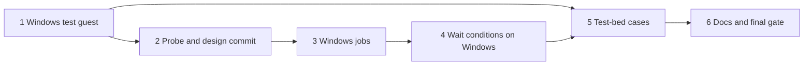

# Live interaction, run 3: implementation plan

Status: approved with its six design amendments, built from
[`live-interaction-design.md`](live-interaction-design.md) at `4e0a3af` and revised for a plan-critic review. The
design owns behaviour; this plan owns order and checks. Progress goes in the execution record at the end. This is the
last of outcome 2's three runs; runs 1 and 2 are in
[`live-interaction-run-1-implementation-plan.md`](live-interaction-run-1-implementation-plan.md) and
[`live-interaction-run-2-implementation-plan.md`](live-interaction-run-2-implementation-plan.md).

## Overview

Run 3 brings Windows to the features runs 1 and 2 built for Linux and for screens. Background jobs (`job_start`,
`job_read`, `job_stop`, `job_list`) and the `wait_for` conditions `command`, `job_done` and `job_output` refuse Windows
guests today, naming this run. After it, they work on a Windows 11 Pro guest with the QEMU guest agent, and the test
bed shows screen waits and the mouse on that guest's desktop.

Everything rests on a Windows guest whose agent answers, and the design records that no setup on this host has tried
the `virtio-win` serial driver and `qemu-ga` (risk 3). The guest therefore comes first. Before any job code, a probe on
that guest settles how a job is started, how it outlives a restart of the guest agent, how its directory is protected,
and how its output, exit code and liveness are read; the design then takes the amendments below in one commit. The job
tools follow, then the wait conditions, which read jobs through the same functions. The test-bed cases and the docs
close the run.

### Design amendments this plan needs

The design's Windows job paragraph names the directory, a launcher sent like `exec` that redirects through `cmd /c`,
and a stop that ends the process tree. These amendments fill it in and are approved with the plan. Unit 2's probe must
confirm each one before the design takes them, at the end of unit 2 and before any job code. A probe result that
contradicts an amendment stops the run for a design change.

1. **Shell and encoding.** A Windows job runs its command with PowerShell, as `exec` does by default there, and
   `job_start`'s description names `/bin/sh` on Linux and PowerShell on Windows. The command reaches the guest as data
   through the agent's file calls, as UTF-8 with a byte-order mark so PowerShell 5.1 reads it as UTF-8, and is never
   placed on a command line. The wrapper, a fixed `cmd` script also written as a file, sets the console code page to
   UTF-8 and redirects stdout and stderr together into the log, so the log holds the bytes the job wrote. PowerShell's
   own output is UTF-8; a native program that ignores the console code page writes in its own. The `command` condition
   runs PowerShell too and holds on exit code 0. PowerShell's `$false` is not a failure: a test such as `Test-Path`
   needs `exit [int](-not (Test-Path ...))`, and the tool description says so.
2. **Detaching.** The job starts outside the guest agent's process tree, by the mechanism unit 2 picks, so restarting
   the `QEMU-GA` service does not end it. The probe tries `Win32_Process.Create` through CIM first, because the WMI
   service then owns the new process.
3. **Directory protection.** `C:\ProgramData\virtmanager-mcp` and its `jobs` directory must be owned by `SYSTEM` or
   `Administrators`, have inheritance removed, and grant access only to those two. The launcher creates a missing level
   in that form. It refuses a level that is a reparse point (a junction or symbolic link), has another owner, or whose
   access list names any other principal, and leaves such a directory as it found it. Ordinary users may create folders
   in `C:\ProgramData`, so the owner check matters: an owner can rewrite the access list. This mirrors the Linux
   launcher's check of a root-owned directory with mode 700.
4. **Stopping.** A Windows console process has no equivalent of SIGTERM. `job_stop` therefore ends the wrapper and
   its process tree with `taskkill /T /F`, whether or not `force` is set, and its result says that `force` changes
   nothing on Windows. Before the kill, the stop script checks that the recorded process ID still has its recorded
   creation time, so a reused ID is never killed. A stopped job then reads "ended without status", as a killed job does
   on Linux. Processes the job started and detached from its tree survive, and the README says so.
5. **Liveness.** While the wrapper runs, it holds a lock file in the job directory open without sharing. `job_read`
   counts a job as running while the agent cannot open that file, and as ended without status once it can and no exit
   code exists. A reboot or a kill drops the lock, so neither a reused process ID nor a reboot passes for a running job,
   and a read needs only file calls, never a PowerShell start. A read that finds the lock free re-reads the exit code
   once, as Linux's does, so a job that ended between the two reads reports its code.
6. **Test guest.** The Windows guest is a persistent test-bed VM, `t-win11`, rather than a template. It keeps the
   design's UEFI with Secure Boot and Microsoft's keys, emulated TPM 2.0, 4 GiB and the KMS client key for Pro. It has
   a 64 GiB thin SATA disk, the size Windows 11 setup requires, no network interface, so it stays out of Windows Update
   and account sign-in, and no serial console. Its local administrator account has a fixed password, marked in the
   answer file as a test value, and logs on automatically so the screen case reaches the desktop. A template would also
   exercise `create_vm_from_template` on Windows, but the domains it builds have no TPM and do not ask for Secure Boot,
   so it would test a guest the design does not name.

## Preflight

These apply to every unit, which names only its additions.

- **Rules.** Follow `AGENTS.md`, including its guardrails: a change to `is_allowed`, `can_manage` or read-only gating
  needs a test that shows the refusal still happens. Load `rust-style`, `rust-error-handling` and `rust-testing`
  before editing Rust, and `bash-shell` before writing a test-bed script.
- **Gate.** Every commit passes the build gate in `AGENTS.md`, plus `cargo +1.94 test --locked`.
- **Dead code.** The crate is a binary, so an item without a caller fails clippy. Add each item in the unit that first
  calls it.
- **Seams.** Unit tests never touch libvirt. Job and command logic runs against the agent's `Channel` trait in
  `src/agent.rs`, which tests implement with a scripted guest, and the wait loop against the `Guest` seam in
  `src/wait.rs`. Guest-side scripts are fixed texts in `src/jobs/`; IDs reach them only as arguments and commands only
  as files.
- **Test bed.** Run cases with `tests/testbed/run-all.sh` and `mcp_call.py --check`, and give every new call an
  `expect`. Touch only `trial-deb13` and VMs and volumes named `t-*` or `tpl-*` in the `agent-vms` pool on
  `qemu:///system`. `tpl-win11-26h2.iso` is already in the pool. Removing `t-win11` takes
  `virsh undefine --nvram --tpm` and deleting `t-win11.qcow2`.
- **Memory.** Check `free -m` before starting a VM. `t-win11` gets 4 GiB; start it only with at least 5 GiB
  available, run no other screen guest beside it, and shut it down once its cases are done.
- **Disk.** Check `df -h /` before builds, and remove any extra build directory or worktree once its result is
  recorded.
- **Downloads.** `virtio-win-0.1.302.iso` comes over HTTPS from the `archive-virtio/virtio-win-0.1.302-1/` directory
  on `fedorapeople.org`, checked against that directory's `CHECKSUM` file, and is uploaded into the pool as
  `tpl-virtio-win-0.1.302.iso`.
- **Review.** After each unit marked "reviewed", dispatch `code-reviewer` on its commits with the test evidence. Units
  3 and 4 use `model: opus`: unit 3 runs code as `SYSTEM` in the guest and guards a directory against guest users,
  and unit 4 changes the wait loop. Fix blocking findings before a dependent unit starts.
- **Commits.** One logical change per commit, Conventional Commits, explicit pathspecs, and a `CHANGELOG.md` entry
  under `## Unreleased` for each change users notice. Pushing waits for the maintainer.

## Units

### 1. Windows test guest (reviewed)

**Outcome.** `t-win11` installs unattended from `tpl-win11-26h2.iso` and then boots from its disk with every ISO
ejected. Its guest agent runs as `SYSTEM` and answers `guest-ping`, `guest-get-osinfo` and the file calls. This settles
the design's open question on how the agent gets its driver, and its "Test guests" decision.

**Changes.**

- `tests/testbed/t-win11.xml`: run 2's `t-win.xml` without its `<console>`, with the amendment's disk and no network,
  the guest agent's `virtio` channel `org.qemu.guest_agent.0`, three SATA CD-ROMs (the Windows ISO, the answer ISO, the
  `virtio-win` ISO), and `on_reboot` restart, because setup reboots several times.
- `tests/testbed/win11/autounattend.xml`: the Pro edition by its KMS client key, a GPT layout on disk 0, the local
  administrator with autologon and its password marked as a test value, hidden online-account and privacy screens,
  and `BypassNRO` set in the `windowsPE` pass for an offline setup. First-logon commands find the `virtio-win` drive
  by a file on it, install the serial driver with
  `pnputil /add-driver <drive>\vioserial\w11\amd64\vioser.inf /install`, and install
  `guest-agent\qemu-ga-x86_64.msi` quietly.
- `tests/testbed/win11/build.sh`: checks that `t-win11` does not exist and that memory and pool space suffice, builds
  the answer ISO with `xorriso`, uploads it and the checked `virtio-win` ISO as `tpl-*` volumes, creates
  `t-win11.qcow2`, defines and starts the VM, and sends a key only during the first boot's prompt, so a later reboot
  cannot restart setup. It waits up to 90 minutes for the agent, then shuts the VM down, ejects the three ISOs, and
  sets the disk as the boot device.
- The test-bed README gives the build steps, the time they take, and the removal command. `run-all.sh` leaves
  `t-win11` and its volumes in place, as it does `t-owrt`.

**Verification.** `build.sh` ends with the agent answering. After a shut-down and a fresh start, which `win-exec.json`
covers, the agent answers again, and:

- `guest-get-osinfo` returns `mswindows` and the Pro edition;
- `exec` runs `whoami` as `nt authority\system` with the default shell and with `shell: cmd`;
- `Confirm-SecureBootUEFI` is true and `Get-Tpm` shows a TPM present;
- `write_file` and `read_file` round-trip a file under `C:\Windows\Temp`.

Afterwards the Debian template's state is unchanged, and only `t-win11` and new `tpl-*` volumes were added.

**Review.** `code-reviewer` on the script and the answer file, for path and quoting safety in `build.sh` and for
anything in the answer file that reaches beyond the VM.

**Recovery.** If setup stops at a screen, take a screenshot and fix the answer file. If setup insists on a network on
this build, add a NIC on an isolated libvirt network for setup only, record it, and remove it afterwards. If the serial
driver or `qemu-ga` does not install from the answer file, record what failed and stop: the design marks this as a
possible design change (risk 3).

### 2. Probe and design commit (self-reviewed)

**Outcome.** A dated note, `docs/research/<date>-windows-jobs-probe.md` named for the day it runs, records on `t-win11`
the mechanism for each amendment, with the commands and their output. The design then takes the six amendments in one
commit, before unit 3 starts.

**Changes.** Through `virsh qemu-agent-command` and `exec`, try:

- starting a long `ping -n 600 127.0.0.1` by direct `guest-exec`, by `Start-Process`, and by `Win32_Process.Create`,
  then `Restart-Service QEMU-GA`, and seeing which survives;
- writing a command file with non-ASCII text as UTF-8 with a byte-order mark, and running it with `powershell -File`;
- the wrapper as a file: `chcp 65001`, the redirect of stdout and stderr into the log, and the exit code it records,
  checking the log's bytes for non-ASCII text from PowerShell and from a native program, and for stderr output;
- the exit code `powershell -EncodedCommand` and `-File` give for `exit 5`, `cmd /c exit 5`, a failing cmdlet, a
  thrown error and a script ending in `$false`, and whether `[Console]::OutputEncoding` works without a console;
- reading the log and the lock file through `guest-file-open` while the wrapper holds them, and the error the agent
  returns for a file held without sharing;
- `taskkill /T /F` on the wrapper's ID, with the creation-time check before it;
- creating both directory levels with the owner and access list of amendment 3, reading them back, and seeing that the
  check notices a junction, a directory a user created, and a foreign access entry;
- the error text `guest-file-open` returns for a missing file and for a missing directory, which `jobs::read` must
  recognise beside Linux's;
- the time a `job_read` and a wait poll take on Windows, against the wait's 1 s probe interval and its 2 s margin.

**Verification.** Every amendment has a mechanism shown to work, and the design commit cites the note.

**Recovery.** Stop and report, without the design commit, if: no start mechanism survives the agent restart
(amendment 2); the owner or access list cannot be checked (amendment 3); the lock file cannot show liveness through file
calls (amendment 5); the command file or the log cannot keep UTF-8 (amendment 1); or `taskkill` cannot end the tree
(amendment 4).

### 3. Windows jobs (reviewed, Opus)

**Outcome.** `job_start`, `job_read`, `job_stop` and `job_list` work on Windows guests as the amended design describes,
and refuse what they refuse on Linux: a malformed job ID, a VM outside `allowed_vms`, and any mutating call in
read-only mode.

**Changes.** `src/jobs.rs` gains the Windows layout under `C:\ProgramData\virtmanager-mcp\jobs\<id>\` and picks the
Linux or Windows form from one `Agent::os` call per tool call. New fixed scripts in `src/jobs/` launch, wrap, stop and
list Windows jobs with the mechanisms unit 2 recorded. `jobs::read` reads Windows liveness from the lock file, and
`is_missing` recognises the Windows missing-file and missing-directory texts. `require_linux` and its refusal go. The
job tools' descriptions name PowerShell for Windows, the `$false` rule, and the stop behaviour.

**Verification.** Unit tests with a scripted guest show:

- the launch, stop and list calls carrying the ID only as an argument and the command only as a file;
- the state rules: running while the lock is held, exited with the recorded code, ended without status once the lock
  is free without a code, and the late exit code winning on the re-read;
- the stop refused when the creation time no longer matches;
- the launcher's refusal output for a reparse point, a foreign owner and a foreign access entry turned into errors;
- the Windows missing-file texts read as missing.

The existing refusal tests still pass for both systems. Live evidence is unit 5's.

### 4. Wait conditions on Windows (reviewed, Opus)

**Outcome.** `command`, `job_done` and `job_output` hold on Windows guests as on Linux, within the call's bound.

**Changes.** The `Guest` seam's `start` takes the guest's system and builds the command with the same shell choice as
`exec`'s default, through `shell_spec`, moved from `src/server.rs` to `src/agent.rs` where both can reach it. The
`command` probe passes the system it already checks once. The job conditions read Windows jobs through `jobs::read`,
with the system checked once per wait. The Windows refusals in `src/wait.rs` and their tests go; tests show each
condition starting the PowerShell form on a Windows fake guest.

**Verification.** `wait::` tests pass on both toolchains, 20 runs in a row at 80 test threads, as in run 2.

### 5. Test-bed cases (self-reviewed)

**Outcome.** Cases with expectations show the Windows jobs, their refusals, the wait conditions, and screen waits and
the mouse on `t-win11`, and `run-all.sh` runs them when `t-win11` exists.

**Changes.**

- `win-jobs.json`:
  - A job printing a numbered line a second reads `running`, with output growing over two reads.
  - `exec` runs `Restart-Service QEMU-GA` and is expected to fail, because the restart drops its reply. A `wait_for`
    `[agent]` then holds, and the job still reads `running`.
  - A job writing non-ASCII text and stderr returns both as UTF-8, and `exit 5` reads `exited` with code 5.
  - `job_stop` ends a long job, says that `force` changes nothing on Windows, and the next read shows "ended without
    status".
  - `job_list` lists the jobs.
- `win-jobs-reopen.json`, run by a new server process, reads and lists the same jobs.
- `win-jobs-refusals.json`: `exec` replaces the `jobs` directory with a junction, and `job_start` is refused naming
  the reparse point; `exec` then adds an access entry for `Users`, and `job_start` is refused naming the access list;
  `exec` restores the directory between and after. A malformed job ID and `trial-deb13` are refused as on Linux.
- `win-wait.json`: `[command "exit [int](-not (Test-Path C:\ready))"]` times out with `last_exit_code` 1, then holds
  after `exec` creates the file; `[job_output "step 3"]` and `[job_done]` hold on PowerShell jobs.
- `win-screen.json` (screen config): after a restart, waits for `screen_settled` on the desktop, clicks the Start button
  with `mouse` at coordinates taken from a probe screenshot, and waits for `screen_text` of a Start menu label,
  attaching a screenshot. If inversion damages the label (risk 6), the case uses a region or a tolerant pattern and
  records which.
- `run-all.sh` gains a Windows unit: it skips with a reason when `t-win11` is absent or memory is short, starts it,
  waits for the agent, runs the cases, and shuts it down. The screen case runs only with the models.

**Verification.** Each case passes with `--check`. `run-all.sh` with no arguments exits 0 with and without
`VIRTMANAGER_OCR_MODELS`, and with `t-win11` absent, where the Windows cases skip. Afterwards `trial-deb13`, `t-owrt`,
`t-win11` and the `tpl-*` volumes remain, `t-win11` is shut off, and the Debian template's SHA-256 is unchanged.

### 6. Docs and final gate

**Outcome.** The README and the design describe what was built, the roadmap marks outcome 2 done, and the final reviews
close.

**Changes.** The README's job and wait sections drop "Linux only" and describe the Windows shell, the `$false` rule,
the stop behaviour, and that jobs run as `SYSTEM` in session 0, without a desktop. The design takes any detail the
build settled differently from unit 2's commit, marks the "Test guests" decision resolved and the open question
settled, and updates risks 3 and 6 with this run's findings. The roadmap marks outcome 2 done and names outcome 3 next.
`CHANGELOG.md` holds the run's entries under `## Unreleased`.

**Verification.**

- The gate and `cargo +1.94 test --locked` pass at the last commit; the ignored OCR tests pass with the models.
- `run-all.sh` exits 0 with and without the models.
- A `code-reviewer` (Opus) review of the whole run, and a separate `conformance-review` against the design and this
  plan, find no material mismatch, with their findings fixed and rechecked.
- CI passes once the maintainer pushes.

## Exceptions the run records

| Check | Why it cannot run here | Stand-in evidence |
| -- | -- | -- |
| Cancellation and progress during Windows waits | The test-bed client sends neither | Unit tests and review, as in runs 1 and 2 |
| Windows guests with a network, other editions, or other languages | `t-win11` is Pro, English and offline; qemu-ga's error texts follow the system language | The README names what was tested |
| A console condition on Windows | `t-win11` has no serial console | Console conditions do not depend on the guest's system |
| Windows templates through `create_vm_from_template` | Amendment 6 keeps the guest persistent | The roadmap keeps it as later work |

## Execution record

The run's goal:

- **Objective.** Units 1 to 6 are committed on `main`, each with its row here.
- **Success.** After the last change:
  - the gate and `cargo +1.94 test --locked` exit 0;
  - the ignored OCR tests pass with the models;
  - `tests/testbed/run-all.sh` exits 0 with and without `VIRTMANAGER_OCR_MODELS`, with `t-win11` present;
  - an Opus code review and a separate conformance review find no material mismatch.
- **Boundaries.** Nothing is pushed. Only `trial-deb13`, `t-*` VMs and `t-*` or `tpl-*` volumes in `agent-vms` are
  touched.
- **Stop.** Stop and report when a step needs root, a design change, or another VM or pool.

| Unit | Commits | Evidence | Review |
| -- | -- | -- | -- |
