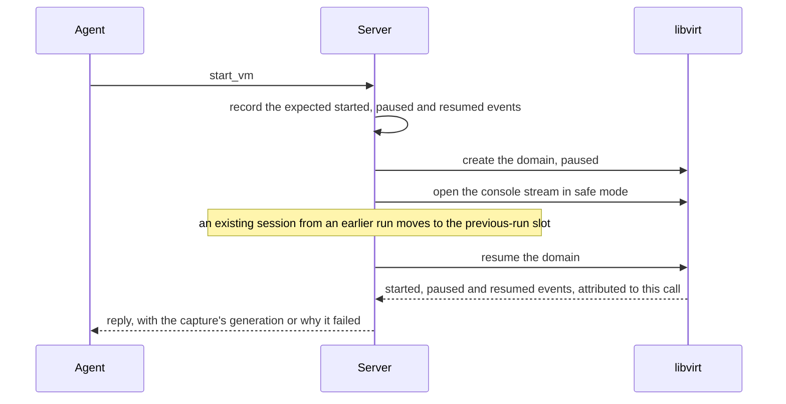
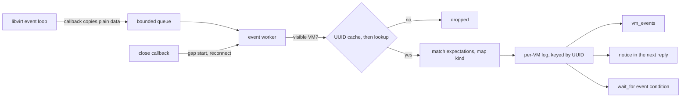

# Seeing what happened: design

Status: draft, revised after an architecture review; for approval.
Once built, the code wins and this design follows it.
Basis: roadmap outcome 4 in [`fork-roadmap.md`](fork-roadmap.md).

## Summary

When something fails in a guest, an agent can find out why. The server records a VM's serial console from the first
byte of every start it makes, and keeps the previous run's output after a stop, so a kernel panic survives the restart
that usually follows it. It records libvirt's events for each VM (crashes, reboots, shutdowns, guest-agent changes),
tells an agent in the next reply about any event that agent did not cause, and lets `wait_for` wait for one. A new
`vm_stats` tool reports CPU, memory, disk, network and filesystem use. VMs the server creates get a panic device and
balloon statistics, so a guest panic becomes an event and guest memory becomes visible. The outcome lands in one run,
after the run of follow-ups 17 and 19 to 21.

## Decisions

| Decision | Chosen | Why | Status |
| -- | -- | -- | -- |
| Scope and order | Console output from start, then events, then resource usage | Console output from start answers the failures no other tool reaches: a guest that panics or hangs before its agent runs | resolved |
| Guest logs | No tool for the journal, `dmesg` or the Windows Event Log | `exec` and the copy tools already reach them | resolved |
| How output from start is captured | The server opens the console itself when it starts a VM, for every allowed VM; no `<log>` element on the serial device | Needs no root and no change to a VM's XML. libvirt's own logs on the test host are `root:root 0600`, so a log file is unlikely to be readable. Listing a VM in `allowed_vms` already hands it to agents | resolved |
| Starting paused | Every start the server makes starts the VM paused, opens the console, then resumes it | Without the pause, firmware and early kernel output can pass before the console opens | resolved |
| VMs started elsewhere | No automatic capture for a VM started outside the server, or already running when the server starts; `console_open` still works on them | Capturing them would take the console from whoever started the VM | deferred: such a VM has no output from before `console_open`. A capture on the `started` event would fix that, at the cost of taking the console from virt-manager |
| Output across a stop and start | One previous run per VM, read with `console_read` `run: "previous"` | Agents restart first and investigate second | resolved |
| Event delivery | `vm_events`, a `wait_for` `event` condition, and a notice in the next reply about events the agent did not cause | An agent that does not know something went wrong will not look | resolved |
| Event source | libvirt's domain event callbacks, registered through `virt-sys` | Polling misses a crash followed by a quick restart. The `virt` 0.4.3 crate has no safe wrapper for them; the console code already calls `virt-sys` | resolved |
| Identity | Diagnostics are keyed by domain UUID, with the name kept for display, and dropped when the VM is deleted | A VM deleted and recreated under the same name must not inherit the old VM's output and events | resolved |
| Resource usage | `vm_stats` returns one snapshot, sampled twice about a second apart; no history | The console and tool errors already show most resource failures, and a snapshot confirms the cause | deferred: a spike that is over before the call leaves no trace. Sampling history could be added later without changing the tool |
| `vm_stats` in read-only mode | Kept, without filesystem figures | Read-only mode already disables guest-agent queries, which is why `guest_info` is hidden there | resolved |
| Devices on created VMs | A panic device, and a balloon stats period of 5 s | Without a panic device a panicked guest hangs with no event; without the period the balloon reports no guest memory | resolved |
| Panic device model | `isa` (the pvpanic device) for Linux guests, `hyperv` for Windows guests | Debian kernels load the pvpanic driver themselves, and `isa` takes no PCI slot. Windows reports a stop error through the Hyper-V crash registers with no driver, and VMs the server creates for Windows already have Hyper-V enlightenments | provisional: the run's probe confirms both |
| Crash action | `manage.on_crash`, `preserve` by default or `destroy`, written into a VM's XML when it is created | `preserve` keeps a crashed VM stopped in place, so an agent can take a screenshot of a Windows stop screen or read the frozen state. The operator, not the agent, chooses | resolved; if the probe shows that `preserve` lets the guest run on, the choice returns for a decision |
| Other crash actions | Refused by the config check | `restart` hides a crash loop behind a guest that looks alive; the core-dump actions write guest memory to a host path | resolved |
| Windows serial output | Not in this outcome | Windows writes nothing to the serial port unless its emergency console is switched on inside the guest; on Windows the screen tools show a boot | resolved |
| Delivery | One run, tested on `trial-deb13`, the `t-*` Linux guests and `t-win11` | About eleven units, a little larger than outcome 3's first run | resolved |

## Behaviour

### Configuration

Two keys join the config:

- `manage.on_crash` is `"preserve"` (default) or `"destroy"`, read as an enum, so any other value stops the server at
  start with a message naming the two accepted values. The create tools write it into a new VM's `<on_crash>` element.
  A change affects only VMs created afterwards, and `reset_vm` keeps the value a VM already has.
- `limits.max_events`, default 256 and refused when 0, caps the events kept per VM. The oldest are dropped first, and
  `vm_events` reports how many were dropped.

`limits.console_buffer_bytes` keeps its meaning, the size of one run's scrollback. With the previous run, a VM's
console output takes at most twice that.

### Starting with a capture

Three tools start VMs: `start_vm`, `create_vm_from_template`, and `reset_vm` after it has replaced the disks. All three
go through one start operation in the server's state, which owns both the libvirt connection and the console sessions.
For an allowed VM it:

1. records an expectation for the events the start produces (see "Who caused an event");
2. starts the domain with `VIR_DOMAIN_START_PAUSED`, plus `VIR_DOMAIN_START_RESET_NVRAM` when a reset needs it;
3. opens a new console session, replacing any session the server holds for that VM. It asks libvirt for the console
   in safe mode, never with the force flag, so it never takes the console from virt-manager;
4. resumes the domain.

Opening the console returns a typed result: opened with a generation, failed with libvirt's reason, or no console
device. On a failure the server still resumes the VM, and the reply says that the capture failed and why. If the
resume fails, the reply says so, and the VM stays paused for the agent to stop.

`snapshot_revert` to a running snapshot also starts a stopped VM. It uses `VIR_DOMAIN_SNAPSHOT_REVERT_PAUSED`, opens
the console in the same way, and then resumes, so a revert gets a capture too.

`start_vm` refuses a VM that is crashed, or paused with reason `VIR_DOMAIN_PAUSED_CRASHED`, and tells the agent to stop
it with `force: true` first. Today it refuses only the first and resumes the second.

### Console sessions

`console_open` on a VM whose session is live attaches to it and replies with its generation, rather than refusing as
it does today. With `force: true` it opens a new session with libvirt's force flag, as today. The new session belongs to
the same run while the domain's ID is unchanged, so the old session's output is dropped rather than moved: a habitual
`force` after a restart must not push the crash run out of the previous-run slot.

A session from a start begins its wait cursor at offset 0, so a `wait_for` console condition without `since` also sees
a prompt that appeared before the call. A session from `console_open` keeps today's cursor. `console_close` ends a
session and moves its output to the previous-run slot.

`console_read` and every other console tool look the VM up first, as the other tools do, and compare its UUID with the
session's. A VM that config hides, or one deleted since, gets the same "not found" answer as any other tool gives.

### The previous run

Each VM has one previous-run slot. When a start replaces a session from an earlier run (a different domain ID), or
`console_close` ends one, the old session's buffer, generation, device and end reason move into the slot. Its reader is
joined and its stream released first, and the slot's earlier content is dropped. A session that a power-off closed
stays the current run until then, so it remains readable as before.

`console_read` takes `run: "current"` (default) or `run: "previous"`. A previous run keeps its own generation and
offsets, and a read reports it as closed with the reason it ended. `wait_for`'s console condition reads only the current
run.

### Events

The server registers callbacks for four libvirt event IDs: lifecycle, reboot, watchdog and guest-agent lifecycle. It
registers them when it starts serving, not in the expiry sweep, and again after each reconnect. A callback runs on the
`libvirt-events` thread, which also carries console data and keepalives, so it does the least possible work. Inside
`catch_unwind`, it copies the domain's UUID and name, the event ID, event, detail and the time into a bounded queue,
and returns. It makes no libvirt calls beyond local getters on the pointer it is given, and it never wraps that pointer
in a `virt::Domain`, whose drop would release a reference libvirt owns.

An event worker thread takes records from the queue. It checks that config lets the server see the VM, through a cache
of known UUIDs and otherwise through the same lookup the tools use. It maps the record to a kind, matches it against
expectations, assigns `seq`, a number that rises across the server process, and appends it to the VM's log. If the
queue is full, the worker records a `gap` for the VMs it could not record.

A record holds `seq`, `time` in UTC, `kind`, `detail` and `cause`. The kinds map from libvirt's events as follows. The
run's probe confirms the sequences and fills in any detail this table misses.

| libvirt event | Kind | Detail | Notice |
| -- | -- | -- | -- |
| lifecycle `started` | `started` | `booted`, `restored`, `from_snapshot`, `wakeup` | no |
| lifecycle `suspended` | `paused` | `paused`, `ioerror`, `watchdog`, `api_error` and the rest | when the detail is `ioerror`, `watchdog` or `api_error` |
| lifecycle `resumed` | `resumed` | libvirt's detail | no |
| lifecycle `shutdown` | `shutdown` | `finished`, `guest`, `host`: the guest finished powering off | no; the `stopped` that follows carries it |
| lifecycle `stopped`, except detail `crashed` | `stopped` | `shutdown`, `destroyed`, `failed`, `saved`, `from_snapshot` | yes |
| lifecycle `crashed` | `crashed` | `panicked`, `crashloaded` | yes |
| lifecycle `stopped` with detail `crashed` | merged into the run's `crashed` record, which gains `stopped: true`; a `crashed` record of its own when none precedes it |  | yes, once per crash |
| lifecycle `pmsuspended` | `pmsuspended` | libvirt's detail | no |
| lifecycle `defined` | none |  |  |
| lifecycle `undefined` | none: the server drops the VM's diagnostics |  |  |
| reboot | `rebooted` |  | yes |
| watchdog | `watchdog` | the watchdog's action | yes |
| agent lifecycle | `agent_connected` or `agent_disconnected` | libvirt's reason | no |
| lost connection | `gap` | when events may be missing, from and to | yes |

Logs live in memory, kept after a VM stops, and end with the server process. The server drops a VM's console sessions,
previous run and log when it deletes the VM, through `delete_vm` or an expiry, and when an `undefined` event arrives.

#### A lost connection

The server registers a close callback on the connection. When the connection drops, the callback notes the time and
wakes a worker, which reconnects through `with_conn` without waiting for a tool call. On the new connection, the
server registers its callbacks again and appends a `gap` record to every log it holds, with both times. It then
compares each visible VM's state with the last recorded event, and records a `stopped` or `started` with detail
`during_gap` where they differ, so a crash and restart during the gap does not leave a VM looking unchanged.
Deregistering on the old connection is best effort. Only libvirt's free callback releases the callback data, whatever
the deregistration returns.

#### Who caused an event

Before a tool changes a VM's power state, it records an expectation: the VM, the MCP session, the tool, and the set of
kinds the action produces, each to be used once. The window opens before the libvirt call and closes 5 s after the
tool returns. The worker maps a record's kind first, so an outside crash can never use up a `stop_vm` expectation.
A matching record takes the tool's name as its `cause`, with the session. Destroys by the expiry sweep take the cause
`expiry`. Every other record has the cause `outside`.

A `stop_vm` that gives up waiting while the guest powers off later produces an outside `stopped`; the tool description
says so. A reboot an agent starts with `exec` is also `outside`, because the server cannot tell it from any other guest
reboot.

#### The notice in replies

After any tool call that names a VM, the server checks that VM's log for records with a notice in the table above that
this MCP session has not seen and did not cause. A record caused by another session counts as not caused by this one.
If there are any, the reply gains a separate trailing text block, such as
`VM 't-deb' crashed (panicked) at 14:02:11Z; see vm_events since 41`, so a reply whose first block is JSON stays
parseable. The notice never replaces a tool's result or error.

Each MCP session keeps a seen-cursor per VM. stdio mode has one session. HTTP mode has one per client, so one client
never consumes another's notice. Reading and advancing a cursor happen under one lock, and a cursor advances only over
records actually returned: by a notice, by `vm_events` without a `kinds` filter, or by a `wait_for` event match. A
`vm_events` call filtered by `kinds` advances nothing, so a crash it did not return is still announced.

A crash notice under `preserve` tells the agent that the VM holds its memory until it is stopped with `force: true`.

#### `vm_events`

`vm_events` takes `vm`, an optional `since` sequence number and optional `kinds`. It returns the matching records after
`since`, oldest first, with `next` for the following call and the count dropped by `max_events`. It answers for a
visible VM whatever its state, and read-only mode keeps it.

#### Waiting for an event

`wait_for` gains an `event` condition with `kinds` and an optional `since`. Without `since`, it matches records that
arrive after the call began, and the tool description tells agents to pass `next` from `vm_events` instead when an
event could land between two calls. A match returns the record.

The wait evaluates event conditions before its check for a stopped VM, so a wait for a crashed console line or a
`crashed` event, whichever comes first, returns the event. When every condition is an event, the wait skips the
running check altogether, so an agent can also wait on a stopped VM for `started`.

### `vm_stats`

`vm_stats` takes `vm` and works on a running VM; on any other state it replies with the state. It samples libvirt's
domain statistics for that VM twice, about one second apart, and returns:

- CPU use as a percentage of the VM's vCPUs over the interval;
- memory: configured, current balloon size and host resident size, plus the guest's own available, usable and unused
  figures and its disk caches when the balloon reports them;
- for each disk, its target, read and write bytes per second, capacity and allocation;
- for each interface, its device, received and sent bytes per second, and drops;
- for each guest filesystem, its mount point, type, total bytes and used bytes, from the guest agent's
  `guest-get-fsinfo`.

The filesystem figures are the guest's own claim, and the reply says so. When the agent does not answer within
`limits.agent_timeout_secs`, the reply has no filesystems and says why. In read-only mode the reply has no
filesystems either, and says that read-only mode disables guest-agent queries. When the guest's memory figures are
missing, the reply names the cause it can see: no stats period on the balloon, or, with a period set, no balloon
driver reporting in the guest, which on Windows needs the virtio balloon driver and its service.

### Devices on VMs the server creates

`domain_xml` in `src/manage.rs`, which builds the XML for both create tools, adds:

- `<panic model='isa'/>` for Linux guests, or `<panic model='hyperv'/>` for Windows guests;
- `<stats period='5'/>` inside the existing `virtio` memory balloon;
- `<on_crash>` with the value of `manage.on_crash`.

VMs the server did not create keep their XML, as the guardrails require, and so do VMs it created before this change.
On them, a panic raises an event only if they already have a panic device, and memory figures appear only if their
balloon already reports them.

### A preserved crash

Under `preserve`, a crashed VM stays stopped in place, in libvirt's crashed state or paused with reason crashed; the
probe records which. It keeps the memory it held while running until `stop_vm` with `force: true` or `reset_vm` ends
it. The console capture stays open, so the panic text is in the current run. `max_vms` already caps how many such VMs
exist, because it counts every VM the server created, whatever its state. Under `destroy`, the memory is freed at the
crash and the panic text moves to the previous run at the next start.

### Windows guests

Events and `vm_stats` work as on Linux, with filesystem figures from the Windows guest agent. The console capture runs,
but holds nothing unless the guest's emergency management console is on. The tool descriptions point agents at the
screen tools for a Windows boot.

## Invariants

- The server opens a console automatically only for an allowed VM it starts, and never with libvirt's force flag.
- No tool changes the XML of an existing VM. The panic device, the stats period and `on_crash` are written only when
  the server creates a VM.
- No reply holds an event, console output or statistics of a VM that config hides, or of a deleted VM.
- A visible, defined VM's retained diagnostics are bounded: two console buffers and `limits.max_events` records. A
  deleted or undefined VM keeps none.
- A notice never replaces a tool's result or error, and announces each record once per MCP session.
- An event callback makes no libvirt call and cannot unwind into libvirt.
- `manage.on_crash` accepts only `preserve` and `destroy`, and `limits.max_events` is positive.
- Read-only mode keeps `vm_events` and `vm_stats`, sends no guest-agent query for `vm_stats`, and still hides every
  tool that starts or stops a VM.
- `start_vm` never resumes a crashed VM.

Each needs a test that shows the refusal or the bound still holds, as `CLAUDE.md` asks for guardrails.

## Code changes

- `src/config.rs`: `manage.on_crash` as an enum, and `limits.max_events` with its check.
- `src/manage.rs`: the panic device, the stats period and `<on_crash>` in `domain_xml`; reset's start moved onto the
  shared start operation; the expiry's destroys marked for attribution.
- `src/events.rs` (new): the per-VM logs keyed by UUID, `seq`, the kind mapping, expectations, per-session cursors and
  the notice text, all without FFI and unit-tested on their own.
- `src/events/ffi.rs` (new): registration and deregistration through `virt-sys`, the callbacks and their queue, the
  close callback, and the event worker.
- `src/hypervisor.rs`: the reconnect that the close callback triggers, and the start refusal for a crashed VM.
- `src/console.rs`: replacing a local session separately from libvirt's force flag, the typed open result, the
  previous-run slot, attaching on `console_open`, and dropping a VM's sessions.
- `src/stats.rs` (new): the two samples, the rates, and the reply's shape.
- `src/agent.rs`: `guest-get-fsinfo`.
- `src/wait.rs`: the `event` condition, evaluated before the stopped check.
- `src/server.rs`: the shared start operation, `vm_events`, `vm_stats`, `console_read`'s `run` and lookup, the notice
  block, the expectations around power actions, the read-only rules and the tool descriptions.
- `README.md`, `CHANGELOG.md` and the `example-global-*.md` templates: the new tools and the agent guidance to read
  the previous run after a crash.

The run adds no crates.

## Test bed

The run starts with a probe on a throwaway VM made by `create_vm_from_template`, recorded in a research note:

- the exact event sequence (event ID, event, detail) and the final state with its reason for a Linux panic
  (`echo c > /proc/sysrq-trigger`) under `preserve` and under `destroy`, and whether the vCPUs stay stopped under
  `preserve`;
- that a Debian 13 guest loads its pvpanic driver for the `isa` device;
- the same for a Windows stop error with `<panic model='hyperv'/>`, forced through `exec` as `SYSTEM`, with a
  screenshot of the stop screen under `preserve`. The device goes into `tests/testbed/t-win11.xml`, from which `t-win11`
  is defined, so the VM never drifts from its file.

New cases then cover:

- a start whose console read from offset 0 holds the guest's first boot lines, for `start_vm`, `reset_vm` and a
  `snapshot_revert` to a running snapshot;
- a crash under each `on_crash` value: the notice in the next reply, `vm_events`, and the panic text in the current run
  under `preserve` and in the previous run after a stop and start under `destroy`;
- a guest's own reboot as an `outside` event, and a `stop_vm` that causes no notice;
- `wait_for` with an `event` condition, alone and with a console condition, on a VM that stops during the wait;
- `vm_stats` with and without a guest agent, in read-only mode, and on `t-win11`;
- `console_open` attaching to a live capture, and a VM deleted and recreated under the same name.

Four existing cases expect `console_open` to report a newly opened console, and change with this outcome:
`console-stall.json`, `templates-reset-uefi.json`, `owrt-wait.json` and `console-closed-on-power-off.json`.

Unit tests cover the event log's bound, the kind mapping and the merged crash record, attribution, the once-only
notice per session, filtered reads and two concurrent readers, the previous-run slot, the `on_crash` refusal, the XML
of both create paths, and the hidden and deleted VM filters on every new reply.

## Checks

- A console read from offset 0 after `start_vm` shows the firmware or kernel's first output.
- A forced Linux panic yields one `crashed` record, one notice in the next reply, and the panic text in the console.
- Every invariant shows in a case or a unit test.
- `vm_stats` CPU use rises while the guest runs a busy loop, and the filesystem figures match `df` in the guest.

## Risks

1. While the server holds an allowed VM's console, virt-manager's serial view and `virsh console` are refused unless
   they use `--force`, which takes the console from the server and ends its capture.
2. Events that happen while the libvirt connection is down are lost. The `gap` record says when, and the state
   comparison after the reconnect catches a VM whose state changed.
3. An outside event that matches an expectation inside its window is attributed to the tool. The window closes 5 s
   after the tool returns, so the error is short-lived.
4. A panic device does nothing without guest support. A Linux kernel built without pvpanic, or a Windows guest where
   the Hyper-V crash registers stay off, panics without an event, and only the console or screen shows it.
5. A preserved VM keeps holding its memory until it is stopped. `max_vms` caps how many owned VMs exist, and `destroy`
   frees the memory at the crash.
6. The event callbacks cross the C boundary. They only copy data and run inside `catch_unwind`. The free callback alone
   releases their data, because a deregistration on a dead connection may fail after libvirt has already dropped the
   callback.
7. A reboot an agent starts with `exec` produces a notice, which is noise but harmless.

## Open questions

None block planning. The probe settles the panic device models, the crashed state and the event sequences; if it shows
that `preserve` lets a crashed guest run on, the crash action returns for a decision. The deferred items are in the
decisions table.
