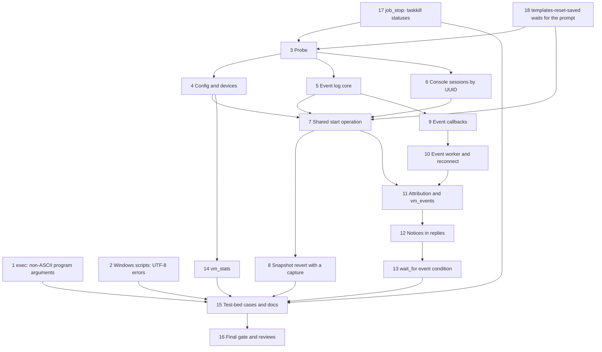

# Seeing what happened: implementation plan

Status: approved, after two plan-critic reviews and a refresh after follow-ups 25, 29 and 30. Built from
[`seeing-what-happened-design.md`](seeing-what-happened-design.md) at `d41fa1c`, which owns the behaviour, and from
roadmap follow-ups 22, 24, 28 and 31 in [`fork-roadmap.md`](fork-roadmap.md) at `deaf2b3`. This plan owns order and
checks. Progress goes in the execution record at the end.

## Overview

The run builds roadmap outcome 4, so that an agent can find out why something failed in a guest, and folds in four
small follow-ups first.

- **Follow-ups first.** `exec` with `program` refuses arguments that are not ASCII on a Windows guest, with a message
  that suggests `command` (follow-up 22). The Windows transfer scripts write their error text as UTF-8, as
  `pull-pack.ps1` already does (follow-up 24). Both landed in follow-ups run 2. `job_stop` on Windows no longer
  reports a failure when the tree is already gone (follow-up 28), and `templates-reset-saved.json` waits for the login
  prompt instead of reading for a fixed time (follow-up 31). These two are units 17 and 18. They run first, before
  the probe: unit 17 needs a working `t-win11`, which the probe's forced stop error could leave unbootable, and unit
  18 changes a case that unit 7 changes again. They are numbered last so that the references among units 3 to 16 stay
  as they are. They also keep `run-all.sh` reliable, which the run's goal needs.
- **A probe before code.** The design leaves three facts to a probe: the libvirt event sequence of a guest panic under
  each crash action, whether Debian's pvpanic driver and Windows' Hyper-V crash registers raise the panic event, and
  which state a preserved crash leaves the VM in.
- **Foundations.** The config gains `manage.on_crash` and `limits.max_events`, and VMs the server creates gain a panic
  device, balloon statistics and `<on_crash>`. The event log, its kind mapping, attribution and cursors come next as
  plain Rust with no libvirt calls, so their rules are unit-tested before any callback feeds them.
- **The console from the first byte.** Console sessions move to the VM's UUID and gain a previous-run slot. One start
  operation starts a VM paused, opens its console, and resumes it, for every tool that starts a VM, and a snapshot
  revert does the same.
- **Events from libvirt.** Callbacks registered through `virt-sys` feed the log through a queue and a worker thread.
  One reconnect function, used by tool calls and by the worker alike, registers the callbacks again and records the
  gap.
- **Delivery.** The power tools record what they expect, `vm_events` lists the log, every reply that names a VM can
  carry a notice, `wait_for` waits for an event, and `vm_stats` reports resource use.



## Design amendments this plan needs

Each lands in `seeing-what-happened-design.md` in the commit of the unit named.

1. **One server-wide notice cursor (units 5, 11 and 12).** MCP protocol `2026-07-28` removes sessions, and tells
   servers not to treat a stdio process or a connection as one either
   ([research](../research/2026-11-15-mcp-sessions.md)). So the design's per-session cursors and causes become
   server-wide:
   - each VM's log has one seen-cursor in the server process. A notice appears in the next reply, from any client,
     that names the VM, and the cursor then moves past the records it announced. `vm_events` without `kinds` and a
     `wait_for` event match move it too, over the records they return;
   - an expectation holds the VM, the tool and its kinds, without a session. A record a tool call caused carries that
     tool as its cause and raises no notice, whichever client made the call. Only `outside` and `expiry` records raise
     notices;
   - with several agents on one server, the first reply that names the VM carries the notice, and `vm_events` lists
     every record for the others. The design's "Event delivery" decision and "The notice in replies" section change
     to say so.
2. **Replacing a console session (unit 6).** A start that cannot open its console still moves the earlier run's
   session to the previous-run slot, so `console_read` never shows an old run as current while a new one runs. A
   `console_open` over a closed session of the same domain ID drops the old output, as `force` does. A moved session
   keeps the reason its stream ended; one moved while still live reads "replaced by a new run", and one ended by
   `console_close` reads "closed by console_close".
3. **One start at a time (unit 7).** While the start operation runs for a VM, a second start of it is refused with a
   message that the VM is starting, so nothing resumes the guest before its console opens.
4. **Snapshot reverts (unit 8).** A revert to a running snapshot gets a capture whether the VM was running or shut
   off before. A revert to a shut-off snapshot opens nothing.
5. **Missing memory figures (unit 14).** A third cause joins the design's two: the VM has no balloon device, as
   `t-win11` has `<memballoon model="none"/>`.
6. **Another process's sweep (unit 11).** VMs that the `sweep` command, run as its own process, destroys get the cause
   `outside`, because only the server process that destroys a VM can mark it. The README says so.
7. **A preserved Windows crash shows no stop screen (unit 3).** The probe found that the Hyper-V crash notification
   stops the guest before Windows paints a stop screen, so a screenshot shows the screen as it was at the crash. The
   design's crash-action reason, its preserved-crash section and its test-bed list say so; behaviour is unchanged.

## Preflight

These apply to every unit, which names only its additions.

- **Rules.** Follow `AGENTS.md`, including its guardrails, and its build gate. Load `rust-style`,
  `rust-error-handling` and `rust-testing` before editing Rust, and `bash-shell` before editing `run-all.sh`. Use `LSP`
  for named symbols where the Rust language server answers, and confirm references with `rg`.
- **Gate.** Every commit passes the build gate in `AGENTS.md`, plus `cargo +1.94 test --locked`, with
  `VIRTMANAGER_REQUIRE_PWSH=1` so the PowerShell parse test runs. The `mdformat` and `pretty-format-json` hooks may
  rewrite a file during a commit; re-add it and commit again.
- **PowerShell steps.** Each script is a constant `.ps1` file in `src/winsteps/`, its arguments arrive as quoted
  literals in `$argv`, and it maps each failure to an exit code listed in its header. Run each changed script on
  `t-win11` before committing it.
- **FFI.** Units 9 and 14 add the run's `unsafe` code. Every callback body runs inside `catch_unwind`, makes no
  libvirt call beyond getters on the pointer it receives, and never wraps a borrowed pointer in an owning `virt` type.
  Every `unsafe` block carries a `SAFETY` comment, and every libvirt allocation has one owner that frees it.
- **No new crates.** Times are kept as epoch seconds and formatted as UTC by a small tested function, because the run
  adds no crates.
- **Strict arguments.** Every tool refuses fields it does not know (follow-up 30). New parameter structs carry
  `#[serde(deny_unknown_fields)]`, which `every_tool_with_parameters_refuses_unknown_ones` in `src/server.rs` checks,
  and a new `wait_for` condition with no fields is a struct variant, as `Agent {}` is, because serde ignores extra
  fields on a unit variant of a tagged enum.
- **Test bed.** Touch only `trial-deb13`, and VMs and volumes named `t-*` or `tpl-*` in pool `agent-vms` on
  `qemu:///system`. Throwaway VMs come from `create_vm_from_template` with names starting `t-`; `config-templates.toml`
  allows three of 1 GiB each. Check `free -m` before starting a VM: `t-win11` needs 5 GiB available. A crashed VM under
  `preserve` keeps its memory and counts against `max_vms`, so each case that crashes a VM stops it with `force: true`
  and deletes it in the same case; `run-all.sh`'s cleanup trap removes any `t-*` VM a failed case leaves. Delete guest
  trees and probe VMs at the end of each probe or case.
- **Build leftovers.** Delete extra Cargo target directories and worktrees made for the run, such as
  `~/.cache/vmm-*-target`, once the unit that made them lands.
- **Review.** Units 6, 7, 10, 12, 13 and 14 change concurrency, FFI, the wait engine or what an agent is told about
  who caused an event. After each, dispatch `code-reviewer` with `model: opus` on its commits and evidence, covering
  the units since the last review, and fix blocking findings before the next dependent unit. If safeguards stop an
  Opus review, run the same brief once on `model: sonnet`, and record both in the unit's row. The other units are
  self-reviewed, and the final review covers them.
- **Commits.** One logical change per commit, Conventional Commits, explicit pathspecs, and a `CHANGELOG.md` entry
  under `## Unreleased` for each change users notice. Mark roadmap items done in the commit that lands them. Nothing
  is pushed in the run.

## Invariants and their tests

The design asks for a test of each invariant. Each row names its owning unit.

| Invariant | Test | Unit |
| -- | -- | -- |
| The server opens a console automatically only for an allowed VM it starts, never with the force flag | Unit test of the start operation through a fake console opener that records each call's VM and flags | 7 |
| No tool changes the XML of an existing VM | Unit test: a reset's XML keeps `<on_crash>` and gains no panic device or stats period | 4 |
| No reply holds an event, console output or statistics of a hidden or deleted VM | Unit tests for `vm_events`, `vm_stats`, `wait_for` `event`, `console_read` with `run: "previous"` and the notice path, each with a hidden VM and a deleted one; a test-bed case with a VM outside `allowed_vms` | 11, 12, 13, 14, 15 |
| Retained diagnostics are bounded | Unit tests: the log drops its oldest records past `max_events`; a second move into the previous-run slot drops the first | 5, 6 |
| A notice never replaces a result or error, and announces each record once per server process (amendment 1) | Unit tests of the cursors and of the reply's blocks | 5, 12 |
| An event callback makes no libvirt call and cannot unwind into libvirt | Unit test: a callback body that panics returns normally through the wrapper; review of the callback code | 9 |
| `manage.on_crash` accepts only `preserve` and `destroy`, and `limits.max_events` is positive | Unit tests of both refusals | 4 |
| Read-only mode keeps `vm_events` and `vm_stats`, sends no guest-agent query for `vm_stats`, and hides every tool that starts or stops a VM | The tool-visibility test in `src/server.rs` extended to both tools; a `vm_stats` unit test with a fake agent that fails on any call | 11, 14 |
| `start_vm` never resumes a crashed VM | Unit tests of the start decision for `VIR_DOMAIN_CRASHED` and for paused with reason crashed; the test-bed refusal for whichever state the probe found | 7 |

## Units

### 1. `exec`: non-ASCII program arguments on Windows (built in follow-ups run 2)

Built in [follow-ups run 2](followups-run-2-implementation-plan.md) as `888fc3f`: on a Windows guest, `exec` refuses a
program path, arguments or `env` entries that are not ASCII, and suggests `command`. Follow-up 22. The goal counts it
as landed; its row below holds the evidence.

### 2. Windows scripts: UTF-8 errors (built in follow-ups run 2)

Built in [follow-ups run 2](followups-run-2-implementation-plan.md) as `2799546`: every script in `src/winsteps/` that
writes error text writes it as UTF-8. Follow-up 24. The goal counts it as landed; its row below holds the evidence.

### 3. Probe: panics, devices and event sequences

**Result.** A dated note, `docs/research/<date>-crash-and-events-probe.md`, records the facts later units depend on,
before any of them is written.

**Changes.** `virsh event --all --loop --timestamp` records events throughout. On a VM from
`create_vm_from_template` whose XML the probe edits with `virsh define` to add `<panic model='isa'/>`, a balloon stats
period and each `<on_crash>` value, the probe records:

- the event sequence and final state with its reason for `echo c > /proc/sysrq-trigger` (after
  `echo 1 > /proc/sys/kernel/sysrq`) under `preserve` and under `destroy`, and whether the vCPUs stay stopped under
  `preserve` (CPU time from `virsh domstats --cpu-total` twice, 10 s apart);
- what `exec` returns for the call that panics the guest, which the test-bed cases then expect;
- that the guest loads its pvpanic driver (`lsmod`, `dmesg`);
- the sequences for a start with `virsh start --paused` then `virsh resume`, a `snapshot-revert --paused` to a running
  snapshot of a BIOS VM, a guest `reboot`, a `poweroff` from the guest, `stop_vm` with and without `force`, and the
  guest agent stopping and starting;
- whether a console opened between the paused start and the resume holds the first firmware or kernel output, and
  whether a revert to a running snapshot gives the domain a new ID.

On `t-win11`: check `free -m`, shut it down, and clone its disk to `t-win11-pre-crash.qcow2` in `agent-vms` with
`virsh vol-clone`. Add `<panic model='hyperv'/>` to `tests/testbed/t-win11.xml`, redefine the VM from that file, and
record the event sequence and final state for a stop error forced as `SYSTEM` by ending a critical process such as
`wininit`, under `preserve`, with a screenshot of the stop screen. Stop it with `force: true`, check it boots, then
delete the clone.

**Verification.** The note holds each item above, and ends with a table of the observed sequences that unit 5's kind
mapping copies.

**Recovery.** If `t-win11` does not boot after the crash, restore its disk from the clone with `virsh vol-upload` or
by cloning back, and stop. If the probe shows that `preserve` lets a crashed guest run on, that Debian does not raise
the event with `isa`, or that Windows does not raise it with `hyperv`, revert `tests/testbed/t-win11.xml`, redefine
`t-win11` from the reverted file, and stop the run: each is a design decision.

### 4. Config and devices on created VMs (self-reviewed)

**Result.** `manage.on_crash` (`preserve` by default, or `destroy`) and `limits.max_events` (default 256, refused
when 0) are read and checked, and both create tools write the panic device, `<stats period='5'/>` in the balloon, and
`<on_crash>`.

**Changes.** `src/config.rs` gains both keys, with an enum for `on_crash` whose other values stop the server with a
message naming the two. `domain_xml` in `src/manage.rs` adds the panic device by guest OS (`isa` for Linux, `hyperv`
for Windows), the stats period and `<on_crash>`, beside the `<firmware>` features and pflash loader that `<os>` gains
for `secure_boot: false` (follow-up 29). `reset_vm` edits the existing XML, so it keeps what a VM has. The README's
configuration section and the CHANGELOG describe the keys.

**Verification.** Unit tests: an unknown `on_crash` and `max_events = 0` are refused; the XML of both create paths
holds the three elements, with the right panic model per OS, with `secure_boot` true and false; a reset's XML keeps
`<on_crash>` and lacks a panic device when the original lacked one. `firmware-secure-boot.json` still passes. A VM
made by `create_vm_from_template` shows the elements in `virsh dumpxml`.

### 5. Event log core (self-reviewed; unit 12's review covers it)

**Result.** `src/events.rs` holds the per-VM logs keyed by UUID, the process-wide `seq`, the kind mapping from the
probe's table, the merged crash record, the `max_events` bound with its dropped count, expectations with their
5 s window, one seen-cursor per VM (amendment 1), and the notice text. It makes no libvirt call.

**Changes.** A new module, with plain input records (UUID, name, event ID, event, detail, epoch seconds) and a clock
passed in, so tests drive it. Its API covers: append a record; record and expire an expectation; read after `since`
with optional kinds; take the notices for a VM; drop a VM. The cursor advances only over records returned, and a
read filtered by `kinds` advances nothing.

**Verification.** Unit tests for each design rule: the bound and dropped count; each row of the kind table; the
`stopped` with detail `crashed` merged into the preceding `crashed` record, and its own record when none precedes it;
an outside crash never consuming a `stop_vm` expectation; a window that closes 5 s after the tool returns; the
`expiry` cause; one notice per record; no notice for a record a tool caused; a filtered read advancing nothing;
two threads taking notices at once, each record going to exactly one of them; a dropped VM keeping nothing; the UTC
formatter.

### 6. Console sessions by UUID, with a previous run (reviewed, Opus)

**Result.** Console sessions are keyed by domain UUID, each VM has one previous-run slot, `console_open` attaches to
a live session, `console_close` moves a session to the previous run, `console_read` takes `run`, and every console
tool looks the VM up first.

**Changes.** In `src/console.rs`:

- sessions keyed by UUID, with the name kept for messages;
- opening split from libvirt's force flag, so the server can replace its own session without forcing, behind a small
  opener trait so unit 7's test can record the flags;
- a typed open result: opened with its generation, failed with libvirt's reason, or no console device;
- the previous-run slot and the replacement rules of amendment 2. The sessions lock is still held only to check and
  swap entries; joining the old reader and releasing its stream happen outside it, as today;
- dropping a VM's sessions and slot.

In `src/server.rs`, `console_read`, `console_close` and `list_vms` use `Hypervisor::lookup`, which works on a stopped
VM, and pass the UUID; `console_open` and `console_write` keep `Hypervisor::domain`, which requires a running VM.
`wait::LiveEnv` carries the UUID. `console_read` gains `run: "current" | "previous"`, and a previous run reads as
closed with its reason. `reset_vm`, `delete_vm` and `snapshot_revert` close the session, which now moves it to the
previous run, as intended: the output from before the reset or revert stays readable.

The cases whose reply this unit's own rules change are updated here: those that call `console_open` over a live
session of this server, at least `console-reopen.json`, `console-generation.json` and `console-stall.json`. Cases
that open the console of a VM the server started change only in unit 7, when that start opens a capture first.

**Verification.** Unit tests on the buffer and slot logic: a replacement by a new domain ID moves the old run; a
`force` or a non-force reopen over a closed session within the same ID drops it; close moves; a second move drops the
older slot content; the slot keeps its own generation and offsets; each moved session's reason. On the test bed, the
cases that call `console_open` pass, and on `trial-deb13`: `console_open` twice attaches; a stop, start and
`console_open` leave the earlier run readable with `run: "previous"`; `console_read` of a VM outside `allowed_vms`
answers "not found".

### 7. Shared start operation (reviewed, Opus)

**Result.** `start_vm`, `create_vm_from_template` and `reset_vm` start a VM through one operation that records an
expectation, starts the domain paused, opens the console in safe mode, and resumes. A console read from offset 0
holds the guest's first boot output. `start_vm` refuses a crashed VM in either crashed state, and a second start
during the operation is refused (amendment 3).

**Changes.** The operation lives on `State`, which owns the hypervisor, the consoles and the event log, with a per-UUID
"starting" guard held for its whole length. `Hypervisor::start` keeps the resume, wake and refusal paths and loses
the boot path; its state-to-action choice moves into a pure function, so both crashed states are unit-tested.
`manage::start_after_reset` gives its `RESET_NVRAM` flag to the operation. The session a start opens begins its wait
cursor at 0. A failed open still resumes and the reply says why; a failed resume leaves the VM paused and says so.
The tool descriptions for `start_vm`, `console_open` and `console_read` tell agents that a start captures the console
from its first byte, and that a Windows guest writes nothing there, so its boot shows through the screen tools.

A `console_open` after a start, reset or template create now attaches to the capture, so the cases that do that are
updated here: at least `templates-reset-saved`, `templates-reset-uefi`, `console-after-start`,
`console-closed-on-power-off`, `job-wait`, `wait-for`, `owrt-boot`, `owrt-pacing` and `owrt-wait`. Units 6 and 7
each run every case that calls `console_open`, and unit 8 every case that calls `snapshot_revert`, such as
`console-generation`, and each fixes any other case whose reply changed.

**Verification.** Unit tests: the start decision for each state; the reply on each open result; the fake opener
records one safe-mode open per start of an allowed VM and none with force; the guard refuses a concurrent start. On
the test bed: `start_vm` of `trial-deb13`, then `console_read` with `since: 0`, holds the kernel's first lines; the
same after `reset_vm` of a `t-*` VM; a wait for a login prompt without `since` matches a prompt printed before the
call; the refusal for whichever crashed state unit 3 found. The full `run-all.sh` passes.

### 8. Snapshot revert with a capture (self-reviewed; unit 10's review covers it)

**Result.** `snapshot_revert` to a running snapshot reverts with `VIR_DOMAIN_SNAPSHOT_REVERT_PAUSED`, opens the
console as the start operation does, and resumes, whether the VM was running or shut off (amendment 4).

**Changes.** `manage::snapshot_revert` reads the snapshot's `<state>` and chooses the flag; the server runs it inside
the start operation's guard and records the expectation.

**Verification.** On a BIOS `t-*` VM (running UEFI VMs cannot take a running snapshot): a revert to a running snapshot
from shut off and from running each leave a current run whose read from offset 0 holds output after the revert; a
revert to a shut-off snapshot opens nothing.

### 9. Event callbacks (reviewed with unit 10, Opus)

**Result.** The server registers its four event callbacks and a close callback, and each callback copies plain data
into a bounded queue without calling libvirt or unwinding.

**Changes.** `src/events/ffi.rs`: registration through `virConnectDomainEventRegisterAny` for lifecycle, reboot,
watchdog and agent lifecycle; callbacks inside `catch_unwind` that read the UUID and name with getters on the given
pointer and push into the queue; a free callback that alone releases the callback data; and
`virConnectRegisterCloseCallback`. `src/main.rs` registers when it starts serving, not in the `sweep` command.

**Verification.** Unit tests: the wrapper returns normally from a body that panics; a full queue sets the overflow
mark. On a `t-*` VM, a start and stop reach the queue (logged at debug level).

### 10. Event worker and reconnect (reviewed, Opus, with unit 9)

**Result.** A worker thread turns queued records into log entries for visible VMs only. One reconnect function, used
by `Hypervisor::with_conn` and by the worker after a close callback, opens the new connection, registers the
callbacks on it under the same write lock as the swap, appends a `gap` record to every log, and records `stopped` or
`started` with detail `during_gap` for each visible VM whose state differs from its last record.

**Changes.** The worker in `src/events/ffi.rs` checks visibility through a UUID cache and otherwise
`Hypervisor::lookup`, records a `gap` when the queue overflowed, and drops a VM's diagnostics on `undefined`.
`src/hypervisor.rs` routes its lazy reconnect through the shared function, which takes a hook so the hypervisor does
not depend on the events module. Deregistering on the old connection is best effort.

**Verification.** Unit tests with a fake source: visibility; the overflow gap; `undefined`; a reconnect started by a
tool call and one started by the close callback both register again and record the gap and `during_gap`. On a `t-*`
VM: a guest panic produces one `crashed` record; a guest reboot a `rebooted`; the agent stopping and starting its
`agent_*` records. The live reconnect is an exception below.

### 11. Attribution and `vm_events` (self-reviewed; unit 12's review covers it)

**Result.** Power tools record what they expect, records carry their cause, and `vm_events` lists a VM's log.

**Changes.** `stop_vm`, `reset_vm`, `delete_vm` and `snapshot_revert` record expectations; the start operation
already does. `manage::expire` and `manage::reset` take a hook, as `reset`'s `before_power_off` already is, through
which the server records the expectation (cause `expiry` for the sweep) and drops or moves console sessions; the
`sweep` command's own process passes a hook that does nothing (amendment 6). `vm_events` takes `vm`, `since` and
`kinds`, answers for a visible VM in any state through `Hypervisor::lookup`, appears in read-only mode, and advances
the caller's cursor only without `kinds`. `stop_vm`'s description says that a stop that gives up waiting produces an
outside `stopped` later.

**Verification.** Unit tests: the tool-visibility test lists `vm_events` in read-only mode; a hidden and a deleted
VM's `vm_events` answer "not found". On a `t-*` VM: `stop_vm` records `stopped` with cause `stop_vm`; a guest's own
`reboot` records `rebooted` with cause `outside`; `vm_events` with `kinds` returns only those kinds.

### 12. Notices in replies (reviewed, Opus, covering units 5, 11 and 12)

**Result.** A reply to any tool call that names a VM gains a trailing text block for records with a notice that this
server has not announced and no tool caused, once (amendment 1), never replacing a result or error.

**Changes.** `VirtServer` implements `call_tool` itself instead of the one `#[tool_handler]` generates: it reads `vm`
from the request's arguments, calls `self.tool_router.call(ToolCallContext::new(self, request, context))`, and on a
`Complete` result appends the notice block. Finding the UUID runs in `spawn_blocking` through `Hypervisor::lookup`,
so a hidden VM gets no notice. No session is involved: the cursor lives in the event log. The crash notice under
`preserve` says the VM holds its memory until stopped with `force: true`.

**Verification.** Unit tests: the notice is a separate block after a JSON block; an error reply keeps its error and
gains the notice after it; two concurrent calls naming the VM carry the notice once between them; a hidden VM's
records produce none. On a `t-*` VM: after a forced panic and a wait for the `crashed` record (events arrive
asynchronously, so a case waits before asserting), the next reply that names the VM carries one notice, and the reply
after carries none; a `stop_vm` causes no notice.

### 13. `wait_for` event condition (reviewed, Opus)

**Result.** `wait_for` gains an `event` condition with `kinds` and `since`, evaluated before the stopped check; a
wait whose conditions are all events skips the running check and works on a stopped VM.

**Changes.** `src/wait.rs` gains the condition as a struct variant that refuses unknown fields, its check and an
`Env` method that reads the log; the zero-timeout
rule lets `event` conditions be checked once, as console ones are. `src/server.rs` uses `Hypervisor::lookup` instead
of `domain` when every condition is an event. A match returns the record and advances the VM's cursor over it.
The console condition still reads only the current run.

**Verification.** Unit tests in the wait engine with a fake log: an `event` condition with an unknown field is
refused; an event before the stopped check wins over `closed`; an all-event wait on a stopped VM matches `started`;
`since` from `vm_events` catches a record that landed between two calls; a hidden VM's records never match. On a
`t-*` VM: a wait for `crashed` together with a console condition returns the event when the guest panics.

### 14. `vm_stats` (reviewed, Opus)

**Result.** `vm_stats` reports CPU, memory, disk, network and filesystem use for a running VM from two samples about
a second apart, replies with the state for any other VM, and names why figures are missing.

**Changes.** `src/stats.rs` (new) samples through `virDomainListGetStats` with only this domain, read through
`virt-sys` and freed with `virDomainStatsRecordListFree` (the `virt` crate's `get_all_domain_stats` has no accessors
and leaks its records), computes the rates, and shapes the reply. `src/agent.rs` gains `guest-get-fsinfo`, skipped in
read-only mode and bounded by `limits.agent_timeout_secs`. The reply says the filesystem figures are the guest's own
claim. A missing-memory reason names one of three causes (amendment 5). `vm_stats` appears in read-only mode.

**Verification.** Unit tests: rates from fixed samples, including counters that reset; the reply shape; read-only
mode makes no agent call (a fake agent fails on any call); a hidden and a deleted VM answer "not found". On a `t-*`
VM: CPU use rises during `yes > /dev/null`; filesystem figures match `df`; a shut-off VM replies with its state; a VM
without an agent returns the rest and says why. On `t-win11`: the reply holds filesystems and names the missing
balloon device.

### 15. Test-bed cases and docs (self-reviewed; unit 16's reviews cover it)

**Result.** `run-all.sh` covers each item in the design's "Test bed" list, and the docs describe the outcome.

**Changes.** New cases, each with its own throwaway `t-*` VM made and deleted inside the case:

- `diag-start-capture.json`: a read from offset 0 after `start_vm`, after `reset_vm`, and after a revert to a running
  snapshot;
- `diag-crash-preserve.json` and `diag-crash-destroy.json`: a forced panic with its notice, `vm_events`, and the panic
  text in the current run under `preserve` and in the previous run after a stop and start under `destroy`;
  `run-all.sh` writes `config-crash-destroy.toml` from `config-templates.toml` with `on_crash = "destroy"`;
- `diag-attribution.json`: a guest's own reboot as `outside`, and a `stop_vm` with no notice;
- `diag-wait-event.json`: `wait_for` with an `event` condition, alone and with a console condition, on a VM that
  stops during the wait;
- `diag-stats.json`: `vm_stats` with and without a guest agent, and in read-only mode; the `t-win11` check joins
  `win-exec`'s unit;
- `diag-identity.json`: `console_open` attaching to a live capture, and a VM deleted and recreated under the same name
  that has no events or output from the first;
- a hidden-VM check as a `run-all.sh` unit function: start a VM outside `allowed_vms` with `virsh`, as
  `unit_templates_expiry_command` runs host steps, then check that no reply mentions it, with a positive control (an
  allowed VM's start recorded in the same run), so silence does not just mean a dead worker.

The `exec` that panics a guest uses a short `timeout_secs` and expects what unit 3 recorded. Each case is added to
`UNITS` and, where cases depend on each other, `MEMBERS`. The README, the test-bed README, the CHANGELOG and both
`example-global-*.md` templates describe `vm_events`, `vm_stats`, notices, the previous run and the advice to read it
after a crash.

**Verification.** Each new case passes on its own, and `run-all.sh` passes as a whole.

### 16. Final gate and reviews

**Result.** The run is verified as a whole, the roadmap is closed, and the record is complete.

**Changes.** The roadmap marks outcome 4 done and rewrites its "Next" paragraph for outcome 5.

**Verification.**

- The gate and `cargo +1.94 test --locked` pass at the last commit.
- `run-all.sh` exits 0 with `t-win11` present.
- An Opus `code-reviewer` review of the whole run (Sonnet if safeguards stop it, as in the preflight), and a separate
  `conformance-review` against the design, the roadmap entries and this plan, find no material mismatch, with their
  findings fixed and rechecked.
- This row names the evidence for each of the design's "Checks".

### 17. `job_stop` on Windows: taskkill statuses (self-reviewed)

**Result.** `job_stop` on a Windows job whose process tree is gone by the time `taskkill` runs, or goes during it,
reports the job ended instead of "taskkill failed". Follow-up 28.

**Changes.** First, a probe on `t-win11`: a loop of at least 20 cycles that starts a job running
`ping.exe -n 300 127.0.0.1` and stops it, with the root ended at varying moments around the `taskkill` call so the
race happens. A loop inside the guest is the main form, because a round trip from the host is far longer than the
`taskkill` window. The probe records a histogram of `taskkill` exit statuses and outputs, and whether any descendant
of the tree survives a stop; its results go in a dated note in `docs/research/`. It deletes the jobs it made under
`C:\ProgramData\virtmanager-mcp\jobs\` when it ends. Then:

- `src/jobs/stop.ps1` lists the tree's descendants by parent PID, each with its start time, before `taskkill`. After
  a non-zero status, it rechecks the recorded process and those descendants by PID and start time, retrying for up
  to 2 s while one is still terminating. When all are gone, it exits with a new status, 7, "ended; taskkill exited N
  after the tree had gone", and it still exits 5 with the status while any of them runs. Its header lists the new
  status. Jobs scripts live in `src/jobs/` and take `$id`, not `$argv`; the parse test covers them.
- `jobs::stop` in `src/jobs.rs` maps exit 7 to the same success text as exit 0, followed by the script's line, so
  `win-jobs.json`'s `contains` strings still hold and the agent sees what happened.

The roadmap marks 28 done, and the CHANGELOG gains a "Fixed" entry.

**Verification.** The parse test passes. Unit tests with the fake Windows guest in `src/jobs.rs`: exit 7 gives the
success text with the script's line, and exit 5 still fails with it. On `t-win11`, the probe loop run again on the
fixed script ends every cycle without a failure and with no surviving descendant, and the record gives both
histograms. `win-jobs.json` passing five times in a row is a regression check only, because one stop per run rarely
meets the race.

### 18. `templates-reset-saved.json` waits for the login prompt (self-reviewed)

**Result.** The case's check that the console still reads output after a refused reset waits for the login prompt,
instead of a fixed 3 s `console_read` that a slow guest missed once. Follow-up 31.

**Changes.** In `tests/testbed/cases/templates-reset-saved.json`, after the `console_write` of an empty line, a
`wait_for` console condition for `login:` without `since` and with a 30 s timeout replaces the `console_read`.
Without `since`, the wait starts where the last `console_write` began, so only a prompt the guest printed after the
Enter matches, which is the case's claim that the console still answers. A `console_read` from offset 0 then checks
that the console is open and holds output. Unit 7 later changes the same case, on top of this. The roadmap marks 31
done; the change is to a test only, so the CHANGELOG has no entry.

**Verification.** The evidence is the structural one: the case waits up to 30 s for an answer instead of reading for
a fixed 3 s. That the Debian template's serial getty prints `login:` again after a bare Enter is unverified; the first
run confirms it, and the `templates-reset-uefi` unit of `run-all.sh`, which runs the case, then passes three times in
a row.

## Exceptions the run records

| Check | Why it cannot run here | Stand-in evidence |
| -- | -- | -- |
| A lost libvirt connection and the reconnect | Restarting `libvirtd` or dropping a client needs root | Unit 10's tests with a fake source, for a reconnect from a tool call and from the close callback |
| A notice shown once across two HTTP clients | `mcp_call.py` speaks stdio only | Unit 5's and 12's tests of two concurrent callers |
| A guest without pvpanic support | Debian 13 ships the driver | None: design risk 4 |

## Execution record

Run rules, re-read after any compaction or resume:

- Answer questions from this plan, the design, the roadmap and the files they name.
- Make reversible calls yourself, and record each under "Judgement calls" with its reason and how to undo it.
- Park what only the project owner can answer under "Parked questions", with options and a recommendation; continue.
- Run every command standalone from the repository root: no `cd … &&`, no `git -C`, nothing chained after a commit.
- Commit this record's update with each landed unit, and keep working past a progress report.

Order: 17, 18, 3, then 4 to 16 by the diagram. Units 1 and 2 landed in follow-ups run 2.

Judgement calls:

- Unit 17: after a failed `taskkill`, `stop.ps1` ends the listed processes still running itself, rather than only
  rechecking them, because the probe found a child that `taskkill` exit 128 leaves running. Undo: drop the
  `Stop-Process` line in the recheck loop, which turns those cases back into exit 5.
- Unit 3: `t-win11` got its panic device and `<on_crash>preserve</on_crash>` through `virt-xml` rather than by
  redefining it from `tests/testbed/t-win11.xml`, because the file holds no UUID and redefining would mean undefining
  the VM with its NVRAM and TPM state. The file carries the same two changes. Undo: remove both from the file and run
  `virt-xml t-win11 --remove-device --panic all` and `--edit --events on_crash=destroy`.
- Unit 3: `wininit` is protected even from `SYSTEM`, so the Windows stop error came from a process that marked itself
  critical with `RtlSetProcessIsCritical` and exited. The result is the same kind of stop error.

Parked questions: none yet.

The run's goal:

- **Objective.** Units 1 to 18 are committed on `main`, each with its row here.
- **Success.** After the last change:
  - the gate and `cargo +1.94 test --locked` exit 0;
  - `tests/testbed/run-all.sh` exits 0, with `t-win11` present;
  - an Opus code review (Sonnet where safeguards stop Opus) and a separate conformance review find no material
    mismatch.
- **Boundaries.** Nothing is pushed. Only `trial-deb13`, `t-*` VMs and `t-*` or `tpl-*` volumes in `agent-vms` are
  touched.
- **Stop.** Stop and report when a step needs root, a design change beyond the amendments above (including unit 3's
  probe outcomes), another VM or pool, or when the host runs short of memory.

The command that arms the run:

```text
/goal Outcome 4 per docs/plans/seeing-what-happened-implementation-plan.md is built: units 1-18 on main, each with its record row. After the last change, AGENTS.md gate and `cargo +1.94 test --locked` exit 0, `tests/testbed/run-all.sh` exits 0 with t-win11 present, and an Opus code review (Sonnet if safeguards stop Opus) plus a separate conformance review against the design, roadmap and plan find no material mismatch. Nothing pushed; only trial-deb13 and t-*/tpl-* in agent-vms touched. Else stop: root, design change, other VM or pool, low memory
```

| Unit | Commits | Evidence | Review |
| -- | -- | -- | -- |
| 1. `exec`: non-ASCII program arguments on Windows | `fix(exec): refuse text the Windows guest agent cannot pass` | Probe on `t-win11`: a non-ASCII `env` entry fails like an argument, with `program` and with `command`, so `env` is refused in both modes. Three new unit tests pass; `win-exec.json` passes on `t-win11` with both refusals and `echo été` through `command` | Self-reviewed |
| 2. Windows scripts: UTF-8 errors | `fix(winsteps): write guest error text as UTF-8` | Parse test passes; under code page 437 on `t-win11`, a push below a file named `vmm-été-file` fails naming the path intact; the seven Windows cases pass. Built in [follow-ups run 2](followups-run-2-implementation-plan.md) | Self-reviewed |
| 3. Probe: panics, devices and event sequences | `docs(research): record the crash and event probe for outcome 4` | [Probe note](../research/2026-11-23-crash-and-events-probe.md). Debian loads pvpanic; both `isa` and `hyperv` raise `Crashed Panicked`; `preserve` leaves `crashed (panicked)` with the vCPUs stopped, and `destroy` adds `Stopped Crashed`; a console opened during a paused start holds the boot from GRUB on. `t-win11` booted after the crash and the clone was deleted. None of the stop outcomes held; design amendment 7 records the missing stop screen | Self-reviewed |
| 4. Config and devices on created VMs |  |  |  |
| 5. Event log core |  |  |  |
| 6. Console sessions by UUID, with a previous run |  |  |  |
| 7. Shared start operation |  |  |  |
| 8. Snapshot revert with a capture |  |  |  |
| 9. Event callbacks |  |  |  |
| 10. Event worker and reconnect |  |  |  |
| 11. Attribution and `vm_events` |  |  |  |
| 12. Notices in replies |  |  |  |
| 13. `wait_for` event condition |  |  |  |
| 14. `vm_stats` |  |  |  |
| 15. Test-bed cases and docs |  |  |  |
| 16. Final gate and reviews |  |  |  |
| 17. `job_stop` on Windows: taskkill statuses | `fix(jobs): end a Windows job's tree when taskkill fails on a racing root` | [Probe note](../research/2026-11-23-taskkill-race-probe.md). Before: 24 cycles gave exit 0 ×8, 128 ×14 (2 with a surviving child), 255 ×2. After, with the race injected: 30 cycles, exit 0 ×20 and 7 ×10, no survivors. Unit tests with the fake Windows guest for exits 7 and 5; parse test; `win-jobs.json` passed 5 times in a row on the rebuilt server, every stop with status 0 | Self-reviewed |
| 18. `templates-reset-saved.json` waits for the login prompt | `test(testbed): wait for the login prompt after a refused reset` | The getty on the Debian template prints `login:` again after a bare Enter, so the wait without `since` matched; the `templates-reset-uefi` unit passed 3 times in a row | Self-reviewed |
