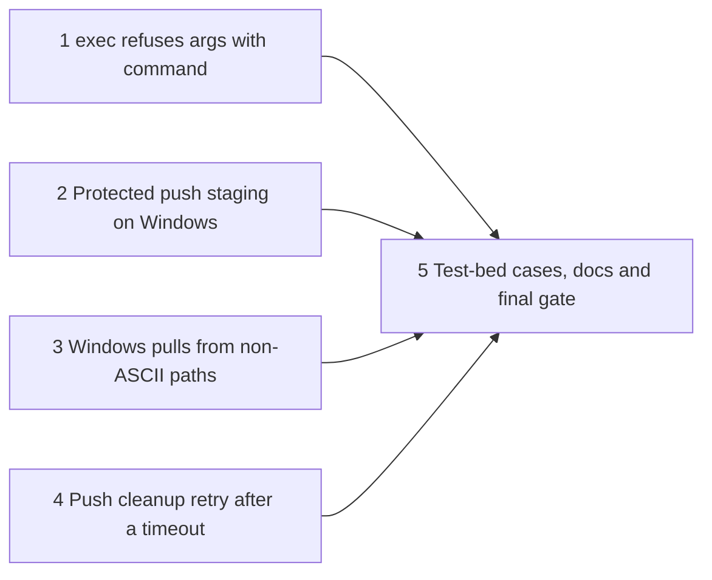

# Follow-ups 17 and 19 to 21: implementation plan

Status: approved; built, awaiting the maintainer's review decision. Built from roadmap follow-ups 17 and 19 to 21 in
[`fork-roadmap.md`](fork-roadmap.md) at `d41fa1c`, and from [`guest-transfer-design.md`](guest-transfer-design.md),
which owns the behaviour of the transfer tools. Evidence is in
[`2026-11-13-windows-followups-probe.md`](../research/2026-11-13-windows-followups-probe.md). This plan owns order and
checks. Progress goes in the execution record at the end.

## Overview

The run closes four follow-ups before outcome 4 is built. Each one is small, and each unit can land on its own:

- **`exec` with both `command` and `args` (follow-up 17).** `exec` runs the command line and silently drops `args`,
  so an agent gets a result for a command it did not mean. The tool refuses the combination.
- **A junction planted in a Windows push's staging directory (follow-up 19).** The probe showed that `tar.exe`
  extracts through a junction, and that both `C:\Users\Public` and `C:\Windows\Temp` let ordinary users create entries
  inside a directory that `SYSTEM` creates there. A logged-on user could therefore make a push, which runs as `SYSTEM`,
  write anywhere. The staging directory is created with an access list that only `SYSTEM` and `Administrators` can
  write, and gets its normal inherited access list back once `tar.exe` has finished. This closes the hole under parents
  where users can create entries but cannot delete or rename other users' entries, which covers both of those. A user
  who may delete or rename entries in the parent, such as the owner of `C:\Users\alice`, can still replace the staging
  directory with a junction between two guest calls. That residual risk is stated in the design and recorded as
  follow-up 23.
- **Windows pulls from non-ASCII paths (follow-up 20).** A push to `C:\Windows\Temp\vmm-été` or `vmm-日本` works. A pull
  from either fails with `failed to parse JSON: invalid utf-8 string`, because the pull hands the path to `tar.exe` as a
  `guest-exec` argument, and Windows' guest agent fails any `guest-exec` whose arguments are not ASCII. A pull from a
  non-ASCII path runs `tar.exe` from a PowerShell step instead, which receives the path inside `-EncodedCommand`. A
  pull from an ASCII path keeps running `tar.exe` directly, as today. `tar.exe` still fails when a name in the tree does
  not fit the guest's ANSI code page, and the reply then says so.
- **Cleanup straight after a timed-out push (follow-up 21).** After `taskkill` stops a `tar.exe` that ran out of time,
  the push deletes its temporary entries at once, while `tar.exe` may still hold files. The cleanup retries for up to
  10 s, as the pull already retries removing its archive.

No unit depends on another, except that unit 5 tests all of them and closes the run.

### Design amendments this plan needs

Each lands in `guest-transfer-design.md` in the commit of the unit named.

1. **The push's staging directory on Windows (unit 2).** The "Windows guests" section gains: a push creates its
   staging directory with an access list protected from inheritance, granting full control only to `SYSTEM` and
   `Administrators`, and checks the list before unpacking, so no other guest user can add entries while `tar.exe`
   unpacks. After the unpack, in a step of its own, the directory gets back the access list its parent passes on, so
   the pushed tree ends with the permissions a directory created there would have. A new risk states what stays open:
   a user who may delete or rename entries in the target's parent can replace the staging directory with a junction
   between its creation and the unpack, and so make the push write elsewhere as `SYSTEM`.
2. **Non-ASCII paths in Windows pulls (unit 3).** The sentence that the server "runs `tar.exe` directly" gains its
   exception: a pull from a path that is not ASCII runs `tar.exe` from PowerShell, in the directory being pulled,
   because the guest agent fails a `guest-exec` whose arguments are not ASCII. The code-page paragraph gains the pull's
   side: a pull fails when a name in the tree does not fit the guest's ANSI code page, with `tar.exe`'s own message
   or, when it prints none, one naming that cause. The risks gain the guest agent's refusal of non-ASCII arguments,
   which `exec` with `program` also meets; follow-up 22 records that.

## Preflight

These apply to every unit, which names only its additions.

- **Rules.** Follow `AGENTS.md`, including its guardrails. Load `rust-style`, `rust-error-handling` and `rust-testing`
  before editing Rust, and `bash-shell` before editing `run-all.sh`. Use `LSP` for named symbols where a Rust language
  server is available, and confirm references with `rg`.
- **Gate.** Every commit passes the build gate in `AGENTS.md`, plus `cargo +1.94 test --locked`, with
  `VIRTMANAGER_REQUIRE_PWSH=1` so the script parse test runs.
- **PowerShell steps.** As in run 2 of outcome 3: each script is a constant `.ps1` file in `src/winsteps/`, its
  arguments arrive as `ps_quote` literals in `$argv` through `winsteps::script`, it sets
  `$ErrorActionPreference = 'Stop'` and `$ProgressPreference = 'SilentlyContinue'`, uses `-LiteralPath`, maps each
  failure to its own exit code listed in its header comment, and uses `$env:SystemRoot`, never `C:\Windows`. The parse
  test in `src/winsteps.rs` picks up a new file by itself; raise its minimum script count to the new total.
- **Guest runs.** Run each changed script on `t-win11` through a scratch case under `.scratch/` before committing it.
  Check `free -m` first: `t-win11` needs 5 GiB available. Shut it down when the unit's runs are done.
- **Test bed.** Touch only `trial-deb13` and VMs and volumes named `t-*` or `tpl-*` in the `agent-vms` pool on
  `qemu:///system`. Guest trees live under `$env:SystemRoot\Temp\vmm-*` on `t-win11`, and under
  `C:\Users\Public\vmm-*` for unit 2's access-list check.
- **Review.** Units 2 and 3 change what runs as `SYSTEM` in a guest, so after each, dispatch `code-reviewer` with
  `model: opus` on its commits and evidence, and fix blocking findings before unit 5. Units 1 and 4 are small and
  self-reviewed; the final review covers them.
- **Commits.** One logical change per commit, Conventional Commits, explicit pathspecs, and a `CHANGELOG.md` entry under
  `## Unreleased` for each change users notice. Pushing waits for the maintainer.

## Units

### 1. `exec` refuses `args` with `command` (self-reviewed)

**Outcome.** `exec` with `command` and a non-empty `args` fails with a message saying that `args` goes with `program`,
and runs nothing.

**Changes.** The `exec` handler in `src/server.rs` builds its spec from `(command, program)`. The `command` arm refuses
a non-empty `p.args` before any guest call. Move the choice into a small function that the handler calls, so a unit
test covers it without libvirt. The `args` field's description says it is for `program` only. The CHANGELOG gains a
"Fixed" entry.

**Verification.** Unit tests: `command` with `args` is refused with that message; `command` alone, and `program` with
`args`, build the same specs as today. The case in unit 5 shows the refusal on `trial-deb13`.

### 2. Protected push staging on Windows (reviewed, Opus)

**Outcome.** While `tar.exe` unpacks a push, only `SYSTEM` and `Administrators` can create entries in the staging
directory. The pushed tree ends with the access list its destination's parent passes on, on every directory and file.

**Changes.**

- `src/winsteps/push-mkdir.ps1` creates the directory through `CreateDirectory(path, DirectorySecurity)`, with
  protection from inheritance turned on and two rules granting `FullControl`, inherited by subdirectories and files, to
  the SIDs `S-1-5-18` and `S-1-5-32-544`. SIDs, not names, because group names are localized. It then reads the list
  back with `[IO.Directory]::GetAccessControl(path, 'Access')` and exits 2 unless the list is protected and holds
  exactly those two rules, and the directory is not a reparse point. That check also catches a path that already
  existed, which `CreateDirectory` accepts silently; the name is a random UUID, so no one can plant it in advance.
- A new step, `Step::Inherit`, with a new `src/winsteps/push-inherit.ps1`, runs once between the unpack and the swap.
  It turns inheritance back on for the staging directory with `SetAccessRuleProtection($false, $false)`, removes only
  the explicit rules, and applies the list with `[IO.Directory]::SetAccessControl`, which leaves owner and group alone.
  It skips the change when the list is already unprotected, so running it again is harmless. It gets
  `LONG_TIMEOUT` in `OnGuest::run`, like the unpack, because Windows propagates the change to every entry in the
  tree. Its failure fails the push with a message saying the staging tree is deleted and the old tree is unchanged,
  and the cleanup deletes the staging directory as for any failed step. Linux has no such step.
- `src/push.rs` maps exit 2 of `MakeDir` and the `Inherit` failure to messages, and the scripted-guest tests cover
  both, plus the step order.
- Design amendment 1, follow-up 23 in the roadmap for the residual risk, and a CHANGELOG "Security" entry that says
  what is closed: a guest user who can create entries in the target's parent, as any user can in `C:\Users\Public` and
  `C:\Windows\Temp`, can no longer make a Windows push write outside its target.

**Verification.**

- Unit tests with the scripted Windows guest: the step order with `Inherit` between `Unpack` and `Swap`, the messages
  for each new failure, and the cleanup after a failed `Inherit`.
- On `t-win11`, through a scratch case:
  - `push-mkdir.ps1` run by `exec` makes a directory whose access list is protected and holds exactly the two rules,
    and exits 2 for a path that exists;
  - a push to `C:\Users\Public\vmm-acl` gives the root, a subdirectory and a file the same `icacls` lists as a
    reference tree made there with `New-Item` and `Set-Content`. Under `C:\Users\Public`, interactive users get
    `(OI)(CI)(IO)(M,DC)`, so a file shows whether inheritance reached it, which the probe under `C:\Windows\Temp` could
    not;
  - a push of `share/win-deep`, whose paths pass 260 characters, succeeds, and its deepest file has the inherited list;
  - `push-inherit.ps1` run twice on one tree leaves the same lists as once;
  - a push of a tree of 5,000 small files records how long `Inherit` takes, in the research note;
  - a junction placed in the staging directory before `push-inherit.ps1` runs leaves its target's security descriptor
    unchanged, as the probe showed.
- The step that cannot run here: a non-administrator user planting a junction during a real push, because the test
  bed runs every guest command as `SYSTEM`. The access-list checks stand in for it.

### 3. Windows pulls from non-ASCII paths (reviewed, Opus)

**Outcome.** `copy_dir_from_vm` pulls `C:\Windows\Temp\vmm-été` on `t-win11`. A pull of a tree holding a name outside
the guest's ANSI code page fails with a message that names the cause. ASCII pulls run exactly as today.

**Changes.**

- First, probe on `t-win11`, before writing code, and record the results in the research note. Write the wrapper
  below as a scratch script and run it through `exec` on: `vmm-été` holding `été.txt`; a tree holding `日本.txt`; a
  directory named `vmm-日本` holding only ASCII names; and the junction loop that `win-transfer-caps.json` uses. Record
  each exit code and the text that reaches `exec`'s stderr. The probe settles two things the rest of the unit uses:
  whether `tar.exe` prints a message for a name outside the code page once its stderr is relayed, and whether that
  stderr arrives as plain text or as CLIXML.
- A new `src/winsteps/pull-pack.ps1` takes the directory, the archive path and the path of `tar.exe`. It sets the
  location with `Set-Location -LiteralPath`, exiting 30 if that fails. It runs `& $tar -c -f $archive .` with
  `$ErrorActionPreference = 'Continue'` for that call only, so that `tar.exe` writing to stderr does not stop the
  script, and writes `tar.exe`'s stderr lines to `[Console]::Error` as plain text. It exits 31 if `$LASTEXITCODE` is
  unset, because `tar.exe` never ran, and otherwise exits with `tar.exe`'s own code. Codes 30 and 31 lie outside
  `tar.exe`'s range of 0, 1 and 255.
- `Step::Pack` in `src/dirpull.rs` runs `pull-pack.ps1` through `winsteps::script` when the guest path is not ASCII,
  and `tar.exe` directly otherwise. The size polling in `pull-size.ps1` is unchanged, and stopping the pack still
  works, because `agent::kill` runs `taskkill /T`, which stops PowerShell and `tar.exe` together.
- `src/dirpull.rs` maps exits 30 and 31 to their own messages. When a Windows pack exits 255 with empty stderr, the
  message says that `tar.exe` could not pack the tree, and that a name outside the guest's ANSI code page is the usual
  cause. Any stderr text is quoted as today.
- Design amendment 2, follow-up 22 in the roadmap (`exec` with `program` and non-ASCII arguments fails on Windows with
  an unclear error), and a CHANGELOG "Fixed" entry.

**Verification.**

- Unit tests: `Step::Pack` on Windows builds the `pull-pack.ps1` script with its three arguments for a non-ASCII path,
  and the direct `tar.exe` spec for an ASCII one; exits 30 and 31 give their messages; exit 255 with empty stderr gives
  the code-page message, and with stderr quotes it.
- On `t-win11`: a pull of `vmm-été` holding `été.txt` matches the guest's hashes; a pull of a tree holding `日本.txt`
  fails with the code-page message, or `tar.exe`'s own, and leaves no `.vmm-*` entry in `$env:SystemRoot\Temp`;
  `win-transfer.json` and `win-transfer-caps.json` still pass, the junction loop included.

### 4. Push cleanup retry after a timeout (self-reviewed)

**Outcome.** After a Windows unpack that ran out of time, the push's cleanup tries again for up to 10 s before it
reports the entries it could not delete.

**Changes.**

- Today `OnGuest::run` in `src/push.rs` turns a timeout into a plain error, so nothing after it can tell a timeout from
  any other failure. Add a `StepTimedOut` error type, carrying the step and whether the kill succeeded, that
  `OnGuest::run` returns through `anyhow`. The cleanup in `push` checks the failed result with `downcast_ref`.
- When a Windows push failed because its unpack timed out, the cleanup retries `Step::Cleanup` every second for up to
  10 s, with the scripted guest's tests using a short window, as the pull's `remove` in `src/dirpull.rs` does. Mirror
  that loop rather than sharing it, because the two modules' `Guest` traits and step types differ. The failure note
  quotes the last attempt, and says that `tar.exe` may still be running when the kill did not succeed. Every other
  failure runs the cleanup once, as today, and Linux is unchanged.

**Verification.** Unit tests with the scripted Windows guest, which gains a step that times out and a cleanup that
fails a set number of times: after a timed-out unpack, a cleanup that fails twice and then succeeds leaves no note; one
that keeps failing reports after the window, in well under a second; a failure other than a timeout runs the cleanup
once.

### 5. Test-bed cases, docs and final gate

**Outcome.** `run-all.sh` covers the four changes, the docs describe them, and the final reviews close.

**Changes.**

- `exec-args.json`, a new Linux case on `trial-deb13`, holds the `exec` refusal with an `expect` of `"error": true`
  and the message.
- `win-transfer.json` gains: the access-list comparison after a push to `C:\Users\Public\vmm-acl`; a push and pull of
  `C:\Windows\Temp\vmm-été` from a new `share/win-ete` tree holding `été.txt` and `a.txt`, with hashes; and a pull of a
  guest tree holding `日本.txt`, made in the guest by `exec`, that expects the code-page message. Each new guest tree is
  deleted at the end of the case. `transfer_setup` in `run-all.sh` creates `share/win-ete`; because it returns early
  when its config exists, a run in an old work directory needs that directory removed first, which the README says.
- The test-bed README lists the new calls and the case.
- The README's "Directory transfers on Windows" section covers non-ASCII paths, the code-page limit for pulls, and the
  protected staging directory. The roadmap marks follow-ups 17, 19, 20 and 21 done, with this plan as evidence, and
  adds follow-ups 22 and 23.

**Verification.**

- The gate and `cargo +1.94 test --locked` pass at the last commit.
- `run-all.sh` exits 0 with `t-win11` present.
- An Opus `code-reviewer` review of the whole run, and a separate `conformance-review` against the roadmap's
  follow-up entries, `guest-transfer-design.md` and this plan, find no material mismatch, with their findings fixed
  and rechecked.
- CI passes once the maintainer pushes.

## Exceptions the run records

| Check | Why it cannot run here | Stand-in evidence |
| -- | -- | -- |
| A non-administrator guest user planting a junction during a push | Every test-bed guest command runs as `SYSTEM` | The staging directory's access list on `t-win11`, and the probe's junction runs |
| A user who owns the target's parent replacing the staging directory | Same as above; the design records it as a residual risk | None: follow-up 23 |
| Guests with another ANSI code page, such as 932 | `t-win11` uses 1252 | `日本.txt` stands in for a name outside the code page |
| Stopping a non-ASCII pull's PowerShell and `tar.exe` at the cap on a guest | Not run: the caps case pulls an ASCII path | `agent::kill` runs `taskkill /F /T`, and the unit test `a_non_ascii_windows_pull_packs_from_powershell_and_stops_it_at_the_cap` shows the kill and the removal |

## Execution record

The run's goal:

- **Objective.** Units 1 to 5 are committed on `main`, each with its row here.
- **Success.** After the last change:
  - the gate and `cargo +1.94 test --locked` exit 0;
  - `tests/testbed/run-all.sh` exits 0, with `t-win11` present;
  - an Opus code review and a separate conformance review find no material mismatch.
- **Boundaries.** Nothing is pushed. Only `trial-deb13`, `t-*` VMs and `t-*` or `tpl-*` volumes in `agent-vms` are
  touched, and guest trees stay under `$env:SystemRoot\Temp\vmm-*` and `C:\Users\Public\vmm-*` on `t-win11`.
- **Stop.** Stop and report when a step needs root, a design change beyond the amendments above, another VM or pool,
  or when the host runs short of memory.

| Unit | Commits | Evidence | Review |
| -- | -- | -- | -- |
| 1. `exec` refuses `args` with `command` | `5e7427a` | Unit tests `exec_refuses_args_with_command`, `exec_refuses_neither_or_both_without_asking_the_guest` and `exec_builds_command_and_program_specs_as_before` pass; gate passed. The `trial-deb13` case lands in unit 5 | Self-review; the final review covers it |
| 2. Protected push staging on Windows | `b4ee49e` | Scripted-guest tests for the step order, exit 2 of `MakeDir` and a failed `Inherit` pass. On `t-win11` every check in the plan passed: `push-mkdir.ps1` refused an inheriting directory, a directory owned by `Users` and a junction; the pushed tree matched a reference tree under `C:\Users\Public`; a second inherit changed nothing; a 292-character path inherited; a junction's target kept its descriptor; inherit took 0.27 s on 5,000 files (research note). Deviations: `push-mkdir.ps1` also checks the owner, because the archive written first reveals the staging name; `push-inherit.ps1` applies on every run rather than skipping an unprotected list, so a rerun repairs an unfinished propagation; follow-up 22 landed here, as `mdformat` numbers the list | The Opus review was stopped by Anthropic's safeguards twice, before it reported (the briefs are kept for a support case outside the repository). A Sonnet `code-reviewer` review, run at the maintainer's direction, approved with nothing blocking. Its three optional findings are fixed in `7c32998`: a timed-out `Inherit` step gets the cleanup retry, the failure message no longer claims the tree was deleted, and a read-back failure exits 1. Its two suspicions: a junction in a tree that the cleanup deletes is already covered by `win-transfer.json`'s sentinel, and the archive's inherited list is follow-up 25. The first full test-bed run then had one `Inherit` step exit 1 without output, not reproduced since; `7c32998` runs a failed step once more (research note) |
| 3. Windows pulls from non-ASCII paths | `90625f3` | Probe first (research note): `tar.exe`'s stderr arrives as plain text, a name outside the code page gives 255 with no message, and a directory outside the code page packs when its names fit. A missing program's error came out as CLIXML, so the script checks for it first. Unit tests for both specs and the four messages pass. On `t-win11`, pulls of `vmm-été` and `vmm-日本` matched the guest's hashes, `vmm-jp` failed with the code-page message, the junction loop still failed with `Cannot stat`, and no `.vmm-*` entry was left. `win-transfer.json` and `win-transfer-caps.json` run in unit 5 | Opus `code-reviewer`: approved, nothing blocking. Two optional findings fixed in `75db3cf`: relayed stderr was written in the console code page, now UTF-8 (checked on `t-win11` under code page 437); a unit test now drives a non-ASCII pull through `pull` to the cap. Open: the review notes that the other Windows scripts also write stderr in the console code page, which is cosmetic (follow-up 24) |
| 4. Push cleanup retry after a timeout | `124e76f` | Tests `after_a_timed_out_unpack_the_cleanup_is_retried_until_it_succeeds`, `after_a_timed_out_unpack_a_failing_cleanup_is_reported_once_the_window_ends` and `any_other_failure_runs_the_cleanup_once` pass; gate passed. `push` keeps its signature and calls `push_retrying` with the 10 s window, which the tests set to 200 ms | Self-review; the final review covers it |
| 5. Test-bed cases, docs and final gate | `4f9fd8e`, with `7c32998` and `4218692` from the first full run and the reviews, and this record's commit | The first full `run-all.sh` failed `win-transfer.json`: one `Inherit` exit 1 without output (fixed by a retry, `7c32998`), stale trees from the unit 3 probe, and an `icacls` comparison that broke on a non-ASCII name (now `Get-Acl` rules). After the fixes, the Windows unit passed, and the final full `run-all.sh` exited 0 with 49 cases passed and `t-win11` present, in 1,137 s. The gate and `cargo +1.94 test --locked` passed on the final tree. Deviations: the README note about old work directories was dropped, because `run-all.sh` always makes a fresh one with `mktemp` (a manual run of `win-transfer.json` needs `share/win-ete`); the access-list case compares the root and two files, without a subdirectory, which unit 2's guest run covered; follow-ups 24 and 25 came from the reviews | Opus whole-run review: stopped by safeguards a third time. A Sonnet `code-reviewer` review approved, nothing blocking; its documentation findings are fixed in this commit, and its test findings (a stale-marker cleanup in `exec-args.json`, assertions in the `Inherit` timeout test, a loose timing bound) are nonblocking and left open. The conformance review found no material mismatch; its minor findings are fixed in this commit, except the optional tool-level wording of `exec`. Whether the Sonnet review stands in for the goal's Opus review is the maintainer's decision |
