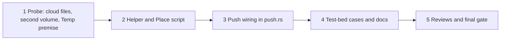

# Follow-up 23: implementation plan

Status: approved design; plan for the build. Built from roadmap follow-up 23 in [`fork-roadmap.md`](fork-roadmap.md)
and from [`windows-push-staging-design.md`](windows-push-staging-design.md), which owns the behaviour. Evidence is in
[`2026-11-23-windows-handle-steps-probe.md`](../research/2026-11-23-windows-handle-steps-probe.md). This plan owns
order and checks. Progress goes in the execution record at the end. The work lands before the 0.3.0 release.

## Overview

A Windows push moves its staging to `%SystemRoot%\Temp`, and one `Place` step, run by a C# helper on held handles,
does everything the push does in the target's parent. Each unit lands on its own and keeps the gate green.

## Units

### 1. Probe

On `t-win11`, through the server's `write_file` and `exec`, with a temporary standard user removed afterwards:

- a cloud-file placeholder directory, made with the Cloud Files API's sync-root registration, opened component by
  component with `FILE_OPEN_REPARSE_POINT`: its reparse tag, whether it opens as a directory, and whether a relative
  open of an entry inside it works;
- a small extra `t-*` disk in `agent-vms`, attached for the probe and formatted as NTFS in the guest: the rename
  error from `%SystemRoot%\Temp` to it, the volume serial numbers, and a handle-based copy of a tree with a read-only
  file and a long path;
- the standard user's rename and delete of a push's staging entry in `%SystemRoot%\Temp`, with a `DELETE`-only
  handle.

**Done:** a dated record in `docs/research/`, and the design's provisional decision on reparse points either resolved
or returned as a question. The extra disk is detached and deleted.

### 2. Helper and `Place` script

`src/winsteps/push-helper.cs` and `src/winsteps/push-place.ps1`, with the `winsteps.rs` constants. `push-probe.ps1`
prints the staging root and checks the language mode, and stops creating parents.

**Done:** the scripts' parse test covers `push-place.ps1`; the helper compiles under `Add-Type` on `t-win11` and its
cases from unit 1's record pass when run by hand through `exec`.

### 3. Push wiring

`src/push.rs`: the staging root in `Target`, the probe output's parsing, the helper's write, the `Place` step with
`LONG_TIMEOUT` and its exit statuses, `Place` in the timed-out filter, and `Cleanup` limited to the staging root.
`push-inherit.ps1` and `push-swap.ps1` go, after a search for every reader.

**Done:** unit tests with the fake guest cover the step order, the arguments, every new exit status's message, the
timed-out message naming each `.vmm-<id>` entry, and the note for an old tree that could not be deleted.

### 4. Test-bed cases and docs

The cases in the design's test-bed list, on `t-win11`, in `tests/testbed/cases/` and `run-all.sh`, with rows in
`tests/testbed/README.md`. `docs/file-transfer.md` and `CHANGELOG.md` describe the new staging and refusals.

**Done:** every new case passes, and the existing Windows transfer cases still pass.

### 5. Reviews and final gate

A code review and a separate conformance review against the design, this plan and the roadmap; findings fixed or
recorded. The roadmap marks follow-up 23 done.

**Done:** after the last change, the gate and `cargo +1.94 test --locked` exit 0, and `tests/testbed/run-all.sh`
exits 0 with `t-win11` present.

## Boundaries

Nothing is pushed. Only `trial-deb13`, `t-*` VMs and `t-*` or `tpl-*` volumes in `agent-vms` are touched. `t-win11`
needs 5 GiB of available host memory.

## Execution record

| Unit | Commits | Evidence | Review |
| -- | -- | -- | -- |
| 1. Probe | `docs(research): record the Windows push staging probe for follow-up 23` | [Probe note](../research/2026-11-23-windows-push-staging-probe.md). A standard user cannot open a push's staging entry in `%SystemRoot%\Temp` for `DELETE`. A second volume has its own serial number, a rename onto it fails with `STATUS_NOT_SAME_DEVICE`, and a handle-based copy reached a 345-character path; the copy must set attributes and times itself. A sync root and two placeholders below it opened through the component walk, carry cloud tags without the name-surrogate bit, and took a moved tree and its inheritance. The design's provisional decision on reparse points is resolved. The extra disk is detached and deleted | Self-reviewed |
| 2 and 3. Helper, `Place` script and push wiring, in two commits: the helper with its .NET format and lint checks, then the wiring | `build(winsteps): add the Windows push helper with C# format and lint checks`; `feat(push): stage Windows pushes in Temp and place them through handles` | The helper builds as C# 5 with the recommended .NET analyzers, and `pwsh` compiles it in a unit test that also checks the method `push-place.ps1` calls. Scripted-guest tests cover the step order (helper written into the protected archive directory before the archive, staging in `%SystemRoot%\Temp`, cleanup of the staging entries only), every `Place` and probe exit status, the busy retry, the old tree left as a note, and a timed-out `Place` naming what it may have left. On `t-win11` the seven Windows cases pass with `win-transfer.json` updated for the staging root, after one fix: a busy target made the helper delete the moved tree, so the retry found none; a failure before the inheritance now moves the tree back to the staging root, as the design now says. A push into `C:\Users\Public` with a non-ASCII name, and its replace, left nothing behind | Self-reviewed; unit 5 reviews the whole run |
| 4. Test-bed cases and docs | `test(testbed): cover Windows pushes into user folders and across volumes` | `win-push-place.json` and `win-push-volume.json`, with `run-all.sh` attaching and removing a 1 GiB `t-push-vol.qcow2` for the second and `cleanup` detaching it after an interruption; the test-bed README, `docs/file-transfer.md`, `CHANGELOG.md` and a pointer in `guest-transfer-design.md`. Of the design's test-bed list, the busy file and the long path stay covered by `win-transfer.json`, and the staging premise is checked from `C:\Windows\Temp`'s access list instead of a standard user's attempt, which the probe record holds. On `t-win11`, the nine Windows cases passed apart from one expectation in `win-push-place.json`, the sort order of `été.txt`, since fixed; unit 5's full run covers it | Self-reviewed; unit 5 reviews the whole run |
| 5. Reviews and final gate | `fix(push): settle the review findings on Windows push placement` | A code review asked for two changes, both made: status 18 had covered three states, so an inheritance whose undo also failed now has status 26; and a busy refusal is retried only when the new tree went back to staging. Its optional findings are also fixed: renames work on 32-bit PowerShell, deletion falls back where POSIX deletion or the read-only flag is missing, the volume check works on every file system and falls back to the copy when two volumes share a serial number, the target is checked before a copy, and a unit test compares every helper status with `push.rs`. On `t-win11`, `SYSTEM`'s temporary path is `C:\Windows\SystemTemp` whatever `TEMP` says, so `Add-Type` never wrote to `C:\Windows\Temp` there; `push-place.ps1` points `TEMP` at the push's own directory for older Windows. The conformance review found no material mismatch; its findings are fixed: the inheritance retry now stays on the held handle, the reserved names match `push.rs`, the cross-volume case checks last-write times, and the stale text in the tool description, the changelog, `docs/file-transfer.md`, the old design and this record is corrected. A read-only file cannot reach the volume case, because `tar.exe` drops host modes. After the last change, the gate and `cargo +1.94 test --locked` passed (425 tests), and `run-all.sh` passed 63 of 63 with `t-win11` | Code review (Sonnet), approved after one fix round; separate conformance review |
