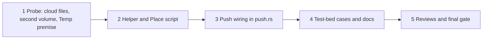

# Follow-up 23: implementation plan

Status: approved design; plan for the build. Built from roadmap follow-up 23 in [`fork-roadmap.md`](fork-roadmap.md)
and from [`windows-push-staging-design.md`](windows-push-staging-design.md), which owns the behaviour. Evidence is in
[`2026-11-23-windows-handle-steps-probe.md`](../research/2026-11-23-windows-handle-steps-probe.md). This plan owns
order and checks. Progress goes in the execution record at the end. The work lands before the 0.3.0 release.

## Overview

A Windows push moves its staging to `%SystemRoot%\Temp`, and one `Place` step, run by a C# helper on held handles,
does everything the push does in the target's parent. Each unit lands on its own and keeps the gate green.

## Units

### 1. Probe

On `t-win11`, through the server's `write_file` and `exec`, with a temporary standard user removed afterwards:

- a cloud-file placeholder directory, made with the Cloud Files API's sync-root registration, opened component by
  component with `FILE_OPEN_REPARSE_POINT`: its reparse tag, whether it opens as a directory, and whether a relative
  open of an entry inside it works;
- a small extra `t-*` disk in `agent-vms`, attached for the probe and formatted as NTFS in the guest: the rename
  error from `%SystemRoot%\Temp` to it, the volume serial numbers, and a handle-based copy of a tree with a read-only
  file and a long path;
- the standard user's rename and delete of a push's staging entry in `%SystemRoot%\Temp`, with a `DELETE`-only
  handle.

**Done:** a dated record in `docs/research/`, and the design's provisional decision on reparse points either resolved
or returned as a question. The extra disk is detached and deleted.

### 2. Helper and `Place` script

`src/winsteps/push-helper.cs` and `src/winsteps/push-place.ps1`, with the `winsteps.rs` constants. `push-probe.ps1`
prints the staging root and checks the language mode, and stops creating parents.

**Done:** the scripts' parse test covers `push-place.ps1`; the helper compiles under `Add-Type` on `t-win11` and its
cases from unit 1's record pass when run by hand through `exec`.

### 3. Push wiring

`src/push.rs`: the staging root in `Target`, the probe output's parsing, the helper's write, the `Place` step with
`LONG_TIMEOUT` and its exit statuses, `Place` in the timed-out filter, and `Cleanup` limited to the staging root.
`push-inherit.ps1` and `push-swap.ps1` go, after a search for every reader.

**Done:** unit tests with the fake guest cover the step order, the arguments, every new exit status's message, the
timed-out message naming each `.vmm-<id>` entry, and the note for an old tree that could not be deleted.

### 4. Test-bed cases and docs

The cases in the design's test-bed list, on `t-win11`, in `tests/testbed/cases/` and `run-all.sh`, with rows in
`tests/testbed/README.md`. `docs/file-transfer.md` and `CHANGELOG.md` describe the new staging and refusals.

**Done:** every new case passes, and the existing Windows transfer cases still pass.

### 5. Reviews and final gate

A code review and a separate conformance review against the design, this plan and the roadmap; findings fixed or
recorded. The roadmap marks follow-up 23 done.

**Done:** after the last change, the gate and `cargo +1.94 test --locked` exit 0, and `tests/testbed/run-all.sh`
exits 0 with `t-win11` present.

## Boundaries

Nothing is pushed. Only `trial-deb13`, `t-*` VMs and `t-*` or `tpl-*` volumes in `agent-vms` are touched. `t-win11`
needs 5 GiB of available host memory.

## Execution record

| Unit | Commits | Evidence | Review |
| -- | -- | -- | -- |
